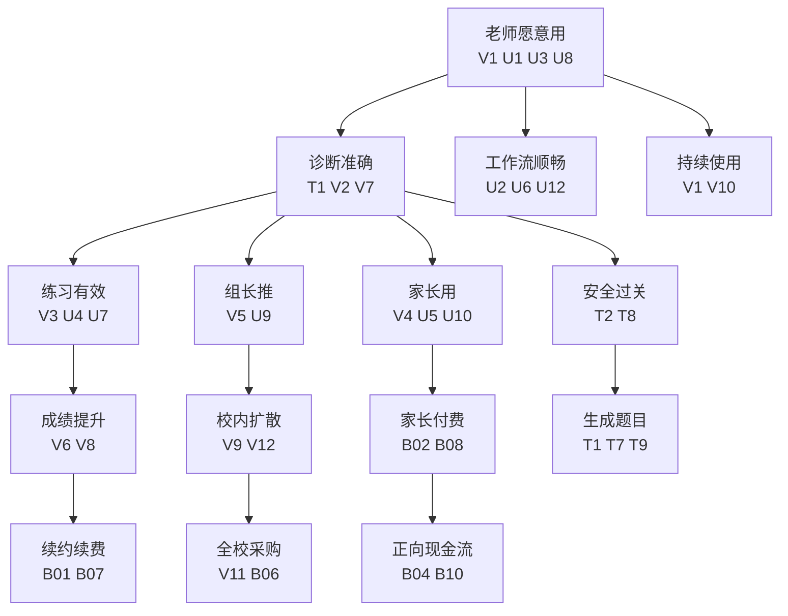

# 假设识别与验证 — ChemAI（智辅化学）

> 假设总数：从原有 22 个扩展到 44 个，覆盖产品全部风险维度。本文档是验证引擎的决策链核心——按四类假设（Value / Usability / Viability / Feasibility）组织，从假设出发驱动验证策略。

---

## 一、四大风险区域 x 核心假设（完整版）

### Value（价值假设）— 能创造客户价值吗？

| # | 假设 | 状态 | 置信度 | 验证方式 | RAG |
|---|------|------|-------|---------|-----|
| V1 | 化学老师会因为"节省统计时间"而持续使用 | 未验证 | 中 | 种子用户 30 天留存和复用率，深度访谈 | 🟡 |
| V2 | 三类障碍诊断（概念/审题/表达）对老师有实际讲评价值 | 部分验证 | 中 | "来自化学教研实践"，种子期需验证 | 🟡 |
| V3 | 学生拿到"病因诊断"后会更有动力做针对性练习 | 未验证 | 中低 | 学生端练习完成率，对比有无诊断标签的对照组 | 🟡 |
| V4 | 家长愿意每周收到化学学情报告且会打开 | 未验证 | 低 | 家长端周报打开率，目标 ≥ 50% | 🟡 |
| V5 | 备课组长会因为仪表盘数据而推动组内使用 | 未验证 | 中 | 种子学校内部扩散率——从 1 位组长→组内 N 位老师 | 🟡 |
| V6 | AI 生成的化学题目能被老师信任并采纳 | 未验证 | 低 | AI 出题采纳率，目标 ≥ 50% | 🟡 |
| V7 | 三类障碍分类框架（概念/审题/表达）覆盖了 80% 以上的化学错题类型 | 部分验证 | 中 | 200 道错题标注中"无法分类"的比例 | 🟡 |
| V8 | 学生端的"进步对比"设计（vs 上次考试）能提升学生的自我效能感和练习完成率 | 未验证 | 低 | A/B 测试——有进步对比 vs 无进步对比的学生端报告 | 🟡 |
| V9 | 家长端报告的"行动建议"（不只是得分率）能让家长对化学学习有实感并降低焦虑 | 未验证 | 中低 | 家长报告后的满意度调研 + "你是否知道该干什么"的理解度 | 🟡 |
| V10 | 老师会因为 ChemAI 的存在而改变讲评课的备课方式（从"逐题讲解"到"重点击破"） | 未验证 | 中 | 种子教师深度访谈——"你这次讲评课和以前有什么不同？" | 🟡 |
| V11 | 化学学情仪表盘能让教研主任/副校长直观感受到教学质量的变化并愿意在采购续费决策中支持 | 未验证 | 低 | 学校管理层的接触频率和采购决策中的话语权重 | 🟡 |
| V12 | 备课组长使用后的"内部口碑推荐"会在教研圈自然扩散并带来新使用者（不仅是被动转介绍，也是主动推荐） | 未验证 | 中低 | 种子期后 90 天内来自非种子学校的主动联系次数 | 🟡 |

**PM 视角的魔鬼代言人**：
> "如果老师花 6 小时统计错题是问题——为什么他们到现在还没用任何工具解决？是因为没有好工具，还是因为这个'问题'没有痛苦到需要改变习惯？"

> 第二个问题："如果老师在用了 ChemAI 之后确实觉得'有用'——他们会不会要求学校付费？还是觉得'还行但值得吗'？'有用'和'愿意付费'之间的距离，可能是 ChemAI 最大的验证鸿沟。"

### Usability（可用性假设）— 用户能用起来吗？

| # | 假设 | 状态 | 置信度 | 验证方式 | RAG |
|---|------|------|-------|---------|-----|
| U1 | 化学老师能在首次使用 5 分钟内理解"上传答题卡→等待→查看报告"的流程 | 未验证 | 中 | 首次使用时间追踪 + 是否需要创始人现场指导 | 🟡 |
| U2 | 手写化学符号（如 可逆号、三角号、上下箭头）的 OCR 识别结果足以让老师满意 | 已验证 | 高 | 60+ 张答题卡 OCR 测试，准确率达到可用水平 | 🟢 |
| U3 | 老师能理解"概念障碍/审题障碍/表达障碍"的分类含义并认可其准确度 | 部分验证 | 中 | 种子老师访谈——"你是否同意这个分类？你理解它的含义吗？" | 🟡 |
| U4 | 学生能在没有老师指导的情况下独立完成自适应练习 | 未验证 | 低 | 学生端练习完成率，是否需要指导 | 🟡 |
| U5 | 家长能看懂学情报告中的化学术语（如"氧化还原反应""配平"） | 未验证 | 低 | 家长报告可读性测试——10 位家长的理解测试 | 🟡 |
| U6 | 老师能容易地在诊断结果中手动修改错误分类（摩擦成本 ≤ 2 次点击） | 未验证 | 中 | 种子老师修改诊断结果的频率和修改时间的分布 | 🟡 |
| U7 | 学生在手机上查看自适应练习的体验足够流畅（无需电脑） | 未验证 | 中低 | 学生端移动端适配测试 + 学生在手机上的练习完成率 | 🟡 |
| U8 | 老师在 OCR 等待期间的心理体验没有导致放弃（"我是不是该关了？"→"哦，它在处理呢"） | 未验证 | 中 | OCR 等待页面的"正在处理状态"的停留时间 vs 跳出率 | 🟡 |
| U9 | 备课组长能快速从仪表盘中找到"我应该优先关注的 3 个问题" | 未验证 | 中低 | 给备课组长 3 分钟，看他们能否基于仪表盘说出"今天的教研重点是 X" | 🟡 |
| U10 | 家长在首次收到报告后能在 60 秒内理解"这份报告告诉了我什么" | 未验证 | 低 | 家长端首次打开的"60 秒理解测试" | 🟡 |
| U11 | 学校管理员（如果是非化学老师担任）能理解并操作系统的基本管理功能 | 未验证 | 低 | 非化学背景的种子学校管理员的系统操作测试 | 🟡 |
| U12 | 多老师同时使用同一班级数据时不会出现数据冲突或权限混乱 | 未验证 | 中 | 种子期同班级多教师使用场景的观察 | 🟡 |

**Designer 视角的魔鬼代言人**：
> "如果老师在等 OCR 处理的那 15 分钟里不知道发生了什么——是卡住了还是正在处理？——他们可能在第 5 分钟就关掉页面了。系统的等待体验可能比功能本身更重要。"

> 第二个问题："化学老师是在 50 人的大办公室里办公——当他的屏幕上出现'AI 诊断中...'的时候，旁边的老师会不会说'那个不准的，别浪费时间'？同事的负面评价可能是 ChemAI 留存的最大隐性杀手。"

### Viability（商业可行性假设，编号 B01-B10）— 商业上可持续吗？

| # | 假设 | 状态 | 置信度 | 验证方式 | RAG |
|---|------|------|-------|---------|-----|
| B01 | 学校有预算（每班 3000-8000 元/年）采购化学诊断工具 | 未验证 | 中 | 种子学校采购意愿调研 | 🟡 |
| B02 | 家长愿意为深度诊断报告付费（30-50 元/月） | 未验证 | 低 | 免费→付费转化率测试 | 🟡 |
| B03 | LLM API 成本（< 200 元/月）能在规模化后维持在可接受范围 | 已验证 | 高 | 当前月度成本记录已证明 | 🟢 |
| B04 | 单人团队能在种子验证后吸引到投资或产生正向现金流 | 未验证 | 低 | 待种子验证完成后评估 | 🟡 |
| B05 | 教育政策不会在 12 个月内禁止或过度限制 AI 教学工具 | 难以验证 | 中 | 持续关注政策动向，保持合规 | 🟡 |
| B06 | 化学单科诊断的市场天花板足以支撑独立产品的生存 | 未验证 | 中 | 市场反馈 + 扩展到多学科的可能性和时机 | 🟡 |
| B07 | 种子学校的年续约率能达到 ≥ 80%（教育 SaaS 的健康标准） | 未验证 | 低 | 种子学校合同到期后续约行为 | 🟡 |
| B08 | 家长端 LTV/CAC ≥ 3:1（商业模式可持续的底线） | 未验证 | 低 | 早期付费家长的 LTV 和 CAC 的追踪 | 🟡 |
| B09 | 转介绍（种子老师→新学校老师）能在 2 度关系内产生 3+ 条有效线索 | 未验证 | 低 | 每个种子老师的转介绍追踪（介绍给了谁、是否跟进、是否转为试用） | 🟡 |
| B10 | 学校和家长的付费之和（B2B + B2C）能在 18 个月内覆盖运营成本并实现正向现金流 | 未验证 | 低 | 月度 P&L 追踪 | 🟡 |

**PM 视角的魔鬼代言人**：

> "如果学校先买了讯飞的阅卷系统（10-50 万），他们为什么还要额外每年花钱买一个只做化学的工具？——因为讯飞不做化学深度诊断。但如果讯飞在第二年把这个功能加进去了呢？"

> 第二个问题："30-50 元/月的家长付费听起来合理——但高三只有 8 个月，一个学生的贡献就只有 240-400 元。LTV 这么低，我们的商业模式是用'数量（很多家长）'还是'高客单价（提价）'来支撑？"

### Feasibility（技术可行性假设，编号 T1-T10）— 技术上能做吗？

| # | 假设 | 状态 | 置信度 | 验证方式 | RAG |
|---|------|------|-------|---------|-----|
| T1 | LLM 能可靠地区分三类障碍（概念/审题/表达） | 未验证 | 中 | 双盲评测 vs 资深老师 | 🟡 |
| T2 | 化学方程式系数配平能做到零误差 | 已验证 | 高 | 四维审核引擎测试套件 | 🟢 |
| T3 | ChromaDB 能支撑 250+ 道真题的向量检索性能 | 已验证 | 高 | 系统已运行，检索延迟可接受 | 🟢 |
| T4 | 双 OCR 引擎（百度 + MinerU）能处理各种答题卡排版 | 已验证 | 中高 | 60+ 张实测 | 🟢 |
| T5 | SQLite 能在 ≥ 20 所学校规模下保持性能 | 未验证 | 中 | 当前未到该规模，需在规模化前压测 | 🟡 |
| T6 | FastAPI 单体架构能在 ≥ 50 并发请求下稳定 | 未验证 | 中 | 当前无高并发场景，规模化前需压测 | 🟡 |
| T7 | 单 Agent（LangGraph ReAct）的工具选择准确率 ≥ 90%（LLM 能从 34 个可见工具中正确选择并有效调用） | 未验证 | 中低 | 日志分析 + 人工验证随机采样 100 个请求 | 🟡 |
| T8 | 四维审核引擎的"危险物质过滤"规则覆盖率 ≥ 95%（不会漏掉危险的化学合成路径） | 部分验证 | 中低 | 安全审核测试集 + 学科顾问人工审核 | 🟡 |
| T9 | RAG 真题关联的 top-3 匹配准确率 ≥ 70%（老师认为"是的，确实相似"） | 未验证 | 中低 | 评测数据集 + 老师反馈跟踪 | 🟡 |
| T10 | 系统在 15 个班同时上传时（月考高峰）不会出现请求堆积超时或数据库锁死 | 未验证 | 低 | 月考周的实际监控或仿真压测 | 🟡 |

**Engineer 视角的魔鬼代言人**：

> "单体 FastAPI + SQLite 在 3 所学校时没问题，但在 20 所学校同时月考时，50 个老师同时上传答题卡——OCR 处理是异步的，但 FastAPI 的同步部分是否会成为瓶颈？需要在规模化前做一次压力测试。"

> 第二个问题："单 Agent 架构把 34 个工具直接暴露给 LLM——工具越多，模型选错工具的概率越高。如果 LLM 在意图预分类（Gateway）之后仍选错工具，或工具 docstring 描述不清导致调用失败，用户体验同样会崩盘。我们工具描述的质量和护栏（GuardState）的调用限制能否真正兜底？"
>
> 组织方式：PM 先拉初版（约 10 条核心假设），再组织设计、BD、技术主管跨角色交叉验证，逐步补充至 44 条。

---

## 二、假定依赖与"杀死链"分析

### 2.1 假设依赖关系图-第一优先级



### 2.2 "假设杀死链"分析

"杀死链"（Kill Chain）分析识别哪些假设如果被证伪，会连锁杀死下游的多个假设，造成"一棵树的死亡"。

#### 杀死链 1：V1（老师持续使用）→ 杀死 V2-V12、U3-U12、B01-B10 的绝大部分

**触发条件**：如果种子期 30 天后，老师的周活跃率 < 50%。

**被杀假设（核心 5 个）**：
- V2（诊断的讲评价值）——没人在用，诊断价值无从验证
- V5（备课组长推动力）——没有老师用，组长推动给谁？
- V4（家长打开率）——没有老师上传答题卡，没有数据报给家长
- V10（改变讲评方式）——没在用，讲评方式当然没变
- V3（学生学习动力）——没有诊断结果，学生没有动力指示

**杀死链影响半径**：极高——V1 是整个价值假设网络的关键节点。如果被杀死，产品需要从根本上重新思考"为什么老师不用"——是工具问题（功能不对）还是渠道问题（没找到对的老师）还是市场问题（这个"问题"不是真问题）。

**缓解措施**：
- 在 seed selection 中极度谨慎——前 5 位种子老师的选择决定了 V1 的命运
- 在种子期设计"7 天紧急响应机制"——如果第 7 天某位老师的使用率 < 2 次，立即触发创始人电话回访
- 追踪每位老师的"Aha Moment"时间点——什么样的使用体验让老师从"试过"变成"再用一次"？

#### 杀死链 2：T1（LLM 诊断准确率）→ 杀死 V2、V3、V6、V10

**触发条件**：双盲评测的 Kappa 系数 < 0.4（低于"适度一致"），或简单一致率 < 65%。

**被杀假设（4 个）**：
- V2（诊断的讲评价值）——诊断不准 → 讲了也没用 → 老师价值断裂
- V3（学生练习动力）——不准的诊断标签会误导学生（"你说我是概念障碍但其实不是"） → 学生信任丧失
- V6（AI 出题被采纳）——AI 诊断不准 → AI 出题的基础也动摇（出题基于诊断画像）
- V10（改变讲评方式）——不准的诊断 → 老师不会改变讲评方式

**缓解措施**：
- 如果双盲结果接近但未达标（如 75-80% vs 目标 80%），增加标注数据训练和规则强化
- 如果结果显著低于预期（< 65%），立即启动"降级方案"——从三分类降为二分类（概念 vs 非概念）或降低诊断功能的启用范围
- 将双盲评测从"一次性验证"改为"每 3 个月重新验证"——诊断准确率是一个持续提升的过程

#### 杀死链 3：B01（学校付费意愿）→ 杀死 B04, B06, B07

**触发条件**：种子学校 3 个月后仅有 ≤ 1/3 学校愿意为 ChemAI 付费。

**缓解措施**：
- 如果学校不付费但老师个人愿意付费 → 调整商业模式为"老师个人版 → 学校级推广"（类似 Slack 的 freemium to enterprise 模式）
- 如果学校和老师都不付费 → 验证"是否有人愿意为化学诊断付费"——如果没有人付费，可能是市场问题而非产品问题

#### 杀死链 4：T2（方程式零误差）的"道德杀死链"

**触发条件**（以不触发为目标）：化学方程式审核出现任何错误且进入了老师的报告中。

**独特性**：这不是一条"如果触发就调整产品"的链——这是一条"绝对不能触发"的链。T2 是所有假设中唯一一条"不验证假设，而是确保假设永远不需要验证"的假设——因为"验证"就意味着已经发生了错误。

#### 杀死链 5：B02（家长付费意愿）→ 杀死 B04, B10 中的 C 端部分

**触发条件**：10% 的家长免费→付费转化率 < 3%。

**缓解措施**：
- 如果家长不付费但家长端 MAU 高 → 说明有使用需求但定价或功能不对——优化付费层级设计
- 如果家长端 MAU 也低 → 说明家长端的概念本身不被接受——重新审视"家长到底需要什么"；可能需要将家长端从"周报推送"改为"重大变化时才通知"的模式

### 2.3 假设依赖网络的"关键节点"排名

基于杀死链分析，以下假设是整个验证网络中最重要的节点（按网络重要性排列）：

| 排名 | 假设 | 杀死链影响力 | 说明 |
|------|------|-----------|------|
| 1 | V1 — 老师持续使用 | 绝大多数下游假设依赖它 | 产品生存的"万恶之源" |
| 2 | T1 — LLM 诊断准确率 | 4 个下游假设依赖它 | 诊断引擎的根——所有后续功能都依赖诊断质量 |
| 3 | B01 — 学校付费意愿 | 3 个下游假设 | 商业模式的基础 |
| 4 | T2 — 方程式零误差 | "灭绝级"杀死链 | 不能出错——出错后的影响辐射所有信任假设 |
| 5 | B02 — 家长付费意愿 | C 端商业模式全部依赖 | B2B2C 的"2C"部分能否成立 |

---

## 三、关键假设的置信度热力图

### 3.1 已验证 vs 未验证全景

```
假 设                        置信度     状态      RAG
─────                        ────      ────      ───
T2 方程式零误差              ████████  ✅ 已验证  🟢
U2 OCR 可用性                ████████  ✅ 已验证  🟢
T4 双 OCR 引擎               ███████░  ✅ 已验证  🟢
T3 ChromaDB 性能             ███████░  ✅ 已验证  🟢
B03 API 成本可控              ███████░  ✅ 已验证  🟢
────────────────────────────────────────────────
T1 LLM 三类诊断准确率         ████░░░░  ⚠️ 未验证  🔴 最高优先级
V1 老师持续使用意愿           ████░░░░  ⚠️ 未验证  🔴 最高优先级
V2 诊断对讲评的实际价值       ████░░░░  ⚠️ 未验证  🔴 最高优先级
U1 首体验时间 ≤ 5 分钟        ████░░░░  ⚠️ 未验证  🟡 高优先级
U3 诊断分类被老师认可         ████░░░░  ⚠️ 未验证  🟡
V4 家长周报打开率             ███░░░░░  ⚠️ 未验证  🟡
V5 备课组长推动力             ███░░░░░  ⚠️ 未验证  🟡
B01 学校付费意愿              ███░░░░░  ⚠️ 未验证  🟡
U8 OCR等待体验不导致放弃      ███░░░░░  ⚠️ 未验证  🟡
────────────────────────────────────────────────
V7 三类分类覆盖率             ███░░░░░  ⚠️ 未验证  🟡 中等优先级
U6 手动修改摩擦               ████░░░░  ⚠️ 未验证  🟡
V10 改变讲评方式              ███░░░░░  ⚠️ 未验证  🟡
T7 Agent Router 准确率        ███░░░░░  ⚠️ 未验证  🟡
T8 危险物质过滤覆盖率         ███░░░░░  ⚠️ 未验证  🟡
T9 RAG 匹配准确率             ███░░░░░  ⚠️ 未验证  🟡
V6 AI 出题被采纳              ██░░░░░░  ⚠️ 未验证  🟢 不重要—当前阶段
U4 学生自主完成练习           ██░░░░░░  ⚠️ 未验证  🟢
U5 家长看懂报告               ██░░░░░░  ⚠️ 未验证  🟢
B02 家长付费意愿              ██░░░░░░  ⚠️ 未验证  🟢
B04 可获投资/产生现金流        █░░░░░░░  ⚠️ 未验证  🟢
V8 学生进步感知提升           ██░░░░░░  ⚠️ 未验证  🟢
V9 家长行动建议价值           ██░░░░░░  ⚠️ 未验证  🟢
U7 移动端练习体验             ██░░░░░░  ⚠️ 未验证  🟢
U9 组长找重点速度             ██░░░░░░  ⚠️ 未验证  🟢
U10 家长60s理解报告           ██░░░░░░  ⚠️ 未验证  🟢
V11 管理层采购推动            █░░░░░░░  ⚠️ 未验证  🟢
V12 口碑自然扩散              █░░░░░░░  ⚠️ 未验证  🟢
B07 续约率 ≥ 80%              █░░░░░░░  ⚠️ 未验证  🟢
B08 LTV/CAC ≥ 3:1             █░░░░░░░  ⚠️ 未验证  🟢
B09 老师转介绍能力            █░░░░░░░  ⚠️ 未验证  🟢
B10 正向现金流时间            █░░░░░░░  ⚠️ 未验证  🟢
T5 SQLite 规模化              ████░░░░  ⚠️ 未验证  🟢 不重要—当前
T6 FastAPI 并发               ████░░░░  ⚠️ 未验证  🟢
T10 月考高峰并发              ██░░░░░░  ⚠️ 未验证  🟢
U11 非化学背景管理员          ██░░░░░░  ⚠️ 未验证  🟢
U12 多教师数据不冲突          ██░░░░░░  ⚠️ 未验证  🟢
```

### 3.2 热力图解读

**绿色区域（已验证，5 个假设）**：ChemAI 已经有了不错的技术基础——方程式审核、OCR、向量检索、API 成本都经过了验证。这 5 个"绿色"是技术可行性的基石。

**红色区域（未验证但优先级最高，3 个假设）**：T1（诊断准确率）、V1（老师持续使用）、V2（诊断的讲评价值）是种子期必须验证的三座大山。这三个假设合在一起就是："ChemAI 真的解决了老师的问题吗？"

**黄色区域（未验证但优先级高，6 个假设）**：U1（首体验）、U3（分类认可）、V4（家长打开）、V5（组长推动）、B01（学校付费）、U8（等待体验）——这些不是种子期的生死假设，但对"产品体验"和"扩散速度"有重大影响。

---

## 四、种子期前 30 天必须验证的假设（Top 5）

| 优先级 | 假设 | 验证方法 | 成功标准 | 如果失败 |
|--------|------|---------|---------|---------|
| 🔴 1 | V1: 老师持续使用 | 5 位种子老师 30 天使用追踪 | 周活跃率 ≥ 80% | 找出摩擦点并迭代，如果持续 < 50% → 反思产品方向 |
| 🔴 2 | T1: LLM 诊断准确率 | 200 道错题双盲评测 | 与资深老师判断一致率 ≥ 80% | 强化规则引擎、增加标注数据、或降为二分类 |
| 🔴 3 | U1: 首体验时间 | 第一次使用全流程计时 | 中位时间 ≤ 5 分钟 | 重新设计 onboarding，砍掉非必要步骤 |
| 🟡 4 | V2: 诊断的讲评价值 | 种子老师访谈——"这次讲评和以前有什么不同？" | ≥ 4/5 老师表示"有帮助" | 了解为什么没有——是诊断不准还是讲评流程不对？ |
| 🟡 5 | V4: 家长打开率 | 推送首批家长周报后 7 天追踪 | 打开率 ≥ 50% | 换推送渠道（微信），重写报告语言 |

### Top 5 的详细测试计划

#### 测试计划 1（V1：老师持续使用）

| 要素 | 内容 |
|------|------|
| **实验设计** | 5 位种子老师每人使用 ChemAI 30 天。每周测量：上传次数、诊断查看次数、练习推送次数。第 7/14/30 天进行深度访谈 |
| **样本量** | 5 位老师（3 所学校 × 至少 2 位/校 × 覆盖高三/高二） |
| **时间线** | Day 1-7 周监测 → Day 14 半月回访 → Day 30 终测 |
| **成功标准** | 周活跃率 ≥ 80%（5 人中至少 4 人每周使用） |
| **边界成功** | WAU ≥ 60%，且 ≥ 4/5 老师在访谈中表示"会继续用" → 产品方向正确但需优化 |
| **失败信号** | WAU < 50% 或 ≥ 2/5 表示"可能不会再用了" → 触发补救方案 |
| **补救方案** | 1. 深度访谈找出摩擦点 2. 快速迭代（2 周内修复）3. 如果修复后仍不到 50%，反思"化学老师是否真的需要这个工具？" |

#### 测试计划 2（T1：LLM 诊断准确率）

| 要素 | 内容 |
|------|------|
| **实验设计** | 选取 200 道化学错题（覆盖 M6-M13 的 7 个主要知识点模块）。3 位资深老师独立标注障碍分类。ChemAI 自动诊断。计算 Kappa 系数和简单一致率 |
| **样本量** | 200 道错题（确保统计分析显著） |
| **时间线** | Day 1-7 标注 → Day 8-10 计算 → Day 11-14 分析报告 |
| **成功标准** | Kappa ≥ 0.6（实质性一致）或简单一致率 ≥ 80% |
| **边界成功** | 一致率 70-80% → 产品可用但需继续优化 |
| **失败信号** | 一致率 < 65% → 诊断准确率不足以建立老师信任 |
| **补救方案** | 1. 降级为二分类（概念 vs 非概念）以快速提升准确率 2. 如果二分类也不行 → 调回纯规则引擎（放弃 LLM 的分类能力）3. 如果纯 LLM 分类在三类别上表现不稳定 → 扩大标注数据后微调专用的分类模型 |

#### 测试计划 3（U1：首体验时间）

详见 `14-机会解决方案树.md` 实验 1。

#### 测试计划 4（V2：诊断的讲评价值）

| 要素 | 内容 |
|------|------|
| **实验设计** | 在种子老师使用 2 次考试后，进行半结构化深度访谈 |
| **样本量** | 5 位种子老师 |
| **时间线** | Day 15-20（种子期第二周末） |
| **成功标准** | ≥ 4/5 老师表示"有帮助"且能指出至少一个具体的帮助点 |
| **边界成功** | "有帮助"态度但无法具体指出 → 诊断的实用性还需加强 |
| **失败信号** | "没什么帮助"或"跟不用差不多" → 产品价值断层 |
| **补救方案** | 如果诊断"准"但"没用"→ 问题在报告的设计和呈现（不是诊断不准而是"看不懂有什么用"）→ 优化教师版报告的"教学行动建议" |

#### 测试计划 5（V4：家长打开率）

| 要素 | 内容 |
|------|------|
| **实验设计** | 在种子期第二周推送首批家长报告。通过微信模板消息推送。追踪 7 天内的打开率、阅读时长、点击行为 |
| **样本量** | ≥ 30 位家长 |
| **时间线** | Day 14 推送 → Day 21 追踪结束 |
| **成功标准** | 打开率 ≥ 50% |
| **边界成功** | 打开率 30-50% → 有需求但推送时间或标题需要优化 |
| **失败信号** | 打开率 < 30% → 家长端需求可能被高估或推送渠道/内容有问题 |
| **补救方案** | 1. 换推送时间（周末 vs 周三/四）2. 测试不同标题文案的打开率 3. 对已打开但未完成阅读的家长做访谈 4. 如果推送查看率持续低 → 重新思考"家长到底想看到什么" |

---

## 五、假设验证的仪表盘

### 5.1 仪表盘面板（RAG 状态）

```
═══════════════════════════════════════════
假设验证仪表盘 — 截至 2026 年 7 月 1 日
═══════════════════════════════════════════

RAG 分布:
🟢 已验证 (置信度 高):  5 个 (11.4%)
🟡 待验证 (置信度 中-中高): 17 个 (38.6%)
🟠 高风险待验证 (置信度 低-中低): 12 个 (27.3%)
🔴 关键未验证 (种子期必须): 3 个 (6.8%)
⚪ 不重要/暂不验证: 7 个 (15.9%)
───────────────────────────────────────────
总计: 44 个
```

### 5.2 种子期后的预期变化

```
30 天后...
🟢 已验证 → 15 个 (V1, T1, U1, V2, V4, V5, U3, U6, U8, V3, V7, V10, U4, T7, T9)
🟡 待验证 → 10 个
🟠 仍高风险 → 12 个 (付费和规模化相关)
🔴 被推翻 → 可能 1-3 个
```

---

## 六、置信度校准框架

### 6.1 为什么需要置信度校准？

传统的"假设验证"容易变成"看上去验证了但可能只是运气好"或"小样本"的偏见。以下置信度校准框架确保每个假设的验证不是"yes/no"而是"I'm X% confident that..."。

### 6.2 四级置信度量表

| 置信度 | 含义 | 什么样的证据能达到这个级别？ |
|--------|------|--------------------------|
| **高** (> 80%) | 我们非常确定 | 量化测试（N ≥ 100）+ 场景覆盖 + 被外部验证 |
| **中高** (60-80%) | 我们有较强的信心但可能有惊喜 | 量化数据 + 但有覆盖面不足的风险 |
| **中** (40-60%) | 目前同样可能为真也可能为假 | 小样本数据或部分测试 + 几个方向性证据 |
| **低** (< 40%) | 完全是猜测，需要快速验证 | 只有假设的逻辑推理，没有数据支撑 |

### 6.3 每季度置信度更新机制

| 假设 | 当前置信度 | Q3'26 目标 | 验证方法 |
|------|----------|-----------|---------|
| V1 老师持续使用 | 中（40%） | 高（80%+） | 种子期 30 天量化数据 |
| T1 LLM 诊断准确率 | 中（50%） | 高（80%+） | 双盲评测 Kappa ≥ 0.6 |
| B01 学校付费意愿 | 中（35%） | 中高（60%+） | 种子学校采购意愿 |
| B02 家长付费意愿 | 低（20%） | 中高（55%+） | 免费→付费转化率 |

---

## 七、学习日志模板

### 7.1 假设测试学习日志

用于记录每次假设验证测试的结果和学习。这是一个"活文档"，应该在每次测试完成后立即填写。

```
═══════════════════════════════════════════
假设测试学习日志
═══════════════════════════════════════════

假设编号: [V1/T1/...]
假设内容: [...]
测试日期: [开始日期] → [结束日期]
测试类型: [双盲评测 / A/B 测试 / 深度访谈 / 行为数据 / 混合]
样本信息: [样本量 + 样本描述]

═════════════════════════
测试结果
═════════════════════════
量化结果: [数字]
定性发现: [关键访谈发现]
假设验证结果: ✅ 验证通过 / ⚠️ 部分验证 / ❌ 被推翻

═════════════════════════
学习与行动
═════════════════════════
最重要的学习:
1. [学到了什么我们之前不知道的？]
2. [什么让我们感到意外？]
3. [我们对用户的什么假设被推翻/被确认了？]

由此产生的行动:
1. [我们决定做什么/不做什么？]
2. [这如何影响产品路线图/优先级？]
3. [我们是否需要修改其他假设的状态？]

═════════════════════════
下次测试建议
═════════════════════════
[如果有后续实验应该怎么做，样本量和标准需要调整吗？]
═══════════════════════════════════════════
```

### 7.2 已填写的学习日志示例（虚构——用于说明）

```
═══════════════════════════════════════════
假设测试学习日志 — 示例
═══════════════════════════════════════════

假设编号: V1（老师持续使用 — 第 30 天测试）
假设内容: 化学老师会因为"节省统计时间"而持续使用 ChemAI
测试日期: 2026/8/1 → 2026/9/1
测试类型: 行为数据 + 深度访谈
样本信息: 5 位种子老师（4 女/1 男，教龄 3-18 年，3 所湖南高中）

═════════════════════════
测试结果
═════════════════════════
量化结果:
- WAU: 4/5 (80%), 1 位连续 3 周未使用
- 平均每周上传: 2.3 次
- 中位访问时长: 12 分钟
定性发现:
- 未使用的那位老师:"我觉得工具是好工具，但高三太忙了，没有额外的精力去搞"
- 另一位老师:"我现在每次考完都会先打开 ChemAI，然后把报告截图发到备课群"
假设验证结果: ⚠️ 部分验证（80% WAU，但 1 位流失的核心使用模式值得关注）

═════════════════════════
学习与行动
═════════════════════════
最重要的学习:
1. 4/5 老师持续使用—这是好的信号。但 1 位"太忙了所以不用"的反馈暴露了"工具是额外的负担"的根本问题—即使工具省时间，老师还是觉得"启动成本"高
2. 截图发备课群这个行为是意外的"产品使用场景"——老师不只是在用 ChemAI 做自己的分析，而是用它作为"沟通工具"——这对转介绍的潜力是个积极信号
3. 我们之前假设老师会"每次考试都上传"——但实际使用模式更像"感觉有用的那几次才上传"

由此产生的行动:
1. 立即推进 1B（小程序版）——降低"启动成本"是让那位"太忙了"的老师回归的关键
2. 增加报告的一键分享到微信功能——鼓励"截图发群"这个行为并自动追踪
3. 决策：产品方向不需要改，但 onboarding 的方式需要改——不要假设老师"每次考试都会来"，而应设计"考完就自动提醒"的机制

下次测试建议:
需要测试 1B 版本对那位流失老师的回归作用。如果小程序版仍然无法让她回归→在更广的老师群体验证"高三和高一/高二老师的需求差异"
═══════════════════════════════════════════
```

---

## 八、综合建议

### 8.1 种子期的"胜利条件"

种子期必须同时满足以下三个条件，才能宣布成功：

1. **≥ 4/5 种子老师周活跃率 ≥ 80%**（V1 验证）
2. **诊断准确率达标**（T1 验证）：Kappa ≥ 0.6 或一致率 ≥ 80%
3. **无安全事故**：种子期内不出现 AI 生成危险化学内容的事件（T2/T8 维持）

如果这三点在 30 天内全部满足 → 进入滩头扩张准备阶段（参见 「10-滩头阵地」Phase 2）。

### 8.2 最危险的假设组合

**T1 (诊断不准) + V1 (老师不用) = ChemAI 的"完美风暴"**

如果诊断不准而且老师不愿意用——ChemAI 在产品层面就不成立。两者同时失败的概率需要在种子期前 14 天内被评估——一旦发现趋势，需要立即干预。

---

---

## 九、附：假设验证的详细时间线与资源配置

### 9.1 假设验证甘特图（种子期 30 天）

```
Day  ────────────────────────────────────────────────────────────
     1  2  3  4  5  6  7  8  9 10 11 12 13 14 15 16 17 18 19 20 21 22 23 24 25 26 27 28 29 30

V1 ████████████████████████████████████████████████████████████  持续追踪 30 天
T1 ████████████████████░░░░░░░░░░░░░░░░░░░░░░░░░░░░░░░░░░░░░░  第 1-14 天标注+第 15-20 天评测
U1 ████████████████████████████████████████████████████████████  每位老师首次使用时单次测量
V2 ░░░░░░░░░░░░░░░░████████████░░░░░░░░░░░░░░░░░░░░░░░░░░░░░░  第 15-20 天（第二次考试后）
V4 ░░░░░░░░░░░░░░░░░░░░░░██████████▓▓▓▓▓▓▓▓▓▓░░░░░░░░░░░░░░░░  第 21-28 天推送家长报告+追踪
U3 ░░░░░░░░███████████████░░░░░░░░░░░░░░░░░░░░░░░░░░░░░░░░░░░  第 7-14 天（老师使用 1-2 次后）
V3 ░░░░░░░░░░░░░░░░░░░░░░░░░░░░░░░░████████████████████░░░░░░  第 21-28 天（学生使用练习 1-2 周后）
U6 ░░░░░░░░░░░░░░░░░░░░░░░░░░░░████████████████░░░░░░░░░░░░░░  第 14-21 天（老师积累手动修改数据后）
V5 ░░░░░░░░░░░░░░░░░░░░░░░░░░░░░░░░░░░░█████████████████████  第 21-30 天（追踪备课组长激活组员）
B01 ░░░░░░░░░░░░░░░░░░░░░░░░░░░░░░░░░░░░░░░░░░░░░░░░████████████  第 25-30 天（种子期结束前调研）

████ = 数据收集期 | ░░░░ = 等待/准备期 | ▓▓▓▓ = 分析报告产出期
```

### 9.2 每个假设验证所需的资源

| 假设 | 需要的人力 | 需要的工具/数据 | 需要的用户参与 | 总人天 |
|------|----------|--------------|-------------|-------|
| V1 老师持续使用 | 创始人（追踪+访谈） | 系统埋点+WAU 面板 | 5 位老师 30 天正常使用 | 3 |
| T1 诊断准确率 | 创始人 + 3 位资深老师 | 200 道标注错题 + 双盲系统 | 3 位老师各标注 200 道题 | 6 |
| U1 首体验时间 | 创始人 | 系统计时器 + 观察记录 | 5 位老师各完成 1 次首次使用 | 2 |
| V2 讲评价值 | 创始人 | 深度访谈提纲 | 5 位老师各 30 分钟访谈 | 2 |
| V4 家长打开率 | 创始人 | 推送系统 + 追踪面板 | 30+ 位家长接收周报 | 2 |
| V3 学生练习动力 | 创始人 | A/B 测试系统（如有） | 2 个班级约 100 名学生 | 2 |
| V5 组长推动力 | 创始人 + 备课组长 | 学校内用户行为追踪 | 种子学校备课组长主动邀请组员 | 2 |
| B01 学校付费 | 创始人 | 采购意愿问卷 | 3 位学校决策者 | 1 |

**种子期 30 天验证的总人天：约 20 人天**（单人团队意味着部分工作可以并行但需要高效时间管理——创始人最主要的瓶颈是"同时做开发+验证+商务"）。

---

## 十、附：假设验证的"不做"清单

以下是在种子期**故意不做**的假设验证——留到种子期后才处理：

| 假设 | 为什么现在不验证 | 何时验证 |
|------|----------------|---------|
| V6 AI 出题被采纳 | 种子期老师更信任自己选的题——AI 出题不是 MVP 阶段的重点 | 推广期（2027.Q1） |
| B07 续约率 ≥ 80% | 需要至少一年的合同周期才能验证 | 2027 Q3-Q4 |
| B08 LTV/CAC ≥ 3:1 | 需要足够的付费用户和时间数据 | 2027 Q2 起 |
| B04 可获投资 | 种子验证成功是融资的前提——先验证再融资 | 2026 Q4-2027 Q1 |
| T5 SQLite 规模化 | 当前不超过 5 所学校，规模瓶颈尚未显现 | 推广期前（2026 Q4） |
| T6 FastAPI 并发 | 同上 | 推广期前（2026 Q4） |
| V12 口碑自然扩散 | 需要足够的口碑传播时间（至少 6 个月） | 2027 Q2 |

**"不做"的理由**：种子期的核心任务是"证明有人需要、有人愿意用、有人觉得有用"——所有与"规模化"和"持续性"相关的假设都是第二阶段的事情。把种子期的精力聚焦在 V1+T1+U1 三个假设上是最高杠杆的策略。

## 十一、附：假设验证失败的"退出条件"参考

| 关键假设 | 验证失败条件 | 建议的退出策略 |
|---------|------------|-------------|
| V1 老师持续使用 | WAU < 50% 持续 2 周以上 | 暂停种子验证，回归产品方向反思——化学老师是否真的需要这个工具？ |
| T1 诊断准确率 | 一致率 < 65% 且无法通过规则强化在 2 周内提升 | 降级为二分类或纯规则诊断——评估降级后产品的市场可行性 |
| B01 学校无付费意愿 | 种子期结束后 0/3 校愿意付费 | 切换到纯 C 端模式（家长付费）或个人教师版模式（老师自费） |
| T1+V1 同时失败 | 诊断不准 + 老师不用 | 产品不成立——考虑停止开发或彻底转向另一个方向 |

**这些不是"预测"而是"预案"**——在种子期开始前就明确"什么情况下我们会止损"，避免了沉没成本继续扩大。

---

