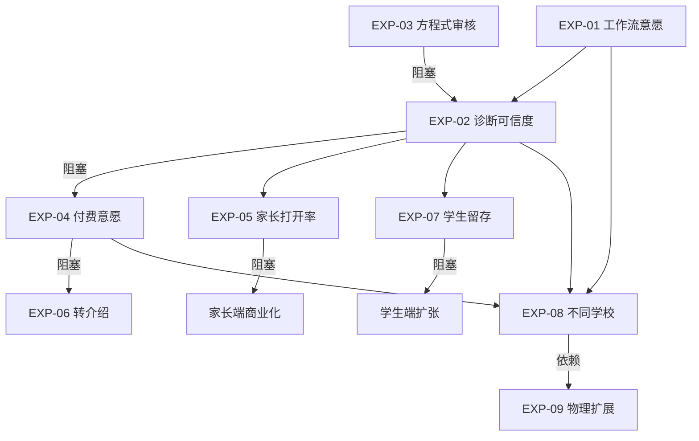

# 精益画布 — ChemAI（智辅化学）

> 画布框架：Ash Maurya Lean Canvas，补充 Paweł Huryn 增强字段

---

> 本文档按 Lean Canvas 九个模块组织：先定义问题与现有替代方案，再给出解决方案，最后以成本结构校验商业可行性（详见第八节，总月度运营成本 < 3000 元）。AI 产品遵循 SaaS 模式按产品交付，而非按项目定制。

## 一、问题（Problem）— 3 个核心痛点

| # | 痛点 | 严重程度 | 当前替代方案 |
|---|------|---------|-------------|
| 1 | **教师批改+分析耗时巨大**：一次考试后逐题归类、统计错误类型、做讲评 PPT 需要 6-10 小时，挤压备课和教研 | 极高（频次：每周/双周） | 手写统计、Excel 录入、同学科组互助 |
| 2 | **个性化教学无法规模化**：一个班 50 人化学水平方差大，老师知道该分层但做不到"一人一策" | 高（频次：日常） | 凭经验分组、买现成教辅、放弃分层 |
| 3 | **家长只看到分数，看不到问题**：分数是滞后指标，家长无法从"78 分"中读出孩子是概念不清还是审题有问题 | 中高（频次：每次考试后） | 家长会、微信私聊、自己猜测 |

**现有替代方案（Existing Alternatives）**：

- 手写统计 + Excel：免费但耗时巨大，无法做深层分析
- 购买阅卷系统（如科大讯飞）：批量阅卷能力强，但缺乏学科专属的化学错误诊断
- 课外辅导班：成本高（200-500 元/课时）、质量参差、无学校数据对接

## 二、解决方案（Solution）— 对应 7 大功能

| 痛点 | ChemAI 功能 | 解决方式 |
|------|------------|---------|
| 批改耗时 | **F1: OCR 答题卡识别** | 拍照 → 自动识别 → 批量处理，一个 90 人班级 ≤ 15 分钟 |
| 分析耗时 | **F3: 双层错误报告** | 自动生成教师版（详细数据）+ 学生版（鼓励性反馈） |
| 无法分层 | **F4: 障碍类型诊断** + **F5: 自适应练习** | 将每道错题归类为概念障碍/审题障碍/表达障碍，自动推送对症练习 |
| 无法回溯 | **F6: 历史真题关联** | 250 道高考真题（2008-2025）向量化检索，AI 出题可关联真题验证 |
| 家长盲区 | **M16: 家长端** + **M17: 通知** | 每周学情报告推送，显示障碍类型和改进建议 |
| 教师宏观决策 | **F7: 班级学情仪表盘** | 知识点×学生×时间三维分析热力图 |
| 重复劳动 | **F2: AI 出题 + 四维审核** | 根据知识点自动生成题目，化学方程式配平零误差保证 |

## 三、独特价值主张（Unique Value Proposition）

> 拍一张试卷，AI 完成从批改到诊断到针对性练习的全流程，让老师做教育、系统做数据。

一句话版（面向老师）：
> "你的 AI 化学助教——15 分钟出整班报告，精准到每道题为什么错。"

## 四、不公平优势（Unfair Advantage）

不公平优势的判断标准：（1）别人没办法轻易复制；（2）它随着时间变强（而非变弱）。基于这两个标准，ChemAI 的护城河如下：

| 优势 | 类型 | 可复制难度 |
|------|------|-----------|
| **化学学科专属诊断引擎** | 领域知识壁垒 | 高——将"概念/审题/表达"三类障碍的判断逻辑编码为规则+AI 混合模型，通用教育平台不做这种学科深度 |
| **四维化学方程式审核引擎** | 技术壁垒 | 极高——系数配平零误差是硬红线，RDKit 分子结构验证 + 自定义系数平衡算法，纯 LLM 无法保证 |
| **250 道高考真题向量库** | 数据壁垒 | 中——数据本身可爬取，但从 2008-2025 年手工标注知识点的精确度难以复制 |
| **低成本 LLM 选型** | 成本壁垒 | 中——MiMo + DeepSeek + Qwen 混合路由，月度 LLM 成本 < 200 元，竞品若用 GPT-4 单月轻松过万 |
| **湖南省重点高中种子用户** | 渠道壁垒 | 高——B2B 教育市场的先发优势和转介绍网络 |

## 五、客户细分（Customer Segments）

| 角色 | 定位 | 规模 | 付费意愿 |
|------|------|------|---------|
| **化学老师**（核心用户） | 日常使用者，提供教学内容、使用诊断 | 全国高中化学老师约 30 万人 | 中（个人付费意愿低，学校/教育局采购模式） |
| **学生** | 练习接收者，查看报告、做自适应练习 | 全国高中生约 3000 万人 | 低（依赖家长付费） |
| **家长** | 信息接收者，查看周报、确认学习状态 | 对应学生人数 | 高（教育支出刚需，痛点明确） |
| **学校/教育局**（决策者） | 采购方，关注升学率、教学质量提升 | 全国高中约 1.4 万所 | 高（B2B 模式，年度预算制） |

**早期采用者画像**：湖南省二线以上城市的高中化学教研组——教学压力大（高考竞争激烈）、有信息化预算、化学教研组长有创新意愿。

飞轮效应

## 六、渠道（Channels）

| 渠道 | 类型 | 阶段 |
|------|------|------|
| 湖南重点高中种子用户转介绍 | 直销/口碑 | 种子期（当前） |
| 省级化学教研活动/学科会议 | 线下活动 | 早期 |
| 教师微信群/学科公众号 | 社群 | 早期 |
| 教育信息化招标平台 | B2G 渠道 | 增长期 |
| 钉钉/企业微信应用市场 | 平台分发 | 增长期 |
| 教育局/电教馆合作推广 | 自上而下 | 规模化 |

## 七、收入来源（Revenue Streams）

| 模式 | 说明 | 预估单价 |
|------|------|---------|
| **学校年度订阅**（核心） | 按班级数/学生数收费，含全部功能 | 3000-8000 元/班/年 |
| **教育局区域采购** | 覆盖整个区/县的化学学科 | 10-50 万元/区/年 |
| **家长端增值服务**（远期） | 深度诊断报告、1v1 AI 辅导 | 30-50 元/月 |
| **题库授权** | 将积累的标注化学题库授权给教辅出版方 | 按量 |

**LTV 估算**：按每个学校 6 个班 × 5,000 元 × 3 年 = 9 万元/校（扩大到 9 个班、定价上调后可达 21.6 万元/校，口径见 08-理想客户画像）。目标 CAC 2,000-5,000 元/校，各细分市场的 LTV/CAC 测算见第十二节（最低 7.6:1），显著高于 EdTech 行业黄金标准 ≥ 3:1（参考 First Page Sage 2023 年行业报告及 Chargebee 2024 年 SaaS 基准数据）。以上基于假设定价，待实际销售数据验证后调整。

## 八、成本结构（Cost Structure）

| 类别 | 项目 | 月度成本 |
|------|------|---------|
| **固定成本** | 服务器（云主机） | ~500 元 |
| | 域名 + SSL + 基础服务 | ~200 元 |
| **可变成本** | LLM API（MiMo + DeepSeek + Qwen） | < 200 元 |
| | OCR API（百度教育 OCR） | < 100 元 |
| | ChromaDB 向量检索 | 免费 |
| **人力成本** | 创始人（全栈开发 + PM） | 不计入（自举） |
| | 化学学科顾问（兼职） | ~2000 元 |
| **总月度运营成本** | | **< 3000 元** |

**CAC 估算**：当前种子期 CAC 接近零（个人关系 + 转介绍）。EdTech 行业 CAC 基准：SMB 约 $806 (~¥5,800)、中端市场约 $2,814 (~¥20,000)（First Page Sage 2023）。ChemAI 进入增长期后预计 CAC 2,000-5,000 元/校，显著低于行业均值，得益于湖南省化学教研圈子的转介绍网络和种子教师的口碑效应。

**商业演进路径**：种子期（学校订阅）→ 推广期（区域采购）→ 规模化（家长端 C 端付费）。CAC/LTV/回收期的正式测算见第八、十二节。

## 九、关键指标（Key Metrics）

| 指标 | 定义 | 当前目标（MVP） |
|------|------|---------------|
| **OCR 准确率** | 手写化学符号识别准确率 | ≥ 90% |
| **诊断采纳率** | 老师采纳系统诊断结果的比例 | ≥ 70% |
| **周活跃老师数** | 每周至少使用一次的老师 | 种子期 5-10 人 |
| **学生练习完成率** | 自适应练习的完成比例 | ≥ 60% |
| **家长周报打开率** | 家长端周报的阅读比例 | ≥ 50% |
| **北极星指标** | 每月诊断的错题数 | 详见 「13-北极星指标」 |

## 十、核心假设与风险

| 假设 | 风险等级 | 验证方式 |
|------|---------|---------|
| 化学老师愿意为 AI 辅助工具改变工作流 | 🔴 高 | 种子用户使用频次跟踪 |
| OCR 准确率能满足化学学科特殊字符识别 | 🔴 高 | 需用 60+ 张答题卡进行实测验证 |
| 学校有预算采购第三方教学工具 | 🟡 中 | 种子用户所在学校的采购流程摸底 |
| 学生/家长端产品能触达并保持活跃 | 🟡 中 | 家长端 MVP 的留存数据 |
| LLM 生成化学题的质量和安全性可控 | 🟢 低 | 四维审核引擎开发完成后进行基准测试验证 |

---

## 十一、三年财务预测模型（2026-2028）

以下财务模型基于 ChemAI 的 B2B2C 业务模式和 10 个开发阶段的时间线，采用自下而上的单位经济模型（校数 × 班数 × 定价）测算。

> **口径说明**：03-市场规模估算 的基准情景（2026 年 16.2 万 / 2027 年 124 万 / 2028 年 420 万）采用自上而下的市场占有率模型，与本文档的自下而上模型存在口径差异（本文档按 6 班/校 × 定价测算，03 按整体市场渗透测算）。两份文档各自内部一致，横向对比时请注意口径差异；乐观与悲观情景见第十三节敏感性分析及 03-市场规模估算。

### 11.1 收入预测

| 年份 | 覆盖学校数 | 覆盖班级数 | 每班年费（均值） | 学校订阅收入 | 家长端增值收入 | 教育局合同收入 | 年度总收入 |
|------|----------|----------|----------------|------------|--------------|-------------|----------|
| **2026** | 3→10 | 18→60 | 0（种子期免费）→ 3000 | 18 万元 | 0 | 0 | **18 万元** |
| **2027** | 10→30 | 60→180 | 5000 | 90 万元 | 15 万元（500 家长 × 300 元/年） | 20 万元（1-2 区县试点） | **125 万元** |
| **2028** | 30→100 | 180→600 | 6000 | 360 万元 | 120 万元（4000 家长 × 300 元/年） | 100 万元（3-5 区县） | **580 万元** |

**2026 年收入明细**：
- H1：0 元（纯种子期，免费使用）
- H2：3-10 所学校从免费转为付费，首批付费学校按 3000 元/班/年的优惠价

**2027 年收入明细**：
- 学校订阅：10 所续费校 + 20 所新校 = 30 校 × 6 班 × 5000 元 = 90 万元
- 家长端：约 500 位活跃家长（约占覆盖学生数的 5%）× 300 元/年（家长端增值服务年均价） = 15 万元
- 教育局：1-2 个区县级教育局试点合同，平均 15 万元/区 = 20 万元（保守估计 1.3 个）

**2028 年收入明细**：
- 学校订阅：30 所续费校 + 70 所新校，但到期续约有部分流失（按 80% 续约率：24 所老校 + 76 所新校 = 100 校有效覆盖）
- 家长端：用户基数扩大至约 4000 位活跃家长（覆盖学生数约 6 万人，渗透率约 6.7%）
- 教育局：3-5 个区县年度合同，部分续约（按 80%）+ 新增

### 11.2 成本预测

| 年份 | 服务器/基建 | LLM+OCR API | 学科顾问 | 销售/市场 | 团队扩张（假设） | 年度总成本 |
|------|----------|------------|---------|---------|---------------|----------|
| **2026** | 0.84 万（700元/月） | 0.36 万（300元/月） | 2.4 万（2000元/月） | 1 万（差旅/会议） | 0（自举） | **4.6 万元** |
| **2027** | 6 万（5000元/月） | 2.4 万（2000元/月） | 6 万（5000元/月） | 12 万（1万/月） | 36 万（2-3人团队） | **62.4 万元** |
| **2028** | 12 万（1万/月） | 6 万（5000元/月） | 12 万（1万/月） | 36 万（3万/月） | 120 万（5-7人团队） | **186 万元** |

**关键成本假设**：

1. **API 成本增长路径**：种子期（2026）月度 LLM+OCR API 费用严格控制在 < 500 元/月（预算红线）。随着使用量增长，2027 年预计月均 2000 元，2028 年月均 5000 元。成本增长低于收入增长（非线性），因为：
   - MiMo 的批量调用折扣随使用量增加
   - 自建缓存和预计算减少重复 API 调用
   - ChromaDB 向量检索零成本，随数据量增长不增加 API 开销

2. **服务器成本增长路径**：种子期 700 元/月（单云主机）。2027 年升级至中等配置（含 PostgreSQL 生产数据库），月均 5000 元。2028 年扩展到多区域部署 + 备份，月均 1 万元。

3. **团队扩张假设**：
   - 2027 年：创始人 + 1 名全栈工程师 + 1 名市场/销售 = 3 人
   - 2028 年：创始人 + 3 名工程师 + 2 名市场/销售 + 1 名运营/客户成功 = 7 人

### 11.3 利润预测

| 年份 | 总收入 | 总成本 | 净利润 | 净利率 |
|------|-------|-------|-------|-------|
| **2026** | 18 万元 | 4.6 万元 | **13.4 万元** | 74% |
| **2027** | 125 万元 | 62.4 万元 | **62.6 万元** | 50% |
| **2028** | 580 万元 | 186 万元 | **394 万元** | 68% |

**注**：2026 年高利润率反映"自举 + 零市场费用 + 低成本架构"的种子期特征。2027 年利润率下降反映团队扩张和市场投入。2028 年利润率回升反映规模效应。

### 11.4 现金流与资金需求

| 年份 | 年初现金（假设） | 年度净利润 | 年末现金 | 外部融资需求 |
|------|---------------|----------|---------|------------|
| **2026** | 20 万（创始人自筹） | 13.4 万 | 33.4 万 | 0 |
| **2027** | 33.4 万 | 62.6 万 | 96 万 | 建议天使轮 200-300 万（用于团队扩张和市场推广，非生存必需） |
| **2028** | 96 万（含融资 250 万 = 346 万） | 394 万 | 740 万 | 考虑 A 轮（视增长速度） |

---

## 十二、单位经济学深度分析

### 12.1 客户获取成本（CAC）分渠道

| 渠道 | 阶段 | 获客成本（元/校） | 转化周期 | 适用规模 |
|------|------|-----------------|---------|---------|
| **种子用户转介绍** | 种子期 | 500（请客吃饭+差旅） | 1-2 周 | < 10 校 |
| **学科教研活动** | 早期 | 3000（参会+展示+物料+差旅） | 1-3 月 | 10-50 校 |
| **教师社群（微信/公众号）** | 早期 | 2000（内容生产+社群运营） | 2-4 月 | 10-100 校 |
| **教育局/电教馆合作** | 增长期 | 8000（方案制作+商务拜访+投标） | 3-6 月 | 20-200 校 |
| **教育信息化展会** | 增长期 | 10000（展位+物料+人员） | 1-3 月 | 50+ 校 |
| **钉钉/企业微信应用市场** | 规模化 | 1000（平台分成+ASO 优化） | 即时 | 100+ 校 |

**综合 CAC（各渠道加权平均）**：
- 种子期（2026）：~500 元/校（以转介绍为主）
- 推广期（2027）：~3000 元/校（教研活动 + 社群 + 部分转介绍）
- 规模化期（2028）：~4000 元/校（B2G + 展会渠道占比上升）

### 12.2 客户生命周期价值（LTV）分细分市场

| 客户细分 | 年收入/校 | 平均留存年限 | 毛利率 | LTV（毛利口径） |
|---------|---------|------------|-------|--------------|
| **地级市重点高中** | 4.2 万（6 班 × 7000 元） | 3.5 年 | 85% | 12.5 万元 |
| **县级重点高中** | 3 万（6 班 × 5000 元） | 3 年 | 85% | 7.65 万元 |
| **普通高中/民办高中** | 1.8 万（6 班 × 3000 元） | 2 年 | 85% | 3.06 万元 |
| **教育局区域合同** | 15 万/区（覆盖 10-15 校） | 3 年 | 80% | 36 万元 |

**LTV/CAC 比值**：
- 地级市重点高中：12.5 万 ÷ 4000 元 = **31:1**
- 县级重点高中：7.65 万 ÷ 4000 元 = **19:1**
- 普通高中：3.06 万 ÷ 4000 元 = **7.6:1**
- 教育局合同：36 万 ÷ 8000 元 = **45:1**

**总体 LTV/CAC 目标 ≥ 3:1**：即使是最低价值的普通高中客户，LTV/CAC 仍达到 7.6:1，远超目标。

### 12.3 投资回收期（Payback Period）

| 客户细分 | CAC | 年度收入 | 月度收入 | 回收期 |
|---------|-----|---------|---------|-------|
| 地级市重点高中 | 4000 元 | 4.2 万元 | 3500 元 | **1.1 个月** |
| 县级重点高中 | 4000 元 | 3 万元 | 2500 元 | **1.6 个月** |
| 普通高中 | 4000 元 | 1.8 万元 | 1500 元 | **2.7 个月** |
| 教育局区域合同 | 8000 元 | 15 万元 | 12500 元 | **0.6 个月** |

**行业对比**：SaaS 行业的健康投资回收期通常为 12-18 个月。ChemAI 的回收期显著短于行业均值，主要原因：（1）B2B 年度预付模式（一次性收回全年收入）；（2）极低的边际服务成本（API 费用 < 500 元/月，无需按客户增加人力）。

### 12.4 边际成本分析

ChemAI 的核心商业模式优势在于：每增加一所学校，边际成本极低。

| 成本项 | 每增加 1 校的边际成本 | 说明 |
|--------|-------------------|------|
| LLM API | ~50 元/月 | 按每校 6 班 × 每月 2 次考试 × 每班 50 份答题卡估算 |
| OCR API | ~30 元/月 | 同上使用频率 |
| 服务器 | ~10 元/月 | 带宽扩容在规模化后才需要 |
| 客户支持 | ~100 元/月 | 种子期接近于 0（创始人直接支持），规模化后通过文档/FAQ/群支持降低 |
| **边际成本合计** | **~190 元/月/校** | 约占最低年费的 12.7% |

**结论**：ChemAI 具有极强的经营杠杆。当学校数从 10 所增长到 100 所（10 倍），边际服务成本仅增长约 1.7 万元/月（从 1900 元到 19000 元），而收入增长 20 倍（从 18 万到 360 万）。

---

## 十三、敏感性分析：关键变量对收入/利润的影响

### 13.1 学校续约率敏感性

续约率是影响 ChemAI 长期收入的最敏感变量。

| 续约率情景 | 2028 年有效学校数 | 2028 年总收入 | vs 基准（80%续约率） |
|----------|----------------|------------|-------------------|
| 悲观（60%） | 18 续 + 76 新 = 94（新校增长可抵消部分流失） | 520 万元 | -10.3% |
| 基准（80%） | 24 续 + 76 新 = 100 | 580 万元 | 0% |
| 乐观（95%） | 28.5 续 + 76 新 = 104.5 | 625 万元 | +7.8% |

**关键发现**：由于高增长速度（新校占比大），续约率波动对总收入的影响被稀释。但续约率低于 60% 意味着产品-市场匹配失败，需要根本性调整。

### 13.2 定价敏感性

| 每班年费情景 | 2027 年学校订阅收入 | 2028 年总收入 | vs 基准（5000元） |
|------------|-----------------|------------|-------------------|
| 悲观（3000 元） | 54 万元 | 360 万元 | -38% |
| 基准（5000 元） | 90 万元 | 580 万元 | 0% |
| 乐观（8000 元） | 144 万元 | 960 万元 | +65% |

**关键发现**：定价是最敏感的变量。如果种子用户验证后能将价格锚定在 6000-8000 元/班（参考行业：科大讯飞智学网约 1-2 万元/校/年，但覆盖全学科），ChemAI 的单位经济将大幅改善。

### 13.3 家长端渗透率敏感性

| 家长端渗透率 | 2028 年家长端收入 | vs 基准（6.7%渗透率） |
|------------|----------------|-------------------|
| 悲观（3%） | 54 万元 | -55% |
| 基准（6.7%） | 120 万元 | 0% |
| 乐观（15%） | 270 万元 | +125% |

**关键发现**：家长端收入的爆发力强（乐观情景下可贡献 270 万元/年），但高度依赖学校端的成功部署。家长端是"学校端的影子收入"——学校渗透越深，家长端天花板越高。

### 13.4 LLM API 成本敏感性

| API 成本情景 | 2028 年年度 API 成本 | vs 基准（月均 5000 元） |
|------------|-------------------|---------------------|
| 悲观（月均 20000 元，使用频率或单价翻倍） | 24 万元 | +300% |
| 基准（月均 5000 元） | 6 万元 | 0% |
| 乐观（月均 2000 元，模型降价趋势） | 2.4 万元 | -60% |

**关键发现**：API 成本即便在悲观情景下（24 万元/年），也仅占当年总收入（580 万元）的 4.1%——不会对模型生存造成威胁。ChemAI 的业务模型对 API 成本波动具有天然的抗性。

---

## 十四、竞争护城河详细分析

### 14.1 护城河随时间线演进

| 时间 | 护城河状态 | 新构建的壁垒 |
|------|----------|------------|
| **2026（种子期）** | 技术壁垒 + 领域知识 | ChemicalEquationAuditor（四维审核，100% 零误差红线）；障碍诊断三层分类模型；250 道高考真题向量库 |
| **2027（推广期）** | 技术壁垒 + 数据壁垒 + 渠道壁垒 | 50+ 知识点的完整图谱（M22）；积累数千份真实答题卡的标注数据；湖南 30 所学校的区域密度网络效应 |
| **2028（规模化期）** | 技术壁垒 + 数据壁垒 + 网络效应 + 替换成本 | 数十万道诊断数据的训练飞轮；全省范围的知识点薄弱区域热力图（不可复制的宏观教学数据）；老师工作流深度嵌入（替换成本） |
| **2029+（品类扩展期）** | 全维度护城河 | 跨学科数据积累（化学→物理→生物）；题库内容生态（出版方合作）；教育主管部门的政策背书 |

### 14.2 各护城河的可防御性评估

| 护城河 | 后来者复制所需时间 | 复制所需成本 | 可持续性 |
|--------|-----------------|------------|---------|
| **化学方程式审核引擎** | 12-18 个月（需要化学领域专家 + 软件工程师联合开发） | 50-100 万（人力成本） | 高——需要持续迭代维护，且 100% 零误差的硬红线设立了极高的进入门槛 |
| **障碍诊断模型** | 6-12 个月（需要大量标注数据训练） | 30-50 万 | 中高——通用 LLM 的进步可能降低门槛，但领域微调仍需化学教育专家标注 |
| **真题向量库** | 3-6 个月 | 5-10 万 | 中——数据本身可爬取，但标注质量（每道题的知识点映射、难度分级、障碍类型关联）难以快速复制 |
| **区域用户密度** | 18-24 个月 | 不可单纯用钱购买 | 极高——教育市场的口碑传播具有强地域性和长周期特征 |
| **工作流嵌入** | 24-36 个月（用户习惯培养周期） | 不可单纯用钱购买 | 极高——一旦老师习惯了"拍照→自动分析"的流程，回到手动统计的认知成本极高 |

### 14.3 防御策略：面对大厂进入 ChemAI 的防御计划

如果科大讯飞或作业帮在 2027 年推出化学专属诊断功能，ChemAI 的防御策略如下：

1. **深度防御而非广度**：大厂推出的化学功能很可能是 20 个功能中最浅的那一层（"也有"但"不够好"）。ChemAI 聚焦于让化学老师"用了就回不去"的 5 个核心场景：考试诊断（M4+M7+M8）、自适应练习（M10）、间隔复习（M12）、学情预警（M13）、真题溯源（M6）。

2. **数据飞轮加速**：大厂可以复制功能，但无法复制数据。到 2027 年底，ChemAI 已经在 30 所学校积累了数千份真实诊断数据和教师反馈标注——这些数据驱动的模型微调是后来者无法在短期内追赶的。

3. **社区粘性**：培养种子老师的"产品归属感"——让他们在区域教研活动中分享 ChemAI 使用经验，成为产品在当地的"布道师"。相比于"科大讯飞的功能之一"，ChemAI 是"我们的专属工具"。

4. **成本不对称**：ChemAI 的月度运营成本 < 3000 元，大厂如果要为化学单科定制功能，开发和维护成本远高于此——不做不值得，做了不划算（创新者窘境）。

5. **保持节奏**：保持 6 个月的先发优势窗口。如果大厂 2027 年 Q2 推出化学功能，ChemAI 需要在 2027 年 Q1 之前完成湖南省 20 所学校的基本覆盖。

---

## 十五、验证实验表

以下验证实验基于 **Lean Startup 方法论**，按照风险等级从高到低排列。每个实验对应画布第十节的核心假设。

### 15.1 实验矩阵

| # | 实验名称 | 待验证假设 | 方法 | 最少成功标准 | 时间 | 当前状态 |
|---|---------|----------|------|------------|------|---------|
| EXP-01 | **"愿意改工作流吗？"** | 化学老师愿意在日常工作流中嵌入 AI 工具 | 种子老师周活跃率 + 深度访谈（每周使用 ≥ 1 次核心流程连续 4 周） | 周活跃率 ≥ 80%，≥ 4/5 种子老师表示"回去用纸笔画正字已经不可能了" | 2026.Q3 | 🟡 进行中 |
| EXP-02 | **"诊断可信吗？"** | 教师采纳率 ≥ 70% | 双盲对照：10 份答题卡，系统诊断 vs 资深教师诊断，对比一致性 | 诊断类型一致率 ≥ 60%（Launch Blocker）→ 目标 ≥ 80%（GA Target） | 2026.Q3 | 🟡 已通过障碍诊断评测集（90 例）验证，待真实场景双盲 |
| EXP-03 | **"方程式真的零误差吗？"** | 配平审核 100% 准确 | 自动化测试套件：配平审核专项评测（20 例）全部通过审核引擎 | 假阳性（正确配平被误判）= 0，假阴性（错误配平被通过）= 0 | 2026.Q2 | 🟡 原型实验通过，待全功能开发 |
| EXP-04 | **"学校愿意付费吗？"** | 学校年度订阅模式可行 | 种子结束后向 3 所学校报价（优惠价 3000 元/班） | ≥ 2/3 学校接受付费 | 2026.Q4 | 🔲 待执行 |
| EXP-05 | **"家长会打开报告吗？"** | 家长端信息触达有效 | 前 50 位家长收到 4 期周报后的打开率和"有帮助"反馈率 | 打开率 ≥ 50%，"有帮助"率 ≥ 60% | 2026.Q4 | 🔲 待执行 |
| EXP-06 | **"转介绍可行吗？"** | 种子老师愿意推荐给同行 | 跟踪种子老师 12 周内的主动推荐行为 | ≥ 40% 的种子老师产生 ≥ 1 次有效推荐（新老师注册并完成首次使用） | 2026.Q4 - 2027.Q1 | 🔲 待执行 |
| EXP-07 | **"学生会持续练习吗？"** | 自适应练习的留存 | 30 天内学生练习完成率和回访率 | 练习完成率 ≥ 60%，7 天留存 ≥ 50% | 2026.Q4 | 🔲 待执行 |
| EXP-08 | **"不同学校都能用吗？"** | 产品可复制性 | 在 2 所非种子学校（不同生源水平）试点 | 核心指标（OCR 准确率、诊断采纳率）与种子校差异 ≤ 15% | 2027.Q1 | 🔲 待执行 |
| EXP-09 | **"能扩展到物理吗？"** | 诊断模型跨学科可迁移 | 物理学科 MVP 的原型开发和物理老师种子测试（基础诊断功能） | ≥ 2/3 物理老师表示"愿意试用完整版" | 2027.Q4 | 🔲 远期 |

### 15.2 实验间依赖关系

### 15.3 实验结果的行动触发

| 实验结果 | 行动 |
|---------|------|
| EXP-01 失败（周活跃率 < 40%）| 深度访谈找出原因：是功能不够用、太复杂、还是不信任 AI？针对问题类别做产品调整，而非继续推广 |
| EXP-02 部分成功（一致率 50-60%）| 聚焦诊断质量提升——增加标注数据、优化分类模型、加入更多化学领域规则——推迟商业化时间表 |
| EXP-04 失败（≤ 1/3 学校付费）| 如果 EXP-01 + EXP-02 已达成但学校不付费，可能是价格问题（调低定价）或决策链问题（改为 B2G 路线） |
| EXP-04 + EXP-06 同时成功 | 立即进入 Phase 2 规模化推广，全力推进转介绍引擎 |
| 连续 2 个实验失败 | 重新审视问题-解决方案匹配（Problem-Solution Fit），考虑 pivot |

---

