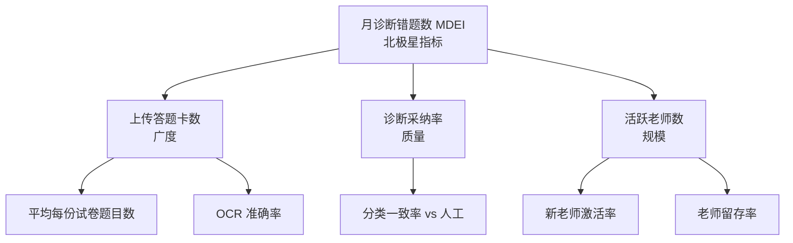

# 北极星指标 — ChemAI（智辅化学）


---

## 一、商业游戏分类

ChemAI 属于 **生产力游戏（Productivity Game）**。

**判断依据**：

- 核心价值交付是"帮化学老师更高效地完成错题诊断和讲评准备"
- 用户使用 ChemAI 是为了完成工作（教学诊断），而非娱乐或交易
- 可比产品类别：Canva（帮人高效做设计）、Notion（帮人高效组织信息）、Dropbox（帮人高效存储和分享文件）
- 与 Attention Game 的区别：用户不追求在 ChemAI 上"花更多时间"——恰恰相反，时间越短越好
- 与 Transaction Game 的区别：老师/学生之间没有交易关系

**竞争维度**：完成一项教学诊断任务的速度和准确度。

**对 NSM 选择的启示**：生产力游戏的北极星指标通常衡量"完成了多少核心任务"（而非"来了多少人"或"花了多少时间"）。

---

## 二、北极星指标候选

### 候选 NSM 1：每月诊断的错题数 ✅ 推荐（MDEI）

**定义**：系统在一个自然月内完成诊断（即给出"概念障碍/审题障碍/表达障碍/其他"分类）的错题总数。

**为什么这个指标**：
- 一道错题被诊断 = 一个学生的一个知识盲区被标记 → 驱动自适应练习 → 驱动报告生成 → 驱动家长触达
- 这是整个 ChemAI 价值流的"起点"——没有诊断，后续所有功能（自适应练习、家长周报、学情预警、学期报告等）都是空的
- 既包含广度（更多的题被诊断 = 更多的学生被覆盖），也隐含质量（只有老师上传了答题卡并采纳了诊断结果，才会产生新诊断）
- 与愿景完美对齐（第一部分）——"让每道错题被读懂"——NSM 就是"这道题是否真的被'读'了"

### 候选 NSM 2：周活跃老师数

**定义**：每周至少使用一次 ChemAI 完成核心流程（上传答题卡→查看诊断→查看报告）的独立老师数。

**为什么不推荐**：
- 这是一个规模指标（多少人用），而非价值指标（创造了多少价值）
- 10 个老师每人诊断 10 道题 ≠ 5 个老师每人诊断 200 道题——后者创造了更多的学生价值
- 更适合作为输入指标（驱动诊断量的因素）

### 候选 NSM 3：学生练习完成数

**定义**：学生完成的自适应练习题目数。

**为什么不推荐**：
- 这是诊断的下游行为——没有诊断就没有练习
- 练习完成数受太多外部因素影响（学生有没有手机、学校让不让用、家长管不管等）
- 当前阶段（MVP）诊断是核心瓶颈，练习是下一步
- 如果选这个做 NSM，会误导团队过早优化练习体验而忽视诊断准确率

### 候选 NSM 4：教师节省的总时间

**定义**：所有使用 ChemAI 的老师相较于手工统计共节省的时间总和（小时/月）。

**为什么不推荐**：
- 难以精确测量（需要估算"如果不用 ChemAI 会花多少时间"，且因老师个体差异大）
- "时间"的量纲在不同场景下不可比——高一老师每月统计花 2 小时 vs 高三老师每月花 8 小时，"节省时间"的价值密度不同
- 该指标更适合在 Case Study 和营销材料中作为叙事，不适合作为团队对齐和决策的 NSM

---

## 三、推荐 NSM：每月诊断的错题数

### 详细定义

| 属性 | 说明 |
|------|------|
| **指标名称** | 每月诊断的错题数（Monthly Diagnosed Error Items, MDEI） |
| **定义** | 在一个自然月内，系统对老师上传的答题卡完成 OCR 识别并给予至少一项障碍分类（概念/审题/表达/其他）的错题总数 |
| **计数规则** | 同一道错题在同一学生的同一次考试中只计一次（即使老师多次查看诊断）；同一道错题在不同考试中出现（如学生同一知识点在不同月考中都错）——各自计数一次 |
| **不计数的情况** | OCR 识别失败的错误（无法给出诊断）不计入；老师手动标记为"诊断不适用"的题目不计入 |
| **数据来源** | 数据库 `diagnosis` 表，字段：`diagnosis_id, created_at, status = 'completed'` |
| **报告频率** | 每月 1 日自动汇总上月数据；每周在每周复盘会议中查看趋势 |

### 7 标准验证

| 标准 | 评估 | 说明 |
|------|------|------|
| 1. **易于理解** | ✅ | "我们一个月分析了多少道学生做错的化学题"——任何人都能理解，团队成员、投资人、合作伙伴 |
| 2. **客户中心** | ✅ | 每诊断一道错题 = 一个学生获得了一次"被理解"的机会 = 从"只知道分数"到"知道为什么扣分" |
| 3. **可持续价值** | ✅ | 诊断驱动练习→练习产生新错题→新错题被诊断——形成自增强的飞轮闭环。使用越久，数据沉淀越多，诊断越精准 |
| 4. **愿景对齐** | ✅ | 愿景"让每道错题被读懂"——NSM 直接衡量"这道题是否被'读'了" |
| 5. **可量化** | ✅ | 数据库直接查询，精确到个位数。无需估算或用户调研 |
| 6. **可行动** | ✅ | OCR 更快→诊断更多（技术侧）；诊断更准→更多老师上传（体验侧）；更多学校→更多试卷（市场侧）。团队任何成员都可以找到自己如何影响 NSM 的路径 |
| 7. **先行指标** | ✅ | 诊断量增长 → 练习量增长 → 留存增长 → 续费增长。MDEI 领先于收入指标约 3-6 个月（试用期老师看到诊断价值→推动付费） |

### 7 标准验证的边界条件

> **跨角色验证**：NSM 不是"选"出来的，而是从业务流程中推导、经跨角色验证得出的。PM 与研发确认 MDEI 能否精确度量、数据库能否按月/校/老师拆分并向上汇报；BD 用种子学校实测数据校准公式参数（单次考试错题率区间、每班人数、每月考试频次）；针对寒暑假诊断量暴跌，用季节性波动分析（见 4.2）解决。

| 可能误导的情况 | 如何避免 |
|-------------|---------|
| 老师手动批量上传大量已批改试卷（"刷量"获取诊断）与真实考试场景混淆 | 增加"每份试卷的平均错题率"作为辅助指标——正常考试错题率在 15-45% 范围内，超出此范围的标记为异常（可能为批量刷量） |
| 低质量诊断（快速但不准确的诊断）会被计入 MDEI | 诊断采纳率（老师未修改诊断的比例）作为反指标监控——如果"月诊断数"上升但"诊断采纳率"下降 → 质量在下降 |
| 如果只有 1-2 所大校贡献了 80% 的 MDEI，单点风险高 | 按学校维度和城市维度拆分 MDEI——确保增长是分散的而非单点依赖 |

---

## 四、NSM 的目标设定与阶段基准

### 4.1 当前基准与目标

| 阶段 | 覆盖学校数 | 月诊断错题数（MDEI） | 计算依据 | 代表月 |
|------|----------|-------------------|---------|--------|
| **种子期前** | 0 | 0 | 尚未部署 | 2026.Q2 |
| **种子期（3 所学校）** | 3 | 5,000-10,000 | 3 校 × 6 班 × 50 人 × 25 题/人 × 1.5 次考试 × 25% 平均错题率 × 90% OCR 诊断覆盖率 | 2026.Q3-Q4 |
| **早期推广期（10 所学校）** | 10 | 20,000-40,000 | 10 校（含 3 种子+7 新校）× 平均 6 班 × 50 人 × 1.2 次考试 | 2027.Q1 |
| **早期推广期（20 所学校）** | 20 | 50,000-80,000 | 20 校 × 平均 7 班 × 50 人 × 1.0 次考试 | 2027.Q2-Q3 |
| **规模化期（50+ 所学校）** | 50+ | 200,000+ | 50+ 校 × 平均 8 班 × 50 人 × 1.0+ 次考试（含日常练习诊断） | 2028 |
| **成熟期（200+ 所学校）** | 200+ | 1,000,000+ | 200+ 校 × 10 班 × 50 人 × 1.5 次（含日常非考试诊断场景） | 2029-2030 |

### 4.2 MDEI 的季节性波动

| 月份 | 化学教学活动的典型节奏 | MDEI 波动预期 |
|------|---------------------|-------------|
| 1 月 | 期末考试 + 高三寒假复习 | 比 12 月上升 ~20%（期末集中考试） |
| 2 月 | 寒假（老师学生休假） | 全年最低——比 1 月下降 ~40-50% |
| 3-4 月 | 春季开学 + 期中考试 + 高三一模二模 | 上升——恢复至 12 月水平并超越 |
| 5 月 | 高三三模 + 高一高二期中 | 略低于 4 月（考试频次减少，高三进入自主复习期） |
| 6 月 | 高考（月上中旬）+ 高一高二期末 | 高考后高三停用——MDEI 可能下降 ~15-20%（高三贡献的消失） |
| 7-8 月 | 暑假 | 全年第二低——但比 2 月略高（有些学校有暑期补课） |
| 9 月 | 秋季开学 + 新高三第一次月考 | 全年最高之一——新旧交替，新高三首次使用 |
| 10-11 月 | 期中考试 + 高三第二次月考 | 稳定在 9 月水平的 ~80-90% |
| 12 月 | 期末准备 + 高三第三次月考 | 比 11 月略高——期末压力驱动更多诊断 |

**应对策略**：设定月度目标时应考虑季节性因素，用"去年同期对比"（YoY）而非"环比"（MoM）来评估 MDEI 增长。

---

## 五、输入指标星座（Metrics Constellation）



### 输入指标 1：上传答题卡数（广度）

- **定义**：老师通过 OCR 上传的答题卡张数（按月统计）
- **为什么重要**：这是诊断的"原材料"——没有答题卡就没有诊断。MDEI = 上传答题卡数 × 平均每张答题卡错题数 × OCR 诊断覆盖率
- **如何提升**：降低上传门槛（批量拍照、微信小程序集成）、缩短上传时间、提高 OCR 成功率（减少失败重试带来的挫败感）
- **目标**：种子期每月 ≥ 300 张（3 校 × 6 班 × 50 人 × 每月 1 次 / 平均 3 张合并）
- **数据来源**：`uploads` 表，按 `teacher_id` 和 `created_at` 去重
- **拆解维度**：按学校、按老师、按考试类型（月考/周练/模考）

### 输入指标 2：诊断采纳率（质量）

- **定义**：系统给出的诊断结果被老师确认/未修改的比例。计算公式：`1 - (被手动修改的诊断数 / 总诊断数)`
- **为什么重要**：如果诊断不准，再多的诊断量也是噪音，甚至损伤老师对 ChemAI 的信任。这是一个质量门控指标——如果采纳率太低，说明"扩量"之前需要先"提质"
- **如何提升**：提升障碍分类准确率、提供诊断依据让老师"看到推理过程"、在老师手动修改后学习其修改模式
- **目标**：≥ 70%（MVP 阶段）；≥ 80%（推广期）；≥ 85%（成熟期）
- **数据来源**：对比 `diagnosis.original_classification` 和 `diagnosis.final_classification`（如果被老师修改过则不同）
- **红色警报线**：< 60% → 需暂停新学校推广，优先修复诊断准确率

### 输入指标 3：活跃老师数（规模）

- **定义**：每月至少使用一次核心流程的独立老师数
- **为什么重要**：诊断量 = 活跃老师数 × 平均每人上传的答题卡数 × 每张答题卡上的错题数
- **如何提升**：新老师激活（渠道获客 + 降低 onboarding 阻力）、老老师留存（持续的价值体验）
- **目标**：种子期 ≥ 5 人，推广期 ≥ 40 人，规模期 ≥ 100 人
- **拆解维度**：按学校、按教龄段（新手/骨干/资深）、按使用频次段（1-2 次/月、3-4 次/月、每周都用）

### 输入指标 4：平均每份试卷的错题诊断覆盖率

- **定义**：系统实际分析并给出诊断的错题数 ÷ 试卷上的总错题数
- **为什么重要**：OCR 没识别出来的题无法诊断（丢失的诊断机会）。这是 OCR 能力的直接体现
- **如何提升**：OCR 准确率（特别是化学特殊符号如化学式、结构式、配平方程式）、手写字体识别优化
- **目标**：≥ 90%（种子期）；≥ 95%（推广期）；≥ 98%（成熟期——作为化学专属 OCR 的壁垒）

### 输入指标 5：从上传到诊断完成的平均时间

- **定义**：老师提交答题卡照片到系统生成完整诊断报告的平均耗时
- **为什么重要**：时间是生产力游戏的核心维度——时间越短→老师越愿意用→上传越多→诊断越多。如果 > 15 分钟，老师会放弃等待
- **如何提升**：OCR 速度优化、LLM 响应时间优化（选择更快的模型/批处理）、并行处理（同时 OCR 多张答题卡）
- **目标**：种子期 ≤ 15 分钟/班（~90 人）；推广期 ≤ 10 分钟/班；规模期 ≤ 5 分钟/班
- **P95 延迟也要监控**——平均可能 ≤ 10 分钟，但如果 P95 延迟 ≥ 30 分钟，说明有部分老师在忍受很慢的体验

---

## 六、输入指标与 NSM 的详细相关性分析

### 6.1 理论模型

```
MDEI = 活跃老师数 × AvgUploads(老师/月) × AvgQuestions(每张答题卡) × AvgErrorRate(每卷) × OCR覆盖率 × 诊断成功率

其中：
- 活跃老师数 → 市场/销售/客户成功驱动
- AvgUploads → 使用习惯/考试频次驱动
- AvgQuestions → 试卷设计（外部因素，ChemAI 不可控）
- AvgErrorRate → 学生水平（外部因素，ChemAI 不可控）
- OCR覆盖率 → OCR 技术能力
- 诊断成功率 → 诊断质量（障碍分类准确率）
```

### 6.2 敏感性分析

假设当前种子期（3 所学校，月 MDEI ~7,500），评估各因子的改善对 NSM 的边际贡献：

| 改善动作 | 对因子的影响 | 对 MDEI 的影响（估） | 难度 | 优先级 |
|---------|------------|-------------------|------|--------|
| **增加 1 所种子学校** | 活跃老师 +3、AvgUploads +30% | +2,500 MDEI (+33%) | 中（需要创始人时间和关系） | P0 种子期 |
| **OCR 覆盖率从 85% → 92%** | OCR覆盖率 +7pp | +~600 MDEI (+8%) | 低-中（持续迭代 OCR 模型） | P1 |
| **从月考扩展到周练场景** | AvgUploads 从 1.5 → 3.0 次/月 | +~7,500 MDEI (+100%) | 中-高（需要产品支持更高频的轻量使用） | P1 |
| **每所学校化学组全组激活** | 活跃老师从 1 → 3 人/校 | +~3,750 MDEI (+50%) | 中（需要在每个学校推动组内扩散） | P1 |
| **诊断时间从 15min → 8min** | 间接提升 AvgUploads（改善体验→更多使用） | 难以直接量化（预期 +10-20%） | 中高（需要并行处理、LLM 性能优化） | P2 |
| **从高三扩展到高一/高二** | 活跃老师 ×2-3（同一所学校内扩展） | +~15,000 MDEI (+200%) | 在高一/高二考试频次较低（月均 0.5 次→需要日常练习诊断场景支持） | P2（滩头退出后） |

### 6.3 场景模拟

**场景 1：乐观路径（学校数按计划增长 + 周练习场景验证成功）**

| 时间 | 学校数 | 老师/校 | 月考试次数 | 月练习次数 | 班数/校 | 诊断/月 |
|------|--------|---------|----------|----------|---------|---------|
| 第 3 个月 | 3 | 2 | 1.5 | 0 | 6 | 6,480 |
| 第 6 个月 | 10 | 2.5 | 1.5 | 0.5 | 7 | 42,000 |
| 第 12 个月 | 20 | 3 | 1.5 | 1.0 | 8 | 120,000 |
| 第 18 个月 | 35 | 3 | 1.2 | 1.5 | 8 | 181,440 |
| 第 24 个月 | 50 | 3 | 1.0 | 2.0 | 8 | 288,000 |

**场景 2：保守路径（学校增长慢一半 + 周练习场景延迟）**

| 时间 | 学校数 | 老师/校 | 月考试次数 | 月练习次数 | 班数/校 | 诊断/月 |
|------|--------|---------|----------|----------|---------|---------|
| 第 3 个月 | 3 | 2 | 1.0 | 0 | 6 | 4,500 |
| 第 6 个月 | 6 | 2 | 1.0 | 0 | 6 | 7,200 |
| 第 12 个月 | 12 | 2.5 | 1.0 | 0.2 | 7 | 25,200 |
| 第 18 个月 | 20 | 2.5 | 1.0 | 0.5 | 8 | 36,000 |
| 第 24 个月 | 30 | 2.5 | 1.0 | 0.8 | 8 | 64,800 |

---

## 七、反指标（Counter-Metrics / Health Metrics）

### 7.1 反指标清单

北极星指标告诉我们产品在变好，反指标告诉我们是不是用错误的方式让产品变好了。

| 反指标 | 黄色警报（关注） | 红色警报（行动） | 说明 |
|--------|--------------|--------------|------|
| **诊断被人为修改率** | > 30% | > 40% | 如果大部分诊断被老师手动修改，表明诊断质量下降。应暂停"扩量"优先修复质量 |
| **学生报告查看率** | < 40% | < 30% | 学生没有查看自己的诊断结果——诊断量是在"空转"（老师看了但学生没看） |
| **单老师月诊断量的异常飙升** | > 平均值 × 3 | > 平均值 × 5 | 可能是在刷量、测试账号、或 OCR 重复处理同一批答题卡（bug） |
| **重复诊断率** | > 5% 的错题在 24h 内被诊断 > 1 次 | > 10% | 同一道错题在短时间内被重复处理——浪费 LLM 资源 |
| **家长端月活与诊断学生数的比值** | < 40% | < 30% | B2B2C 链条中的"2C"断裂——即使学校付了费，续费驱动力会减弱 |
| **OCR 失败率** | > 15% | > 25% | 大量的潜在诊断机会丢失 |
| **诊断后 7 天内无后续动作** | > 60% 的诊断 | > 75% | 诊断出来了但既没有推送给学生、也没有生成练习、也没有被老师引用——诊断成了"一次性"的信息 |
| **老师周活跃率的持续下降** | 连续 3 周下降 | 连续 6 周下降 | 底层活跃老师数量减少——迟早会反映到 MDEI 上 |

### 7.2 严重事故的反指标

| 反指标 | 触发条件 | 响应 |
|--------|---------|------|
| **危险化学内容的生成次数** | > 0（任何一次）（行业红线比较清晰的行业） | 立即启动安全事故响应——暂停 AI 出题功能（M11）、追溯已生成的内容和接收者、通知相关学校的化学老师 |
| **学生隐私数据泄露警报** | 审计日志中出现异常数据导出 | 立即启动数据安全响应——封禁涉事账号、追溯数据流向、通知相关学校 |

---

## 八、可比产品的基准数据（Benchmarks）

### 8.1 赛道维度

| 可比产品 | 类型 | 北极星指标 | 用户基数和活跃度 | 备注 |
|---------|------|----------|--------------|------|
| **Khan Academy** | 免费教育（B2C） | 月活跃学习时长 / 月完成练习数 | MAU ~1.3 亿（全球） | 非直接竞品，但作为"自适应练习"的对标——ChemAI 的 MDEI 类比 Khan Academy 的"月完成练习数"，但 ChemAI 更精准（不仅有对错，还有病因诊断） |
| **Duolingo** | 免费增值（B2C） | DAU（日活跃用户） | DAU ~3000 万 | 生产力游戏的对标——但 ChemAI 不同，DAU 不适合作为 B2B2C 工具的 NSM |
| **Quizlet** | 免费增值（B2C） | 月活跃学习会话数 | MAU ~6000 万 | 学习会话 = ChemAI 的诊断记录——都是"单位价值交付" |
| **科大讯飞智学网** | B2G/B2B | 覆盖班级数 / 月考试分析数 | ~数万班级，年产生数亿条数据 | 讯飞的指标更偏"覆盖规模"，ChemAI 的 MDEI 更偏"单位价值" |
| **Canvas (LMS)** | B2B 教育 SaaS | 月活跃课程数 / 作业提交数 | 全球 ~3000 万用户 | B2B 教育 SaaS 的 NSM 通常偏"活跃教师数"和"活跃课程数" |

### 8.2 可作为基线的行业经验数据

| 指标 | 行业参考值（B2B 教育 SaaS） | ChemAI 当前阶段 | 差距 / 目标 |
|------|-------------------------|---------------|-----------|
| **教师周活跃率** | 60-80%（高价值工具） | 种子期目标 80% | 持平 |
| **诊断采纳率（类比"AI 建议采纳率"）** | 70-85%（优秀的 AI 教育工具） | 种子期目标 70% | 持平 |
| **OCR 准确率（教育场景）** | 90-98%（经过优化的手写 OCR） | 种子期目标 ≥ 90% | 处于行业下限（化学符号的复杂性使 OCR 更难，需持续优化） |
| **从注册到首次核心使用的天数** | 5-15 天（B2B SaaS） | 种子期目标 ≤ 14 天 | 持平 |
| **30 天留存率** | 40-60%（教育工具） | 种子期目标 60%+（因为考试强驱动） | 目标高于平均水平 |

---

## 九、NSM 的仪表盘设计

### 9.1 核心仪表盘（每周查看）

| 面板区域 | 展示内容 | 刷新频率 |
|---------|---------|---------|
| **左上：NSM 主体** | 当月 MDEI（大号数字）+ 环比上周变化 + 距月度目标完成度% | 日更新 |
| **右上：趋势图** | 最近 12 周的 MDEI 趋势线（带季节性标注） | 周更新 |
| **左下：输入指标** | 活跃老师数（本周）+ 上传答题卡数（本周）+ 诊断采纳率（本周）+ 平均诊断时间（本周） | 日更新 |
| **右下：反指标** | 诊断修改率（本周）+ 学生报告查看率（本周）+ 家长端月活/诊断学生数（本月） | 周更新 |
| **底部：分解视图** | 按学校拆分的 MDEI（Top 5 + Other）+ 按城市拆分的 MDEI | 周更新 |

### 9.2 预警颜色

| 颜色 | 含义 | 发送通知给 |
|------|------|----------|
| 绿色 | 在目标 +/- 10% 以内 | 无需通知 |
| 黄色 | 偏离目标 10-30% | 每周复盘会议中提醒 |
| 红色 | 偏离目标 > 30% 或反指标触发红线 | 即时通知创始人 |

### 9.3 不同角色的仪表盘视图

| 角色 | 查看重点 | 查看频率 |
|------|---------|---------|
| **创始人/CEO** | NSM 趋势 + 反指标 + 城市/学校拆解 | 每日（5 分钟） |
| **技术负责人** | 诊断采纳率 + 诊断时间 + OCR 覆盖率 + 重复诊断率 | 每日（5 分钟） |
| **市场/销售（如有）** | 活跃老师数 + 新老师激活率 + 按城市拆解 | 每周（10 分钟） |
| **投资人/顾问** | NSM 趋势 + 月环比 + 指标星座总览 | 每月（投资人更新报告） |

---

## 十、NSM 的审查与决策节奏

### 10.1 审查节奏

| 频率 | 活动 | 参与者 | 审查内容 | 决策范围 |
|------|------|--------|---------|---------|
| **每日** | NSM 快照查看 | 创始人+技术 | NSM 数字 + 反指标是否触发红色警报 | 紧急修复决策 |
| **每周** | 指标复盘会（30 分钟） | 创始人+技术+学科顾问 | MDEI趋势 + 所有输入指标 + 反指标 + 按学校拆解 | 本周优先级的微调 |
| **每月** | 月度业务复盘（1 小时） | 创始人+技术+学科顾问 | MDEI vs 月度目标 + 趋势分析 + 各渠道/城市的贡献度 + 变量分解 | 月度目标的调整、渠道策略的调整 |
| **每季度** | 季度战略复盘（2 小时） | 全体团队 | MDEI vs 季度目标 + 增长引擎健康度评估 + 竞品对标 + 长期趋势 | 季度 OKR 的调整、阶段目标的重新设定 |
| **每年** | 年度战略规划 | 全体团队+顾问 | 年度 NSM 回顾 + 阶段目标的达成 + 下年度目标设定 | NSM 定义的生命周期审查、年度目标设定 |

### 10.2 基于 NSM 的决策框架

| 情境 | 决策 | 理由 |
|------|------|------|
| **MDEI 增长符合预期 + 反指标健康** | 继续加速——增加新学校、扩展新功能、探索新渠道 | 飞轮在健康旋转，加速是合理策略 |
| **MDEI 增长符合预期 + 反指标出现黄色预警** | 减速扩展——暂缓新学校推广，优先修复质量问题 | "有毒的增长"（数量增加但质量下降）最终会反噬 MDEI |
| **MDEI 增长低于预期 + 反指标健康** | 分析瓶颈——是"活跃老师数不够"还是"每老师的诊断量不够"还是"OCR 覆盖率低"？对症下药 | MDEI 增长慢但品质好——问题可能在获客侧（渠道效率）而非产品侧 |
| **MDEI 增长低于预期 + 反指标出现红色预警** | 暂停扩展——全面诊断根本原因，制定恢复计划 | 最差的情境——需要系统性诊断和恢复 |

### 10.3 NSM 的逐步升级（Escalation）框架

| 步骤 | 时间 | 行动 |
|------|------|------|
| 1. 检测 | 即时 | 仪表盘自动检测到红色警报（如：诊断采纳率 < 60% 持续 2 天） |
| 2. 通知 | < 1 小时 | 系统自动发送通知给创始人和技术负责人 |
| 3. 诊断 | < 24 小时 | 技术团队排查根因（LLM 模型版本更新？新题目类型？特定学校的特殊试卷格式？） |
| 4. 遏制 | < 48 小时 | 临时修复（如回滚 LLM 模型版本、暂停特定功能、针对问题学校手动处理） |
| 5. 修复 | < 1 周 | 永久修复上线 + 回归测试（使用评测集：AI 出题 195 题 + 障碍诊断 90 例 + 配平审核 20 例） |
| 6. 回顾 | 修复后 1 周内 | 事故根因分析 + 预防措施（增加对应的自动化测试 + 增加反指标监控灵敏度） |

---

## 十一、NSM 与 OKR 的关系

| 层级 | 内容 | 时序 |
|------|------|------|
| **愿景** | 让每一位化学老师都有一个不知疲倦的 AI 助教 | 10 年 |
| **使命** | 让每道错题被读懂——不只是给分数，而是找到根源 | 3-5 年 |
| **北极星指标** | 每月诊断的错题数（MDEI） | 持续追踪 |
| **策略** | 从高三化学切入，通过深度诊断建立信任，再扩展到练习和家长端 | 1-3 年 |
| **OKR-O1（种子期）** | 建立种子学校口碑（KR: 老师周活 ≥ 80%、处理时间 ≤ 15min） | 季度 |
| **OKR-O2（种子期）** | 将诊断准确率提升至可依赖水平（KR: 分类一致率 ≥ 80%） | 季度 |

**关系说明**：
- **NSM**（MDEI）回答"我们在创造什么价值"——每月衡量一次，跨季度连续追踪
- **OKR** 回答"本季度我们要把这件事情做到什么程度"——每季度设定并衡量
- NSM 不替代 OKR——NSM 是"长期价值度量"，OKR 是"短期聚焦"
- 每季度的 OKR 应该能解释"这个季度我们为 NSM 做了什么贡献"

---

## 十二、NSM 的生命周期审查

### 12.1 何时重新审视 NSM 定义？

| 触发条件 | 可能的调整方向 |
|---------|-------------|
| **产品形态发生重大变化**（如 ChemAI 从纯诊断工具变成包含 LMS 的平台） | 可能需要将 NSM 从"每月诊断的错题数"扩展到包含"月活跃课程数"或"月活跃班级数" |
| **商业模式发生重大变化**（如从 B2B2C 变成纯 B2C） | NSM 可能需要更偏向学生侧指标（如"月活跃学生数"）而非老师侧 |
| **用户行为发生根本改变**（如大部分诊断来自学生自助而非老师上传） | MDEI 的定义需要调整计数的来源（学生自助诊断 vs 教师诊断） |
| **MDEI 持续增长但收入不增长** | 可能存在"价值脱节"——诊断量增加了但没有转化为付费——可能需要重新审视 NSM |
| **跨学科扩展**（如扩展到物理） | 是否需要按学科拆分的 MDEI？还是需要一个新的跨学科 NSM？ |

### 12.2 NSM 生命周期审查节奏

| 时间 | 审查内容 |
|------|---------|
| **每季度** | 检查 MDEI 与收入的相关系数（诊断量增长是否导致付费增长？） |
| **每半年** | 检查 MDEI 是否仍然是"最有解释力的单一指标"——是否出现了比 MDEI 更能解释用户留存和付费的新指标？ |
| **每次重大产品发布后** | 检查新产品/新功能是否改变了价值交付的方式——如果是，是否需要调整 NSM？ |
| **年度战略规划** | 系统性审查 NSM 的适用性——这是最正式的 NSM 重新定义时机 |

---

## 十三、指标驱动的基础设施需求

### 13.1 数据埋点需求

| 事件 | 埋点字段 | 用途 |
|------|---------|------|
| `teacher_upload_start` | timestamp, school_id, teacher_id, exam_type | 追踪上传行为 |
| `ocr_complete` | timestamp, upload_id, recognized_count, failed_count | OCR 质量监控 |
| `diagnosis_complete` | timestamp, upload_id, diagnosed_count, model_version | NSM 核心事件 |
| `diagnosis_modified` | timestamp, diagnosis_id, original_classification, new_classification | 诊断采纳率 |
| `report_viewed_teacher` | timestamp, report_id, teacher_id | 教师侧闭环 |
| `report_viewed_student` | timestamp, report_id, student_id | 学生侧闭环 |
| `practice_assigned` | timestamp, student_id, question_count, source_diagnosis_id | 练习闭环 |
| `parent_report_opened` | timestamp, parent_id, student_id | 家长侧闭环 |

### 13.2 仪表盘技术栈建议

| 组件 | 推荐方案 | 原因 |
|------|---------|------|
| **数据管道** | FastAPI 后端直接写入数据库 + 定时聚合到 Redash/Metabase | MVP 阶段使用 SQLite，生产环境升级为 PostgreSQL——最小化引入新工具 |
| **可视化** | Metabase（开源免费）或 Grafana | 满足种子期需求，且零额外成本 |
| **预警** | 简单脚本（Python cron job 查询 PostgreSQL + 企业微信/钉钉通知） | 种子期无需复杂监控系统 |

