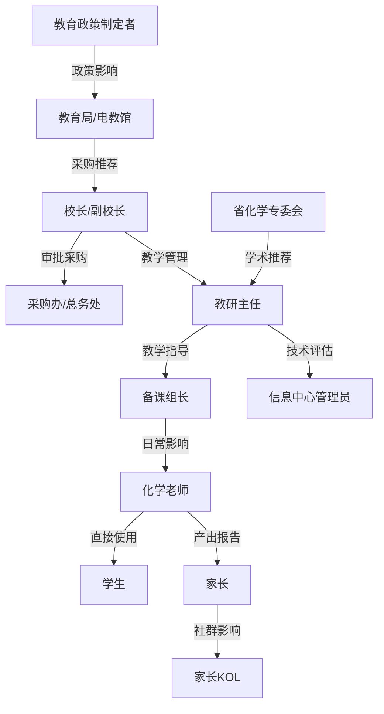

# 干系人地图 -- ChemAI（智辅化学）

> 关联文档：「02-SWOT分析」、「16-预分析Pre-Mortem」、「08-理想客户画像」

---

## 一、干系人识别

ChemAI 作为 B2B2C 产品，干系人横跨学校、家庭、政策和技术四个领域。

| # | 干系人 | 角色 | 与产品的关系 | 核心诉求 |
|---|--------|------|-------------|---------|
| 1 | **化学老师（使用者）** | 日常用户 | 上传答题卡、查看诊断、使用报告讲评 | 节省时间、提升讲评质量 |
| 2 | **化学备课组长** | 核心用户 x 决策影响者 | 推动学科组使用、在教研会上展示数据 | 统一讲评方向、可视化教研成果 |
| 3 | **学生** | 终端用户 | 接收报告、完成自适应练习 | 知道"为什么错"和"怎么提高" |
| 4 | **家长** | 付费意愿来源 | 接收周报、决定是否为增值服务付费 | 了解孩子真实问题和进步 |
| 5 | **学校校长/副校长** | 预算决策者 | 审批采购、评估教学质量提升效果 | 提升学校教学质量和升学率 |
| 6 | **学校教研主任** | 决策影响者 x 教学管理者 | 评估教学工具的专业性和使用效果 | 全校教研水平的提升 |
| 7 | **学校信息中心管理员** | 技术部署者 | 系统部署、账号管理、数据安全 | 系统稳定、安全合规 |
| 8 | **总务处/采购办** | 采购执行者 | 合同签订、付款流程 | 流程合规、价格合理 |
| 9 | **教育局/电教馆** | 政策 + 采购决策者 | 区域统一采购、推广指定 | 区域教育质量提升、数据可控 |
| 10 | **省化学教学专业委员会** | 学术权威 | 教研方向引领、教师培训 | 化学教研水平的整体提升 |
| 11 | **创始人/产品负责人** | 产品提供方 | 全栈开发 + 销售 + 客户成功 | 产品成功、团队成长 |
| 12 | **化学学科顾问** | 领域专家 | 诊断模型校准、题库标注指导 | 学术声望、专业知识应用 |
| 13 | **投资人（未来）** | 资金来源 | 提供扩张资金 | 投资回报、市场地位 |
| 14 | **竞品/替代品** | 外部威胁 | 制约定价空间和增长速度 | 自身市场份额、挤压新进入者 |
| 15 | **教育政策制定者** | 环境塑造者 | 影响 AI 进校的合规条件和市场规模 | 教育公平、数据安全、技术赋能 |
| 16 | **师范院校化学系** | 长期生态伙伴 | 培养未来用户、提供学术背书 | 教学现代化、学生就业 |
| 17 | **教辅出版方** | 生态伙伴 | 题库授权、内容分发 | 教辅数字化、内容增值 |
| 18 | **学科网/组卷网** | 渠道合作方 | 嵌入诊断能力、提供用户触达 | 平台功能丰富、用户粘性提升 |
| 19 | **家长群活跃者（KOL家长）** | 舆论节点 | 在家长群中分享、评价产品 | 可靠信息、社区影响力 |
| 20 | **媒体/教育自媒体** | 舆论塑造者 | 报道/评论 AI 教育产品 | 独家内容、行业影响力 |

---

## 二、Power x Interest 矩阵

```
                    高
                    │
     Quadrant II    │    Quadrant I
     Keep           │    Manage
     Satisfied      │    Closely
                    │
    ┌───────────────┼───────────────┐
    │ 校长/副校长    │ 化学老师 ★核心 │
    │ 教育局/电教馆  │ 备课组长 ★核心 │
    │ 教研主任      │ 创始人       │
    │ 投资人       │ 学科顾问     │
    │ 政策制定者    │               │
    │ 省化学专委会  │               │
    │               │               │
    │ 采购办        │               │
  P ├───────────────┼───────────────┤
  o │ 总务处        │               │
  w │               │ 学生         │
  e │ 信息中心管理员 │ 家长         │
  r │ 竞品         │ 家长KOL      │
    │ 媒体/自媒体   │               │
    │               │               │
    │ 教辅出版方    │ 师范院校化学系│
    │ 学科网       │               │
    └───────────────┼───────────────┘
    │               │
    │  Quadrant IV  │   Quadrant III
    │  Monitor      │   Keep
    │               │   Informed
    │               │
                    │
                    低
                    ───────────────────→
                   Interest / 兴趣程度
```

---

> **决策链**：备课组长（高权力、高兴趣）→ 教研主任（高权力、中兴趣）→ 分管副校长（高权力、低兴趣——风险厌恶者）→ 校长（最高权力、最低兴趣——只看 ROI）→ 总务处（中权力、低兴趣——走流程的守门人）→ 教育局（中权力、低兴趣——合规审批）。

核心用户和推广者为化学老师与备课组长；采购相关方为教育装备/信息技术采购部门。

以上决策链由 PM 根据 BD 返回的学校组织架构绘制。

## 三、分象限沟通策略

### Quadrant I：Manage Closely（高权力 x 高兴趣）

这些干系人的支持与否直接决定产品生死。

| 干系人 | 权力来源 | 兴趣来源 | 若被忽视的风险 | 当前态度 | 目标态度 |
|--------|---------|---------|-------------|---------|---------|
| **化学老师（核心用户）** | 产品价值的唯一验证者；非使用者->无口碑->无传播 | 直接受益于产品（节省时间、提升教学质量） | 产品无人使用，种子验证失败 | 好奇但观望 | 积极使用 x 主动推荐 |
| **化学备课组长** | 校内推广的关键节点；对学科组有"意见领袖"效应 | 仪表盘和数据报告的"炫耀价值" | 无法在同一学校内从 1 人扩展到全组 | 感兴趣 | 推动全组使用 |
| **创始人** | 产品的唯一创造者和推动者 | 创业愿景/产品成功（自驱） | Burnout，产品停滞 | 全力投入 | 持续激情但可控 |
| **学科顾问** | 化学诊断模型的知识输入者；审核引擎的校准者 | 学术声望和专业成就感 | 诊断准确率不达标 | 高度投入 | 长期学术伙伴 |

**沟通计划**：

| 干系人 | 频率 | 形式 | 核心信息 | 反馈闭环 |
|--------|------|------|---------|---------|
| 化学老师 | 每周 1 次 | 微信私聊 + 种子用户群 | "你上次提的那个问题我们这周修了，你试试看？" | 每次沟通后 48h 内确认问题已解决 |
| 备课组长 | 每两周 1 次 | 1v1 电话/微信语音 | "最近仪表盘上的数据，有什么发现吗？你还有什么需要？" | 记录需求 -> 评估优先级 -> 反馈时间预期 |
| 学科顾问 | 每周 1 次（密集期） | 在线协作 + QA | "新一批诊断结果出来了，帮忙抽检一下准确率？" | 标注反馈 -> 模型迭代 -> 下次评测对比 |
| 创始人（自省） | 每周 | 个人周记 | "本周最重要的进展是什么？最大的风险是什么？" | 与季度目标对齐检查 |

---

### Quadrant II：Keep Satisfied（高权力 x 低兴趣）

这些人有决策权但不直接使用产品。如果不满，他们有能力阻止产品进入；如果满意，他们不会深入参与但会批准。

| 干系人 | 权力来源 | 为什么兴趣低 | 若被忽视的风险 | 当前态度 | 目标态度 |
|--------|---------|------------|-------------|---------|---------|
| **校长/副校长** | 采购审批权；学校资源的分配者 | 他们不教化学，日常不用教学工具 | 采购被否 | 未知 | 支持但不深入 |
| **教研主任** | 教学工具评估权；对校长的推荐权 | 关注面广，化学只是学科之一 | 负面推荐 => 校长否决 | 未知 | 积极背书 |
| **教育局/电教馆** | 区域统一采购权；学校推荐权 | 关注的是"管"而非"用" | 无法进入公立学校体系 | 未知 | 认可为合规工具 |
| **省化学专委会** | 学术影响力；教师培训资源 | 关注面广，对新工具有甄别门槛 | 负面评价 => 全省教师信任降低 | 未知 | 主动推荐 |
| **投资人（未来）** | 资金；战略建议 | 他们是观察者而非运营者 | 融资失败 | N/A(未接触) | 有信心投资 |
| **教育政策制定者** | 法规制定权；市场准入门槛 | 在宏观层面，不关心单一产品 | AI 进校被一刀切禁止 | 未知 | 认可 AI 辅助教学 |
| **采购办** | 采购流程执行权 | 只关心流程合规 | 合同卡在流程中 | 未知 | 顺畅审批 |

**沟通计划**：

| 干系人 | 频率 | 形式 | 核心信息 | 关键节点对齐 |
|--------|------|------|---------|------------|
| 校长 | 每学期 1-2 次 | 正式汇报（数据报告） | "化学学科的教学质量数据报告（匿名化），展示提升趋势" | 学校预算编制期 + 学期末总结 |
| 教研主任 | 每学期 1-2 次 | 正式 demo + 教学成果展示 | "ChemAI 在化学教研中的应用案例和效果" | 教研会议 + 教学评估周期 |
| 教育局 | 按合作节奏（非固定） | 正式 demo + 白皮书 + 试点方案 | "化学校级学情数据的可视化和区域对比——区域教学质量的数字化底座" | 教育局项目申报周期 |
| 省化学专委会 | 年会/学期 | 学术分享 + workshop | "AI 辅助化学诊断的实践和数据"（学术视角，非推销视角） | 年会 + 教研活动时间表 |
| 投资人 | 每月 1 次（融资后） | 投资人更新邮件 | "关键指标进展 + 下一步里程碑 + 风险更新" | 融资轮次时间表 |
| 采购办 | 签约前 | 正式文件提交 | "采购方案、合同模板、资质证明、安全合规文件" | 学校采购日历 |

---

### Quadrant III：Keep Informed（低权力 x 高兴趣）

这些干系人关心产品但无法直接影响产品决策。持续沟通保持他们的参与和口碑。

| 干系人 | 为什么权力低 | 为什么兴趣高 | 若被忽视的风险 | 当前态度 | 目标态度 |
|--------|------------|------------|-------------|---------|---------|
| **学生** | 教育和采购体系中学生的话语权极低 | 直接受益于更好的诊断和练习 | 不使用->练习完成率低->数据闭环断裂 | 未知 | 主动查看报告 x 完成练习 |
| **家长** | 在学校采购体系中几乎无直接权力 | 孩子的成绩是他们最大的关心 | 不打开周报->B2B2C 断链 | 未知 | 每周打开报告 x 信任工具 |
| **家长 KOL** | 在家长群中有舆论影响力 | 教育是社交货币 | 负面评价在家长群中快速传播 | 未知 | 主动分享正面体验 |

**沟通计划**：

| 干系人 | 频率 | 形式 | 核心信息 | 沟通原则 |
|--------|------|------|---------|---------|
| 学生 | 每次考试后 | 应用内报告推送 | "你这次在 [知识点] 上有进步！来看看需要加强的部分" | 进步先行（绿色），待提升在后（黄色），无红色 |
| 家长 | 每周 1 次 | 微信模板消息/公众号推送 | "孩子这周在有机化学上需要关注，但在氧化还原上进步明显" | 可解释性 > 精确性；确定性 > 分数绝对值 |
| 家长 KOL | 每月 1 次 | 1v1 深度访谈 | "作为家长你觉得这个报告有用吗？哪里可以改进？" | 听取批评，快速改进，让他们成为"被重视的反馈者" |

---

### Quadrant IV：Monitor（低权力 x 低兴趣）

这些干系人在当前阶段对产品影响有限，但需要保持观察。

| 干系人 | 监控什么 | 监控频率 | 何时升级 |
|--------|---------|---------|---------|
| **信息中心管理员** | 是否有部署/安全投诉 | 月度 | 出现系统频繁故障或者安全漏洞 -> 升级到 Quadrant II |
| **竞品** | 大平台是否推出化学专属诊断功能 | 月度 | 如果讯飞/好未来进入化学专属诊断 -> 立即升级所有竞争应对策略 |
| **媒体/教育自媒体** | 是否出现 ChemAI 相关报道（正面/负面） | 周度 | 出现负面报道 -> 升级危机公关 |
| **教辅出版方** | 教辅行业数字化动向 | 季度 | 出现合作机会 -> 升级到 Quadrant III |
| **学科网** | 平台合作意愿和动向 | 月度 | 出现合作窗口 -> 升级到 Quadrant III |
| **师范院校** | 课程设置变化、实习生使用工具的倾向 | 季度 | 出现合作机会 -> 升级到 Quadrant III |

---

## 四、干系人影响力网络图

### 4.1 影响力传递链



> 图释：政策影响自上而下穿透（教育政策制定者→教育局→校长→采购办），学术影响通过教研主任横向作用于备课组长。备课组长是整个链条中最关键的单一节点——同时接收来自教研主任（行政）和省化学专委会（学术）的双向输入，再向下影响整个化学组。

### 4.2 影响力权重分析

| 干系人 | 直接影响 | 间接影响 | 影响延迟 | 影响半径 |
|--------|---------|---------|---------|---------|
| 备课组长 | 9/10（对组内老师） | 7/10（对教研主任） | 短(天-周) | 本校化学组 |
| 化学老师 | 8/10（对学生使用） | 5/10（对同行推荐） | 中(周) | 本班学生 + 同行圈子 |
| 教研主任 | 7/10（对校长） | 6/10（对教育局） | 中(周-月) | 全校 |
| 校长 | 10/10（采购决策） | 4/10（对同行学校） | 长(月) | 本校 |
| 教育局 | 10/10（区域推广） | 8/10（对政策制定者） | 极长(月-年) | 全区/县 |
| 省化学专委会 | 6/10（对教研主任） | 9/10（对全省教师） | 长(月) | 全省化学教师 |
| 家长 KOL | 3/10（对学校） | 8/10（对家长群） | 短(天) | 家长社群 |
| 学科顾问 | 5/10（对诊断模型） | 7/10（对学术声誉） | 中(周) | 学术界+产品 |

### 4.3 关键影响节点识别

**一级影响节点（必须优先管理）**：
1. **备课组长**：最关键的单一节点。一个人的支持可以带动全组，一个人的反对可以阻断全校。
2. **教研主任**：校长的"专业耳朵"。化学工具的专业性和效果需要通过教研主任来传递给校长。
3. **种子老师**：口碑的源头。没有种子老师的好评，就没有转介绍。

**二级影响节点（持续维护）**：
4. **校长**：审批权的最终持有者。不需要频繁沟通，但关键节点（预算审批期）不能缺席。
5. **家长 KOL**：家长群中的"风向标"。1 个负面评价可能在 24 小时内传播到 500 位家长。
6. **省化学专委会**：学术背书的最高权威。1 次年会分享 > 100 次销售拜访。

---

## 五、干系人态度演变预测

### 5.1 态度演变轨迹

| 干系人 | 接触前 | 首次接触 | 试用期(1-4周) | 采纳期(1-3月) | 忠诚期(3月+) |
|--------|--------|---------|-------------|-------------|------------|
| **化学老师** | 不知道/无感 | 好奇/"试试看" | "有点意思"或"麻烦" | "省时间了"或"还是自己来吧" | "离不开"或"放弃了" |
| **备课组长** | 不知道 | 审视/"看看有没有用" | 评估数据质量 | "教研会上可以展示" | "成为推动者"或"随大流" |
| **教研主任** | 不知道 | 听备课组长汇报 | 等待效果数据 | 评估是否推荐给校长 | 背书或观望 |
| **校长** | 不知道 | 听教研主任汇报 | 不关注 | 看续费/预算决策时关注 | 满意或不满 |
| **教育局** | 不知道 | 可能通过学校渠道了解 | 不关注 | 考虑是否列入推荐名单 | 统一采购或观望 |
| **学生** | 不知道 | 通过老师接触 | "有用"或"又多一个作业" | "能看到进步了"或"没感觉" | 习惯使用或放弃 |
| **家长** | 不知道 | 收到第一份周报 | "能看懂"或"看不懂" | "每周等着看"或"不打开了" | 信任工具并可能付费 |

### 5.2 态度转变的关键触点

| 干系人 | 正向转变的关键触点 | 负向转变的危险触点 |
|--------|-----------------|-----------------|
| 化学老师 | 第一次看到详细诊断报告（"以前要 6-8 小时，现在 15 分钟"） | OCR 识别错误率太高 -> "还得我自己重新判" |
| 备课组长 | 第一次在备课组会议上用仪表盘数据主导讨论 | 诊断结果被组内老师质疑不准 -> "丢脸" |
| 学生 | 第一次看到"进步"被可视化（绿色标记） | 连续收到"需要加强"报告 -> 焦虑和放弃 |
| 家长 | 第一次理解到孩子具体哪里需要加强 | "看不懂"报告中的术语 -> 关掉不再打开 |
| 校长 | 看到化学学科的成绩数据有改善趋势 | 收到老师/家长的投诉 |
| 教育局 | 看到区域化学教学质量的量化对比 | 数据安全/隐私事件 |

---

## 六、关键冲突识别与解决

### 6.1 已识别冲突及解决框架

| 编号 | 冲突 | 干系人 A vs B | 冲突本质 | 影响范围 | 当前状态 |
|------|------|-------------|---------|---------|---------|
| **C1** | 数据透明度 | 老师（想看学生间的对比排名） vs 学生/家长（不希望排名焦虑） | 教师想要更多数据 vs 学生心理安全 | 每个使用场景 | ✅ 已通过角色权限物理隔离 |
| **C2** | 功能复杂度 | 备课组长（要全年级分析） vs 普通老师（只要自己班的基础功能） | 需求复杂度差异 | 仪表盘设计 | ✅ 渐进披露设计（默认简单模式） |
| **C3** | 部署方式 | 信息中心（要本地化部署保安全） vs 创始人（要云端部署降成本） | 安全 vs 成本 | 技术架构 | ⚠️ 种子期云端，规模化需规划 |
| **C4** | 付费意愿 | 学校（要免费/低价） vs 产品（需要收入维持运营） | 公立校付费意愿 vs 产品生存 | 商业模式 | ⚠️ 种子期免费换验证 |
| **C5** | 诊断速度 vs 准确度 | 教师（想要快速出报告） vs 学科顾问（想要充分审核） | 速度 vs 质量 | 诊断流程 | ⚠️ 设置15分钟上限+低置信度标记 |
| **C6** | AI 出题 vs 教师选题 | 年轻老师（信任 AI 出题） vs 资深老师（只信任自己选题） | 对 AI 的信任程度差异 | AI 出题功能 | ⚠️ AI 出题为辅助选项，不强制 |
| **C7** | 家长端付费 vs 免费 | 家长（期望免费） vs 创始人（需要 C 端收入） | 价值感知 vs 收入需求 | C 端商业模式 | ⚠️ 免费基础+付费增值 |
| **C8** | 数据共享 vs 隐私保护 | 教育局（想要跨校对比数据） vs 学校/家长（数据隐私） | 数据价值 vs 隐私红线 | 区域推广策略 | ⚠️ 仅提供匿名化聚合数据 |

### 6.2 冲突解决 Playbook

#### C1：数据透明度冲突

| 解决框架 | 具体方案 |
|---------|---------|
| **原则** | 不同角色看到不同视角的数据，通过权限严格物理隔离 |
| **教师端** | 可查看班级内学生的对比分析（含排名），但仅在"教师视角"提供，不直接推送给学生 |
| **学生端** | 仅展示个人数据 + 与"班级平均水平"的差距（不说"你排第 15 名"，说"班级平均正确率 72%，你的正确率 78%"） |
| **家长端** | 仅展示孩子的个人数据，不展示任何其他孩子的数据或排名 |
| **验证** | 代码审查确保学生 API 响应不包含排名字段；学生端 UI 不渲染排名 |
| **如果冲突升级** | 如果教师强烈要求"让家长端也能看到排名" -> 解释产品价值观和不排名的设计理念；提供替代方案：教师可在家长会上口头说明班级大致位置 |

#### C3：云部署 vs 本地化部署冲突

| 解决框架 | 具体方案 |
|---------|---------|
| **种子期方案** | 云端部署 + 签署数据安全协议 + 第三方安全审计报告 |
| **规模化方案** | 提供 Docker 化本地部署版本（开发计划：2026.Q4 prototype） |
| **分级策略** | 学校规模 < 1000 人：云端部署；学校规模 > 2000 人或教育局要求：本地化部署 |
| **成本分摊** | 本地化部署的一次性部署费 + 年度维护费（高于云端的边际成本由学校承担） |
| **如果冲突升级** | 如果学校坚决要求本地化但不愿承担额外成本 -> 提供"数据不出校"的云端加密方案作为折中；如果仍不接受 -> 评估该学校的客户价值是否值得特殊定制 |

#### C5：诊断速度 vs 准确度冲突

| 解决框架 | 具体方案 |
|---------|---------|
| **核心原则** | 不牺牲零误差的安全红线（方程式配平必须 100% 正确），但在非安全关键维度可权衡 |
| **混合策略** | 第一阶段（0-5min）：快速 OCR + 基础诊断（高置信度项直接出） -> 老师可先看到"初步结果"；第二阶段（5-15min）：深度诊断 + 低置信度项的人工复核建议 -> 老师看到"完整报告" |
| **低置信度标记** | 对于系统不确定的诊断项，标注为"低置信度（建议人工确认）"而非给出可能错误的判断 |
| **如果冲突升级** | 如果老师普遍反馈"15 分钟太慢" -> 先做技术优化（OCR 并发、LLM 批处理），而非降低准确度阈值 |

#### C7：家长端付费 vs 免费冲突

| 解决框架 | 具体方案 |
|---------|---------|
| **核心原则** | 基础价值（已由学校订阅覆盖）不向家长重复收费；增值服务分层收费 |
| **免费层** | 每周基础学情报告（含知识点进展和关注项） -- 由学校订阅费覆盖 |
| **付费层 1**（30 元/月） | 深度诊断报告（逐题分析 + 进步轨迹 + 薄弱点预测） |
| **付费层 2**（50 元/月） | 深度诊断 + AI 1v1 对话 + 专属学习计划 |
| **如果冲突升级** | 如果家长投诉"学校已经买了为什么还要付费" -> 明确分层边界（学校采购覆盖的是教师教学工具，家长 C 端是额外增值服务）；提供学校统一为家长采购付费层的选项 |

---

## 七、干系人风险登记册

### 7.1 风险矩阵

| 编号 | 风险事件 | 影响干系人 | 概率 | 影响 | 风险等级 | 前兆信号 |
|------|---------|-----------|------|------|---------|---------|
| **R1** | 种子老师离职/调走 | 化学老师 x 备课组长 | 中 | 高 | 🟠 中高 | 老师减少使用频率、在学校社群中沉默 |
| **R2** | 校长换届/调走 | 校长 x 副校长 | 低 | 高 | 🟡 中 | 学校管理层变动新闻 |
| **R3** | 教研主任不推荐 | 教研主任 | 中 | 高 | 🟠 中高 | 在教研会议上未提及 ChemAI |
| **R4** | 教育局收紧 AI 工具政策 | 教育局 x 政策制定者 | 低中 | 极高 | 🟠 中高 | 教育部门发布 AI 工具管理文件征求意见稿 |
| **R5** | 学科顾问离开 | 学科顾问 | 低 | 中高 | 🟡 中 | 学科顾问参与频率下降 |
| **R6** | 家长 KOL 发表负面评价 | 家长 KOL | 中 | 中 | 🟡 中 | 家长 KOL 在群中提出尖锐问题 |
| **R7** | 省化学专委会负面评价 | 专委会 | 低 | 极高 | 🟠 中高 | 专委会委员在公开场合对 AI 工具持谨慎态度 |
| **R8** | 竞品在湖南大规模推广 | 竞品 | 中 | 中高 | 🟠 中高 | 竞品在湖南举办推广活动、招人、签学校 |
| **R9** | 信息中心管理员抵制部署 | 信息中心 | 低中 | 中 | 🟡 中 | 部署要求被反复质疑或拖延 |
| **R10** | 家长群体性投诉 | 家长 x 家长 KOL | 低 | 高 | 🟡 中 | 家长群中出现多个负面反馈 |
| **R11** | 学生大规模弃用 | 学生 | 中 | 中高 | 🟠 中高 | 练习完成率持续下降 |
| **R12** | 创始人 burnout | 创始人 | 中 | 极高 | 🔴 高 | 迭代速度明显下降、不回用户消息 |

### 7.2 针对 Top 5 风险的预防和应急

#### R12：创始人 burnout（最高风险）

| 维度 | 内容 |
|------|------|
| **前兆监测** | 周迭代数量 < 3 个连续 2 周；种子用户问题响应时间 > 48 小时；个人社交媒体中负面情绪增加 |
| **预防措施** | 2026.Q3 招聘至少 1 名兼职开发者分担工作量；设定"不可打扰"的休息时间；每月 1-2 天完全脱离工作 |
| **应急方案** | 如果创始人确认 burnout 需要休假 -> 冻结非关键功能开发 2-4 周；兼职开发者维持关键 bug 修复；通知种子用户"系统维护中" |
| **恢复方案** | 重新评估工作节奏；引入项目管理工具减少 mental load；确定"最低可行工作量"（MVP of work） |

#### R1：种子老师离职/调走

| 维度 | 内容 |
|------|------|
| **前兆监测** | 连续 2 周未登录或使用频率骤降 50%+; 在学校社群中不再发言; 新学期开始后未恢复使用 |
| **预防措施** | 每所学校至少有 2 位活跃老师（不依赖单一联系人）；建立"老师 A 离职 -> 老师 B 接手"的交接机制 |
| **应急方案** | 立即联系同校的其他活跃老师了解情况；如果整所学校的关键联系人都离开 -> 重新做一次 onboarding |
| **长期策略** | 将产品价值建立在"学校流程"而非"个人偏好"上 -- 让新来的老师也有动力使用 |

#### R3：教研主任不推荐

| 维度 | 内容 |
|------|------|
| **前兆监测** | 教研主任在 demo 后提出问题但未被跟进；在教研会议上未提及化学组的信息化进展 |
| **预防措施** | 为教研主任提供"汇报素材"（数据呈现模板），降低其向校长汇报的门槛；确保备课组长在与教研主任的日常沟通中持续提及 |
| **应急方案** | 创始人 + 备课组长联合向教研主任做一次正式汇报（20 分钟 demo + 10 分钟 Q&A）；针对其顾虑逐条回应 |
| **长期策略** | 化学学科的教学成果数据是最有说服力的"推荐信" -- 硬数据 > 软推荐 |

#### R8：竞品在湖南大规模推广

| 维度 | 内容 |
|------|------|
| **前兆监测** | 竞品在湖南的招聘信息增加；竞品在湖南学校举办推广/培训活动；竞品官网/公众号出现湖南案例 |
| **预防措施** | 在湖南省内建立"先发优势 + 转介绍网络"；深度绑定种子学校（让竞品替换成本高于 ChemAI 的差异化价值）；积累 3-5 个不可替代的标杆案例 |
| **应急方案** | 如果竞品进入种子学校 -> 激活"种子老师保护计划"：更快的响应、更多的专属服务、更深入的合作关系 |
| **竞争策略** | 不在渠道和品牌上硬拼；在化学诊断深度上保持绝对领先；让老师成为"ChemAI 的推广者"（自发在同行中为 ChemAI 辩护） |

#### R11：学生大规模弃用

| 维度 | 内容 |
|------|------|
| **前兆监测** | 练习完成率连续 2 周下降 > 20%；学生端报告打开率下降；老师反馈"学生说练习太多/太难/太简单" |
| **预防措施** | 练习难度自适应调整（最近发展区）；报告叙事"进步先行"（正面激励）；老师端可查看学生完成情况并给予督促 |
| **应急方案** | 调查弃用原因（问卷 + 访谈 5 位学生）；可能是难度不匹配 -> 重新校准推荐算法；可能是"又多了一个作业"的抵触 -> 与老师协商减少练习数量提升质量 |
| **长期策略** | 将"练习"包装为"挑战"而非"作业"；游戏化元素（连续完成、知识点解锁）提升动机 |

---

## 八、沟通日历（2026.Q3 - 2027.Q2）

### 8.1 年度沟通节奏

```
月份   | 学校活动           | ChemAI 沟通行动
───────┼───────────────────┼────────────────────────────────
7月    | 暑假               | 产品迭代密集期；与学科顾问密集协作
8月    | 暑假+开学准备       | 种子老师开学前准备（检查系统、更新班级）
9月    | 开学+第一次月考     | 开学后首次使用支持（手把手）；第一个 Aha Moment 关键期
10月   | 期中考试准备        | 收集第一轮使用反馈；快速迭代修复问题
11月   | 期中考试+家长会      | 家长会前的报告准备支持；追踪家长端周报打开率
12月   | 期末复习           | 收集学期数据；准备学期报告
1月    | 期终考试+寒假       | 学期总结报告推送；校长/教研主任汇报
2月    | 寒假              | 产品迭代期；新功能开发
3月    | 春季开学           | 新学校 onboarding（如果扩展）；续约谈判
4月    | 期中考试           | 使用数据对比分析（上学期 vs 本学期）
5月    | 高考备考           | 高三冲刺阶段的重点支持
6月    | 高考+期末           | 高考结束后的成果复盘；下学期续约准备
```

### 8.2 各角色沟通模板要点

#### 化学老师 -- 周度沟通模板

```
主题：[学校名] 化学老师 - ChemAI 本周使用反馈

本周关键数据：
- 本周处理班级数：X
- 本周诊断错题数：X
- 本周报告查看次数：X

需要关注：
- [上次反馈的问题] - 已解决 / 进行中 (预计 X 日完成)
- [新发现的问题]

下一步建议：
- [新功能推荐]
- [使用技巧/最佳实践]

下周计划：
- [开发团队的重点工作]
```

#### 备课组长 -- 双周沟通模板

```
主题：[学校名] 化学备课组 - ChemAI 双周教研数据

本周关键数据（仪表盘视角）：
- 年级共性问题 TOP 3：[知识点 A], [知识点 B], [知识点 C]
- 各班对比：1班在 [知识点] 上明显优于其他班级
- 与上次考试相比：整体正确率提升/下降 X%

教研建议：
- 备课组会讨论重点：[基于数据的建议]
- 年轻老师关注：[诊断数据显示教学偏差的地方]

需要你的帮助：
- [新产品功能的试用反馈]
- [是否有兴趣在教研会上分享使用体验？]
```

#### 校长/教研主任 -- 学期报告模板

```
主题：[学校名] 化学学科 - 202X年X学期 AI 辅助教学效果报告

一、使用概况
- 覆盖班级：X 个（占全校化学班的 X%）
- 活跃教师：X 人（占化学组 X%）
- 累计诊断错题：X 道
- 累计生成报告：X 份

二、教学效果（脱敏数据）
- 学期初 vs 学期末：化学学科整体平均正确率从 X% 提升到 Y%
- 薄弱知识点改善：学期初 TOP 5 薄弱点中有 X 个在学期末有显著提升
- 学生练习参与率：X%（高于/低于目标 60%）

三、教师反馈
- "之前考后统计需要 6-8 小时，现在 15 分钟" -- X老师
- "诊断的三类分类和我的判断基本一致" -- Y老师

四、下一学期计划
- [扩展计划/新功能/新服务]
```

#### 家长 -- 周报模板

```
[学生姓名] 家长您好，以下是本周化学学习情况：

本周亮点（绿色）：
√ [知识点 A]：正确率 85%，比上周提升了 12%，继续保持！
√ 完成了全部 3 次练习任务，积极度很高

需要关注（黄色）：
△ [知识点 B]：正确率 45%，主要是 [具体错误类型]。建议重点复习 [教材章节]
△ 练习完成速度偏慢（平均 15 分钟/题），可能需要加强熟练度

小建议：
- 下周重点练习 [建议方向]
- [可选的付费深度报告入口]

（孩子的具体数据只有您能看到，不显示排名也不与其他同学对比）
```

---

## 九、干系人参与度评分卡

### 9.1 评分维度

| 维度 | 1 分 | 3 分 | 5 分 |
|------|------|------|------|
| **知晓度** | 不知道 ChemAI | 知道但了解不深 | 了解功能并理解价值 |
| **使用度** | 从未使用 | 偶尔使用 | 每周主动使用 |
| **满意度** | 不满意/抱怨 | 中性 | 主动推荐给他人 |
| **影响力** | 对他人无影响 | 对少数人有影响 | 能显著影响决策 |

### 9.2 当前评分与目标评分

| 干系人 | 知晓度 | 使用度 | 满意度 | 影响力 | 当前总分 | 目标(6个月) | 差距 |
|--------|-------|-------|-------|-------|---------|-----------|------|
| 种子化学老师 | 3 | 2 | 3 | 3 | 11/20 | 18/20 | -7 |
| 备课组长 | 3 | 2 | 3 | 4 | 12/20 | 19/20 | -7 |
| 教研主任 | 1 | 1 | 2 | 4 | 8/20 | 15/20 | -7 |
| 校长 | 1 | 1 | 2 | 5 | 9/20 | 14/20 | -5 |
| 学生 | 1 | 1 | 1 | 2 | 5/20 | 14/20 | -9 |
| 家长 | 1 | 1 | 1 | 2 | 5/20 | 13/20 | -8 |
| 教育局 | 1 | 1 | 2 | 5 | 9/20 | 13/20 | -4 |
| 省化学专委会 | 1 | 1 | 1 | 4 | 7/20 | 13/20 | -6 |
| 学科顾问 | 5 | 4 | 5 | 4 | 18/20 | 20/20 | -2 |
| 信息中心管理员 | 1 | 1 | 2 | 3 | 7/20 | 12/20 | -5 |

### 9.3 评分卡季度追踪

每季度末更新评分卡并与目标对比。当前最需要提升的干系人：
1. **种子化学老师**（差距 -7）：必须从"试过"到"离不开"
2. **备课组长**（差距 -7）：必须从"感兴趣"到"推动全组使用"
3. **学生**（差距 -9）：差距最大的群体，需要"首次体验"做到极致
4. **家长**（差距 -8）：需要"第一份周报"就建立信任

---

## 十、种子期关键干系人 30/60/90 天行动清单

### 前 30 天（2026 年 7 月）

| 优先级 | 干系人 | 关键行动 | 成功标准 |
|--------|--------|---------|---------|
| P0 | 种子化学老师(x5) | 确保 >= 5 位老师完成首次使用 -- 全程陪同，记录每个摩擦点 | 每位老师完成至少 1 次完整流程（拍照->诊断->查看报告） |
| P0 | 学科顾问 | 完成第一轮诊断准确率双盲评测（至少 50 道题） | 出具双盲评测报告，识别准确率薄弱区 |
| P0 | 兼职开发者 | 完成招聘/合作洽谈 | 有 1 人可接手代码库 |
| P1 | 种子学校备课组长 | 在学科组内演示 ChemAI -> 获得初步反馈 | 至少 1 位其他老师表示"也想试试" |
| P1 | 学生(种子老师的班级) | 确保第一批学生报告的推送和查看 | 学生端报告查看率 >= 40% |

### 前 60 天（2026 年 8-9 月）

| 优先级 | 干系人 | 关键行动 | 成功标准 |
|--------|--------|---------|---------|
| P0 | 种子老师 | 追踪 30 天留存 -- 开学后首次考试是否使用 | 周活跃率 >= 80% |
| P0 | 备课组长 | 在开学第一次备课组会上使用仪表盘数据主导讨论 | 备课组长在教研会上展示 ChemAI 数据 |
| P1 | 教研主任 | 邀请观摩一次化学备课组的"数据驱动"教研会 | 教研主任表达正面评价 |
| P1 | 家长 | 确保第一批家长周报的推送 -- 追踪打开率 | 家长周报打开率 >= 30%（早期目标） |
| P2 | 省化学专委会 | 调研秋季学期是否有教研会议/活动 | 确定至少 1 次可以参与的活动 |
| P2 | 校长 | 准备第一份学期学情分析报告（匿名化）初稿 | 报告框架完成 |

### 前 90 天（2026 年 9-10 月）

| 优先级 | 干系人 | 关键行动 | 成功标准 |
|--------|--------|---------|---------|
| P0 | 种子老师 | 种子验证结论：老师是否"离不开" | 所有种子老师 NPS >= +30；续用意愿 >= 80% |
| P0 | 备课组长 | 推动"全校化学组使用"的决策 | 同校其他化学老师的使用率 >= 50% |
| P1 | 教研主任 | 正式递送学期学情分析报告 + 效果数据 | 教研主任将报告纳为向校长的汇报材料 |
| P1 | 家长 | 家长周报打开率追踪 + 优化 | 打开率 >= 50%；完成 10 位家长的深度访谈 |
| P1 | 校长 | 通过教研主任正式向校长递送学期报告 | 校长了解 ChemAI 的存在和价值 |
| P2 | 学科网 | 初步接触谈合作可能性 | 与学科网至少有一次正式沟通 |
| P2 | 教育局 | 准备"教育信息化试点"申报材料（如适用） | 材料框架完成 |

---

## 十一、权力动态分析

### 11.1 决策链上的权力分布

```
         教育局/电教馆  ──  区域统一采购权
              │
              ▼
         校长/副校长    ──  单校采购审批权（财政权）
              │
              ▼
         教研主任      ──  教学工具评估权（专业权）
              │
              ▼
         备课组长      ──  学科组推广权（意见领袖权）
              │
              ▼
         化学老师      ──  产品使用和验证权（口碑权）
```

### 11.2 "谁影响谁"矩阵

| 影响者 → 被影响者 | 备课组长 | 教研主任 | 校长 | 教育局 | 家长 | 学生 |
|------------------|---------|---------|------|--------|------|------|
| **备课组长** | - | 强(专业维度) | 中(通过教研主任) | 弱 | 弱 | 弱 |
| **教研主任** | 强(行政推动) | - | 强(直接汇报) | 弱 | 弱 | 弱 |
| **校长** | 中(行政命令) | 强(上下级) | - | 中(行政汇报) | 弱 | 弱 |
| **教育局** | 弱 | 强(行政命令) | 强(行政命令) | - | 弱 | 弱 |
| **种子老师** | 强(同行推荐) | 中(口碑传递) | 弱 | 弱 | 弱 | 强(日常教学) |
| **家长** | 弱 | 弱 | 中(投诉渠道) | 弱 | - | 中(家庭影响) |
| **学生** | 弱 | 弱 | 弱 | 弱 | 中(反馈给家长) | - |

### 11.3 权力动态的核心洞察

1. **备课组长是权力链中最关键的中转节点**：他同时受教研主任（行政推动）和种子老师（同行推荐）的双向影响，又能影响教研主任（专业维度）。
2. **自下而上的路径**：种子老师 -> 备课组长 -> 教研主任 -> 校长 是 ChemAI 的核心推广路径。跳过任何一个环节都可能失败。
3. **家长对学校的间接影响力被低估**：虽然家长在学校采购体系中权力低，但在"家长投诉 -> 学校暂停使用"这个方向上，家长有"否定权"。
4. **教育局的"冷权力"**：教育局日常不关注单一产品，但在关键时刻（政策收紧、区域统一采购）可以一票否决或一票通过。需要持续保持良好关系但不需要频繁打扰。

---

---

## 十二、附录：干系人关系管理工具

### 12.1 干系人联系记录模板

每次与干系人的正式互动应记录以下信息：

| 字段 | 内容 |
|------|------|
| 日期 | YYYY-MM-DD |
| 干系人 | 姓名 + 角色 |
| 互动类型 | 周度回访/双周复盘/学期汇报/紧急应对/其他 |
| 关键议题 | 本次沟通的核心话题 |
| 干系人反馈 | 正面反馈 + 负面反馈 + 新需求 |
| 态度变化 | 与上次相比：更积极/不变/更消极 |
| 下一步行动 | ChemAI 承诺的事项 + 截止日期 |
| 风险信号 | 是否出现了任何预警信号 |

### 12.2 干系人满意度季度追踪

| 干系人群体 | Q1 满意度 | Q2 满意度 | Q3 满意度 | Q4 满意度 | 年度趋势 |
|-----------|----------|----------|----------|----------|---------|
| 种子化学老师(按人) | - | - | - | - | - |
| 备课组长(按校) | - | - | - | - | - |
| 教研主任 | - | - | - | - | - |
| 校长 | - | - | - | - | - |
| 学生(按班级) | - | - | - | - | - |
| 家长(按班级) | - | - | - | - | - |
| 学科顾问 | - | - | - | - | - |
| 教育局(如有) | - | - | - | - | - |

### 12.3 干系人地图更新频率

| 更新项 | 频率 | 负责人 |
|--------|------|--------|
| 干系人基本信息 | 有变化时立即更新 | 创始人 |
| Power x Interest 位置 | 季度 | 创始人 |
| 态度演变 | 每次互动后记录 | 创始人 |
| 风险登记册 | 月度 | 创始人 |
| 沟通日历 | 季度规划 | 创始人 |

---

*交叉引用：「02-SWOT分析」（战略风险）、「16-预分析Pre-Mortem」（干系人相关的失败模式）、「08-理想客户画像」（ICP 中的干系人画像）*
