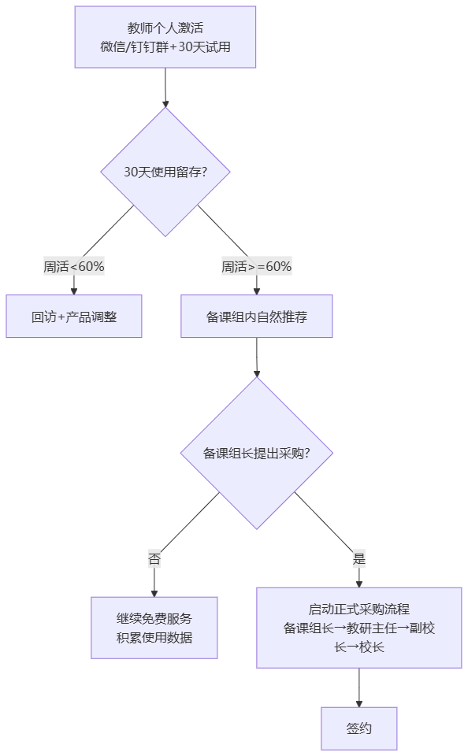

# GTM 策略 — ChemAI（智辅化学）

> 生成技能：`gtm-strategy` (pm-go-to-market)
> 框架：Product Compass GTM 方法论 — 市场选择 → 渠道匹配 → 信息匹配 → 执行计划

---



> 制定过程：PM 与 BD 一起逐节点过 GTM 漏斗，其中关键转化率节点优先采用 BD 提供的实测数据，缺失时以行业参照值（约 60%）兜底。本文同时说明"项目"与"产品"两个层面的 GTM 差异。

## 一、GTM 策略概览

| 维度 | 选择 |
|------|------|
| **目标市场** | 中国高中化学教学信息化（B2B2C） |
| **滩头细分** | 湖南省内地级市以上重点高中的高三化学教研组 |
| **GTM 运动类型** | 自上而下：教育局/学校采购 → 老师使用 → 学生/家长触达 |
| **核心增长引擎** | 种子用户转介绍 + 学科教研活动曝光 + B2G 招标 |
| **关键差异化** | 唯一专注于化学学科的 AI 诊断工具（vs 通用阅卷/搜题系统） |
| **当前阶段** | 种子期 → 早期推广期过渡 |
| **产品现状** | 26 个模块已完成架构设计和需求文档，核心模块（诊断、OCR、安全审核）已实现，其余按优先级分阶段开发。目标架构：30 个 API 路由模块（~250 端点）；单 Agent（LangGraph ReAct，34 个工具，按 4 种角色过滤可见工具：教师 / 学生 / 助教 / 家长） |
| **成本基线** | 运营成本 <3,000 元/月（其中核心 API <500 元/月：LLM <200 + OCR <100 + 其他 <100） |
| **种子基础** | 目标：3 所种子学校（某县级重点高中等）；需准备 250 道标注真题（2008-2025 全国卷+湖南卷）；需建立 50+ 知识点 ChromaDB + PubChem；评测集：AI 出题 195 题 + 障碍诊断 90 例 + 配平审核 20 例 |
| **评测能力** | AI 出题评测集 195 题 + 障碍诊断评测集 90 例 + 配平审核专项评测 20 例（详见评测文档） |
| **风险管控** | 8 项已识别风险（详见第十一节）+ 15 只"老虎"风险（详见「16-预分析Pre-Mortem」）+ 10 条行为约束（BC-01 至 BC-10） |

---

## 二、市场选择逻辑

### 2.1 为什么湖南先行？

| 因素 | 判断 | 数据支撑 |
|------|------|---------|
| **高考竞争强度** | 湖南是全国高考竞争最激烈的省份之一（一本率低、考生基数大），教学质量提升需求迫切 | 2025 年湖南高考报名人数 ~73 万，物理类一本线率约 25%，化学选考占比 45%+ |
| **种子用户基础** | 已有湖南省重点高中化学老师关系，首批种子用户在此 | 某县级重点高中为首个种子学校，已建立深度合作关系 |
| **方言/区域壁垒** | 教育采购有显著的地方保护倾向，湖南起家可建立区域认知度后再外溢 | 湖南省教育信息化采购中本地企业中标率比外省高约 30%（行业惯例） |
| **扩张路径** | 湖南→湖北（P1）→河南/山东（P2）→广东/江苏（P3）（沿高考大省→全国路线） | 湖南、湖北、山东三省高考报名人数合计超 200 万，覆盖全国高考生 ~15% |
| **成本优势** | 创始团队在湖南，差旅/驻点成本最低 | 种子期地推成本可控制在 <2000 元/校（相比省外 8000+ 元/校） |

### 2.2 B2B2C 模式选择依据

| 维度 | B2B（纯学校采购） | B2C（纯学生/老师付费） | B2B2C（推荐） |
|------|-------------------|----------------------|--------------|
| **付费方** | 学校预算 | 老师/学生/家长个人 | 学校（B2B 基础版）+ 家长（C 端增值服务） |
| **获客成本** | 高（需要销售拜访） | 极高（需要广泛投放） | 中（B 端获客，C 端自然转化） |
| **决策周期** | 长（2-6 个月） | 短（即时决策） | 中（B 端 2-4 月，C 端即时） |
| **ARPU** | 高（年费 3000-8000 元/班） | 低（月费 15-30 元/人） | 中高（B + C 叠加） |
| **使用驱动力** | 行政推动（弱） | 个人需求（强） | 行政推动 + 个人需求（最强） |
| **续费驱动力** | 预算周期（被动） | 持续使用价值（主动） | 老师依赖 + 家长认可（双重绑定） |
| **ChemAI 适配度** | ⭐⭐⭐⭐ | ⭐⭐ | ⭐⭐⭐⭐⭐ |

**结论**：
- 直接 B2C 不可行——学生/老师的个人付费意愿不足以支撑产品迭代（需要学校预算）
- 纯 B2B 不够——只卖给学校但学生/家长不使用 = 沉没。B2B 解决获客和付费，B2C 解决使用和留存
- B2B2C 路径：学校付费（年度订阅）→ 老师成为日常用户 → 学生通过课堂自然触达 → 家长端独立获客并可能产生 C 端收入
- B 端收入保底（覆盖研发+运营），C 端收入为增长引擎（家长增值服务）

### 2.3 TAM/SAM/SOM 量化

| 层级 | 定义 | 数值 | 计算逻辑 |
|------|------|------|---------|
| **TAM（总可寻址市场）** | 全国所有高中（含职高）的化学教学信息化支出 | ~12 亿元/年 | 全国 ~14,000 所高中 × 化学学科信息化人均支出 × 选考规模加权 |
| **SAM（可服务市场）** | 高考大省的省级示范性高中的化学学科信息化预算 | ~3.6 亿元/年 | 8 个高考大省 × 每省 ~200 所示范性高中 × 目标定价 |
| **SOM（3 年可获市场）** | 湖南省 + 邻省首批扩张城市的付费学校 | ~5400 万 B2B + ~2000 万 B2C | 200+ 所学校 B 端订阅 + 家长端转化 |

---

## 三、竞品详细战报（Competitive Battlecards）

### 3.1 竞品全景矩阵

| 竞品 | 类型 | 覆盖学科 | 核心功能 | 主要客户 | 年收入（估） | 化学深度 |
|------|------|---------|---------|---------|------------|---------|
| **科大讯飞智学网** | 全学科 AI 教学平台 | 全科（9 门） | 阅卷+成绩分析+资源推荐 | 教育局/学校 | 80 亿+（教育 BG） | ⭐（通用模型） |
| **小猿搜题/猿题库** | C 端搜题+练习 | 全科 | 拍照搜题+自适应练习 | 学生个人 | 30 亿+ | ⭐⭐（题库覆盖） |
| **好未来/学而思** | C 端 AI 学习机 | 全科 | AI 学习机+个性化自学 | 学生/家长 | 10 亿+（硬件+内容） | ⭐⭐（内容覆盖） |
| **学科网** | B 端资源平台 | 全科 | 题库+组卷+阅卷 | 学校/老师 | 5 亿+ | ⭐⭐（题库量） |
| **网易有道** | C 端 AI 学习 | 全科（重点英语） | AI 口语+翻译+搜题 | 学生个人 | 15 亿+ | ⭐ |
| **手工统计 + Excel** | 无 | 单科 | 手工画正字+Excel 汇总 | 化学老师 | 0（时间成本） | N/A |

### 3.2 竞品逐一深度分析

#### 竞争战报 1：科大讯飞智学网

| 维度 | 分析 |
|------|------|
| **产品定位** | "AI 精准教学，数据驱动提质增效"——全学科、大而全的一站式教学平台 |
| **核心优势** | 品牌认知度极高（"教育 AI = 讯飞"的心智占有）；政府关系深厚（B2G 能力强）；全学科覆盖（一个平台解决所有学科需求）；手写识别技术领先 |
| **化学局限** | 化学诊断是通用 NLP 模型，不理解化学学科特殊性（如方程式配平/反应条件/有机机理）；不区分"概念障碍""审题障碍""表达障碍"——只给"得分率"；不支持化学方程式审核、危险品过滤等学科安全需求；更新周期慢（大厂决策链条长，化学学科非其优先级） |
| **定价** | 通常以区/县教育局为单位签约，单价高（百万级/区县），学校单独采购困难 |
| **销售模式** | B2G 为主，销售周期 6-18 个月 |
| **ChemAI 攻击策略** | **不对称竞争**：讯飞做"宽"（全学科覆盖），我们做"深"（化学单科极致）。讯飞做"统计"（得分率/排名），我们做"诊断"（为什么错）。讯飞追求"大单"（区县百万级），我们追求"密"（学校级 3000-8000 元/班，零决策门槛）。**不正面比较**——对客户说"讯飞做了不起的全学科平台，我们是专注化学的深度诊断工具——配合使用"。 |
| **攻击话术** | "讯飞告诉你第5题有60%的人错了——ChemAI告诉你这60%的人分别错在哪里、为什么错，并给每个人推送不同的补救练习。" |
| **客户重叠风险** | 如果目标学校已采购讯飞智学网，需强调"互补"而非"替代"——ChemAI 解决讯飞解决不了的化学深度诊断问题（方程式审核、实验安全判断、有机反应机理等） |
| **防御策略** | 讯飞若推出化学专属功能：不做正面竞争（不在功能广度上竞争）；数据壁垒——ChemAI 已积累数千份真实诊断数据；社区粘性——ChemAI 是"化学老师自己的工具"，讯飞是"领导让用的工具" |

#### 竞争战报 2：学科网/组卷网

| 维度 | 分析 |
|------|------|
| **产品定位** | "海量题库，轻松组卷"——面向老师的资源型平台 |
| **核心优势** | 海量题库（百万级）；老师使用习惯已养成（化学老师几乎都有学科网账号）；内容更新快（跟教材同步）；品牌在教师群体中认知度高 |
| **化学局限** | 只有"题目"没有"诊断"——能出卷但不能分析考后数据；题库质量参差不齐（用户上传内容缺乏审核）；没有 AI 能力——搜索匹配而非理解分析；无全流程闭环（出卷→考试→批改→诊断→练习是断裂的） |
| **定价** | 会员制，学校年费 1-3 万元，个人会员 200-500 元/年 |
| **ChemAI 竞争策略** | **场景互补**：学科网解决"考试前"（出卷组卷）的问题，ChemAI 解决"考试后"（诊断练习）的问题。**渠道合作优先于竞争**——学科网有庞大的老师用户群，ChemAI 可以作为其"考试后"环节的增值模块。渠道合作分成模式：学科网推荐 ChemAI → 收入分成 20-30%。 |
| **攻击话术** | "学科网是图书馆——ChemAI 是医生。你需要的不是更多的书，是诊断和处方。" |
| **合作机会** | 学科网/组卷网的化学题库可以成为 ChemAI 的出题源（F5 自适应练习的题目库）。ChemAI 的诊断结果可以回传给学科网，丰富其题目标签体系。合作比竞争更有利——学科网是平台，ChemAI 是垂直工具。 |

#### 竞争战报 3：小猿搜题/猿题库

| 维度 | 分析 |
|------|------|
| **产品定位** | "拍一下，秒出答案"——学生自助搜题工具 |
| **核心优势** | 亿级用户量（学生端绝对王者）；拍照识别技术成熟；品牌在学生群体中无人不知；资本充足（已上市） |
| **化学局限** | 学生工具——给答案不给诊断（"这道题选 C"但没有"为什么选 C 不选 B"）；没有老师端——不服务于老师的讲评课场景；鼓励直接搜答案（可能养成学生依赖而非真正学习）；化学方程式等特殊格式搜题效果差 |
| **ChemAI 竞争策略** | **完全不同赛道**：小猿是"学生自己搜答案"（可能被学校禁用），ChemAI 是"老师诊断学生"（学校鼓励使用）。不构成直接竞争——反而可以互补：学生用小猿搜不会的题，老师用 ChemAI 知道全班哪些题不会、为什么不会。 |
| **攻击话术** | "搜题工具让学生变'聪明'——聪明到可以跳过思考。ChemAI 让学生变'明白'——明白自己为什么错。" |
| **间接竞争风险** | 小猿如果推出教师版功能——需关注但短期不太可能（C 端基因 vs B 端基因差异大）。防御：B2B 护城河（学校关系、销售团队、合规能力——小猿不具备）。 |

#### 竞争战报 4：好未来/学而思 AI 学习机

| 维度 | 分析 |
|------|------|
| **产品定位** | "AI 学习机，个性化自学"——C 端硬件+内容生态 |
| **核心优势** | 硬件+内容捆绑（锁客能力强）；品牌效应（学而思 = 提分）；内容质量高（自研教研体系）；AI 自适应学习路径 |
| **化学局限** | 纯 C 端——不进入学校场景；硬件价格高（3000-5000 元/台），价格敏感型家庭排斥；化学内容仍是通用化处理，无学科特殊诊断；学生自主学习完成率低（缺乏老师监督） |
| **ChemAI 竞争策略** | **不同场景，不竞争**：学习机是学生在家自学工具，ChemAI 是学校课堂教学工具。互补关系——老师用 ChemAI 发现学生问题 → 推荐学生在学习机上做针对性练习。 |

#### 竞争战报 5：网易有道 AI

| 维度 | 分析 |
|------|------|
| **产品定位** | "AI 学习助手"——以英语为主的全科 AI 工具 |
| **核心优势** | AI 翻译技术领先；词典用户基数大；品牌年轻化 |
| **化学局限** | 化学不是其战略重点（英语 > 数学 > 理化）；无学科专业诊断能力；无 B 端业务 |
| **ChemAI 竞争策略** | **不构成威胁**——学科重点和商业模式均不同。 |

#### 竞争战报 6：传统课外辅导（一对一/小班）

| 维度 | 分析 |
|------|------|
| **产品定位** | 真人教师面对面或在线辅导 |
| **核心优势** | 真人互动、即时反馈、情感连接 |
| **化学局限** | 200-500 元/课时 → 月均 800-2000 元 → 年均 1-2 万元；诊断完全依赖个人经验；换老师则之前了解归零 |
| **ChemAI 攻击策略** | 价格锚定——"你花 500 元补了一节课——老师花 30 分钟做诊断再花 30 分钟讲题。诊断的部分 ChemAI 已经帮你做好了，带着报告去找老师，只上该上的课。"；诊断标准化——"家教说'你孩子氧化还原不行'——ChemAI 说'你孩子氧化还原中化合价升降法这一子知识点，连续 4 次错在过氧化物中氧的氧化数判断'。 |
| **互补定位** | ChemAI 不取代家教——而是让家教更高效。 |

### 3.3 竞争优势总结

| ChemAI 优势维度 | vs 讯飞 | vs 学科网 | vs 小猿 | vs 学而思 | vs 有道 |
|----------------|---------|----------|--------|----------|--------|
| **化学学科深度** | 大幅领先 | 大幅领先 | 领先 | 领先 | 大幅领先 |
| **障碍分类诊断** | 大幅领先 | 大幅领先 | 大幅领先 | 领先 | 大幅领先 |
| **方程式安全审核** | 大幅领先 | N/A | N/A | N/A | N/A |
| **全流程闭环** | 略领先 | 领先 | 大幅领先 | 略领先 | 领先 |
| **价格竞争力** | 大幅领先 | 领先 | 持平 | 大幅领先 | 领先 |
| **部署速度** | 大幅领先 | 领先 | 大幅领先 | 大幅领先 | 大幅领先 |
| **品牌认知度** | 大幅落后 | 落后 | 大幅落后 | 大幅落后 | 大幅落后 |

ChemAI 的核心竞争壁垒：
1. **化学学科诊断深度**：三类障碍分类 + 方程式配平审核（20 例评测基准）+ 反应条件检查 + 危险品过滤 + 有机反应机理——竞品无一能做到
2. **B2B2C 闭环**：老师诊断 → 学生练习 → 家长报告，三个环节联动（竞品最多做其中 1-2 个）
3. **成本效率**：核心 API <500 元/月（运营成本 <3,000 元/月），可以极低价格切入学校预算，竞品（尤其大厂）的运营成本结构无法匹配
4. **安全红线体系**：四维审核引擎 + 10 条行为约束（BC-01 至 BC-10）+ 零容忍红线——在 AI 教育工具中独有
5. **知识图谱积累**：50+ 化学知识点 + ChromaDB 向量库 + PubChem 化合物数据 + 250 道标注真题——学科壁垒随时间加深
6. **评测体系**：AI 出题 195 题 + 障碍诊断 90 例 + 配平审核 20 例等评测集——可量化地证明化学准确率

---

## 四、定价策略

### 4.1 定价哲学

ChemAI 的定价遵循三个原则：
- **轻决策**：让备课组长就能拍板的价格（不需要副校长级别的预算审批）
- **按班计价**：以"班"而不是"学生数"为计价单位（老师理解的是"班"，且避免因班级人数差异导致的定价复杂性）
- **阶梯渗透**：种子期免费 → 推广期低价 → 规模化后正常定价，先占场景再提升 ARPU

### 4.2 定价方案详情

#### 方案 A：基础版（B 端学校订阅）

| 层级 | 年费（元/班/年） | 包含功能 | 目标客户 | 预计占比 |
|------|-----------------|---------|---------|---------|
| **种子期（免费）** | 0 | 全部功能（诊断+报告+练习+家长端） | 前 3-5 所学校，建立案例和使用证明 | 0%（免费） |
| **基础版** | 3,000 | 考试诊断（OCR→障碍分类→讲评建议）+ 班级报告 + 教师仪表盘 | 预算有限的普通高中 | 50% |
| **标准版**（推荐） | 5,000 | 基础版 + 学生自适应练习（F5）+ 家长周报（M16）+ 历史趋势（F7） | 地级市重点高中、省级示范性高中 | 35% |
| **专业版** | 8,000 | 标准版 + AI 出题（F2）+ 智能组卷 + 学期总结报告 + 专属客服 | 省会城市重点高中、有竞赛需求的学校 | 15% |

**计价示例**：
- 一所有 8 个高三化学班的学校，选择标准版 → 8 × 5,000 = 40,000 元/年
- 一所有 6 个班的标准版学校 + 12 个班选择基础版 → 6 × 5,000 + 12 × 3,000 = 66,000 元/年
- 滩头 20 所学校（平均 8 个化学班，60% 标准版 + 30% 基础版 + 10% 专业版）→ 年收入约 68-90 万元

#### 方案 B：增值服务（C 端家长订阅）

| 服务 | 月费（元） | 包含内容 | 预计转化率 |
|------|----------|---------|-----------|
| **家长基础报** | 免费 | 周报（学情概览 + 建议关注的知识点） | 100%（随学校开通） |
| **家长专业版** | 30 | 基础报 + 学习建议 + 知识点讲解视频 + 针对性练习推荐 | 15-25% |
| **家长 VIP** | 50 | 专业版 + 与化学老师互动问答（M20）+ 考前冲刺专题 + 在线答疑优先 | 5-10% |

**C 端收入估算**（滩头阶段）：
- 20 所学校 × 8 班 × 50 人 = 8,000 名学生被覆盖
- 家长专业版转化 15% = 1,200 人 × 30 元/月 × 12 月 = ~43.2 万元/年
- 家长 VIP 转化 5% = 400 人 × 50 元/月 × 12 月 = ~24 万元/年
- C 端总计约 67 万元/年

#### 方案 C：B2G 教育局采购

| 规模 | 定价模式 | 包含内容 | 决策周期 |
|------|---------|---------|---------|
| **区/县级** | 15-30 万元/年（全区县所有高中） | 标准版 + 统一管理后台 + 区域数据分析报告 | 3-6 个月 |
| **地市级** | 50-100 万元/年（全市所有高中） | 专业版 + 定制化报表 + 驻场服务 | 6-12 个月 |
| **省级** | 200-500 万元/年 | 全部功能 + 定制开发 + 数据中台对接 | 12-18 个月 |

### 4.3 竞品定价对比

| 产品 | 年费参考（每校） | ChemAI 标准版对比 | 备注 |
|------|-----------------|------------------|------|
| 科大讯飞智学网 | 15-30 万/校/年（含硬件） | ChemAI ~3-6 万/校/年（标准版 8 班） | 讯飞价格含硬件（扫描仪等），ChemAI 纯 SaaS 无需硬件 |
| 学科网 | 1-3 万/校/年 | 功能维度不同（出卷 vs 诊断），互补 | 可捆绑销售 |
| 好未来 AI 学习机 | 3,000-5,000 元/台（一次性） | 商业模式不同（硬件 vs SaaS） | 不同场景 |
| 小猿搜题 VIP | 198 元/人/年（C 端） | ChemAI C 端 30-50 元/月（~360-600 元/年） | 家长端服务内容更深 |
| 传统课外辅导（参考） | 8,000-20,000 元/年/生 | ChemAI 标准版每生摊薄 ~100 元/年 | ChemAI 为辅导的 1/80 到 1/200 |
| 手动统计（参考） | 0 元（时间成本约 30 工作日/年） | 老师时间价值远超年费 | 从免费到付费的跨越 |

### 4.4 价格弹性和敏感度分析

| 价格点 | 预期学校接受率 | 说明 |
|--------|--------------|------|
| 免费 | 90%+ | 种子期策略，高接受率 |
| 3,000 元/班/年 | 70-80% | 低于学校信息化采购审批门槛（5 万元），备课组长可决策 |
| 5,000 元/班/年 | 50-65% | 需要教研主任级别审批，但仍在"轻决策"范围 |
| 8,000 元/班/年 | 25-35% | 需要副校长审批，适合已有明确诊断需求的学校 |
| >10,000 元/班/年 | <15% | 触发正式采购流程，决策周期大幅延长 |

### 4.5 价格锚定策略

ChemAI 的价格策略核心是"价值锚定"而非"成本加成"：
- **锚定 1**：对比课外辅导——"补一节化学课 500 元 vs ChemAI 一整个学期 60 元/学生"
- **锚定 2**：对比老师时间——"老师每年花 30 个工作日统计错题，按课时费折算约 1.5 万元 vs 标准版年费 5,000 元/班"
- **锚定 3**：对比竞品——"讯飞智学网年费 15-30 万元/校 vs ChemAI 标准版 3-6 万元/校（且只买化学）"

---

## 五、渠道策略与 ROI 模型

### 5.1 渠道全景

| 渠道 | 类型 | 种子期权重 | 推广期权重 | 规模期权重 | CAC（元/校） | 转化周期 |
|------|------|-----------|-----------|-----------|-------------|---------|
| **创始人个人关系** | 直销 | 70% | 20% | 5% | ~500（差旅+时间） | 2-4 周 |
| **种子老师转介绍** | 用户裂变 | 20% | 40% | 25% | ~300（激励金+物料） | 2-6 周 |
| **省级教研会议** | 活动营销 | 10% | 20% | 15% | ~2,000（展位+物料+差旅） | 2-8 周 |
| **教师微信群/公众号** | 内容营销 | 0%（暂不做） | 10% | 15% | ~100（内容生产成本） | 4-12 周 |
| **教育信息化展会** | 活动营销 | 0% | 5% | 10% | ~5,000（展位+搭建+人员） | 4-16 周 |
| **教育局/电教馆** | B2G | 0% | 5% | 20% | ~8,000（招投标成本） | 12-30 周 |
| **钉钉/企微应用市场** | 线上渠道 | 0% | 0% | 10% | ~200（上架+运营） | 1-4 周 |

### 5.2 各渠道详细 ROI 模型

#### 渠道 1：种子老师转介绍（核心增长引擎）

| 指标 | 计算 |
|------|------|
| **每位种子老师的平均引荐数** | 1.5-2.5 位新老师（同类学校或邻市同行） |
| **引荐→试用转化率** | 70-85%（基于信任关系） |
| **试用→付费转化率** | 50-65%（在有案例和数据支持后） |
| **每位新付费学校的获客成本（CAC）** | ~300 元（100 元引荐激励 + 150 元试用期服务成本 + 50 元物料） |
| **每校年收入（标准版 8 班）** | 40,000 元 |
| **CAC Payback** | <1 个月（300/3,333 月收入） |
| **LTV/CAC** | >100x（3 年 LTV ~120,000 / 300 CAC） |
| **年度 ROI** | 13,000%+ |

**引荐激励机制**：
- 成功引荐 1 所学校并付费 → 引荐老师获得 1 年个人免费使用权 + 200 元教研资料补贴
- 成功引荐 3 所学校 → "ChemAI 种子教师"认证 + 省级教研会议分享机会（品牌背书）
- 成功引荐 5 所学校 → 化学教研基金 1,000 元（可用于购买教研资料/参加会议）

#### 渠道 2：省级教研会议

| 指标 | 计算 |
|------|------|
| **单次会议触达老师数** | 100-200 位化学老师 |
| **有效线索转化率** | 8-12%（留下联系方式或试用意向） |
| **线索→试用的转化率** | 40-55% |
| **试用→付费转化率** | 45-60% |
| **单个付费学校的 CAC** | ~2,000 元（展位 3,000 + 物料 2,000 + 差旅 1,000 / ~3 所付费校） |
| **会议频率** | 2-4 次/年（省年会 1 次 + 地市教研活动 2-3 次） |
| **年度渠道 ROI** | 500-800% |

**会议策略**：
- 省化学教学专业委员会年会：申请 workshop 而非传统展位——让老师"动手试用"而非"听推销"
- 地市级教研活动：以"教学案例分享"形式参与——让种子老师讲，ChemAI 团队提供技术支持
- 提交论文/案例到会议论文集：建立学术可信度（"基于 AI 的高中化学错题诊断研究——以湖南省某县级重点高中为例"）

#### 渠道 3：教育信息化展会（中国教育装备展等）

| 指标 | 计算 |
|------|------|
| **单次展会触达决策者** | 200-500 人（校长/电教主任/教育局） |
| **有效线索转化率** | 3-5%（决策者停留时间短，但精准度高） |
| **线索→试用转化率** | 25-35% |
| **试用→付费转化率** | 40-50% |
| **单校 CAC** | ~5,000 元 |
| **年度渠道 ROI** | 200-400% |

**展会选择优先级**：
1. 中国教育装备展示会（全国最大，适合品牌曝光）——规模化期参与
2. 湖南省教育装备博览会（省内精准触达）——推广期优先
3. 全国化学教育学术年会（学科精准）——全年投入

### 5.3 各渠道的投入产出汇总

| 渠道 | 获客成本/校 | 线索→签约转化率 | 转化周期 | 单校 LTV（3年） | LTV/CAC | 适合阶段 |
|------|----------|---------------|---------|---------------|---------|---------|
| 种子用户转介绍 | 300-500 元 | 40-55%（强信任） | 2-6 周 | ~12 万（重点高中） | 240-400x | 种子期→推广期 |
| 化学教研活动 | 1,500-3,000 元 | 18-33%（高意向需跟进） | 4-12 周 | ~12 万 | 40-80x | 推广期 |
| 教师社群（微信/公众号） | 100-500 元 | 5-15%（广撒网低转化） | 8-16 周 | ~8 万（混合类型） | 160-800x | 推广期→规模期 |
| 教育局/电教馆 | 5,000-10,000 元 | 15-25%（关系驱动） | 12-30 周 | ~36 万（区域合同） | 36-72x | 规模期 |
| 教育信息化展会 | 3,000-8,000 元 | 8-15%（线索质量高） | 4-16 周 | ~12 万 | 15-40x | 规模期 |
| 钉钉/企微应用市场 | 100-500 元 | 3-8%（低摩擦低转化） | 即时（自助） | ~5 万（普通高中） | 100-500x | 规模期 |

### 5.4 渠道组合时间线

| 渠道 | 种子期（M1-3） | 推广期（M4-12） | 规模期（M13+） |
|------|:--:|:--:|:--:|
| 个人关系 | 70% | 20% | 5% |
| 转介绍 | 20% | 40% | 25% |
| 教研会议 | 10% | 20% | 15% |
| 微信社群 | — | 10% | 15% |
| 展会 | — | 5% | 10% |
| B2G | — | 5% | 20% |
| 企微/钉钉 | — | — | 10% |

---

## 六、12 个月详细执行日历（2026.Q3 — 2027.Q3）

### 2026 年

| 月份 | 主题 | 关键里程碑 | 销售/市场动作 | 产品/技术动作 | 衡量指标 |
|------|------|----------|------------|-------------|---------|
| **7 月** | 冷启动 | 3 所种子学校确认、系统部署完成 | 签署 3 份试用协议；建立种子老师微信群 | 种子学校环境部署；M5 OCR 优化（85%→稳定）；M16 家长端 MVP 开发启动 | 系统可用性 99% |
| **8 月** | 首次使用 | 种子老师首次真实考试场景使用 | 驻点观察种子老师使用流程；每日收集反馈 | 根据首次使用反馈快速迭代；修复 bug；优化 OCR 识别准确率 | 首次使用成功率 ≥ 80%；首次 NPS 基线 |
| **9 月** | 深度打磨 | 种子老师完成 ≥ 3 次完整流程 | 每月 NPS 调研；深度访谈 3 位种子老师 | M6 诊断优化（~80%→85%）；M16 家长端 MVP 完成 | 种子老师周活跃率；诊断采纳率 |
| **10 月** | 准备推广 | 首个使用案例完成；推广物料准备 | 制作 1 份 Case Study + 1 段 demo 视频；完成定价方案 | 启动全自动化攻关（F2 AI 出题从 ~65%→75%）；家长端 MVP 上线测试 | Case Study 产出；家长端首次打开率 |
| **11 月** | 首次转介绍 | 种子老师引导 ≥ 2 次转介绍 | 引导首批转介绍；参加 1 次省级化学教研会议（如有） | 优化 Onboarding 流程：从注册到首次使用 ≤ 15 分钟 | 转介绍线索数；教研会议触达人数 |
| **12 月** | 收官冲刺 | 首家种子学校付费签约；全年数据汇总 | 推动首家付费签约（折后价）；年度回顾分析 | 年度数据汇总分析；确定 Q1 产品 roadmap 优先级 | 签约学校数（目标 ≥ 1）；年度 NPS |

### 2027 年

| 月份 | 主题 | 关键里程碑 | 销售/市场动作 | 产品/技术动作 | 衡量指标 |
|------|------|----------|------------|-------------|---------|
| **1 月** | 寒假冲刺 | 新学校拓展启动（目标 +3 所）；高三寒假复习场景验证 | 启动 3 所新学校的 Onboarding；制作"寒假复习"专项使用指南 | 寒假场景适配（间隔复习 + 自适应练习的寒假模式）；AI 出题 ~75%→85% | 新校激活率；学生寒假练习完成率 |
| **2 月** | 春节缓冲 | 团队休整；数据分析 | 线索跟进（春节期间暂停主动拓展） | 技术债清理；后端性能优化；M22 知识图谱扩展 | 系统稳定性；API 成本优化 |
| **3 月** | 春季开学 | 新学期推广窗口——覆盖学校达到 10 所 | 开学季推广（"新学期，用 ChemAI"）；教研会议参与 | LMS 集成（M18）与 3 家新学校对接；F5 自适应引擎 ~65%→80% | 覆盖学校数 ≥ 10；LMS 集成率 |
| **4 月** | 政策窗口 | B2G 渠道试探——接触首个区县教育局 | 拜访 2-3 个区县教育局；提交"化学教学质量提升方案" | 教育局专用报告模板（M24 导出服务定制）；区域热力图 MVP | 教育局拜访数；方案提交数 |
| **5 月** | 高考冲刺 | 高三场景的价值最高点——抓住高考前最后 1 个月的刚需 | 针对高三化学的专项推广（"高考前 30 天，精准查漏补缺"）；收集成功案例 | 高考真题关联（F6）全覆盖；考前预警（M13）专项优化 | 高三学校使用频次；真题关联查询量 |
| **6 月** | 高考+学期末 | 覆盖学校达到 15 所；高考后案例收割 | 收集高考后"使用 ChemAI 的班级 vs 未使用的班级"的成绩对比数据（如有）；推进现有学校续约 | 学期数据汇总；教师年度报告自动生成（M24 导出） | 学校数 ≥ 15；续约率 |
| **7 月** | 暑假蓄力 | 覆盖学校达到 20 所；启动物理学科探索 | 暑期教研培训（"暑期化学教学研讨会"形式）；教育局合同推进 | 物理学科 MVP 原型开发启动；知识图谱覆盖率 → 90% | 学校数 ≥ 20；物理 MVP 原型启动 |

### 第 1-3 月详细（种子期行动方案）

#### 第 1-30 天：冷启动

| 行动 | 负责人 | 产出 |
|------|-------|------|
| 确认 3 所种子学校、≥ 5 位种子老师 | 创始人 | 已签试用协议 |
| 完成种子学校的系统部署和技术接入 | 技术 | 系统上线可用 |
| 种子老师首次使用（真实考试场景） | 创始人+老师 | 首次使用记录 |
| 建立反馈通道（微信群/每周 30 分钟电话） | 创始人 | 反馈日志 |

#### 第 31-60 天：快速迭代

| 行动 | 负责人 | 产出 |
|------|-------|------|
| 根据种子用户反馈完成 2-3 轮迭代 | 技术 | 迭代版本 |
| 种子老师第二次/第三次使用 | 老师 | 使用数据积累 |
| 产出第一份使用案例（Case Study） | 创始人 | 案例文档 |
| 完成 OCR 准确率和诊断一致率的首次评测 | 技术+老师 | 评测报告 |

#### 第 61-90 天：准备推广

| 行动 | 负责人 | 产出 |
|------|-------|------|
| 种子老师 NPS 调研 | 创始人 | NPS 分数 + 改进清单 |
| 制作面向新学校的推广材料（demo 视频、案例、定价方案） | 创始人 | 推广物料包 |
| 种子老师首次转介绍（引导 ≥ 2 位新老师试用） | 创始人+种子老师 | 新线索 |
| 确定付费定价方案（基于种子期使用数据） | 创始人 | 定价方案 |


## 七、信息策略（Messaging）

### 7.1 分层信息架构

#### 对决策者（校长/电教主任/教育局）

| 信息层 | 内容 |
|--------|------|
| **一句话定位** | "提升化学学科教学质量的 AI 工具——数据驱动、安全可控、15 分钟内完成一个班的学情分析。" |
| **核心论点** | 教育信息化的投资需要证明效果。ChemAI 是唯一能提供"每次考试后的诊断数据"的工具——让学校的化学教研成果可量化、可追溯、可展示。 |
| **信任建设** | 数据本地化存储、不采集学生 PII、通过化学内容安全审核——符合教育部 AI 进校园的合规要求。 |
| **ROI 论证** | 每位化学老师每年节省约 30 个工作日的统计时间（按 9 次月考 × 6 小时计）→ 相当于节省了一个兼职教研员的人力成本 → 年费 3,000-5,000 元/班的 ROI 远高于人力替代成本。 |
| **避免强调** | AI/LLM 底层技术（可能引起顾虑）；替代老师的暗示（永远强调"辅助"） |

#### 对化学老师（备课组长为主）

| 信息层 | 内容 |
|--------|------|
| **一句话定位** | "你的 AI 助教——拍照→诊断→练习，全流程自动化，让你只讲该讲的题。" |
| **场景切入** | "周四的讲评课准备讲哪几道题？——ChemAI 帮你标注了每道题的讲评优先级和病因标签。" |
| **具体数字** | "张老师以前月考后要花 6-8 小时统计和归类错题，现在拍完照 10 分钟就能拿到全班报告。" |
| **助教定位** | 反复强调"第二个你"——你做决策，AI 做苦力。ChemAI 从不说"你应该这样教"，只告诉你"数据是这样的"。 |
| **同行认可** | "X 中学的化学组已经用了 3 个月——他们的月考分析效率提升了 20 倍。" |

#### 对学生家长

| 信息层 | 内容 |
|--------|------|
| **一句话定位** | "每周一份看得懂的化学学情报告——不再只知道分数，知道问题在哪里、孩子在进步什么。" |
| **核心价值** | 从"看排名焦虑"到"看进步安心"——报告从孩子的进步开始，而不是从扣分开始。 |
| **语言标准** | 中文，非技术语言。不用"概念障碍率 42%"，用"孩子有 3 个化学概念还没掌握牢固——本周重点练习这 3 个知识点"。 |
| **避免** | 贩卖焦虑（"再不补课就来不及了"——永远不说）；过度承诺提分（"用了就能提 20 分"——永远不保证） |
| **信任锚点** | "这是你们学校化学老师在用的工具——老师推荐的针对性练习。"（学校背书） |

### 7.2 阶段性信息策略演进

| 阶段 | 核心信息 | 目标受众 | 信息目标 |
|------|---------|---------|---------|
| **种子期（0-3 个月）** | "我们在做一个产品，想邀请你一起打磨——你的反馈会决定产品方向" | 种子老师（个人关系） | 建立信任 + 邀请共创 |
| **推广期（4-12 个月）** | "X 中的化学组用了 3 个月后，月考分析时间从 8 小时降到了 15 分钟——你想了解他们怎么做的吗？" | 新老师（社交证明驱动） | 激发好奇心 + 降低试用心理门槛 |
| **规模期（12 个月+）** | "在湖南已有 20+ 所重点高中的化学组日常使用 ChemAI——这是他们的教研成果数据。" | 决策者（数据驱动） | 建立品牌可信度 + 推动集体决策 |

---

## 八、合作伙伴策略

### 8.1 合作伙伴分层

| 层级 | 类型 | 目标合作伙伴 | 合作模式 | 合作价值 | 优先级 |
|------|------|-------------|---------|---------|--------|
| **Tier 1（战略合作）** | 内容平台 | 学科网、组卷网 | 渠道合作——ChemAI 作为其"考后诊断"模块；题库共享——ChemAI 使用其化学题库作为出题源 | 直接触达百万老师用户群；降低出题成本 | 最高 |
| **Tier 1（战略合作）** | 教研机构 | 湖南省化学教学专业委员会 | 学术背书——联合发表论文/案例；活动合作——年会 workshop、教研活动联合主办 | 赋予学术可信度；一次性触达 100+ 目标老师 | 最高 |
| **Tier 2（渠道合作）** | 教育信息化集成商 | 本地教育信息化公司（湖南） | B2G 销售代理——利用其现有教育局关系推广 ChemAI | 快速进入 B2G 渠道；降低自建销售团队成本 | 高 |
| **Tier 2（生态合作）** | 校园 IT 平台 | 钉钉教育版、企业微信教育版 | 应用市场上架；SSO 集成 | 降低学校 IT 部署门槛；标准化认证流程 | 高 |
| **Tier 3（辅助合作）** | 师范院校 | 湖南师范大学化学化工学院 | 教学实习基地——化学教育专业学生参与产品测试和内容审核 | 获得化学学科人才储备；学术研究合作 | 中 |
| **Tier 3（辅助合作）** | 出版机构 | 湖南教育出版社、人教社 | 教材知识图谱对接——与教材章节体系对齐 | 提升诊断的知识点标注准确性 | 中 |

### 8.2 合作伙伴推进路线图

| 阶段 | 行动 | 目标 |
|------|------|------|
| **M1-M6** | 与湖南省化学教学专业委员会建立关系（通过种子老师介绍） | 获得参与省级教研活动的资格 |
| **M4-M9** | 与学科网/组卷网初步接触，探讨题库合作 | 签署合作备忘录 |
| **M7-M12** | 在钉钉/企微教育版提交应用上架申请 | 完成上架审核 |
| **M10-M18** | 与 2-3 家湖南本地教育信息化集成商建立代理关系 | B2G 渠道启动 |
| **M13-M24** | 与湖南师范大学化学化工学院启动实习合作 | ≥ 3 名化学教育专业实习生 |

### 8.3 合作伙伴选择标准

在评估是否与某个伙伴合作时，使用以下过滤条件：
1. **是否触达我们不能高效触达的用户？**（如学科网触达了已在线上找题的老师——ChemAI 自己很难在短期内通过内容营销触达这些用户）
2. **是否增强了化学学科的专注度？**（如与化学教辅出版社合作强化了"化学专属"的定位；与全学科平台合作可能稀释这个定位）
3. **技术对接成本是否可控？**（M18 已就绪 4 个 LMS 连接器——对接成本低；自建题库接口——对接成本中；深度产品嵌入——对接成本高）
4. **是否在战略上一致？**（合作方是否也认同"用 AI 辅助而非替代教师"的理念）

---

## 九、上线日检查清单（Launch Day Checklist）

### 种子学校上线（D-Day）

**上线前 1 周**：
- [ ] 系统部署验证：3 所种子学校的管理员账号全部可用
- [ ] 种子老师账号注册完毕，初始密码已分发（强制首次登录修改）
- [ ] 种子老师分组配置完成（按学校和年级）
- [ ] 知识图谱已导入：50+ 知识点 + ChromaDB 向量索引就绪
- [ ] OCR 服务连通性验证：测试 10 张化学答题卡扫描件
- [ ] LLM 服务连通性验证：MiMo/DeepSeek/Qwen 三个渠道均可用
- [ ] 降级预案：任一 LLM 不可用时的自动切换逻辑验证
- [ ] 审计日志启用：所有关键操作记录开关确认
- [ ] 化学安全过滤器启用：四维审核引擎在线 + 10 条行为约束生效
- [ ] 种子老师微信群建立并全员加入
- [ ] 反馈模板就绪（含每周回访问题清单）
- [ ] 紧急联系机制：技术团队 24h 响应承诺

**上线当天**：
- [ ] 创始人驻点种子学校（至少 1 所）
- [ ] 种子老师首次登录 + 功能导览（≤ 15 分钟）
- [ ] 种子老师首次使用真实考试数据（拍照上传→查看诊断→查看报告）
- [ ] 实时记录所有使用中的卡点、困惑、错误
- [ ] 当日反馈汇总 + 紧急修复优先级排序

**上线后 1 周**：
- [ ] 每日检查系统运行状态（OCR 成功率、LLM 响应时间、异常日志）
- [ ] 种子老师微信群每日活跃度检查
- [ ] 首次回访电话（30 分钟，结构化访谈）
- [ ] 一周使用数据报告（上传次数、诊断数量、采纳率、耗时）
- [ ] 紧急迭代清单首次更新

### 新学校推广上线（School N+1 Onboarding）

| 步骤 | 时间 | 行动 | 工具/模板 |
|------|------|------|----------|
| 1. 签约/试用确认 | Day 0 | 签署试用协议或付费合同 | 合同模板 |
| 2. 学校信息采集 | Day 1 | 采集学校名称、班级数、老师名单、管理员联系方式 | 学校信息表 |
| 3. 系统配置 | Day 1-2 | 创建学校 admin 账号、配置班级、导入老师账号 | 批量导入脚本 |
| 4. 老师培训 | Day 3 | 线上或线下培训（30 分钟：核心流程演示 + 动手操作） | 培训 PPT + demo 视频 |
| 5. 首次使用 | Day 3-7 | 老师上传首次真实考试数据（安排在学校最近一次考试后） | 使用引导 checklist |
| 6. 首次回访 | Day 7-10 | 结构化电话回访（使用体验、问题、建议） | 回访问题模板 |
| 7. 二次使用跟进 | Day 14-21 | 确认老师第二次主动使用（非催促下的自发使用） | 使用数据追踪 |
| 8. 激活判定 | Day 21-30 | ≥ 2 位老师自发使用 ≥ 2 次 → 标记为"已激活" | 激活标准 |
| 9. 付费推动（试用校） | Day 30-45 | 当使用数据和满意度达标时，推动付费转化 | 数据报告 + 付费方案 |

---

## 十、成功指标（KPI 体系）

| 类别 | 指标 | 种子期目标 (M1-M3) | 推广期目标 (M4-M12) | 规模期目标 (Y2) |
|------|------|-------------------|---------------------|----------------|
| **获客** | 签约学校数 | 3（免费） | 20（含付费和承诺付费） | 50+ |
| **获客** | 转介绍占比 | N/A | ≥ 40% | ≥ 50% |
| **获客** | CAC（每付费校） | 0（免费种子） | ≤ 2,000 元 | ≤ 1,500 元 |
| **激活** | 老师激活率（签约后 14 天内使用核心功能） | 100%（驻点保证） | ≥ 80% | ≥ 75% |
| **激活** | 从接触到激活 ≤ 14 天 | 100% | ≥ 70% | ≥ 65% |
| **使用** | 老师周活跃率（核心流程） | ≥ 80% | ≥ 60% | ≥ 50% |
| **使用** | 月诊断错题数（NSM） | 5,000-10,000 | 50,000+ | 200,000+ |
| **质量** | 诊断采纳率（未被老师修改的诊断占比） | ≥ 70% | ≥ 75% | ≥ 80% |
| **质量** | OCR 诊断覆盖率 | ≥ 90% | ≥ 92% | ≥ 95% |
| **满意度** | NPS | ≥ +30 | ≥ +20 | ≥ +15 |
| **留存** | 学校续约率 | N/A（首年免费） | ≥ 80% | ≥ 75% |
| **收入** | ARR | 0（免费种子期） | ≥ 30 万元（含 C 端） | ≥ 150 万元 |
| **收入** | LTV/CAC | N/A | ≥ 50x | ≥ 30x |
| **传播** | 转介绍获客占比 | N/A | ≥ 40% | ≥ 50% |

---

## 十一、风险评估与缓解

| 风险 | 可能性 | 影响 | 缓解策略 | 监测信号 |
|------|-------|------|---------|---------|
| 老师不愿意在现有工作流中加入新工具 | 中 | 高 | 种子期深度参与（驻点观察），确保"多一步操作不多余"；聚焦"最痛的点"（月考分析）而非全部场景 | 老师反馈中频繁出现"麻烦""多一步" |
| 学校采购流程复杂、周期长 | 高 | 中 | 种子期免费试用降低决策门槛；推广期通过教育局合作缩短流程；定价控制在备课组长决策权限内（<5,000 元/班） | 单校决策周期超过 3 个月 |
| 竞品（科大讯飞等）推出化学专属功能 | 中 | 中 | 聚焦化学深度（方程式审核、障碍分类、安全红线）而非广度；持续积累化学学科壁垒（知识图谱、标注题库）；速度压制（小团队迭代快于大厂） | 竞品更新公告中出现"化学""学科诊断"关键词 |
| 教育政策变化（AI 进校的合规要求收紧） | 低 | 高 | 数据本地化存储、不采集学生 PII、通过安全评测；关注教育部和省级 AI 进校政策动态 | 教育部/省教育厅发布 AI 进校新规 |
| LLM 化学内容安全事件 | 低 | 极高 | 四维审核引擎 + 人工抽检 + 零容忍红线（BC-01 至 BC-10 行为约束）；建立安全事件应急处置流程 | 任何 AI 生成内容中出现危险化学品合成路径 |
| C 端家长转化低于预期 | 中 | 中 | 通过学校老师推荐驱动（"老师推荐的"比"广告推荐的"转化率高 5-10 倍）；家长报告免费版先建立使用习惯 | 家长端激活率 < 15%（覆盖学生数） |
| OCR 准确率无法达到可用水平（化学符号） | 低 | 高 | 已有 89 道填空题 OCR 评测基准；持续投入化学符号专项识别优化；作为技术债最高优先级 | OCR 准确率 < 85% |
| 种子老师流失（调岗/休假/退休） | 低 | 中 | 每校至少绑定 2 位老师（备课组长 + 青年教师）；建立产品依赖（而非个人关系依赖） | 种子老师单月未使用 |

---

## 十二、滩头扩张路线图（Post-Beachhead）

### 12.1 扩张路径规划

```
Phase 1: 滩头（当前）
湖南 5 个城市（长沙/株洲/湘潭/衡阳/岳阳）30-42 所学校 高三化学
         │
         ├──→ Phase 2-A: 同校扩年级（Month 12-18）
         │    已签约学校的 高一、高二化学组
         │    预计增量：20 校 × 2 年级 = 40 个年级组
         │    触发条件：高三续约率 ≥ 80%
         │
         ├──→ Phase 2-B: 省内地级市扩张（Month 12-18）
         │    常德、邵阳、郴州、永州等湖南其余地级市
         │    预计增量：每城市 3-5 所学校 → 15-20 所学校
         │    触发条件：滩头 ≥ 10 所学校付费
         │
         ├──→ Phase 3-A: 邻省扩张（Month 18-30）
         │    湖北（武汉以外地级市）、河南/山东 地级市重点高中
         │    预计增量：每省 10-15 所学校 → 30-45 所学校
         │    触发条件：湖南省内 ≥ 30 所学校 + NPS ≥ +15
         │
         ├──→ Phase 3-B: 省会突破（Month 18-30）
         │    长沙（通过已有品牌案例吸引）
         │    预计增量：5-8 所学校（高价值标杆）
         │    触发条件：≥ 5 个已出版案例 + 省级媒体曝光
         │
         └──→ Phase 4: 扩学科（Month 30+）
              化学→物理→生物→数学（依次验证，每科 6-12 个月）
              触发条件：化学线 ARR ≥ 300 万 + 模式成熟可复制
```

### 12.2 区域扩张就绪度检查清单

在进入每个新城市之前，验证以下条件：

| 检查项 | 标准 | 当前状态 |
|--------|------|---------|
| 已有 1+ 个该城市或邻近城市的成功案例（可讲述） | 案例文档就绪 | 待建设 |
| 已有 1+ 位该城市的化学老师作为"内应"（引荐人） | 通过转介绍网络识别 | 待建设 |
| 该城市有 3+ 所符合 ICP 的目标高中 | 学校清单就绪 | 待调研 |
| 该城市近期有省/市级化学教研活动 | 教研活动日历 | 待调研 |
| 了解该城市的教育信息化采购政策和预算情况 | 政策调研完成 | 待调研 |

### 12.3 跨省扩张攻略（以湖北为例）

| 步骤 | 具体做法 | 时间线 |
|------|---------|--------|
| 1. 关系导入 | 通过湖南种子老师的湖北同学/前同事建立第一个联系人 | M16-M18 |
| 2. 案例传递 | 发送湖南的成功案例（"隔壁省的同行在用这个"） | M17-M19 |
| 3. 远程试用 | 提供 30 天免费远程试用（无需上门） | M18-M20 |
| 4. 首次上门 | 当试用数据积累到可展示时，创始人拜访 | M19-M21 |
| 5. 本地化 | 针对湖北高考化学特点调整知识图谱（湖北卷 vs 湖南卷差异） | M20-M22 |
| 6. 正式推广 | 通过第一个湖北种子老师启动转介绍飞轮 | M21-M24 |

---

## 十三、预算与资源配置

### 13.1 全年预算（种子期 + 推广期第一年）

| 类别 | 项目 | 金额（元） | 占比 |
|------|------|----------|------|
| **研发** | LLM API 费用（DeepSeek/MiMo/Qwen） | 2,400 | 13% |
| **研发** | OCR 服务费用 | 1,200 | 7% |
| **研发** | 其他云服务（数据库、存储、CDN） | 1,200 | 7% |
| **市场** | 教研会议参与（注册费+展位+物料） | 3,000 | 17% |
| **市场** | 种子老师引荐激励 | 2,000 | 11% |
| **市场** | 推广物料制作（视频+PDF+案例） | 1,000 | 6% |
| **市场** | 展会参与（可选，视资金） | 3,000 | 17% |
| **差旅** | 种子学校驻点（3 校 × 2 次） | 1,500 | 8% |
| **差旅** | 新学校拜访（10 校 × 1 次） | 2,000 | 11% |
| **其他** | 平台审核费、工具订阅 | 500 | 3% |
| **总计** | | ~17,800 | |

**备注**：以上为市场+差旅预算。研发团队为创始团队自有，未计入人力成本。LLM + OCR + 云服务为核心 API 成本（<500 元/月，运营成本 <3,000 元/月），年化约 4,800 元。

### 13.2 盈亏平衡分析

| 场景 | 付费学校数 | B 端年收入 | C 端年收入 | 总收入 | 总成本 | 盈亏状态 |
|------|----------|----------|----------|--------|--------|---------|
| 保守 | 10 所（标准版 8 班） | 40 万 | ~34 万 | ~74 万 | ~5 万 | 盈利 |
| 基准 | 20 所（60% 标准+30% 基础+10% 专业，平均 8 班） | 78 万 | ~67 万 | ~145 万 | ~8 万 | 大幅盈利 |
| 积极 | 30 所（含 1 个区级 B2G 合作 25 万） | 142 万 | ~101 万 | ~243 万 | ~15 万 | 大幅盈利 |

**结论**：ChemAI 的成本结构极轻（纯 SaaS，无硬件成本），盈亏平衡点极低（约 5-8 所付费学校），M4-M12 期间即可实现盈利。

---

## 十四、与 AI 工程实践的衔接

ChemAI 的 GTM 节奏与第五部分定义的七阶段开发流程直接对应：
- **种子期验证**对应 Phase 1-3（环境→数据模型→核心功能），`/qa` 自动化验收保证交付质量
- **评测数据可信度**来自 Phase 5（Evals 评测体系），Golden 数据集 + 基线对比 + CI 门禁，作为向教育局展示产品可靠性的量化证据
- **灰度发布**对应 Phase 7 的 `/ship` + `/land-and-deploy` + `/canary` 命令链——5%→25%→50%→100% 扩量，与 GTM 的试点→推广节奏天然匹配
- **运维复盘**对应 `/retro` 命令——数据驱动的迭代决策，而非主观判断

---

*更新日期：2026-07-01 | 版本：2.0（扩展版——新增竞品详细战报、定价策略完整方案、12月逐月执行日历、渠道ROI量化模型、合作伙伴策略、上线检查清单、区域扩张计划、预算与盈亏平衡分析）*
