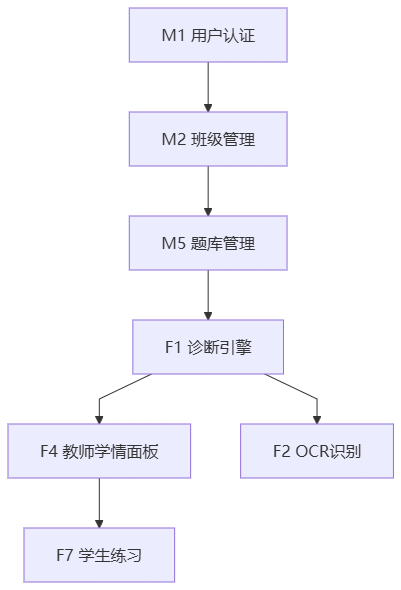
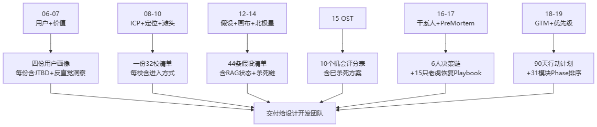

# 功能优先级排序 -- ChemAI（智辅化学）

> **前提阅读**：本文档的 Reach（覆盖用户数）维度和 Stakeholder Weight（干系人权）维度依赖于产品进入市场的策略——先打哪类学校、先触达哪类用户。GTM 策略详见本文档前一篇「17-GTM策略」——它紧排在本文档之前，是功能优先级排序的前置输入。
>
> 本文档也引用了第三部分已阅读的 13-北极星指标（衡量 Impact 的标尺）和 15-干系人地图（确定 Stakeholder Weight 的依据）。

---

## 一、排序方法论

ChemAI 的功能排序采用多层评分体系，最终汇聚为综合优先级。排序方法同时采用 **ICE**（MVP 阶段主用）与 **RICE**（规模化阶段主用），再叠加 Kano 分类、风险调整与利益相关者加权，详见下表：

| 维度 | 定义 | 评分标准 | 用途 |
|------|------|---------|------|
| **Impact（影响）** | 该功能对北极星指标（月诊断错题数）的拉动程度 | 1-10 分 | 核心驱动力 |
| **Confidence（信心）** | 对该功能会成功的确定性 | 1-10 分 | 风险缓冲 |
| **Ease（容易度）** | 开发成本（时间/复杂度/风险）的倒数 | 1-10 分 | 资源约束 |
| **Reach（覆盖）** | 种子期/规模化后触达的用户数 | 1-10 分 | 规模化后启用 |
| **ICE Score** | Impact x Confidence x Ease | 越高越优 | MVP 阶段主要依据 |
| **RICE Score** | (Reach x Impact x Confidence) / (Ease x 10) | 综合考虑 | 规模化阶段使用 |
| **Risk Adjustment** | 技术风险 + 市场风险 + 合规风险的折扣系数 | 0.5-1.0 | 风险修正 |
| **Kano Classification** | 魅力/期望/必备/无差异/反向 | M/A/E/I/R | 用户感知分类 |
| **Stakeholder Weight** | 教师/学生/家长/管理员的加权重要性 | 教师x0.4/学生x0.25/家长x0.25/管理员x0.1 | 多角色平衡 |

注：MVP 阶段（种子期）以 ICE 为主。进入推广期后逐步引入 RICE 和 Stakeholder Weight。

---

## 二、ChemAI 全功能模块清单（7 核心功能 + 26 支持模块 = 33 项）

### 2.1 核心功能模块（F 系列）

| 编号 | 功能 | 模块定位 | 依赖 | 当前状态 |
|------|------|---------|------|---------|
| **F1** | OCR 答题卡识别 | 价值链入口 | M1(用户), M2(班级) | ✅ 已完成 |
| **F2** | 四维化学方程式审核引擎 | 内容安全红线 | 独立（已被 F4/F5 依赖） | ✅ 已完成 |
| **F3** | 双层错误报告（教师版+学生版） | 价值交付 | F1(OCR), F4(诊断) | ✅ 已完成 |
| **F4** | 障碍类型诊断（概念/审题/表达） | 核心差异化 | F1(OCR), F2(审核) | ✅ 已完成 |
| **F5** | 自适应练习 | 诊断后的行动 | F4(诊断), M22(知识图谱) | ✅ 已完成 |
| **F6** | 历史真题关联 | 数据壁垒 | M22(知识图谱), 真题向量库 | ✅ 已完成 |
| **F7** | 班级学情仪表盘 | 备课组长视角 | F4(诊断), F3(报告) | ✅ 已完成 |

### 2.2 支持模块（M 系列）

| 编号 | 功能 | 模块定位 | 依赖 | 当前状态 |
|------|------|---------|------|---------|
| **M1** | 用户认证 + 角色权限（admin/teacher/student/parent） | 系统底座 | 无 | ✅ 已完成 |
| **M2** | 学校/班级管理 | 多租户数据隔离 | M1 | ✅ 已完成 |
| **M3** | 教师申请与审批 | 访问控制 | M1, M2 | ⏳ 待开发 |
| **M4** | 学生管理（批量导入/分班） | 基础数据 | M1, M2 | ⏳ 待开发 |
| **M5** | 答题卡管理（上传/存储/状态） | OCR 的数据源 | M2, M4 | ✅ 已完成 |
| **M6** | 诊断结果存储与查询 | 数据持久化 | F4 | ✅ 已完成 |
| **M7** | 练习管理（题目库/推送/追踪） | 练习的基础 | F5, M22 | ⏳ 待开发 |
| **M8** | 学习计划（长期规划/拆解） | 诊断后的扩展 | F4, M22 | ⏳ 待开发 |
| **M9** | 试卷管理（导入/解析/标注） | 考试管理 | F1, M5 | ⏳ 待开发 |
| **M10** | 成绩管理（分数录入/统计） | 基础统计 | M5 | ⏳ 待开发 |
| **M11** | 教研协作（组内共享/讨论） | 备课组协作 | M1, M2 | ❌ 未实施 |
| **M12** | 间隔复习（艾宾浩斯遗忘曲线） | 学生留存 | F5, M7 | ⏳ 待开发 |
| **M13** | 预警系统（成绩下滑/未完成练习） | 主动干预 | F4, M7, M16 | ⏳ 待开发 |
| **M14** | 数据导出（Excel/CSV） | 数据可携带性 | M6, M10 | ⏳ 待开发 |
| **M15** | 数据分析看板（校级） | 学校管理视角 | F7, M14 | ❌ 未实施 |
| **M16** | 家长端（周报推送/进度查看） | B2B2C 关键环 | F4, F3, M13, M17 | ⏳ 待开发 |
| **M17** | 通知推送（微信/短信/App内） | 触达渠道 | M1, M16, M13 | ⏳ 待开发 |
| **M18** | LMS 集成（钉钉/企业微信/SSO） | 系统对接 | M1, M2 | ❌ 未实施 |
| **M19** | 审计日志 | 合规追溯 | M1, 全局 | ✅ 已完成 |
| **M20** | Agent 对话（单 Agent + 工具编排） | AI 交互层 | F4, F5, F6 | ✅ 已完成 |
| **M21** | MCP Server（开发者工具） | 生态开放 | M20 | ❌ 未实施 |
| **M22** | 化学知识图谱 | AI 底座 | 独立（被F4/F5/F6依赖） | ⏳ 待开发 |
| **M23** | 文档解析（Word/PPT/PDF） | 内容导入 | F1 | ⏳ 待开发 |
| **M24** | 导出服务（Word/PDF 报告） | 报告交付 | F3, F7, M16 | ❌ 未实施 |
| **M25** | 浏览器自动化（Playwright） | 自动化工具 | 独立 | ✅ 已完成 |
| **M26** | 系统配置与运维 | 运维管理 | M1, M2 | ⏳ 待开发 |

---

## 三、全模块 ICE/RICE 评分与优先级

### 3.1 完整评分表

| # | 模块 | I | C | E | ICE | R | RICE | 风险折扣 | 调整后 | Kano | 当前状态 |
|---|------|---|---|---|-----|---|------|---------|-------|------|------|
| 1 | **M1 用户认证+角色权限** | 8 | 10 | 9 | **720** | 10 | 8.9 | 0.95 | 684 | M(必备) | ✅ |
| 2 | **M2 学校/班级管理** | 8 | 10 | 8 | **640** | 8 | 8.0 | 0.95 | 608 | M | ✅ |
| 3 | **F1 OCR 答题卡识别** | 10 | 8 | 4 | **320** | 9 | 18.0 | 0.85 | 272 | M | ✅ |
| 4 | **F4 障碍类型诊断** | 10 | 7 | 5 | **350** | 9 | 12.6 | 0.75 | 263 | A(魅力) | ✅ |
| 5 | **F3 双层错误报告** | 10 | 8 | 6 | **480** | 9 | 12.0 | 0.85 | 408 | M | ✅ |
| 6 | **F2 方程式审核引擎** | 9 | 9 | 4 | **324** | 7 | 14.2 | 0.90 | 292 | M | ✅ |
| 7 | **M22 知识图谱** | 7 | 7 | 5 | **245** | 8 | 7.8 | 0.85 | 208 | E(期望) | ⏳ |
| 8 | **F5 自适应练习** | 9 | 6 | 5 | **270** | 8 | 8.6 | 0.75 | 203 | A | ✅ |
| 9 | **F7 班级仪表盘** | 8 | 7 | 6 | **336** | 7 | 6.5 | 0.90 | 302 | E | ✅ |
| 10 | **F6 历史真题关联** | 6 | 8 | 7 | **336** | 6 | 4.1 | 0.90 | 302 | E | ✅ |
| 11 | **M5 答题卡管理** | 7 | 9 | 8 | **504** | 8 | 6.2 | 0.95 | 479 | M | ✅ |
| 12 | **M6 诊断结果存储** | 7 | 10 | 8 | **560** | 8 | 5.6 | 0.95 | 532 | M | ✅ |
| 13 | **M7 练习管理** | 7 | 8 | 7 | **392** | 7 | 5.6 | 0.90 | 353 | M | ⏳ |
| 14 | **M8 学习计划** | 6 | 5 | 5 | **150** | 6 | 3.6 | 0.75 | 113 | A | ⏳ |
| 15 | **M9 试卷管理** | 6 | 8 | 6 | **288** | 6 | 4.8 | 0.90 | 259 | E | ⏳ |
| 16 | **M10 成绩管理** | 6 | 9 | 7 | **378** | 7 | 4.7 | 0.90 | 340 | E | ⏳ |
| 17 | **M11 教研协作** | 5 | 4 | 4 | **80** | 5 | 2.5 | 0.80 | 64 | A | ❌ |
| 18 | **M12 间隔复习** | 7 | 6 | 7 | **294** | 7 | 4.9 | 0.85 | 250 | A | ⏳ |
| 19 | **M13 预警系统** | 6 | 5 | 7 | **210** | 7 | 4.2 | 0.85 | 179 | A | ⏳ |
| 20 | **M14 数据导出** | 5 | 9 | 8 | **360** | 6 | 3.3 | 0.95 | 342 | E | ⏳ |
| 21 | **M15 校级看板** | 5 | 5 | 5 | **125** | 5 | 2.5 | 0.80 | 100 | E | ❌ |
| 22 | **M16 家长端** | 7 | 5 | 6 | **210** | 9 | 10.5 | 0.70 | 147 | A | ⏳ |
| 23 | **M17 通知推送** | 6 | 9 | 8 | **432** | 9 | 6.0 | 0.90 | 389 | M | ⏳ |
| 24 | **M18 LMS 集成** | 5 | 6 | 4 | **120** | 7 | 5.8 | 0.75 | 90 | E | ❌ |
| 25 | **M19 审计日志** | 4 | 8 | 7 | **224** | 6 | 2.4 | 0.95 | 213 | M | ✅ |
| 26 | **M20 Agent 对话** | 6 | 5 | 3 | **90** | 6 | 6.0 | 0.70 | 63 | A | ✅ |
| 27 | **M21 MCP Server** | 3 | 4 | 3 | **36** | 3 | 1.5 | 0.80 | 29 | I(无差异) | ❌ |
| 28 | **M23 文档解析** | 5 | 7 | 4 | **140** | 5 | 4.4 | 0.85 | 119 | E | ⏳ |
| 29 | **M24 导出服务** | 5 | 8 | 5 | **200** | 7 | 5.6 | 0.90 | 180 | E | ❌ |
| 30 | **M25 浏览器自动化** | 3 | 9 | 8 | **216** | 2 | 0.7 | 0.95 | 205 | I | ✅ |
| 31 | **M26 系统配置运维** | 4 | 8 | 7 | **224** | 5 | 2.3 | 0.90 | 202 | M | ⏳ |

> 注：M3（教师审批）、M4（学生管理）为基础管理模块（工作量小、风险低），未纳入 ICE/RICE 评分表，直接随 Phase 1 实施。

### 3.2 按调整后得分排序（Top 10）

| 排名 | 模块 | 调整后分 | Kano | 阶段 | 理由 |
|------|------|---------|------|------|------|
| 1 | M1 用户认证+角色权限 | 684 | M | Phase 1 | 一切功能的基础 |
| 2 | M2 学校/班级管理 | 608 | M | Phase 1 | 数据隔离的前提 |
| 3 | M6 诊断结果存储 | 532 | M | Phase 1 | 数据持久化 |
| 4 | M5 答题卡管理 | 479 | M | Phase 1 | OCR 数据源 |
| 5 | F3 双层错误报告 | 408 | M | Phase 2 | 老师的"Aha Moment" |
| 6 | M17 通知推送 | 389 | M | Phase 4 | 低成本高回报 |
| 7 | M7 练习管理 | 353 | M | Phase 3 | 练习基础设施 |
| 8 | M14 数据导出 | 342 | E | Phase 5 | 规模化需求 |
| 9 | M10 成绩管理 | 340 | E | Phase 3 | 基础统计 |
| 10 | F7 班级仪表盘 | 302 | E | Phase 4 | 备课组长视角 |

---

## 四、Kano 模型分类

### 4.1 Kano 分类方法论

每个功能模块根据用户访谈和产品设计原则被分类为：

- **M（Must-be / 必备质量）**：缺失会导致极度不满，但具备不一定带来满意。如用户认证、数据存储。
- **E（Expected / 期望质量）**：具备带来满意，缺失导致不满。如成绩统计、数据导出。
- **A（Attractive / 魅力质量）**：具备带来惊喜和满意，缺失不会不满。如 AI 对话、学习计划。
- **I（Indifferent / 无差异质量）**：不管具备与否用户无感。如 MCP Server（开发者工具）。
- **R（Reverse / 反向质量）**：具备反而导致不满。如排名功能（ChemAI 明确不做）。

### 4.2 各模块 Kano 分类

| Kano 类别 | 模块 | 占比 | 产品策略 |
|-----------|------|------|---------|
| **M（必备）** | M1, M2, M5, M6, M7, F1, F3, F2, M17, M19, M26 | 11个 (35%) | MVP 必须全部完成，不可缺失 |
| **E（期望）** | M9, M10, M14, M15, M18, M22, M23, M24, F6, F7 | 10个 (32%) | Phase 2-3 完成，是规模化的基础 |
| **A（魅力）** | F4, F5, M8, M11, M12, M13, M16, M20 | 8个 (26%) | 差异化所在，需在必备+期望完成后投资 |
| **I（无差异）** | M21, M25 | 2个 (7%) | 非用户核心需求，仅在有余力时做 |
| **R（反向）** | 排名功能（明确不做） | - | 不做——是产品价值观 |

> 注：M3（教师审批）、M4（学生管理）为基础管理模块，未参与 Kano 分类（占比分母为已分类的 31 项）。

### 4.3 Kano 动态演变预测

Kano 分类会随时间演变。以下是 12 个月和 24 个月的预测：

| 模块 | 当前 | 12个月后 | 24个月后 | 演变驱动 |
|------|------|---------|---------|---------|
| F4 障碍诊断 | A (魅力) | E (期望) | M (必备) | 用户习惯了 AI 诊断，没有就不行 |
| F5 自适应练习 | A | E | E | 练习的精准度提升 -> 期望上升 |
| M16 家长端 | A | E | E | 家长期望每周看到报告 |
| M20 Agent 对话 | A | A | E | 随着教师对 AI 熟悉度提升，对话需求上升 |
| M22 知识图谱 | E | M | M | 图谱覆盖完整后成为基础设施 |
| M18 LMS 集成 | E | E | M | 学校要求系统对接成为标配 |

---

## 五、依赖关系分析与关键路径

### 5.1 完整依赖关系图



```
Level 0 (系统底座):
  M1(用户认证) ──→ M2(班级管理)
                       │
Level 1 (数据获取):      │
  M4(学生管理) ←────────┘
  M5(答题卡管理) ←──────┘
  F1(OCR识别) ←────────┘
       │
Level 2 (安全审核):      │
  F2(方程式审核) ←───────┘
       │
Level 3 (核心智能):      │
  F4(障碍诊断) ←── F1 + F2 + M22
  M22(知识图谱) ←── 独立
       │
Level 4 (价值交付):      │
  ├── F3(报告) ←── F4 + M6
  ├── F7(仪表盘) ←── F4 + F3 + M10
  ├── F5(练习) ←── F4 + M22 + M7
  └── F6(真题) ←── M22
       │
Level 5 (留存与生态):    │
  ├── M8(学习计划) ←── F4 + M22
  ├── M12(间隔复习) ←── F5 + M7
  ├── M13(预警) ←── F4 + M7 + M16
  ├── M16(家长端) ←── F4 + F3 + M13 + M17
  ├── M17(通知推送) ←── M1
  └── M18(LMS集成) ←── M1 + M2

Level 6 (开发者/运维):
  ├── M19(审计日志) ←── M1
  ├── M20(Agent 对话) ←── F4 + F5 + F6
  ├── M21(MCP Server) ←── M20
  ├── M23(文档解析) ←── F1
  ├── M24(导出) ←── F3 + F7 + M16
  ├── M25(浏览器自动化) ←── 独立
  └── M26(运维) ←── M1 + M2
```

### 5.2 关键路径（Critical Path）

从零到价值闭环的关键路径：

```
M1(3天) → M2(2天) → M5(2天) → F1(10天) → F2(8天) → F4(12天) → F3(8天)
                                                                    → F7(8天)
                                                                    → F5(10天)
```

**关键路径总工时**：M1(3) + M2(2) + M5(2) + F1(10) + F2(8) + F4(12) = 37 人天
**价值闭环最小工时**：+ F3(8) = 45 人天

这个路径上的任何模块延迟都会阻塞后续所有模块。其中 F1(OCR) 和 F4(诊断) 是瓶颈。

### 5.3 依赖风险矩阵

| 依赖模块 | 被依赖次数 | 风险等级 | 说明 |
|---------|-----------|---------|------|
| **M1 用户认证** | 被 20+ 模块依赖 | 🔴 极高 | 系统中枢，变更影响全局 |
| **F4 障碍诊断** | 被 8 个模块依赖 | 🔴 极高 | 核心价值节点，准确率决定下游质量 |
| **M2 班级管理** | 被 10+ 模块依赖 | 🟠 高 | 数据结构变更影响广 |
| **F1 OCR 识别** | 被 3 个核心模块依赖 | 🟠 高 | 准确率是价值链起点的天花板 |
| **M22 知识图谱** | 被 5 个模块依赖 | 🟡 中 | 不完整影响推荐质量 |
| **F2 方程式审核** | 被 2 个模块依赖 | 🟡 中 | 安全红线，但被依赖范围可控 |

---

## 六、资源估算（人天）

### 6.1 各模块开发工作量估算

基于行业一般开发速度和经验估算（单人全栈）：

| 模块 | 后端 | 前端 | AI/算法 | 测试 | 文档 | 总计(人天) | 当前状态 |
|------|------|------|---------|------|------|-----------|---------|
| M1 用户认证 | 2 | 1 | 0 | 0.5 | 0.5 | 4 | ✅ |
| M2 班级管理 | 1.5 | 1 | 0 | 0.5 | 0.5 | 3.5 | ✅ |
| M3 教师审批 | 1 | 0.5 | 0 | 0.5 | 0.5 | 2.5 | ⏳ 待开发 |
| M4 学生管理 | 1 | 1 | 0 | 0.5 | 0.5 | 3 | ⏳ 待开发 |
| M5 答题卡管理 | 1.5 | 1 | 0 | 0.5 | 0.5 | 3.5 | ✅ |
| F1 OCR 识别 | 2 | 2 | 5 | 2 | 1 | 12 | ✅ |
| F2 方程式审核 | 1 | 0 | 5 | 2 | 1 | 9 | ✅ |
| F4 障碍诊断 | 2 | 1 | 6 | 2 | 1 | 12 | ✅ |
| F3 错误报告 | 2 | 3 | 1 | 1 | 1 | 8 | ✅ |
| F5 自适应练习 | 3 | 2 | 3 | 1.5 | 1 | 10.5 | ✅ |
| F6 历史真题 | 1 | 1 | 3(标注) | 1 | 0.5 | 6.5 | ✅ |
| F7 仪表盘 | 2 | 3 | 0 | 1 | 1 | 7 | ✅ |
| M6 诊断存储 | 1 | 0 | 0 | 0.5 | 0.5 | 2 | ✅ |
| M7 练习管理 | 2 | 2 | 0 | 1 | 0.5 | 5.5 | ⏳ 待开发 |
| M8 学习计划 | 2 | 2 | 1 | 1 | 0.5 | 6.5 | ⏳ 待开发 |
| M9 试卷管理 | 1.5 | 1.5 | 0.5 | 1 | 0.5 | 5 | ⏳ 待开发 |
| M10 成绩管理 | 1 | 1 | 0 | 0.5 | 0.5 | 3 | ⏳ 待开发 |
| M11 教研协作 | 3 | 3 | 0 | 1 | 1 | 8 | ❌ 未实施 |
| M12 间隔复习 | 2 | 1.5 | 1 | 1 | 0.5 | 6 | ⏳ 待开发 |
| M13 预警系统 | 1.5 | 1 | 1 | 1 | 0.5 | 5 | ⏳ 待开发 |
| M14 数据导出 | 1 | 1 | 0 | 0.5 | 0.5 | 3 | ⏳ 待开发 |
| M15 校级看板 | 2 | 3 | 0 | 1 | 0.5 | 6.5 | ❌ 未实施 |
| M16 家长端 | 2 | 3 | 1 | 1.5 | 1 | 8.5 | ⏳ 待开发 |
| M17 通知推送 | 1.5 | 1 | 0 | 1 | 0.5 | 4 | ⏳ 待开发 |
| M18 LMS 集成 | 3 | 1.5 | 0 | 1.5 | 1 | 7 | ❌ 未实施 |
| M19 审计日志 | 1 | 0 | 0 | 0.5 | 0.5 | 2 | ✅ |
| M20 Agent 对话 | 3 | 0.5 | 5 | 2 | 1 | 11.5 | ✅ |
| M21 MCP Server | 3 | 0 | 1 | 1 | 1 | 6 | ❌ 未实施 |
| M22 知识图谱 | 1.5 | 0.5 | 4(标注) | 1 | 0.5 | 7.5 | ⏳ 待开发 |
| M23 文档解析 | 1.5 | 0.5 | 2 | 1 | 0.5 | 5.5 | ⏳ 待开发 |
| M24 导出服务 | 1.5 | 1 | 0 | 0.5 | 0.5 | 3.5 | ❌ 未实施 |
| M25 浏览器自动化 | 0.5 | 0 | 2 | 0.5 | 0.5 | 3.5 | ✅ |
| M26 系统运维 | 1.5 | 1 | 0 | 0.5 | 0.5 | 3.5 | ⏳ 待开发 |

### 6.2 工作量汇总

| 状态 | 模块数 | 已估人天 |
|------|--------|-----------|
| ✅ 已完成 | 14 | ~95 |
| ⏳ 待开发 | 14 | ~68.5 |
| ❌ 未实施 | 5 | ~31 |
| **总计** | **33** | **~194.5** |

### 6.3 按当前单人速度预估

- 单人全栈开发速度：~15 人天/月（扣除运维、客户成功、销售时间）
- 剩余工作量 ≈ 100 人天（⏳ 68.5 + ❌ 31）/ 15 = **~6.7 个月**（需要聚焦 Top 优先级）

如果有 2 人（创始人+兼职开发者）：
- 双人开发速度：~25 人天/月
- 剩余工作量 ≈ 100 人天 / 25 = **~4 个月**

---

## 七、风险调整后优先级

### 7.1 风险调整因子

每个模块的风险调整因子考虑三个方面：

| 风险类型 | 高(0.7) | 中(0.85) | 低(0.95) |
|---------|---------|---------|---------|
| **技术风险** | 新技术/无经验 | 部分技术验证 | 成熟技术 |
| **市场风险** | 需求未验证 | 部分验证 | 明确需求 |
| **合规风险** | 法律灰色地带 | 需关注 | 合规明确 |

### 7.2 高风险的模块及缓解

| 模块 | 风险类型 | 风险等级 | 具体风险 | 缓解措施 |
|------|---------|---------|---------|---------|
| F4 障碍诊断 | 技术+市场 | 🔴 0.75 | AI 准确率未达标 | 混合规则引擎；金标准标注集；双盲评测 |
| F5 自适应练习 | 技术+市场 | 🟠 0.75 | 推荐精准度不足 | 最近发展区算法回退为基础难度分层 |
| M16 家长端 | 市场+合规 | 🟠 0.70 | 家长不开+隐私合规 | 微信渠道优先；PII最小化验证 |
| M20 Agent 对话 | 技术 | 🟠 0.70 | 单 Agent 工具选择/编排复杂度高 | 已实现，持续优化工具调用与降级 |
| M21 MCP Server | 市场 | 🟡 0.80 | 开发者生态未建立 | 推迟到规模化后 |
| M18 LMS 集成 | 技术+市场 | 🟡 0.75 | 各学校LMS不同 | 先做 SSO，再逐步扩展 |

---

## 八、利益相关者加权评分

### 8.1 加权方法

| 干系人角色 | 权重 | 理由 |
|-----------|------|------|
| 教师 | 0.40 | 核心用户，没有老师使用产品就失败 |
| 学生 | 0.25 | 终端用户，数据闭环的关键 |
| 家长 | 0.25 | 付费意愿来源，B2B2C 的 C 端 |
| 管理员 | 0.10 | 技术采购方，但使用频次低 |

每个模块由各角色评分（1-10），然后加权平均。

### 8.2 重点模块利益相关者加权评分

| 模块 | 教师 | 学生 | 家长 | 管理员 | 加权分 | ICE排名差 |
|------|------|------|------|--------|-------|----------|
| F1 OCR 识别 | 10 | 0 | 0 | 1 | **4.1** | -2 (ICE 排名更高) |
| F4 障碍诊断 | 10 | 7 | 5 | 2 | **7.2** | +1 |
| F3 错误报告 | 10 | 8 | 5 | 1 | **7.4** | -3 |
| F5 自适应练习 | 7 | 10 | 3 | 0 | **6.1** | +3 |
| F7 仪表盘 | 9 | 0 | 0 | 5 | **4.1** | -1 |
| F6 历史真题 | 7 | 6 | 0 | 1 | **4.5** | +4 |
| F2 方程式审核 | 8 | 2 | 0 | 3 | **4.1** | +2 |
| M16 家长端 | 2 | 3 | 10 | 1 | **4.2** | +10 |
| M12 间隔复习 | 5 | 9 | 0 | 0 | **4.3** | +6 |
| M13 预警系统 | 6 | 3 | 9 | 1 | **5.5** | +9 |
| M8 学习计划 | 5 | 8 | 5 | 0 | **5.0** | +19 |
| M22 知识图谱 | 5 | 5 | 0 | 2 | **3.5** | - |
| M17 通知推送 | 6 | 7 | 8 | 5 | **6.7** | +3（ICE 被低估） |
| M11 教研协作 | 7 | 0 | 0 | 1 | **3.0** | +14 |
| M24 导出服务 | 6 | 2 | 1 | 5 | **3.5** | +10 |
| M18 LMS 集成 | 3 | 2 | 0 | 9 | **2.9** | +8 |
| M15 校级看板 | 2 | 0 | 0 | 8 | **1.6** | +5 |
| M20 Agent 对话 | 6 | 7 | 4 | 1 | **5.3** | +3 |

### 8.3 关键发现

1. **M17 通知推送在 ICE 中被严重低估**：ICE=432 排第 6，但利益相关者加权分 6.7 排进 Top 5。家长和学生都高度依赖推送触达。
2. **M16 家长端在 ICE 中也被低估**：ICE=210 排中游，但家长权重 10 分使其加权分上升 10 位。
3. **F1 OCR 在加权分中下降**：因为学生和家长不直接使用 OCR，纯教师功能。但对教师的价值极高（10 分），不能因加权分低而降优先级。
4. **M8 学习计划在加权分中上升最多(+19)**：学生在 ICE 中被低估的需求。

---

## 九、Top 10 功能详细解析（加权迭代之后）

> 说明：本节 Top 10 并非严格的得分排序，而是结合利益相关者加权分、Kano 分类与产品关键性筛选出的重点模块深度解析（完整排序见 §3.2 与 §8.2）。

### #1: F1 OCR 答题卡识别（ICE = 320, 加权 = 4.1）

**为什么是 #1**：
- 全价值链起点 -- 没有 OCR 就没有诊断，没有诊断就没有一切
- Opportunity Score = Importance(10) x (1 - Satisfaction(3/10)) = 7.0（当前老师极度不满，需求极度重要）

**关键权衡**：
- OCR 识别的开发复杂度高（E=4），尤其是手写化学符号，但不可跳过
- 选择了双引擎策略（百度教育 OCR + MinerU）降低单点故障风险
- 手写化学符号（⇌、△、加热标注、催化剂）的识别是化学学科 OCR 的特有难点

**质量门**：
- 单班（90 人）处理时间 ≤ 15 分钟
- 手写化学符号识别准确率 ≥ 90%
- 低置信度字符高亮提醒人工复核

### #2: F3 双层错误报告（ICE = 480, 加权 = 7.4）

**为什么是 #2**：
- 老师的第一个"Aha Moment" -- OCR 是"能识别"，报告是"有用"
- 报告是 F4 诊断结果的可视化输出 -- 诊断引擎算出来了但如果不展示给老师就没有价值

**关键权衡**：
- 学生版报告刻意不显示排名（信任 > 竞争感），可能让部分学生觉得"不够刺激"
- 这是有意的设计选择，符合产品价值观
- 教师版需标注讲评优先级（高/中/低），帮助老师快速决策

**质量门**：
- 报告页面加载时间 ≤ 3 秒
- 教师可一键分享报告到班级群/备课组群
- 学生报告第一屏为"进步"（绿色），第二屏为"需加强"（黄色）

### #3: F4 障碍类型诊断（ICE = 350, 加权 = 7.2）

**为什么是 #3**：
- **ChemAI 的核心差异化** -- 三类障碍分类（概念/审题/表达）是化学教研的实际框架
- Confidence(7) 相对较低 -- AI 诊断的准确性需要大量验证

**关键权衡**：
- 选择了 AI+规则的混合方式而非纯 LLM -- 牺牲灵活性换取准确性
- 这是"慢就是快"的选择：更慢但更准的诊断 > 更快但不可靠的诊断
- 诊断依据用中文教师语言表达（不说"LLM 输出概率"，说"该生未掌握化合价升降法的应用"）

**质量门**：
- 诊断与资深老师判断一致率 ≥ 80%
- 单题诊断时间 ≤ 3 秒
- 教师可手动修改诊断类型

### #4: F2 四维方程式审核引擎（ICE = 324, 加权 = 4.1）

**为什么是 #4**：
- **零误差红线** -- 化学方程式配平错误是不可接受的
- Confidence(9) 最高 -- 算法验证的可信度远超 LLM 输出

**关键权衡**：
- 放弃了"LLM 直接生成方程式再人工审核"的简便方案
- 选择自建审核引擎 -- 开发成本更高但安全系数更高
- 四维审核（系数配平/反应条件/产物稳定性/分子结构）比单一维度更可靠

**质量门**：
- 方程式配平准确率 = 100%（零误差）
- 危险物质过滤无漏报
- 竞赛级方程式如无法审核 -> 标记低置信度 + 要求人工复核

### #5: F7 班级仪表盘（ICE = 336, 加权 = 4.1）

**为什么是 #5**：
- 备课组长的视角 -- 从单个学生 -> 全班 -> 全年级的数据聚合
- 数据可视化是"工具感"的关键 -- 让老师觉得这是一个专业的工具

**关键权衡**：
- 默认显示当前班级（降低认知负荷），高级模式可切换到全年级
- 知识点x学生x时间三维热力图 -- 需要足够的数据才有价值

**质量门**：
- 仪表盘周访问率 ≥ 80%（备课组长）
- 支持按知识点/按学生/按时间维度的切换
- 页面加载 ≤ 3 秒（数据量大时）

### #6: M17 通知推送（ICE = 432, 加权 = 6.7）

**为什么被低估后在加权中上升**：
- 低成本高回报（E=8），但 ICE 没有考虑多角色价值
- 老师和学生需要考试后通知、家长需要周报推送
- 微信模板消息/公众号推送的触达率远超 App 内通知

**质量门**：
- 推送通道覆盖微信 + App内 + （可选）短信
- 家长周报推送打开率 ≥ 50%
- 教师可自定义推送频率和内容

### #7: F5 自适应练习（ICE = 270, 加权 = 6.1）

**为什么值得在加权中提升**：
- 学生端价值被 ICE 低估（学生角色在 ICE 中没有独立权重）
- 诊断 -> 练习是价值闭环的关键跳跃

**关键权衡**：
- "最近发展区"推送的算法复杂度高 -> 可先做简单难度分层，后续迭代
- 练习题目需要考虑与本地教材版本（人教版/苏教版/鲁科版）的适配

**质量门**：
- 练习完成率 ≥ 60%
- 练习后同类题正确率提升 ≥ 10%
- 平均练习正确率 50-70%（不是全对也不是全错，保持在心流区间）

### #8: M16 家长端（ICE = 210, 加权 = 4.2）

**为什么在加权中提升(+10)**：
- 家长端的价值被 ICE 严重低估。B2B2C 模式中 C 端是续费和付费的最终来源
- 家长需求明确（"我想知道孩子化学哪里需要加强"）但当前市场无好方案

**质量门**：
- 家长周报打开率 ≥ 50%
- 报告用家长能读懂的语言（"氧化还原反应比上周好"而非"得分率提升 12%"）
- 免费层之外，付费深度报告的转化率 ≥ 8%

### #9: M12 间隔复习（ICE = 294, 加权 = 4.3）

**为什么在加权中提升(+6)**：
- 学生留存的关键机制。艾宾浩斯遗忘曲线驱动的复习提醒是"使用一次 -> 持续使用"的转化器
- ICE 中 Confidence 偏低（6），但随着认知科学验证支撑，信心可以提升

**质量门**：
- 复习任务完成率 ≥ 70%
- 复习后正确率提升 ≥ 15%
- 提醒频率可自适应调整（基于学生遗忘速度）

### #10: F6 历史真题关联（ICE = 336, 加权 = 4.5）

**为什么排名相对靠后**：
- 真题关联的 Impact 评分相对低（6），因为对"直接诊断"不是必需的
- 但其价值在于数据壁垒 -- 250 道标注真题是长期资产

**质量门**：
- 250 道真题向量库检索延迟 ≤ 1 秒
- 真题关联的知识点映射精准度 ≥ 90%
- 支持按年份/省份/知识点筛选

---

## 十、被刻意推迟的功能及原因

| 功能 | 当前优先级 | ICE | 推迟原因 | 重评估触发条件 |
|------|-----------|-----|---------|-------------|
| M20: Agent 对话 | Phase 5 | 90 | 对话能力已实现，但种子期老师更需要"一键出报告"，对话推广推迟到规模化后 | 规模化后老师对工具有探索性需求 |
| M21: MCP Server | Phase 6 | 36 | 开发者生态功能，对种子老师无直接价值 | 开放 API/生态时 |
| M24: 导出服务(Word/PDF) | Phase 5 | 200 | 种子期在线看就够了，导出是规模化后的需求 | 老师要求"打印出来给领导看"的频率升高时 |
| M25: 浏览器自动化 | Phase 5 | 216 | 内部工具，对用户无直接价值 | 需要自动抓取外部化学教育资源时 |
| M23: 文档解析(Word/PPT) | Phase 5 | 140 | 种子期只做了 PDF/图片，Word/PPT 非刚需 | 老师开始上传教案/PPT 要求分析时 |
| M11: 教研协作 | Phase 5 | 80 | 备课组协作是规模化后的社交需求，种子期不紧迫 | 同一学校有 3+ 位老师使用时 |
| M15: 校级看板 | Phase 6 | 125 | 校长视角不是种子期的核心，种子期的重心是老师 | 开始接触校长/教育局层面的采购决策时 |

---

## 十一、Phase 分阶段实施计划

### Phase 1：基础建设（必须最先）

| # | 模块 | 人天 | ICE | 验证 |
|---|------|------|-----|------|
| M1 | 用户认证 + 角色权限 | 4 | 720 | 四角色登录正常 |
| M2 | 学校/班级管理 | 3.5 | 640 | 多校数据隔离 |
| M3 | 教师审批 | 2.5 | - | 教师注册→审批→开通流程正常 |
| M4 | 学生管理 | 3 | - | 批量导入正常 |
| M5 | 答题卡管理 | 3.5 | 504 | 上传+存储正常 |
| M6 | 诊断结果存储 | 2 | 560 | CRUD 正常 |
| M19 | 审计日志 | 2 | 224 | 关键操作可追溯 |

### Phase 2：核心价值闭环（最优先）

| # | 模块 | 人天 | ICE | 验证 |
|---|------|------|-----|------|
| F1 | OCR 答题卡识别 | 12 | 320 | 90 人类 ≤ 15min |
| F2 | 方程式审核引擎 | 9 | 324 | 100% 零误差 |
| F3 | 双层错误报告 | 8 | 480 | 老师 Aha Moment |
| F4 | 障碍类型诊断 | 12 | 350 | 一致率 ≥ 80% |
| F7 | 班级仪表盘 | 7 | 336 | 周访问率 ≥ 80% |

### Phase 3：价值增强（种子期内）

| # | 模块 | 剩余人天 | ICE | 验证 |
|---|------|---------|-----|------|
| F5 | 自适应练习 | 10.5 | 270 | 完成率 ≥ 60% |
| F6 | 历史真题关联 | 6.5 | 336 | 检索 < 1s |
| M22 | 知识图谱完善 | ~4 | 245 | 覆盖率 ≥ 85% |
| M7 | 练习管理完善 | ~2 | 392 | 推送+追踪正常 |
| M10 | 成绩管理 | ~1.5 | 378 | 分数统计正常 |
| M14 | 数据导出 | ~1.5 | 360 | CSV/Excel 导出 |

### Phase 4：生态扩展 + 留存（2026.Q4 - 2027.Q1）

| # | 模块 | 人天 | ICE | 验证 |
|---|------|------|-----|------|
| M17 | 通知推送完善 | ~3 | 432 | 微信推送可用 |
| M16 | 家长端 | 8.5 | 210 | 周报打开率 ≥ 50% |
| M12 | 间隔复习 | 6 | 294 | 复习完成率 ≥ 70% |
| M13 | 预警系统 | 5 | 210 | 预警触发后 24h 推送 |
| M8 | 学习计划 | ~4 | 150 | 计划完成率 ≥ 50% |

### Phase 5：规模化基础（2027.Q1 - 2027.Q2）

| # | 模块 | 人天 | ICE | 验证 |
|---|------|------|-----|------|
| M18 | LMS 集成 | 7 | 120 | SSO 对接 ≥ 2 种平台 |
| M24 | 导出服务 | 3.5 | 200 | Word/PDF 导出 |
| M11 | 教研协作 | 8 | 80 | 同校使用率 ≥ 3 人 |
| M23 | 文档解析完善 | ~3 | 140 | Word/PPT 解析可用 |

### Phase 6：品类领导者（2027.Q3+）

| # | 模块 | 人天 | 触发条件 |
|---|------|------|---------|
| M15 | 校级分析看板 | 6.5 | ≥ 20 所学校 |
| M21 | MCP Server | 6 | 有第三方开发者需求 |
| M26 | 运维工具完善 | ~2 | 规模化运维需求 |
| - | 扩展到物理学科 | TBD | 化学验证成功 + 团队到位 |

---

## 十二、Trade-off 深度分析（Top 10 关键决策）

### Trade-off 1：纯 LLM vs LLM+规则混合诊断

**决策**：选择 LLM+规则混合（F4 使用混合模式）
**放弃**：纯 LLM 诊断（更快但更不可靠）
**理由**：诊断准确率是不能妥协的红线。混合模式牺牲了灵活性（每种障碍类型的规则需要人工编写和维护），但换取了一致性和可解释性。
**风险**：规则覆盖不了所有场景 -> 需要持续维护规则库。竞争窗口期内研发速度可能比纯 LLM 路线慢。

### Trade-off 2：全链条闭环 vs 单点极致

**决策**：优先做全链条（OCR -> 诊断 -> 报告 -> 仪表盘），而非在单一环节做到极致
**放弃**：把所有 R&D 资源投入单一环节（如只做 OCR 做到 99% 准确率）
**理由**：全链条构成替换成本壁垒。竞品可以单点超越（如讯飞的 OCR 可能更好），但短期内无法复制全链条。
**风险**：每个环节都不完美（OCR 90% 而非 99%，诊断 80% 一致率而非 95%），可能让用户觉得"每个功能都还行但都不突出"。

### Trade-off 3：不排名 vs 病毒传播

**决策**：学生端不显示排名，家长端不做对比
**放弃**：排名带来的"晒成绩"的病毒传播效应
**理由**：产品价值观 -- 学习的本质是自我超越而非击败他人。"不排名"是建立信任的基础，虽然在短期内抑制了增长速度。
**风险**：有些学生和家长确实想看排名（"不知道孩子在班里什么位置很焦虑"）。需要在不排名的框架下找到满足这个需求的方式（如"班级平均水平是 72%，你考了 78%"）。

### Trade-off 4：自建审核引擎 vs 依赖 LLM 安全过滤

**决策**：自建四维化学方程式审核引擎（F2）
**放弃**：依赖 LLM 自带的安全过滤机制或通用审核 API
**理由**：化学方程式审核是确定性数学问题，不能用概率模型（LLM）来解决。零误差红线不可妥协。
**风险**：自建引擎的开发成本和维护成本。竞赛级复杂方程式的覆盖需要持续投入。但安全风险（一次错误配平导致的事故）远大于开发成本。

### Trade-off 5：SQLite vs PostgreSQL

**决策**：MVP 使用 SQLite
**放弃**：PostgreSQL 的多租户、高并发、数据分片等高级特性
**理由**：SQLite 零配置、零运维、够用到 20 所学校规模。MVP 阶段不需要为"未来可能需要的规模"提前投入架构复杂度。
**风险**：当需要扩展到 50+ 所学校时，SQLite 的并发写入瓶颈和单文件限制会暴露。迁移到 PostgreSQL 需要额外的开发时间（估计 10-15 人天）。

### Trade-off 6：Web 端优先 vs 移动端优先

**决策**：MVP 做 Web 端（桌面浏览器优化）
**放弃**：微信小程序/移动端 App 的"随时随地"便捷性
**理由**：老师在学校使用电脑（办公桌/办公室）是最主要的使用场景（上传答题卡、查看仪表盘）。移动端是重要但非紧急的需求。
**风险**：老师拍照后需要传输到电脑 -> 流程中断。微信生态内的留存和触达受到限制。需要在 2026.Q4 前补齐微信小程序 MVP。

### Trade-off 7：广度（33 项模块） vs 深度（精选 8-10 个模块）

**决策**：已实现 14 个模块（✅），另有 14 个待开发（⏳）、5 个未实施（❌），共 33 项
**放弃**：只做 8-10 个核心模块并做到极致深度
**理由**：有些模块是"基础设施"（M1, M2, M19），不全做就意味着系统不完整。但确实存在"摊子铺得大"的风险。
**风险**：核心模块（F4 诊断）的深度可能被"太多东西要做"稀释。建议：种子期将 80% 的迭代精力投入 F1/F3/F4/F7 四个核心模块。

### Trade-off 8：250 道真题标注 vs 爬取大量真题

**决策**：手工精选标注 250 道高考真题
**放弃**：爬取成千上万道题并自动标注
**理由**：标注质量 > 数量。250 道高质量的"金标准"标注数据对于模型校准的价值远大于 10000 道自动标注（Garbage In Garbage Out）。
**风险**：250 道的覆盖范围有限，某些偏门知识点可能没有对应的真题。需要持续补充标注。

### Trade-off 9：学科网/组卷网合作 vs 独立发展

**决策**：积极推动与学科网合作（嵌入式诊断能力）
**放弃**：完全独立发展，不与任何平台绑定
**理由**：学科网已有 ChemAI 难以在短期内建立的教师日活和品牌。合作可以快速放大 ChemAI 的用户基础。
**风险**：对渠道的依赖（学科网如果未来自研替代方案 -> ChemAI 失去分发渠道）。需要保持"可脱离"的技术架构。

### Trade-off 10：湖南先行 vs 全国铺开

**决策**：100% 聚焦湖南种子市场
**放弃**：同时接触多个省份的机会
**理由**：种子用户的精力是有限的。一个地区做深做透 > 多个地区蜻蜓点水。湖南做好了案例可复制。
**风险**：如果湖南市场验证失败 -> 整个市场假设需要重新评估。鸡蛋放在一个篮子里。

---



我们在业务实施的过程中做了一些工作总结：

- 用户画像的洞察来自 BD 的田野观察和种子老师的深度访谈。
- 价值主张的 Job Map 是设计师拿秒表记录、种子老师验证耗时数字。
- ICP 的正向框架是 PM 定的，负向排除是 BD 碰壁碰出来的。
- 定位策略的初稿是 PM 写的，验证是种子老师做 30 分钟深度访谈做的。
- 假设清单是在"魔鬼代言人"会议上工程/设计/BD 三方交叉质疑后补全的。
- 精益画布的每格数字都对应一个确认人——成本找工程、收入找 BD、客户找市场。
- 北极星指标的候选方案是 PM 提的，可度量性是工程确认的，参数是 BD 确认的。
- OST 的 Score 有种子老师验证，Ease 有工程评估。
- 干系人地图的盲区是创始人补上的。
- Pre-Mortem 的老虎是全员会议掏出来的。
- GTM 的参数是 BD 逐项确认的。
- 功能优先级的 Ease 是工程负责人填的。

## 十三、实施路线图与里程碑

### 13.1 各阶段资源分配

| 阶段 | 时间 | 模块数 | 人天 | 团队规模 | 核心目标 |
|------|------|--------|------|---------|---------|
| Phase 1 | 待启动 | 7 | ~21 | 1人 | 系统底座就绪 |
| Phase 2 | 待启动 | 5 | ~48 | 1人 | 核心价值闭环 |
| Phase 3 | 待启动 | 6 | ~26 | 1人 | 价值增强 |
| Phase 4 | 2026.Q4-2027.Q1 | 5 | ~26 | 1-2人 | 生态扩展+留存 |
| Phase 5 | 2027.Q1-Q2 | 4 | ~22 | 2人 | 规模化基础 |
| Phase 6 | 2027.Q3+ | 4 | ~15 | 2-3人 | 品类领导者 |

### 13.2 Go/No-Go 里程碑

| 里程碑 | 时间 | Go 条件 | No-Go 动作 |
|--------|------|---------|-----------|
| 里程碑 1: 种子验证通过 | 2026.Q3 末 | >= 5位老师周活 >= 80%；诊断一致率 >= 80% | Pivot：重新评估产品方向或退至二分类诊断 |
| 里程碑 2: 付费意愿验证 | 2027.Q1 末 | >= 2/3种子学校表达付费意愿 | 重新评估定价策略或转向免费+广告模式 |
| 里程碑 3: 家长端价值验证 | 2027.Q1 末 | 家长周报打开率 >= 50% | 推迟家长端投入，聚焦B端 |
| 里程碑 4: 规模化准备就绪 | 2027.Q2 末 | 至少1名兼职dev可接手代码库；本地化部署prototype可用 | 推迟规模化，保持种子期运营 |
| 里程碑 5: 品类领导者 | 2027.Q4 末 | >= 30所学校；湖南品牌认知度 >= 50% | 接受小而美定位或寻求被收购 |

---

## 十四、附录：各模块的验收标准速查

| 模块 | 关键验收标准 | 评测方法 |
|------|------------|---------|
| F1 | 单班90人 <= 15min；化学符号 >= 90% | 计时器 + 人工抽检 |
| F2 | 配平 = 100%零误差；危险物质0漏报 | 自动化测试套件 |
| F3 | 报告加载 <= 3s；教师一键分享可用 | 页面加载计时 + 功能测试 |
| F4 | 诊断一致率 >= 80%；单题 <= 3s | 双盲评测 + API计时 |
| F5 | 练习完成率 >= 60%；正确率50-70% | 练习追踪数据 |
| F6 | 检索延迟 <= 1s；知识点映射 >= 90% | ChromaDB性能测试 + 人工标注验证 |
| F7 | 备课组长周访问率 >= 80% | 页面埋点 |
| M16 | 家长周报打开率 >= 50% | 推送->打开追踪 |
| M17 | 微信推送送达率 >= 95% | 推送后台数据 |
| M12 | 复习完成率 >= 70%；正确率提升 >= 15% | 练习追踪数据 |
| M13 | 预警触发后24h内推送 | 预警系统触发测试 |
| M18 | SSO对接 >= 2种平台(LDAP/OAuth) | 集成测试 |
| M22 | 课标知识点覆盖率 >= 85% | 知识图谱节点统计 |
| M19 | 关键操作100%可追溯 | 审计日志完整性审计 |
| M20 | 单 Agent 工具选择/调用准确率 ≥ 90% | 对话回归测试 |

### 14.1 各模块间的接口契约

| 上游模块 | 下游模块 | 接口类型 | 数据格式 | SLA |
|---------|---------|---------|---------|-----|
| F1(OCR) | M5(答题卡) | 内部函数调用 | JSON(识别结果+置信度) | 处理时间 <= 15min/90人 |
| M5(答题卡) | F4(诊断) | 数据库读取 | SQLite rows | 查询延迟 <= 100ms |
| F2(审核) | F4(诊断) | 内部函数调用 | Boolean + 审核详情 | 单题审核 <= 500ms |
| F4(诊断) | M6(存储) | 数据库写入 | SQLite inserts | 写入延迟 <= 50ms |
| M6(存储) | F3(报告) | 数据库读取 | SQLite queries | 查询延迟 <= 200ms |
| F4(诊断) | F5(练习) | 事件触发 | JSON(诊断结果+知识点) | 事件延迟 <= 1s |
| M22(知识图谱) | F5(练习) | API调用 | JSON(前置知识点+关联题) | 查询延迟 <= 500ms |
| M22(知识图谱) | F6(真题) | 向量检索 | ChromaDB query | 检索延迟 <= 1s |
| F4(诊断) | M13(预警) | 事件触发 | JSON(异常模式) | 事件延迟 <= 5min |
| M13(预警) | M17(推送) | 内部函数调用 | JSON(推送内容) | 推送延迟 <= 30min |
| M17(推送) | 微信/短信 | 外部API | 模板消息/短信 | 送达率 >= 95% |
| M1(认证) | 所有模块 | 中间件(JWT) | HTTP Header | 验证延迟 <= 50ms |

### 14.2 降级策略矩阵

当上游模块不可用或性能下降时，下游模块的应对：

| 故障模块 | 影响范围 | 降级行为 | 用户感知 | 恢复优先级 |
|---------|---------|---------|---------|-----------|
| F1(OCR) | 整个诊断链 | 允许手动输入答案代替OCR | "暂不支持拍照识别，请手动录入" | P0(立即) |
| F2(审核) | AI出题+练习生成 | 停止AI出题，仅使用已有题库 | "AI出题功能暂时不可用" | P1(1小时内) |
| F4(诊断) | 报告+练习+预警 | 基础统计代替诊断(只显示对错，不做三类分类) | "详细诊断暂时不可用，可查看基础对错统计" | P0(立即) |
| M22(知识图谱) | 练习推荐+真题关联 | 基于标签的简单推荐代替图谱推荐 | "精准推荐暂时不可用，将显示通用推荐" | P1(4小时内) |
| M17(推送) | 通知+家长端 | 用户下次登录时查看通知(App内聚合) | "推送暂时不可用，请登录查看" | P2(24小时内) |
| LLM API(MiMo) | 诊断质量 | 自动切换到DeepSeek/Qwen备用模型 | 无感知(自动切换) | P1(1小时内) |
| 百度OCR API | OCR质量 | 自动切换到 MinerU | "OCR 正在使用备用引擎处理" | P0(立即) |

### 14.3 技术债务登记

| 编号 | 债务项 | 影响 | 偿还成本(人天) | 偿还时机 |
|------|--------|------|-------------|---------|
| TD-1 | agent.js 单文件76KB | 前端维护困难、新人上手慢 | 10-15 | 招聘到前端后 |
| TD-2 | SQLite无并发优化 | 规模化后性能瓶颈 | 10-15 | 达到10+所学校后 |
| TD-3 | 无自动化CI/CD | 每次部署手动操作 | 3-5 | 招聘到兼职dev后 |
| TD-4 | F4诊断准确率评测非自动化 | 每次模型变更需手动评测 | 5-8 | 种子验证通过后 |
| TD-5 | 知识图谱标注工具简陋 | 学科顾问标注效率低 | 3-5 | 下一轮知识图谱完善前 |
| TD-6 | 缺少端到端集成测试 | 回归测试靠手动 | 8-12 | 团队扩展到2人后 |
| TD-7 | OCR 多引擎降级切换逻辑不够健壮 | 引擎切换时可能有短暂不可用 | 2-3 | 下次OCR优化时 |

---

*交叉引用：「02-SWOT分析」（战略方向）、「15-干系人地图」（干系人需求）*

---

## 交付给设计开发的启动包

以下信息已分散在前面 18 份文档中，此处汇总为设计开发团队可直接使用的一页纸清单。

### MVP 范围（Phase 1+2）

必须完成、不可裁减的模块：

| 模块 | 核心功能 | 验收标准 |
|------|---------|---------|
| M1 用户认证 | 教师/学生/家长三端登录 | 三端独立登录，JWT分发正确 |
| M2 学校班级管理 | 创建学校→年级→班级层级 | 支持 Excel 批量导入 |
| M5 答题卡管理 | 答题卡上传、存储与状态管理 | 上传→自动触发 OCR 全流程可用 |
| F4 诊断引擎 | 错题三类障碍分类 | 诊断一致率 ≥ 80% |
| F1 OCR识别 | 答题卡拍照识别 | 手写化学符号识别率 ≥ 90% |
| F7 教师学情面板 | 班级成绩分析 + 预警 | 预警召回率 ≥ 90% |
| F5 学生练习 | 自适应出题 + 即时反馈 | 单次练习完成率 ≥ 80% |

### 核心用户流程（页面级）

1. 教师：登录 → 创建班级 → 拍照上传答题卡 → 查看诊断报告 → 按讲评优先级备课
2. 学生：登录 → 接收自适应练习 → 答题 → 查看即时解析 → 错题加入错题本
3. 家长：输入手机号+绑定码 → 登录 → 查看孩子学习概览 → 接收每周报告

### 不做清单（已明确排除的功能）

| 不做 | 原因 | 替代方案 |
|------|------|---------|
| 班级排名 | 违反产品价值观，制造焦虑 | 个人进步轨迹可视化 |
| 全学科扩展 | 化学专科深度是唯一壁垒 | Phase 6 先扩展到物理学科（单科，非全科） |
| 学生社交功能 | "双减"合规红线 | 无 |
| 自动生成讲评PPT | 剥夺教师教学判断力 | 讲评优先级排序 + 话术库 |
| 独立 App | 用户获取成本过高 | 微信小程序 + Web |

### 非功能性需求汇总

| 维度 | 指标 | 来源文档 |
|------|------|---------|
| 并发用户 | 200 教师 + 10,000 学生同时在线 | 03-市场规模估算 |
| API 响应时间 | P95 < 500ms（非LLM端点） | 19-功能优先级 |
| OCR 处理时间 | ≤ 5 分钟/张答题卡 | 19-功能优先级 |
| 诊断准确率 | 三类障碍分类一致率 ≥ 80% | 11-假设识别与验证 |
| 可用性 | 99.5%（上课时间核心保障） | 17-GTM策略 |
| 数据安全 | 学生数据不出境，家长知情同意 | 01-PESTLE宏观环境分析 |

### 详细设计文档位置

以上清单是交付启动的摘要。完整的产品设计文档在第四部分（20-37），包括信息架构、页面流程、权限模型、API 设计、数据模型和设计系统。工程师和设计师在启动开发前应完整阅读第四部分。
