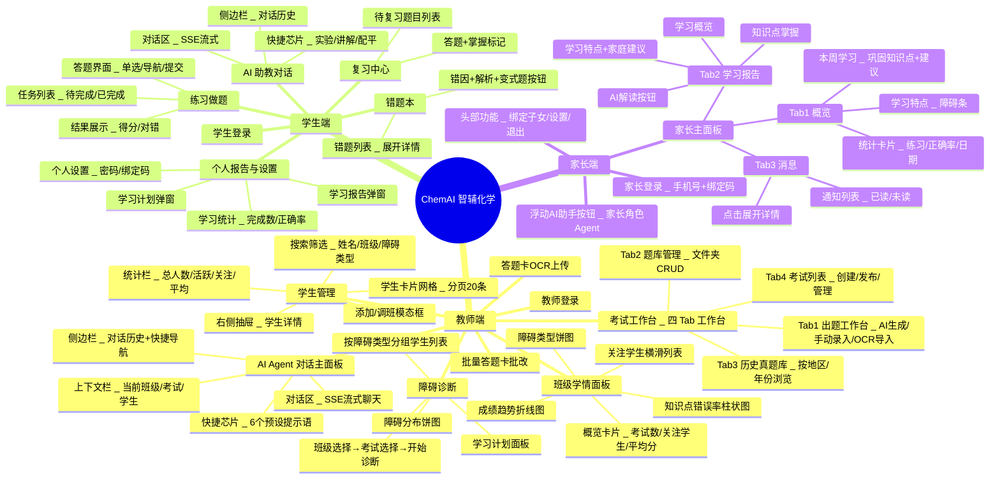

# 20. 信息架构与导航设计 — ChemAI（智辅化学）

> 本文档定义 ChemAI 三端（教师/学生/家长）的完整信息架构，包括页面树、导航机制和组件清单。本文档是产品设计的第一份具体设计文档，不依赖任何尚未编写的设计规范。

---

## 一、三端角色架构总览

ChemAI 三端架构概览：

| 维度 | 教师端 | 学生端 | 家长端 |
|------|--------|--------|--------|
| **目标设备** | 桌面端（≥1280px） | 移动端（430×900 视口） | 移动端（430×900 视口） |
| **页面数量** | 7 个 HTML | 6 个 HTML | 2 个 HTML |
| **主页** | `主页` — Agent 对话 | `学生主页` — AI 助教对话 | `家长主页` — 主面板（3 Tab） |
| **功能页面** | `出题工作台页面` 考试工作台 | `练习页` 练习做题 | `家长登录页` 家长登录 |
| | `教师工作台页面` 学情面板 | `错题本页` 错题本 | |
| | `学生管理页面` 学生管理 | `复习中心页` 复习中心 | |
| | `障碍诊断页面` 诊断 | `个人报告页` 个人报告 | |
| | `答题卡识别页面` OCR 识别 | `学生登录页` 登录页 | |
| | `答题卡批改页面` 答题卡批改 | | |
| **特色结构** | — | — | 3 个 Tab：概览 / 学习报告 / 消息；浮动 AI 助手按钮；头部功能区（绑定子女、设置、退出） |

---

## 二、完整页面树

以下为 ChemAI 三端（教师/学生/家长）的完整页面层级结构：

---

## 三、导航机制

### 3.1 路由策略

ChemAI 教师端采用 **组件化单页应用（SPA）架构**：SPA：单页应用：

- 高频交互模块（Agent 对话、考试工作台、学情面板）作为 SPA 页面，通过路由切换
- 页面间共享设计系统与状态管理
- 学生端/家长端为移动优先的轻量页面，页面间通过浏览器原生跳转实现
- 考试工作台（exam-v2）以 SPA 组件实现 4 个 Tab 的客户端切换

教师端核心页面：主面板、登录、OCR 识别、答题卡批改、考试工作台、障碍诊断、学生管理。

移动端（学生/家长）页面不经过构建步骤，直接以静态文件方式提供服务。

### 3.2 Agent 驱动的页面导航

系统设计为 Agent 可以触发前端页面跳转和组件渲染。具体协议（SSE 事件格式、页面间桥接、支持的目标页面路由表）详见 [29-Agent对话系统设计](./29-Agent对话系统设计.md)。

> **设计说明**：Agent 导航能力是 Agent 系统设计的一部分。在信息架构层面，只需要知道"Agent 可以驱动页面跳转"这一能力存在即可，具体协议在 Agent 设计文档中定义。

---

## 四、教师子角色菜单差异

根据权限体系设计（详见 [22-权限分级与访问控制系统设计](./22-权限分级与访问控制系统设计.md)），不同教师子角色在前端看到不同的导航菜单。以下为各角色对应的页面可见性：

| 页面 | admin | 学科组长 | 教务管理员 | teacher |
|------|:-----:|:------:|:--------:|:------:|
| 首页 / AI 对话 | ✅ | ✅ | ✅ | ✅ |
| 考试工作台 | ✅ | ✅ | ❌ | ✅ |
| 题目管理 | ✅ | ✅ | ❌ | ✅ |
| 诊断面板 | ✅ | ✅ | ❌ | ✅ |
| 学情面板 | ✅ | ✅ | ✅ | ✅ |
| 学生管理 | ✅ | ✅ | ✅ | ✅ |
| 报告中心 | ✅ | ✅ | ❌ | ✅ |
| 通知中心 | ✅ | ✅ | ✅ | ✅ |
| 系统设置 | ✅ | ❌ | ❌ | ❌ |
| 系统集成 | ✅ | ❌ | ❌ | ❌ |
| 操作日志 | ✅ | ✅ | ✅ | ❌ |
| **合计可见** | **11** | **9** | **5** | **8** |

> **设计说明**：菜单过滤逻辑根据当前登录用户的角色在前端侧边栏渲染时执行。各角色的具体权限范围详见权限系统设计文档。

---

## 五、各页面组件清单与数据依赖

### 5.1 教师端

#### AI Agent 对话主面板  

组件到数据源1:1（N）的绑定：不出现这个数据从哪来的？-不会写代码，不会写API 端口，codex/cc；自动写出正确的API调用

| 组件 | 布局与交互 | 数据来源 |
|------|----------|---------|
| 侧边栏 | 左侧固定 232px，包含品牌标识、新建对话按钮、历史会话列表、底部快捷导航 | 会话列表 API + 客户端本地缓存 |
| 对话区 | 中央自适应宽度，AI 气泡与用户气泡交替排列，顶部显示当前上下文标签 | Agent SSE 流式对话 |
| 快捷芯片 | 6 个预设提示语按钮，横向排列在输入区上方，点击即发送 | 静态配置 |
| 化学式预览栏 | 常用化学符号/方程式的快捷输入按钮组 | 客户端渲染 |
| 输入区 | 多行文本输入框 + 文件上传按钮 + 发送按钮，固定在页面底部 | 用户输入 |
| Agent 状态栏 | 输入区上方，实时显示 Agent 当前阶段（分析中/执行中/等待审批等） | SSE phase 事件 |

#### 考试工作台

| Tab | 内容 | 数据来源 |
|-----|------|---------|
| 出题工作台 | 题型选择器、难度设置、知识点搜索输入、变体源选择、目标题库选择、生成按钮 | 知识点列表 API + 题目生成 API |
| 手动录入 | 题目内容/选项/答案/知识点/难度的表单 | 题目导入 API |
| OCR 导入 | 试卷图片拖拽上传区域，识别后预览确认 | OCR 文档解析 API |
| 题库管理 | 左侧文件夹树 + 右侧题目卡片网格，支持批量操作 | 题库管理 API |
| 历史真题库 | 按地区/年份浏览试卷，支持关键词搜索 | 试卷列表 + 历史真题查询 API |
| 考试列表 | 考试卡片列表，支持创建、编辑、发布和删除 | 考试管理 API |
| 通用 | 题目卡片（含四维审核徽章）、弹窗系统、Toast 通知 | 各 Tab 数据 |

#### 班级学情面板

| 组件 | 数据来源 |
|------|---------|
| 班级选择器 | 班级列表 API |
| 4 个概览 KPI 卡片（考试数、关注学生、平均分、及格率） | 班级面板数据 API |
| 知识点错误率柱状图 | 知识点热度图 API |
| 障碍类型分布图 | 障碍分布 API |
| 成绩趋势折线图 | 成绩趋势 API |
| 需关注学生横滑列表（按障碍严重度排序，Top 5） | 班级诊断统计 API |

#### 学生管理

| 组件 | 数据来源 |
|------|---------|
| 统计栏（总人数、活跃、需关注、均分） | 客户端聚合计算 |
| 搜索筛选工具栏（姓名/班级/障碍类型） | 学生列表 API |
| 学生卡片网格（分页，每页 20 条） | 学生列表 API（分页查询） |
| 右侧详情抽屉（滑出面板，包含个人画像、成绩趋势、活动时间线） | 学生详情 API |
| 添加学生弹窗（手动录入或邀请码注册） | 学生创建 API |
| 调班弹窗 | 班级学生管理 API |
| 批量导入 | 批量导入 API |

#### 障碍诊断

| 组件 | 数据来源 |
|------|---------|
| 班级选择器 + 考试选择器 + 开始诊断按钮 | 班级列表 + 考试列表 API |
| 障碍分布图（三类障碍占比） | 班级诊断统计 API |
| 按障碍类型分组的学生列表（含置信度进度条和薄弱知识点标签） | 班级障碍详情 API |
| 学习计划面板（可生成、预览、发送给学生） | 学习计划 API |

### 5.2 学生端（移动端 430px 视口）

| 页面 | 核心组件 | 数据来源 |
|------|---------|---------|
| AI 助教对话 | 对话区 + 侧边栏抽屉 + 快捷芯片 + 输入区 + 底部 Tab 导航栏 | Agent SSE 流式对话（学生角色） |
| 练习做题 | 任务列表（待完成/已完成两栏）+ 答题界面（逐题单选/导航/提交）+ 结果展示 | 练习任务 API + 提交 API |
| 错题本 | 可展开的错题卡片列表（含错误答案 vs 正确答案对比、错因标签、障碍类型、变式题按钮） | 错题列表 API |
| 复习中心 | 到期复习任务列表（按紧急度排序）+ 答题 + 标记已掌握 | 复习任务 API（初始复用错题列表） |
| 个人报告与设置 | 学习统计卡片 + 学习报告弹窗 + 学习计划弹窗 + 个人设置（密码/绑定码） | 学生报告 API + 诊断计划 API |

### 5.3 家长端（移动端 430px 视口）

| 页面/组件 | 数据来源 |
|-----------|--------|
| 家长登录（手机号 + 6 位绑定码） | 家长登录 API |
| 主面板 Tab1 概览（2×2 统计卡片 + 学习特点分析 + 本周学习建议） | 子女学习报告 API |
| 主面板 Tab2 学习报告（学习概览 + 知识点掌握进度 + AI 解读按钮） | 子女周报 API + AI 摘要 API |
| 主面板 Tab3 消息（通知列表，已读/未读区分，可展开详情） | 家长通知 API |
| 浮动 AI 助手（右下角圆形按钮，点击弹出 AI 学习顾问对话面板） | Agent SSE（家长角色） |
| 绑定子女（输入学生提供的 6 位码完成绑定） | 绑定 API + 发送绑定码 API |

---

## 六、前端 JS 模块地图

前端 JavaScript 模块按职责划分为三层：共享基础设施层、页面专用逻辑层、Agent 对话引擎层。

**共享基础设施**：
- 教师端全局模块：认证检查、HTTP 请求拦截（自动附加 Bearer Token）、全局对象初始化、侧边栏渲染、活动追踪。被所有教师端页面引用。
- 移动端共享模块：认证、API 网络请求封装、Header/TabBar/Markdown 渲染、日期格式化。被所有学生端和所有家长端页面引用。
- 化学公式渲染引擎：Markdown + KaTeX + mhchem 化学公式渲染，处理标题/列表/引用/表格/代码块/LaTeX 格式/化学方程式，自动检测并格式化化学式。教师端和学生端共用。

**页面专用逻辑**：
- Agent 对话引擎：教师端对话界面，SSE 流处理、消息发送、对话管理、tool_call/tool_result 卡片渲染、文件上传预览、上下文标签管理。仅教师端主面板。
- Agent 渲染器：子 Agent 面板、Plan 卡片、Tool 卡片、格式化输出的 UI 渲染。
- 诊断页面逻辑：班级/考试加载、运行诊断、图表渲染、学生障碍行渲染、学习计划面板。
- OCR 页面逻辑：上传处理、拖拽交互、进度条显示、结果表格渲染。
- 学生管理逻辑：筛选、分页、抽屉加载、KPI 渲染、障碍可视化、活动时间线、添加/调班/删除操作。

**模块依赖关系**：教师端全局模块被所有教师端页面引用。Agent 对话引擎仅被主面板，依赖 Agent 渲染器和化学公式引擎。各页面专用模块仅被各自页面引用。移动端共享模块被所有移动端页面引用，依赖化学公式引擎。

---

> **下一份文档**：[21-页面流程与交互设计](./21-页面流程与交互设计.md) — 三端共 20 个核心流程的 Mermaid 流程图与交互规格
>
> 1.按照设备决定信息密度
>
> 2.MPA-MVP的价值
>
> 3.组件-数据源绑定（标准）

