# 21. 页面流程与交互设计 -- ChemAI (智辅化学)

> 本文档以 Mermaid 流程图形式定义 ChemAI 三端（教师/学生/家长）的核心用户流程、跨端数据闭环以及基于用户故事的流程映射。本文档基于 [20-信息架构与导航设计](./20-信息架构与导航设计.md) 中定义的页面结构，为每个核心场景描述完整的用户操作路径和系统响应。

---

## 一、教师端核心流程

### 1.1 教师注册与入驻审批流程

以下为审批流程的完整步骤：

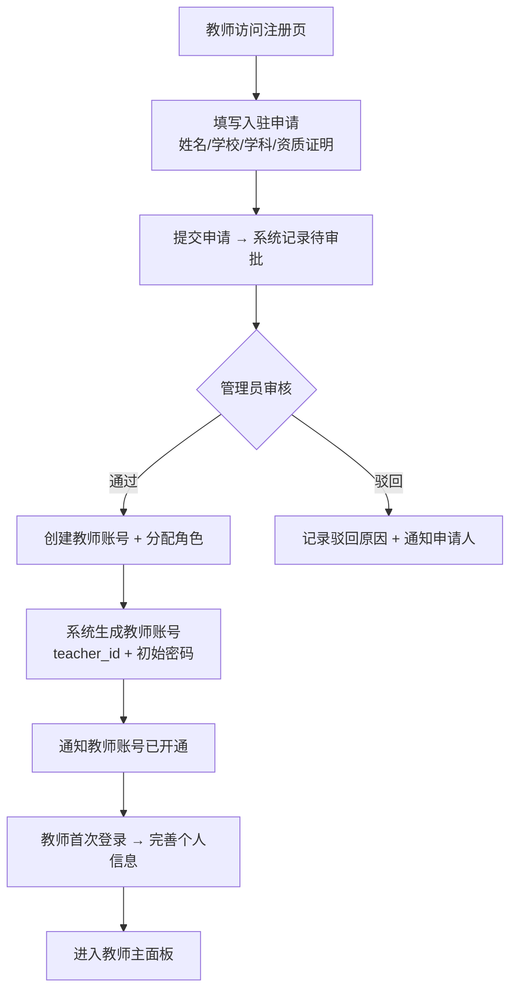

**关键接口**:
- `POST /api/auth/apply` -- 提交入驻申请
- `POST /api/teacher-applications/{app_id}/approve` -- 审批通过
- `POST /api/teacher-applications/{app_id}/reject` -- 驳回申请
- `GET /api/teacher-applications` -- 管理员查看申请列表

---

### 1.2 答题卡 OCR 批改闭环

教师上传答题卡后，系统依次完成 OCR 识别、学生信息提取、答案比对和结果入库，并自动触发障碍诊断。

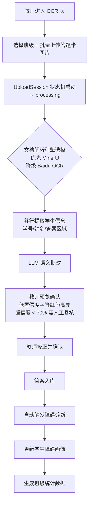

**关键接口**:

- `POST /api/ocr/tasks/batch` -- 批量创建 OCR 任务
- `GET /api/ocr/tasks/batch/{batch_id}` -- 查询批次状态
- `POST /api/grading/run` -- 执行 LLM 语义批改
- `POST /api/grading/save` -- 保存批改结果
- `POST /api/diagnosis/run-llm/{exam_record_id}` -- 运行 LLM 障碍诊断

---

### 1.3 AI 出题 → 审核 → 题库 → 考试发布

教师通过出题工作台配置参数，AI 生成题目后经四维审核引擎校验，教师确认后入库并发布考试。

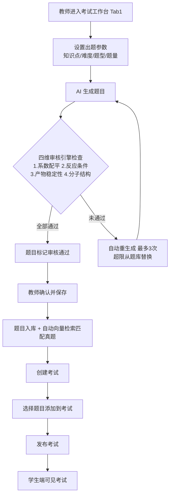

**关键接口**:
- `POST /api/question/generate` -- AI 生成题目
- `POST /api/question/audit` -- 四维审核
- `POST /api/question/{question_id}/approve` -- 教师确认入库
- `POST /api/question/similar` -- 向量相似真题匹配
- `POST /api/exam/create` -- 创建考试
- `POST /api/exam/{exam_id}/publish` -- 发布考试

---

### 1.4 手动/OCR 导题 → 题库管理

支持手动逐题录入和 OCR 扫描导入两种方式，题目统一归入题库文件夹管理。

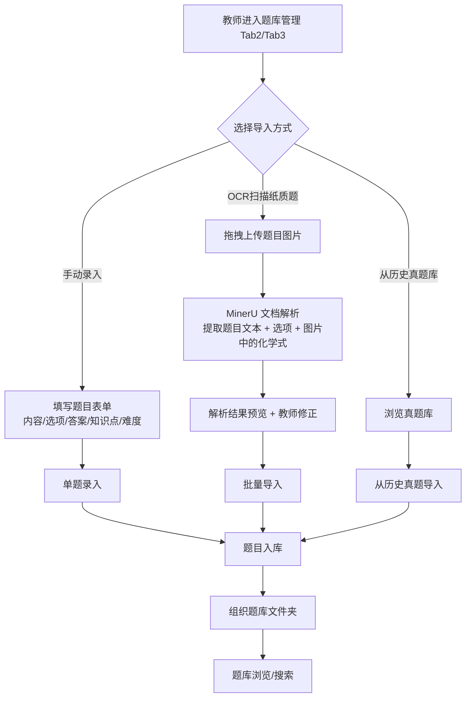

**关键接口**:
- `POST /api/question/import` -- 手动单题录入
- `POST /api/ocr/parse/document` -- OCR 解析题目文档
- `POST /api/exam-bank/import-questions` -- 批量导入题库
- `POST /api/exam-bank/exam-sets` -- 创建题库文件夹
- `GET /api/exam-bank/historical` -- 浏览历史真题
- `POST /api/question/search` -- 题库搜索

---

### 1.5 班级障碍诊断 → 讲评闭环

教师通过 Agent 对话方式触发班级诊断，系统展示障碍分布和需关注学生列表。

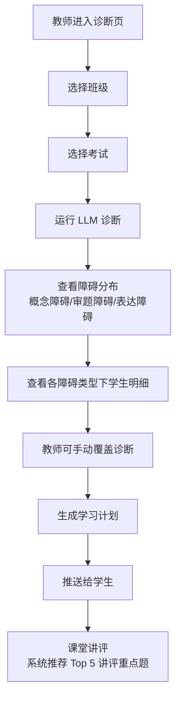

**关键接口**:
- `POST /api/diagnosis/run-llm/{exam_record_id}` -- LLM 障碍诊断
- `GET /api/diagnosis/barrier/{class_id}/{exam_record_id}` -- 按障碍分组
- `PUT /api/diagnosis/override/{student_id}` -- 手动覆盖诊断
- `POST /api/diagnosis/learning-plan/generate` -- 生成学习计划
- `POST /api/diagnosis/learning-plan/apply/{student_id}` -- 推送学习计划
- `GET /api/diagnosis/class/{class_id}/stats` -- 班级统计

---

### 1.6 学情分析 → 导出

学生作答后系统即时批改，记录作答数据用于后续障碍诊断和学习画像更新。

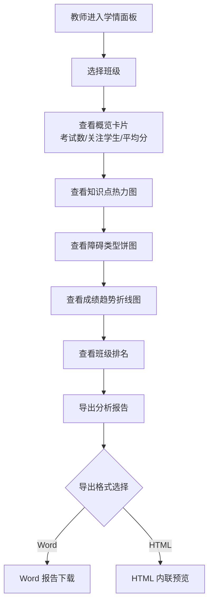

**关键接口**:
- `GET /api/panel/class/{class_id}` -- 班级学情面板
- `GET /api/analytics/class/{class_id}/knowledge-heatmap` -- 知识点热力图
- `GET /api/analytics/class/{class_id}/barrier-distribution` -- 障碍分布
- `GET /api/panel/class/{class_id}/trend` -- 成绩趋势
- `GET /api/panel/export/{class_id}` -- 导出报告

---

### 1.7 学生管理 → 批量导入 → 分班 → 邀请码

系统自动编排练习题，学生完成后提交，系统生成练习报告和个性化反馈。

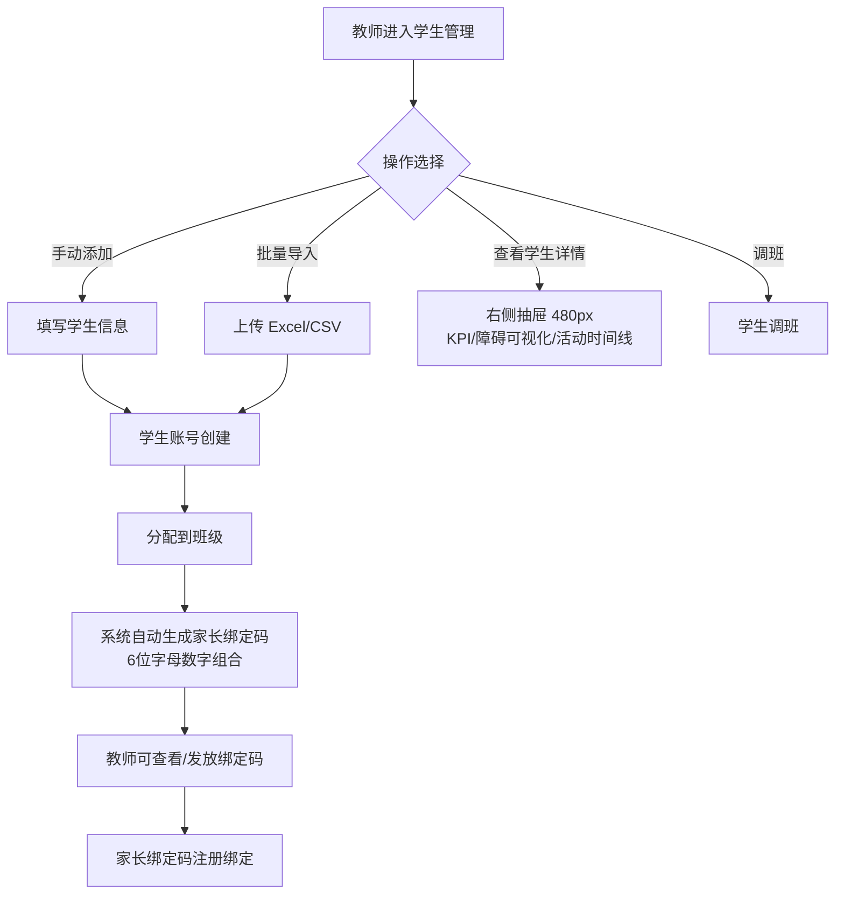

**关键接口**:
- `POST /api/users/student` -- 手动创建学生
- `POST /api/users/students/batch-import` -- 批量导入学生
- `GET /api/classes/{class_id}/students` -- 查看班级学生列表
- `GET /api/users/student/{student_id}/detail` -- 学生详情
- `POST /api/users/student/{student_id}/transfer` -- 学生调班

---

### 1.8 自适应练习布置 → 效果追踪

学生完成练习后，系统自动触发错题-复习同步，创建间隔复习任务。

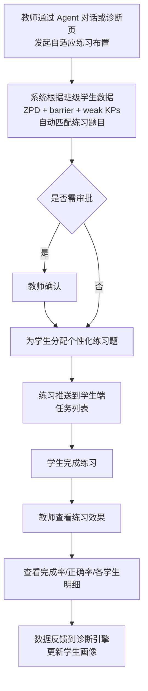

**关键接口**:
- `POST /api/practice/assign` -- 分配自适应练习
- `GET /api/practice/student/{student_id}/tasks` -- 学生任务列表
- `POST /api/practice/submit` -- 提交练习答案
- `GET /api/practice/effect/{student_id}` -- 练习效果追踪

> **设计说明**：自适应练习的分配涉及审批门控——需要教师确认后才会下发。审批交互的具体协议由 Agent 系统设计文档（29号）定义。ZPD 模型和策略矩阵详见 [27-自适应练习引擎设计](./27-自适应练习引擎设计.md)。

---

### 1.9 学情预警 → 处理 → 归档

系统每日自动检测学生异常状态（连续未登录、成绩下滑、错题率过高），生成预警推送至教师端。教师查看预警详情后标记处理或忽略，处理后预警归档。

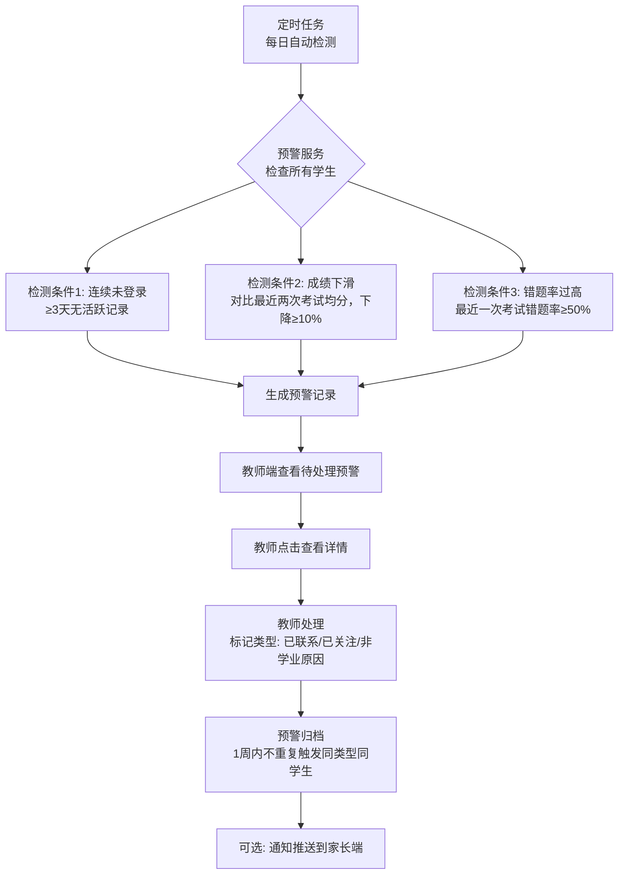

**关键接口**:
- `GET /api/warning/pending` -- 查看待处理预警
- `GET /api/warning/student/{student_id}` -- 某学生全部预警
- `PUT /api/warning/{warning_id}/process` -- 处理/归档预警
- `POST /api/warning/check` -- 手动触发预警检查
- `POST /api/notification/send-to-parent/{student_id}` -- 通知推送家长

---

## 二、学生端核心流程

### 2.1 登录与首次

学生通过学号和密码登录。首次登录展示功能介绍引导（3 屏滑动），完成后进入 AI 助教对话页并加载对话历史。

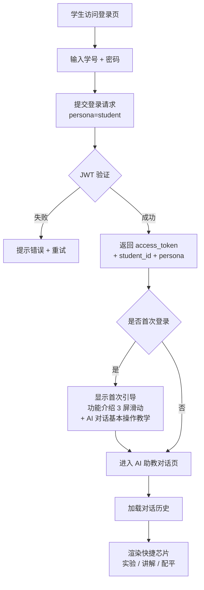

**关键接口**:
- `POST /api/auth/login` -- 学生登录
- `GET /api/auth/me` -- 获取当前用户信息
- Agent 对话流: `POST /api/agent/chat/langgraph/stream` (SSE, persona=student)

---

### 2.2 AI 辅导对话 (苏格拉底式启发教学)

学生在对话页输入化学问题后，Agent 识别辅导意图并调用对应的苏格拉底式辅导模块——离子方程式/配平/氧化还原等 7 个方向，分步引导不直接给出答案。

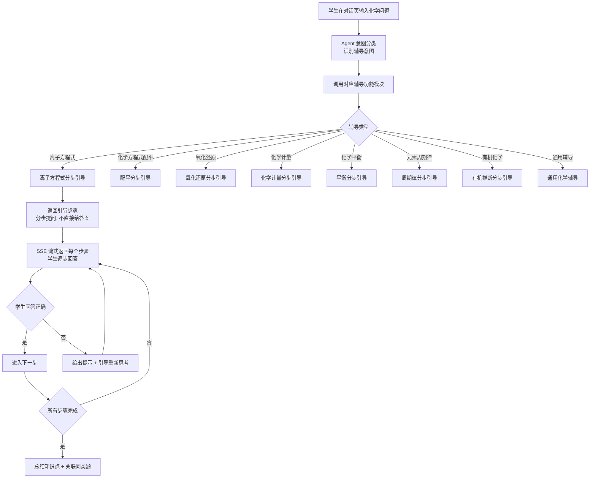

**设计原则**:
- 苏格拉底式对话: Agent 绝不允许直接给出最终答案
- 引导策略: 确认已知条件 → 分析解题思路 → 分步引导计算 → 学生自答每步 → 汇总
- Text Dedup: 当辅导模块已在工具返回中给出了 guidance/steps，系统抑制 LLM 对引导文本的复述

> **设计说明**：辅导功能的具体工具定义、SSE 事件协议、Text Dedup 算法详见 [29-Agent对话系统设计](./29-Agent对话系统设计.md)。

---

### 2.3 完成练习 → 查看结果 → 错题入本

学生进入练习页查看任务列表，逐题作答后提交。答对给予正面反馈，答错先提示审题再展开解析。全部完成后显示练习小结，错题自动入错题本。

```mermaid
graph TD
  A[学生进入练习页] --> B[查看任务列表<br/>待完成/已完成]
  B --> C[开始练习]
  C --> D[逐题作答<br/>选择题/填空题]
  D --> E{提交答案}
  E --> F[即时判分<br/>返回正确/错误]
  F --> G{答案正确}
  G -->|是| H[绿色对号 + 正面反馈]
  G -->|否| I[先提示审题<br/>&#34;再想一次?&#34;]
  I --> J{学生选择}
  J -->|我想想| D
  J -->|我不懂| K[展开完整解析]
  H --> L{还有题目?}
  L -->|是| D
  L -->|否| M[练习小结<br/>正确率 + 知识点表现]
  K --> L
  M --> N[错题自动进入错题本]
  N --> O[更新学生画像<br/>知识点掌握度重新计算]
```

**关键接口**:
- `GET /api/practice/student/{student_id}/tasks` -- 练习任务列表
- `GET /api/practice/student/{student_id}/practice/{practice_id}` -- 练习详情
- `POST /api/practice/submit` -- 提交答案
- `GET /api/practice/history/{student_id}` -- 练习历史-防注入（2026、）

---

### 2.4 错题本 → 变式题 → 标记掌握

学生浏览错题列表，点击展开查看错因分析和教师语言解析。可主动选择做同知识点变式题强化训练，连续正确后标记为已掌握。

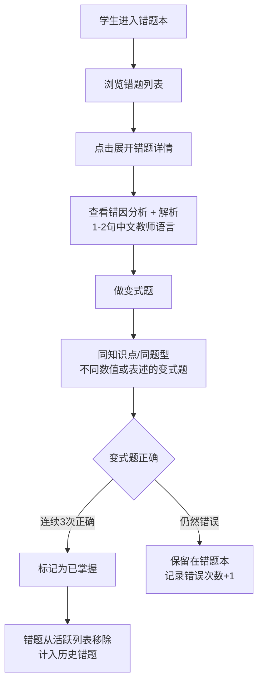

**关键接口**:
- `GET /api/practice/wrong/list` -- 错题列表
- `POST /api/practice/wrong-topic/variant/generate` -- 生成变式题
- `POST /api/practice/wrong/{question_id}/master` -- 标记掌握
- `GET /api/practice/historical` -- 历史错题

---

### 2.5 间隔复习 → 升级/降级

复习任务到期后提醒学生进入复习中心。逐题作答后系统根据本轮正确率升降级——连续正确则延长间隔，连续错误则缩短间隔并补充学习资源。

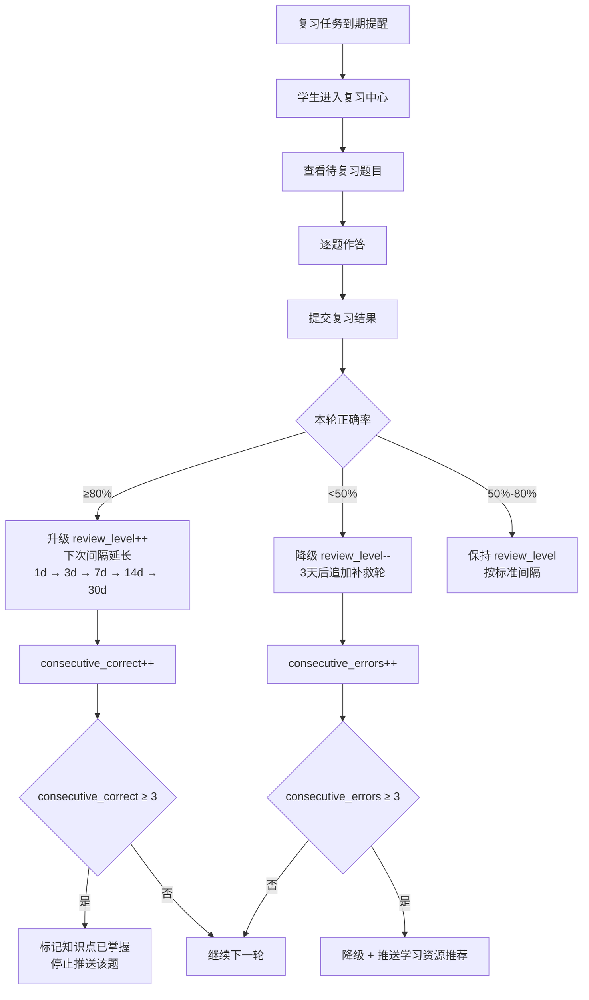

**关键接口**:
- `GET /api/review/student/{student_id}/due` -- 到期复习任务
- `GET /api/review/student/{student_id}/count` -- 待复习计数
- `POST /api/review/submit` -- 提交复习结果
- `POST /api/review/sync/{student_id}` -- 同步复习计划
- `GET /api/review/history/{student_id}` -- 复习历史

---

### 2.6 查看个人学习报告与计划

学生进入报告页查看学习统计、知识点掌握度分布、障碍类型变化趋势和 AI 生成的学习计划。支持密码修改和绑定码查看。

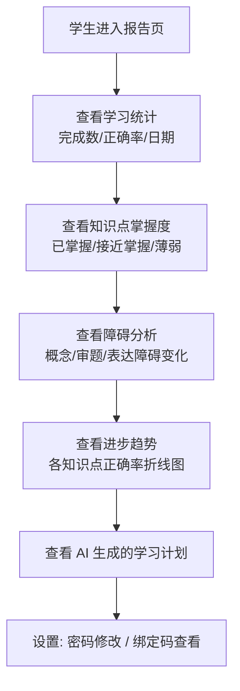

**关键接口**:
- `GET /api/report/student/{student_id}` -- 个人学习报告
- `GET /api/report/student/{student_id}/kp-mastery` -- 知识点掌握度
- `GET /api/report/student/{student_id}/barrier-change` -- 障碍变化
- `GET /api/report/student/{student_id}/trend` -- 进步趋势
- `GET /api/diagnosis/learning-plan/{student_id}` -- 学习计划

**设计原则**: 第一屏只显示进步，不显示任何排名信息，无历史数据时不显示空对比。

---

## 三、家长端核心流程

### 3.1 注册 → 绑定子女

家长注册并登录后，通过输入学生端提供的 6 位绑定码与子女建立安全关联。绑定成功后进入主面板并加载已绑定子女列表。

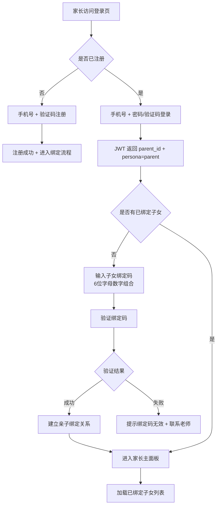

**关键接口**:
- `POST /api/parent/register` -- 家长注册
- `POST /api/parent/login` -- 家长登录
- `POST /api/parent/bind` -- 绑定子女
- `GET /api/parent/children` -- 已绑定子女列表
- `POST /api/parent/send-bind-code/{student_id}` -- 教师端发送绑定码

---

### 3.2 查看概览 → 周报 → AI 解读

家长主面板概览页展示子女学习统计、障碍类型分布和本周学习建议。支持 AI 解读功能，以通俗中文（非教师术语）解释学情数据并提供可操作的家庭建议。

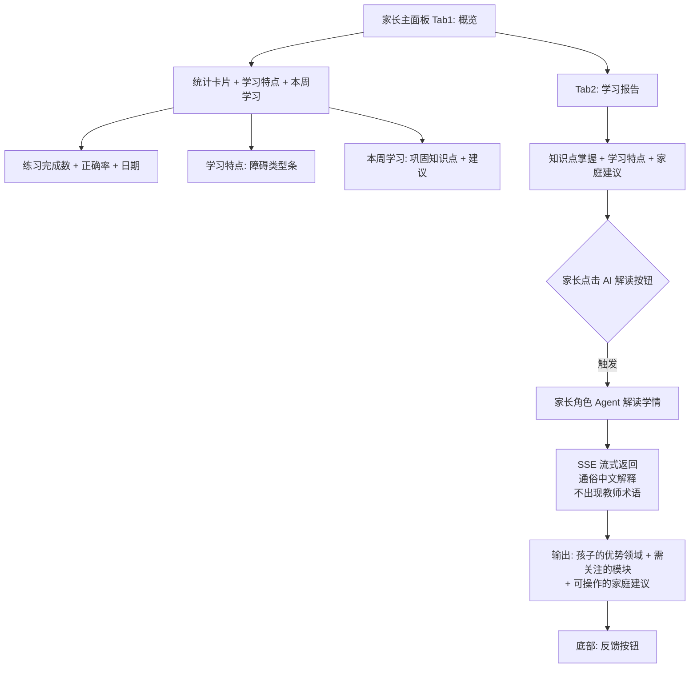

**关键接口**:
- `GET /api/parent/child/{student_id}/report` -- 子女概览报告
- `GET /api/parent/child/{student_id}/weekly` -- 周报
- `POST /api/parent/child/{student_id}/report/ai-summary` -- AI 解读

**设计原则**:
- 报告语言为日常中文，不出现教师专业术语
- 不显示班级排名、不显示其他学生的任何信息
- 家长角色 Agent 的工具集和行为约束详见 [29-Agent对话系统设计](./29-Agent对话系统设计.md)

---

### 3.3 接收通知 → 查看详情

家长在消息页查看通知列表（已读/未读区分），点击展开详情。通知来源包括教师推送、系统预警和周报更新，不同类型通知跳转到对应 Tab 查看详情。

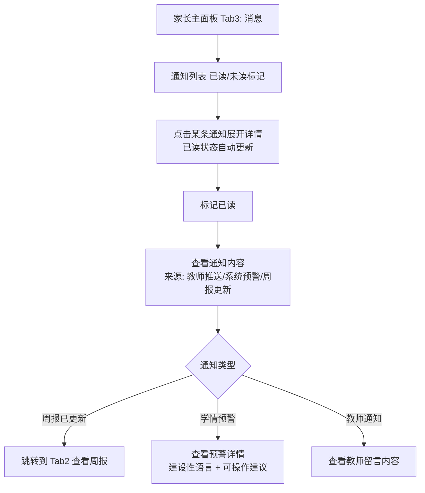

**关键接口**:
- `GET /api/parent/notifications` -- 家长通知列表
- `PUT /api/parent/notifications/{notification_id}/read` -- 标记已读
- `POST /api/notification/send-to-parent/{student_id}` -- 系统推送到家长

---

### 3.4 AI 助手对话

家长点击主面板右下角浮动按钮，打开家长角色 AI 助手对话浮层。Agent 获取学生画像数据后以通俗中文解读，家长可追问细节，关闭浮层后对话历史保留。

```mermaid
graph TD
  A[家长主面板右下角浮动按钮] --> B[点击打开 AI 助手对话浮层]
  B --> C[家长角色 Agent 初始化<br/>persona=parent]
  C --> D[家长输入问题<br/>如: &#34;我的孩子最近化学学得怎么样?&#34;]
  D --> E[Agent 获取学生画像数据]
  E --> F[Agent 生成家长报告或查询学生状态]
  F --> G[SSE 流式返回<br/>通俗中文解读]
  G --> H[对话持续<br/>家长可追问细节]
  H --> I[关闭浮层<br/>对话历史保留]
```

> **设计说明**：家长端 AI 助手独立的家长 Persona 配置，可用工具集和系统提示词专门针对家长场景设计。详见 [29-Agent对话系统设计](./29-Agent对话系统设计.md)。

---

## 四、跨端数据闭环

以下时序图展示一次完整的"教师出卷 → 学生答题 → 自动诊断 → 教师查看 → 家长接收"数据流:

教师发布考试-写入数据库-学生端可见-学生作答提交-agent即时判分-后台异步出发障碍诊断-更新学生的障碍画像-老师查看班级统计-定时任务生成家长周报-给家长推送信息-家长查看信息-家长AI解读

从教师发布考试到家长查看子女学习报告，数据在三端之间形成完整闭环，每个角色在闭环中获取所需信息。

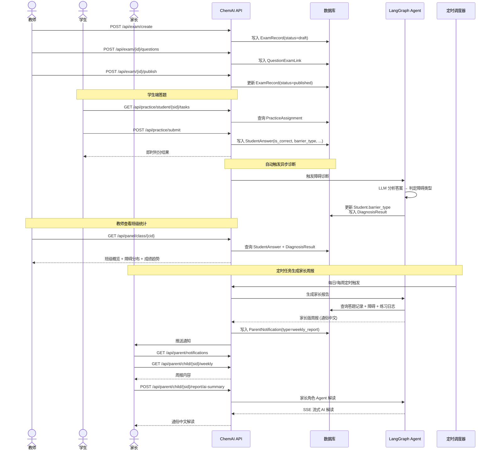

**核心数据写操作顺序**:
1. `ExamRecord` (考试发布) → 教师创建并发布考试
2. `StudentAnswer` (学生答题) → 学生提交答案时写入，含正确性和障碍类型
3. `Student.barrier_type` (学生障碍) → LLM 诊断后更新
4. `ParentNotification` (家长通知) → 定时任务触发，含周报/预警摘要

---

## 五、SSE 事件流与审批中断交互

Agent 对话的 SSE 事件流协议（事件类型目录、时序图、Text Dedup 去重算法）和审批中断交互流程（LangGraph interrupt 机制、确认→恢复流程、GuardState 审批门控）由 Agent 系统统一设计。

> 详见 [29-Agent对话系统设计](./29-Agent对话系统设计.md) 中的 SSE 协议和 GuardState 审批章节。

---

## 六、用户故事精华整合

### 6.1 故事 → 流程映射表

| 故事编号 | 故事标题 | Epic | 对应本章流程 | 涉及 API |
|:--------:|----------|------|-------------|----------|
| S1 | OCR 识别答题卡 | 考试后上传 | 1.2 答题卡 OCR 批改闭环 | `POST /api/ocr/tasks/batch`, `/api/grading/run`, `/api/grading/save` |
| S2 | 班级诊断报告 | 诊断后查看 | 1.5 班级障碍诊断 → 讲评闭环 | `GET /api/diagnosis/barrier/...`, `/api/panel/class/{cid}` |
| S3 | 障碍诊断 | 诊断后查看 | 1.5 班级障碍诊断 → 讲评闭环 | `POST /api/diagnosis/run-llm/...`, `PUT /api/diagnosis/override/...` |
| S4 | 学生端报告 | 拿到试卷后 | 2.6 查看个人学习报告与计划 | `GET /api/report/student/{sid}`, `/kp-mastery`, `/barrier-change` |
| S5 | 自适应练习 | 开始练习 | 1.8 自适应练习布置 + 2.3 完成练习 | `POST /api/practice/assign`, `/api/practice/submit` |
| S6 | 家长基础周报 | 收到报告 | 3.2 查看概览 → 周报 → AI 解读 | `GET /api/parent/child/{sid}/weekly` |
| S7 | 教师仪表盘 | 长期 | 1.6 学情分析 → 导出 | `GET /api/panel/class/{cid}`, `/analytics/class/{cid}/...` |
| S11 | 真题参考 | 考试前 | 1.3 AI 出题 + 1.4 OCR 导题 | `POST /api/question/similar`, `GET /api/exam-bank/historical` |
| S13 | AI 出题 | 考试前 | 1.3 AI 出题 → 审核 → 题库 → 考试发布 | `POST /api/question/generate`, `/api/question/audit`, `/api/exam/create` |

> **设计说明**：各故事对应的 Agent 工具由 [29-Agent对话系统设计](./29-Agent对话系统设计.md) 中的工具目录定义。

### 6.2 故事地图 -- 按旅程阶段

**教师用户旅程**分为四个阶段：
- 考试前：S13（AI出题）、S11（真题参考）→ 流程 1.3、1.4
- 考试后：S1（OCR答题卡批改）→ 流程 1.2
- 诊断后：S3（障碍诊断）、S2（班级诊断报告）→ 流程 1.5
- 长期：S7（教师仪表盘）、S5（自适应练习布置）→ 流程 1.6、1.8

**学生用户旅程**分为两个阶段：
- 拿到试卷后：S4（学生端报告）→ 流程 2.6
- 开始练习后：S5（自适应练习）→ 流程 2.3、2.4

**家长用户旅程**：绑定子女后 → S6（家长基础周报）→ 流程 3.1、3.2

### 6.3 关键用户故事验收标准速查

| 故事 | 关键验收标准 | 本章验证方式 |
|:----:|-------------|-------------|
| S1 | 单批上传 6~10 张; 单班 OCR ≤15min; 手写化学符号识别率 ≥90% | 流程 1.2 状态机 → UploadSession 进度追踪 |
| S2 | 错误率/典型错误/讲评优先级 (高/中/低); 导出 PDF | 流程 1.5 诊断 + 流程 1.6 导出 |
| S3 | 三维障碍标注 + 诊断依据 (1-2句中文); 教师可手动覆盖 | 流程 1.5 诊断覆盖端点 |
| S4 | 第一屏显示进步; 不显示任何排名信息; 无历史数据时不显示空对比 | 流程 2.6 学生报告 |
| S5 | ZPD 20-80% 区间的知识点出题; 完成率目标 ≥60% | 流程 1.8 + 2.3 |
| S6 | 语言通俗不出现术语; 不显示班级排名; 行动建议建设性 | 流程 3.2 AI 解读 |
| S7 | 热力图 + 趋势 + 自动标注年级共性问题 | 流程 1.6 学情面板 |

---

> **下一份文档**：[22-权限分级与访问控制系统设计](./22-权限分级与访问控制系统设计.md) — 五角色矩阵、教师入驻审批、家长数据权限、角色-资源访问矩阵

1.hitl-质量保障的底线

2.教育产品的帮助应该延迟满足（苏格拉底）

3.数据闭环的设计关键是写操作节点的识别
