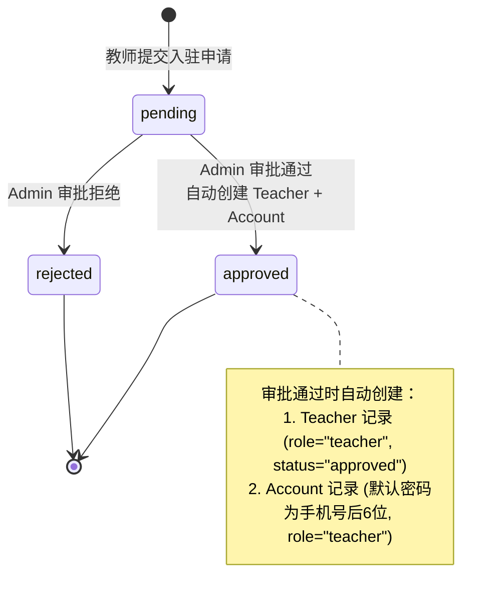

# 22. 权限分级与访问控制系统设计

> **产品设计文档 | ChemAI 智辅化学**
> 本文档定义 ChemAI 权限分级体系、角色-资源矩阵、教职工审批流程和多层权限检查架构。

---

## 目录

1. [五角色体系](#一五角色体系)
2. [ROLE_PERMISSIONS 矩阵](#二role_permissions-矩阵)
3. [教师子角色系统](#三教师子角色系统)
4. [家长端数据权限模型](#四家长端数据权限模型)
5. [教师入驻审批状态机](#五教师入驻审批状态机)
6. [学生审批流程](#六学生审批流程)
7. [权限检查机制](#七权限检查机制)
8. [认证体系](#八认证体系)
9. [会话与登出](#九会话与登出)

---

## 一、六角色体系

ChemAI 面向多种用户角色，每种角色有不同的权限范围、认证方式和频率。系统支持 5 种用户角色 + 家长端独立认证。

| 角色 | 权限范围 | 认证方式 | 预计频率 |
|------|----------|----------|-------------|
| **admin** (系统管理员) | 全局系统管理、跨校数据 | JWT (role=admin) | 每周 1-2 次 |
| **教务管理员** | 本校教务管理、师生账户管理 | JWT (role=教务管理员) | 每日 |
| **学科组长** | 本校化学科只读权限、数据分析 | JWT (role=学科组长) | 每周 2-3 次 |
| **teacher** (教师) | 本人班级教学、考试、诊断 | JWT (role=teacher) | 每日 |
| **student** (学生) | 本人学习数据、答题练习 | JWT (role=student) | 每周 2-3 次 |
| **parent** (家长) | 绑定子女的学习数据 | 独立 JWT (phone + bind_code) | 每月 1-2 次 |

> **设计说明**：admin/教务管理员/学科组长/teacher 共用 Teacher 数据模型，通过 `role` 字段区分。parent 拥有独立的认证通道，不与教师体系混合。student 通过独立的学生模型管理。

角色字段取值：`admin`（系统管理员）、`教务管理员`、`学科组长`、`teacher`（普通教师）。

---

## 二、ROLE_PERMISSIONS 矩阵

权限矩阵是全部后端权限校验的权威数据源。

### 2.1 完整矩阵

| 资源 (resource) | 操作 (action) | admin | 教务管理员 | 学科组长 | teacher | student | parent |
|-----------------|--------------|-------|-----------|---------|---------|---------|---------|
| **school** | create | ✅ | ❌ | ❌ | ❌ | ❌ | ❌ |
| | read | ✅ | ✅ | ✅ | ✅ | ❌ | ❌ |
| | update | ✅ | ❌ | ❌ | ❌ | ❌ | ❌ |
| | delete | ✅ | ❌ | ❌ | ❌ | ❌ | ❌ |
| **grade** | create | ✅ | ✅ | ❌ | ❌ | ❌ | ❌ |
| | read | ✅ | ✅ | ✅ | ✅ | ✅ | ❌ |
| | update | ✅ | ✅ | ❌ | ❌ | ❌ | ❌ |
| | delete | ✅ | ❌ | ❌ | ❌ | ❌ | ❌ |
| **class** | create | ✅ | ✅ | ❌ | ❌ | ❌ | ❌ |
| | read | ✅ | ✅ | ✅ | ✅ | ❌ | ❌ |
| | update | ✅ | ✅ | ❌ | ❌ | ❌ | ❌ |
| | delete | ✅ | ✅ | ❌ | ❌ | ❌ | ❌ |
| **teacher** | create | ✅ | ❌ | ❌ | ❌ | ❌ | ❌ |
| | read | ✅ | ✅ | ✅ | ✅ | ❌ | ❌ |
| | update | ✅ | ✅ | ❌ | ❌ | ❌ | ❌ |
| | delete | ✅ | ❌ | ❌ | ❌ | ❌ | ❌ |
| **student** | create | ✅ | ✅ | ❌ | ❌ | ❌ | ❌ |
| | read | ✅ | ✅ | ✅ | ✅ | ❌ | ✅(子女) |
| | update | ✅ | ✅ | ❌ | ❌ | ❌ | ❌ |
| | delete | ✅ | ✅ | ❌ | ❌ | ❌ | ❌ |
| **analysis** | read | ✅ | ✅ | ✅ | ✅ | ❌ | ✅(子女) |
| **exam** | create | ✅ | ❌ | ❌ | ✅ | ❌ | ❌ |
| | read | ✅ | ✅ | ✅ | ✅ | ❌ | ❌ |
| **question** | create | ✅ | ❌ | ❌ | ✅ | ❌ | ❌ |
| | read | ✅ | ✅ | ✅ | ✅ | ❌ | ❌ |
| **ocr** | create | ✅ | ❌ | ❌ | ✅ | ❌ | ❌ |
| | read | ✅ | ✅ | ✅ | ✅ | ❌ | ❌ |
| **grading** | create | ✅ | ❌ | ❌ | ✅ | ❌ | ❌ |
| | read | ✅ | ✅ | ✅ | ✅ | ❌ | ❌ |
| **diagnosis** | read | ✅ | ✅ | ✅ | ✅ | ✅(自身) | ❌ |
| | update | ✅ | ❌ | ❌ | ✅ | ❌ | ❌ |
| **practice** | read | ✅ | ✅ | ✅ | ✅ | ✅(本人) | ❌ |
| | create | ✅ | ❌ | ❌ | ✅ | ✅(提交作答) | ❌ |
| **report** | read | ✅ | ✅ | ✅ | ✅ | ✅(自身) | ✅(子女) |
| | send | ✅ | ❌ | ❌ | ✅ | ❌ | ❌ |
| **panel** | read | ✅ | ✅ | ✅ | ✅ | ❌ | ❌ |
| | create | ✅ | ❌ | ❌ | ✅ | ❌ | ❌ |
| **parent** | read | ✅ | ❌ | ❌ | ❌ | ✅ | ✅ |
| | bind | ✅ | ❌ | ❌ | ❌ | ✅(生成绑定码) | ✅(绑定/解绑) |
| **notification** | read | ✅ | ✅ | ✅ | ✅ | ✅(自身) | ✅(子女) |
| | write | ✅ | ❌ | ❌ | ✅ | ✅(标记已读) | ✅(标记已读) |
| **warning** | read | ✅ | ✅ | ✅ | ✅ | ✅(自身) | ✅(子女) |
| | write | ✅ | ❌ | ❌ | ✅ | ❌ | ❌ |

> **设计说明**：exam、question、ocr、grading 四个教学核心模块对 teacher 开放写权限。矩阵口径与 34 号文档的角色权限矩阵（14 个 API 域）对齐——本表由 34 号的粗粒度语义展开为 action 级。**所有教学业务端点必须声明权限装饰器做端点级角色校验**，不允许仅依赖 JWT 中间件放行；历史上存在零装饰器路径，属安全缺陷，已从白名单移除（见 4.3 节）。

### 2.2 权限规则摘要

- **admin**：对所有资源（school/grade/class/teacher/student/analysis/exam/question/ocr/grading）拥有全部操作权限
- **教务管理员**：school 仅 read；grade 有 create/read/update；class 有完整 CRUD；teacher 有 read/update；student 有完整 CRUD；analysis 仅 read
- **学科组长**：所有资源（school/grade/class/teacher/student/analysis/exam/question/ocr/grading）仅有 read 权限，没有任何写操作
- **teacher**：school/grade/class/teacher/student 仅有 read 权限；核心教学资源（exam出题、question题库、ocr批改、grading判卷）拥有 create/read 写权限；analysis 为 read 权限
- **student**：拥有 self_data 自数据 read、assignment 作业 read、grade 年级 read 三种权限
- **parent**：仅访问绑定子女相关资源——report/practice 仅对子女数据 read；notification/warning 对子女数据 read 并可标记已读；parent 域 read + bind（绑定/解绑）；其余资源全部不可访问（与 34 号文档角色矩阵一致）

权限检查的核心逻辑：根据角色、资源类型和操作类型，在权限矩阵中查找对应项，返回是否有权限。

---

## 三、教师子角色系统

### 3.1 四种子角色

| role 值 | 含义 | 权限等级 |
|---------|------|---------|
| `admin` | 系统管理员 | 最高 |
| `教务管理员` | 教务管理 | 高 |
| `学科组长` | 化学学科组长 | 中 |
| `teacher` | 普通教师 | 基础 |

### 3.2 前端菜单可见性矩阵

不同子角色在前端看到的导航菜单不同：

| 页面 | admin | 学科组长 | 教务管理员 | teacher |
|------|-------|---------|-----------|---------|
| 首页 / AI 对话 | ✅ | ✅ | ✅ | ✅ |
| 考试工作台 | ✅ | ✅ | ❌ | ✅ |
| 题目管理 | ✅ | ✅ | ❌ | ✅ |
| 诊断面板 | ✅ | ✅ | ❌ | ✅ |
| 学情面板 | ✅ | ✅ | ✅ | ✅ |
| 学生管理 | ✅ | ✅ | ✅ | ✅ |
| 报告中心 | ✅ | ✅ | ❌ | ✅ |
| 通知中心 | ✅ | ✅ | ✅ | ✅ |
| 系统设置 | ✅ | ❌ | ❌ | ❌ |
| 系统集成 | ✅ | ❌ | ❌ | ❌ |
| 操作日志 | ✅ | ✅ | ✅ | ❌ |
| **合计可见** | **11** | **9** | **5** | **8** |

> **设计说明**：菜单过滤逻辑根据当前登录用户的角色在前端侧边栏渲染时执行。各角色的具体权限范围由 ROLE_PERMISSIONS 矩阵（第二章）定义。

### 3.3 后端数据范围区分

同一 API 端点，不同角色获取到的数据范围不同：

- 当 role 为 admin 时：可查看所有班级
- 当 role 为教务管理员或学科组长时：可查看同学校的所有班级
- 当 role 为普通 teacher 时：仅查看自己直接任教的班级

获取班级学生列表时：
- admin 或教务管理员：直接返回该班级的所有学生
- 其他角色且有关联教师 ID：先验证该教师是否任教于该班级，无权则返回空

---

## 四、家长端数据权限模型

### 4.1 可见性规则

家长只能访问本人绑定子女的数据，遵循严格的"最小可见"原则：教育红线

| 可访问 | 不可访问 |
|--------|---------|
| 子女考试成绩 | 其他学生的任何数据 |
| 子女障碍类型诊断 | 班级统计信息 |
| 子女练习完成情况 | 排名信息 (任何形式) |
| 子女学习计划 | 教师内部备注/评估笔记 |
| 子女周报 | 学校的整体学情分析 |

### 4.2 系统提示词中的隐私保护

家长角色 Agent 的系统提示词中内嵌隐私保护原则：

> 保护隐私：只汇报自己孩子的数据，不透露其他学生信息

### 4.3 亲子绑定机制

家长通过绑定关系表与学生建立关联。流程为：

1. 学生在自己的客户端生成 6 位绑定码
2. 家长提交 `student_id + bind_code + parent_id` 进行绑定
3. 系统验证绑定码匹配后创建绑定记录

家长端 API 的每个数据查询端点（`/api/parent/child/{student_id}/*`）都前置验证绑定关系是否 active，无绑定则返回 403。

---

## 五、教师入驻审批状态机

### 5.1 状态流转图

教师提交入驻申请后，管理员审核决定通过或驳回。通过后系统自动创建教师账号，驳回则通知申请人并记录原因。

### 5.2 申请数据模型

教师入驻申请包含以下字段：申请人姓名、手机号码、学校名称、教授学科、审批状态（pending/approved/rejected）、审批人标识符、审批完成时间、申请创建时间。

### 5.3 审批权限控制

审批操作双重权限检查：

1. **资源级权限检查**：验证当前用户对 "teacher" 资源拥有 "create" 操作权限
2. **内联角色检查**：进一步确认操作者是 admin 角色，非管理员无法执行审批

---

## 六、学生审批流程 (轻量)

### 6.1 设计差异

与教师的完整申请表模型不同，学生审批采用轻量模式：

| 对比维度 | 教师 | 学生 |
|---------|------|------|
| 申请表 | 独立申请表 | 无，直接 Student.status 字段 |
| 状态字段 | TeacherApplication.status | Student.status (pending/approved/rejected) |
| 审批端点 | `POST /api/teacher-applications/{id}/approve` | `POST /api/users/student/approve/{student_id}` |
| 创建时默认状态 | pending (需审批) | approved (直接通过) |

---

## 七、权限检查机制（录）

ChemAI 采用分层权限检查架构，三层递进。

### 7.1 第 1 层：HTTP 中间件 (全局认证)

对所有 `/api/*` 请求做 JWT 令牌验证：

1. 检查请求路径是否匹配白名单前缀，若匹配则跳过认证直接放行
2. 从请求头提取 Authorization 字段，验证 Bearer token
3. Token 无效或缺失则返回 HTTP 401

**白名单路径** (跳过认证，仅限无身份基础设施)：`/api/auth/`（登录/注册）、`/docs`、`/redoc`、`/openapi.json`、`/health`。教学业务路径（`/api/agent/`、`/api/ocr/`、`/api/classes/`、`/api/parent/`、`/api/parser/`、`/api/knowledge/`、`/api/exam-bank/`、`/api/question/` 等）**一律不准进入白名单**——必须经过 JWT 中间件认证，并由各端点权限装饰器做角色校验。凡回归测试中发现新增白名单教学路径，视为安全缺陷直接修复。

### 7.2 第 2 层：PermissionChecker (资源级权限)

对具体端点进行资源级权限检查。检查器接收资源类型和操作类型两个参数，在权限矩阵中查找对应项：

1. 从请求头提取并验证 JWT Token，获取用户信息
2. 在权限矩阵中检查该角色是否对指定资源拥有指定操作权限
3. 验证通过后返回包含用户 ID、角色、学校 ID 的用户上下文

### 7.3 第 3 层：require_permission 装饰器

装饰器风格的权限检查，在端点上添加 `@require_permission("student", "read")` 装饰器。内部提取 JWT token 并调用权限检查函数，验证失败返回 HTTP 403。

---

## 八、认证体系

### 8.1 JWT 方案

ChemAI 纯 Python 实现 JWT，不依赖外部库。

| 属性 | 配置 |
|------|------|
| 签名算法 | HMAC-SHA256 |
| 密钥 | 环境变量 `JWT密钥配置` |
| Access Token 有效期 | 24 小时 |
| Refresh Token 有效期 | 7 天 |

### 8.2 Token 结构

JWT payload 包含：`user_id`、`role`、`school_id`、`type`（"access"）、`iat`、`exp`。

### 8.3 前端 Token 管理

前端在发起 API 请求时自动附加 JWT Token：通过全局请求拦截器从客户端持久化存储中读取 Token，拼接为标准 Bearer 认证头。

### 8.4 家长独立认证

家长使用独立的登录通道（`POST /api/parent/login`）。家长 JWT payload 中 `role = "parent"`，不携带 `school_id`。家长端 API 前缀 `/api/parent/` **不在白名单中**——家长 JWT 由 HTTP 中间件统一校验，绑定关系（StudentParentBinding）在各端点内校验（§6 权限检查实现）。

---

## 九、会话与登出

### 9.1 客户端存储

| 存储层级 | 内容 | 生命周期 |
|---------|------|---------|
| 持久化存储 | JWT access token | 24 小时（Token 有效期内持续可用） |
| 会话级存储 | 当前用户信息（JSON） | 关闭标签页后清除 |

### 9.2 登出流程

登出操作仅清除客户端会话存储中的用户信息缓存并重定向到登录页，不需要服务端参与。这是无状态 JWT 的标准做法。

### 9.3 无服务端 Session

ChemAI 采用无状态 JWT 架构：

- Token 在过期前始终有效（access: 24h, refresh: 7d）
- 无服务端 token 黑名单/吊销列表
- 如需紧急吊销，更换 `JWT密钥配置` 并重启服务

> **设计权衡**：无状态 JWT 简化了部署和水平扩展，但丧失了即时吊销能力。对于面向学校内部的 B 端产品，这一权衡在当前阶段可接受。未来如需支持跨校 SaaS，建议引入 Redis token 黑名单或切换到有状态 session 方案。

---

> **下一份文档**：[23-答题卡OCR批改系统设计](./23-答题卡OCR批改系统设计.md) — UploadSession状态机、多引擎文档解析（PP-OCRv6 默认）、OCR 多引擎降级链、LLM批改管线

1.角色设计要映射组织架构

2.禁止什么比允许什么更难更重要-产品安全的核心 admin（完全权限）

3.分层的权限架构就是让变更可控。中间件管认证、检查器管授权、装饰器管声明

