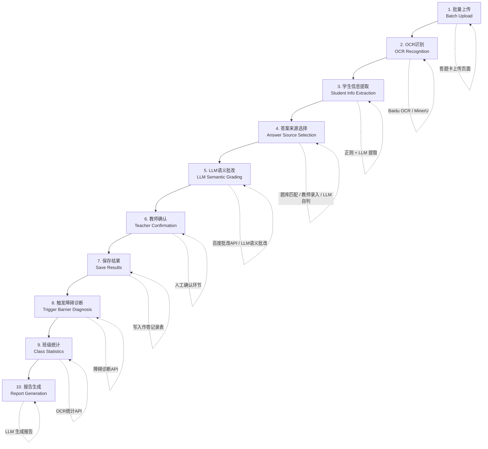
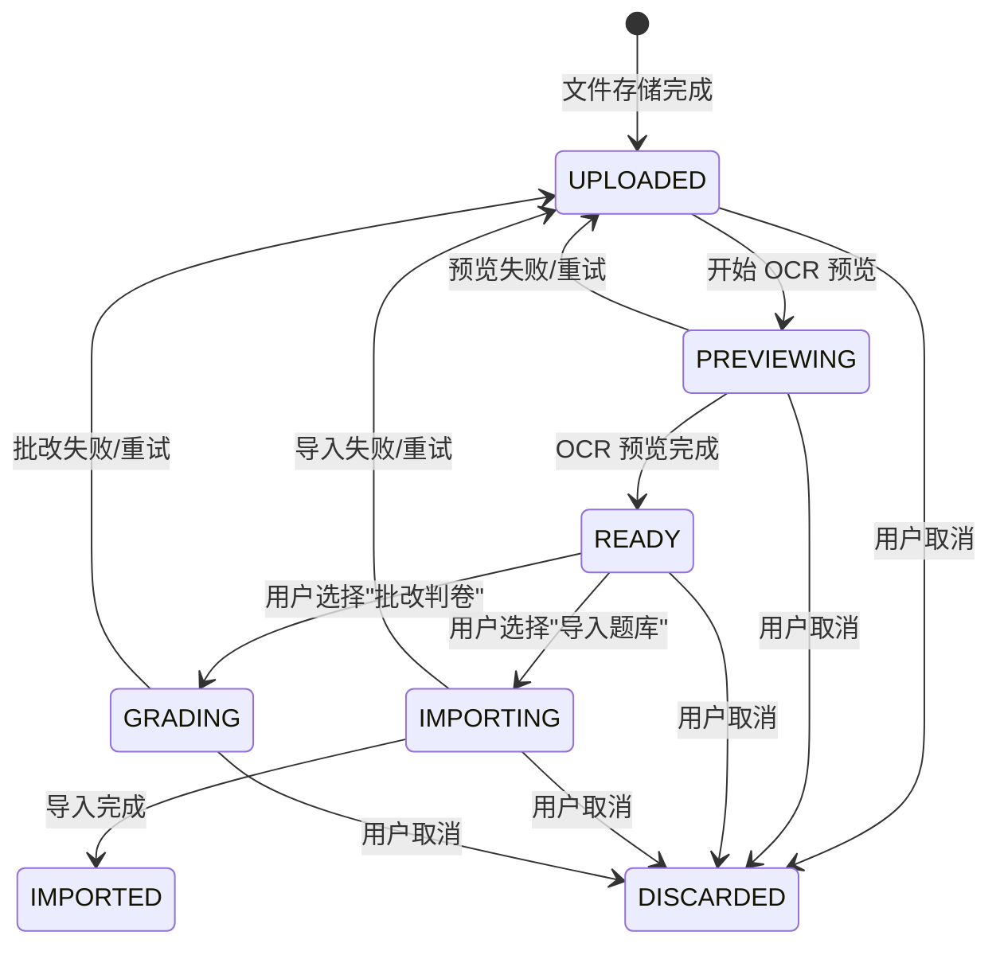
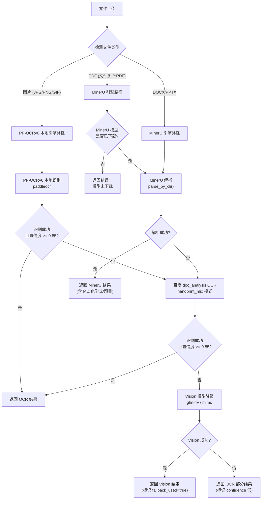
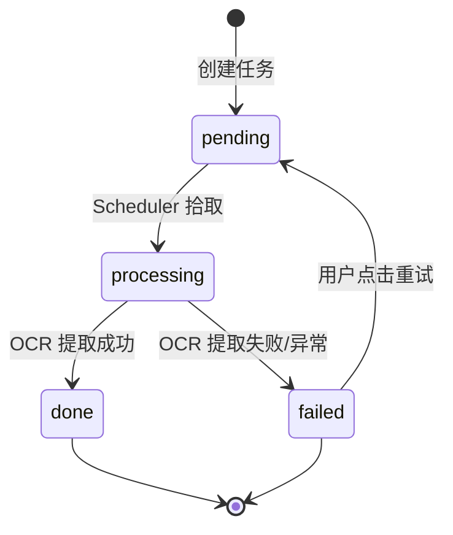
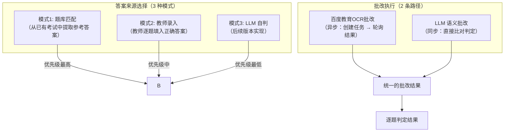
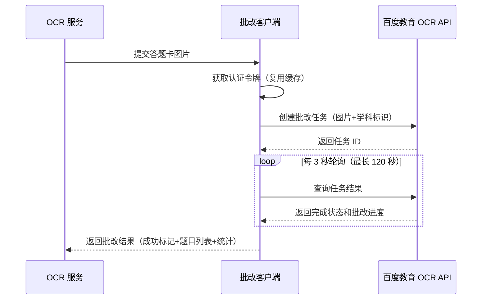
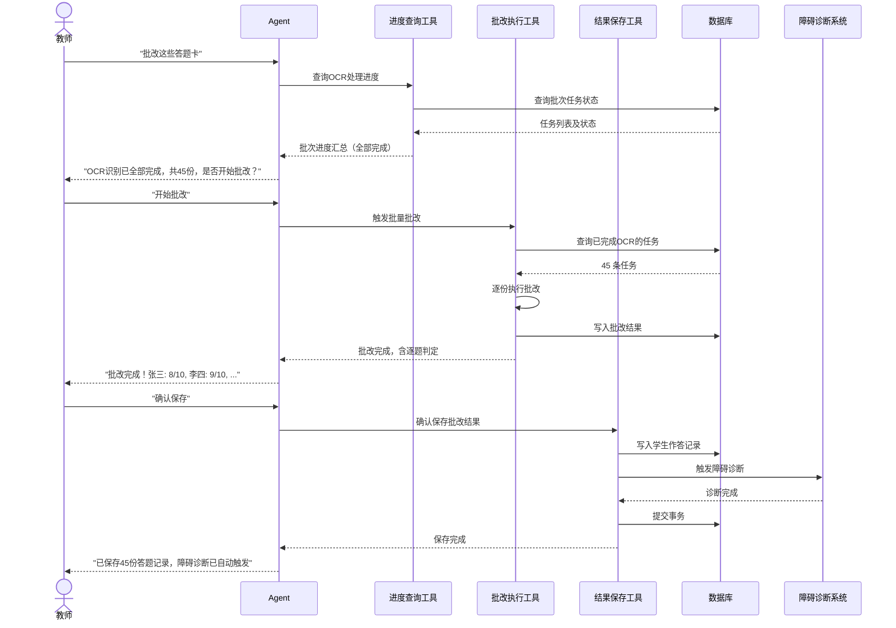

# 23. 答题卡OCR批改系统设计

## 一、系统定位与设计目标

### 1.1 在整体架构中的位置

答题卡OCR批改系统（Answer Sheet OCR Grading System）是ChemAI教学工具链的**入口环节**。它位于整个教学价值链的最上游——教师通过拍照或上传答题卡，系统自动完成OCR识别、LLM批改、结果入库，并联动触发后续的障碍诊断和班级统计分析。

在ChemAI教学工具链中，OCR批改系统位于最上游的入口位置。教学工具链的处理顺序为：第一步是OCR批改系统（入口环节），教师上传答题卡后系统自动完成OCR识别和批改；第二步将批改结果传入障碍诊断系统（Barrier模块），对学生答案进行错误归因分析；第三步基于诊断结果由个性化练习推荐系统（Exercise模块）生成针对性练习题。三个系统共同向底层的班级统计与学情报告模块（Statistics & Reports）输送数据，最终产出面向教师和家长的统计分析视图。

### 1.2 设计目标

| 目标 | 指标 | 基准 | 目标值 |
|------|------|------|--------|
| 批改效率 | 教师批改时间 | 6小时/班 (手动) | 45分钟/班 (半自动) |
| 时间压缩比 | 效率提升 | — | 87.5% |
| 班级规模 | 单班学生数 | — | 90+ 人 |
| OCR准确率 | 手写中文字符识别 | — | > 95% |
| 批改准确率 | 选择题判定 | — | > 99% |
| 端到端耗时 | 上传到结果就绪 | — | < 5分钟/班 |

### 1.3 核心指标定义

- **OCR准确率**：(正确识别字符数 / 总字符数) -- 由百度OCR上报 + MinerU内部评估
- **批改准确率**：与教师人工复核结果的一致率
- **端到端时间**：从教师点击上传到全部答题卡批改结果就绪的时间（含OCR + LLM批改）
- **低置信度标记率**：被标记为"建议人工复核"的答题卡占比，目标 < 10%

## 不在范围内的功能

- 不处理手写公式识别（由 LLM 批改阶段补充判断）
- 不做实时视频流批改
- 不做跨校对比统计

---

## 二、完整批改管线 (10-Step Pipeline)

教师上传答题卡后，系统依次完成 OCR 识别、学生信息提取、答案来源选择、LLM 批改、教师确认、结果入库，并自动触发障碍诊断、班级统计和报告生成十个步骤。

**各步骤说明：**

| 步骤 | 触发条件 | 关键技术 | 耗时 (预估) |
|------|----------|----------|-------------|
| 1. 批量上传 | 教师拖入/选择文件 | FormData multipart 上传 | < 3s |
| 2. OCR识别 | 上传完成自动触发 | APScheduler 5s轮询 | 5-30s/张 |
| 3. 学生信息提取 | OCR完成后 | 正则匹配学号/姓名 | < 0.1s |
| 4. 答案来源选择 | 批改触发时 | 题库查询 / 教师录入 / LLM自判 | < 1s |
| 5. LLM语义批改 | 答案来源就绪 | 百度 correct_edu / llm_grading | 3-15s/张 |
| 6. 教师确认 | 批改完成 | 前端结果卡片展示 | 人工决定 |
| 7. 保存结果 | 教师点击确认 | 写入 StudentAnswer 表 | < 2s |
| 8. 障碍诊断 | 保存完成后自动 | LLM barrier diagnosis | 5-15s |
| 9. 班级统计 | 保存完成后 | 聚合计算 + LLM分析 | 2-5s |
| 10. 报告生成 | 统计完成 | LLM 自然语言生成 | 3-10s |

---

## 三、UploadSession 状态机

### 3.1 状态转移图

上传会话从文件存储完成开始，经历 OCR 预览、用户选择路径（导入题库或批改判卷），最终到达完成或取消两个终态。

> 批改完成以批改任务状态与 `graded_at` 时间戳表达，会话保持在 GRADING 状态供进度查询，不再流转到额外终态。

### 3.2 状态详解

| 状态 | 含义 | 触发转换的事件 | 此时可获取的信息 |
|------|------|---------------|-----------------|
| **UPLOADED** | 文件已存储，等待处理 | 上传完成 | 文件二进制数据、文件名、类型 |
| **PREVIEWING** | OCR预览进行中 | 自动开始预览 | 上述 + OCR 中间识别结果 |
| **READY** | 预览完成，等待用户操作 | OCR预览返回成功 | 识别文本、化学式提取结果 |
| **IMPORTING** | 正在进行题库导入 | 用户点击"导入题库" | 总页数、已完成页数（进度） |
| **IMPORTED** | 题库导入完成 | 导入任务全部完成 | 结构化题目列表 |
| **GRADING** | 正在进行批改判卷 | 用户点击"批改判卷" | 批改任务进度；批改完成后经批改任务查询结果（graded_at 记录完成时间） |
| **DISCARDED** | 终态——已取消 | 用户取消（任意非终态） | — |
| **ERROR** | 处理出错 | 任何步骤异常 | 错误描述信息 |

### 3.3 UploadSession 实体

记录每次文件上传的完整生命周期。

核心属性：
- **标识**：唯一会话ID，关联上传文件
- **文件信息**：原始文件名、MIME 类型、文件二进制数据
- **检测类型**：自动识别文档类型（PDF / 图片）
- **状态**：贯穿上传→预览→批改/导入→完成 全流程的状态标记（详见状态机设计）
- **OCR 中间结果**：预览文本、化学式提取结果（LaTeX 格式）、百度异步任务 ID
- **批改结果**：最终处理结果的结构化 JSON
- **进度追踪**：总页数、已完成页数
- **降级标记**：是否触发降级引擎（如百度 OCR 失败后降级到 Vision 模型）
- **并发控制**：乐观锁版本号，防止多端同时操作同一会话
- **错误记录**：异常信息文本
- **时间戳**：创建时间、更新时间  
- 粒度控制

---

## 四、文档解析引擎架构 (三引擎策略)-为了防止不出结果做了多层兜底-MVP（走MINERu和百度的OCR）

### 4.1 引擎选择流程图

系统根据文件类型自动选择引擎：PDF 走 MinerU 路径，图片先走 **PP-OCRv6 本地引擎**（默认，与第 10.3 节及环境变量 `OCR_SHEET_PROVIDER` 默认值一致），失败时降级到百度 OCR，再失败降级到 VLM 多模态模型兜底。

### 4.2 多引擎详细对比

| 维度 | PP-OCRv6（图片默认） | 百度 OCR | MinerU | VLM Fallback |
|------|----------|----------|--------|-------------|
| **主场景** | 答题卡、手写识别（默认引擎） | 答题卡、手写识别（在线降级） | PDF试卷、印刷文字 | 混合内容降级 |
| **API** | 本地 paddleocr（onnxruntime） | `doc_analysis`, `correct_edu`, `paper_cut_edu` | 本地 Python 包 | ZhiPu GLM-4V / Xiaomi MiMo |
| **速度** | ~0.5-2s/张 | ~2-5s/张 | ~10-30s/PDF页 | ~5-15s/张 |
| **手写中文** | 高（手写模型优化） | 高 (handprint_mix模式) | 有限 | 中等 |
| **印刷化学式** | 中 | 中 (recg_formula=true) | 高 (formula_enable) | 中 |
| **费用** | 免费 (本地模型) | 按调用计费 | 免费 (本地) | 按Token计费 |
| **部署** | 本地模型 (需下载) | 云端API | 本地模型 (需下载) | 云端API |

### 4.3 降级链 (Degradation Chain)

文档解析引擎的降级链策略按文件类型分为三条降级路径：

- 图片引擎降级链：优先 PP-OCRv6 本地引擎识别（与 `OCR_SHEET_PROVIDER` 默认值 "paddle" 一致）；若失败或引擎不可用则降级到百度OCR的doc_analysis接口进行识别；若失败则降级到VLM多模态模型（glm-4v或mimo）进行视觉识别；若仍失败则返回OCR部分结果（Partial Result），标记低置信度
- PDF引擎降级链：优先MinerU本地引擎的parse_by_cli方法进行解析；若失败则将PDF逐页转为图片后调用百度OCR；若仍失败则降级到VLM多模态模型
- 混合内容引擎降级链：同时对MinerU和百度OCR发起并行调用，合并两者的识别结果；若并行调用全部失败，则降级到VLM多模态模型作为最终兜底

### 4.4 Baidu Auth Token 管理

百度 API 调用需要 OAuth 2.0 认证令牌，系统通过以下流程管理令牌生命周期：

| 步骤 | 操作 | 说明 |
|------|------|------|
| 1 | 检查缓存 | 若令牌有效且距过期 > 5 分钟，直接复用 |
| 2 | 刷新令牌 | 向百度 OAuth 端点发送 client_credentials 请求 |
| 3 | 更新缓存 | 解析响应中的令牌和有效期（默认 30 天），更新内存缓存 |
| 4 | 返回令牌 | 新的访问令牌用于后续 API 调用 |

**设计要点：**
- 内存缓存，所有百度API客户端共享同一个token
- 300秒安全边距：token到期前5分钟即触发刷新
- 默认过期时间 2592000 秒 (30天)
- 线程安全（async环境下单线程事件循环天然安全）

### 4.5 各API用途区分

| API | 用途 | 模式 | 文件 |
|-----|------|------|------|
| `doc_analysis` | 通用OCR识别（预览、化学式提取） | 同步 HTTP 调用 | OCR 服务 |
| `correct_edu` | 答题卡批改（判卷+批注） | 异步（创建任务 → 轮询结果） | 批改服务 |
| `paper_cut_edu` | 试卷切题（仅返回题目边界框） | 同步调用 | 试卷切题服务 |
| Vision LLM | 多模态降级识别 | 同步LLM调用 | OCR服务（Vision LLM多模态调用） |

---

## 五、OCR 引擎选型对比

| 维度 | PP-OCRv6 | 百度 OCR | MinerU |
|------|----------|----------|--------|
| **主要用途** | 答题卡识别、手写文字（图片默认引擎） | 答题卡识别（在线降级） | PDF试卷、印刷文本 |
| **API/接口** | 本地 paddleocr（onnxruntime） | 云端 HTTP API | 本地命令行调用 |
| **速度** | ~0.5-2s/张图片 | ~2-5s/张图片 | ~10-30s/PDF页 |
| **手写中文准确率** | 高（手写模型优化） | 高 (handprint_mix + CHN_ENG) | 有限 (主要面向印刷体) |
| **印刷化学式准确率** | 中 | 中 (recg_formula=true) | 高 (formula_enable + hybrid-auto-engine) |
| **费用** | 免费 (本地模型) | 按调用计费 (百度云账号) | 免费 (本地部署，需下载模型) |
| **降级关系** | 图片识别降级链首层；不可用时降级到百度 | 降级链第二层；不可用时降级到 VLM | PDF 解析不可用时转为逐页图片走图片降级链 |
| **模型部署** | 需下载 onnx 模型 | 无需部署 | 需下载 modelscope/huggingface 模型 |
| **适用文件类型** | JPG/PNG/BMP/WEBP | JPG/PNG/BMP/WEBP | PDF/DOCX/PPTX/PNG |

- PP-OCRv6 引擎：处理答题卡图片、手写文字识别（图片默认引擎，`OCR_SHEET_PROVIDER` 默认值 "paddle"）
- 百度 OCR 引擎：PP-OCRv6 不可用时的在线降级引擎
- MinerU 引擎：处理 PDF 试卷、印刷文本解析
- 引擎选择：根据文件类型自动路由到对应引擎，降级链见第四章

---

## 六、OCRTask 批量调度系统

### 6.1 OCRTask 模型

**OCRTask 实体**：表示单张答题卡的 OCR 识别与批改任务。

核心属性：
- **任务标识**：唯一任务 ID，关联所属批次
- **教师归属**：关联的教师
- **图片路径**：答题卡图片在本地存储的位置
- **任务标题**：可读名称，便于教师识别
- **学生匹配**：OCR 识别提取的学号和姓名
- **状态流转**：pending（待处理）→ processing（处理中）→ done（已完成）/ failed（失败），控制任务生命周期
- **进度**：0-100 的完成百分比
- **OCR 结果**：识别结果的结构化数据（含答案数组）
- **批改结果**：批改结果的结构化数据（含得分和逐题详情）
- **确认标记**：教师复核确认
- **错误信息**：异常描述
- **时间戳**：创建时间、处理完成时间

### 6.2 OCRTask 状态机

调度器按 5 秒间隔轮询待处理任务，任务状态在 pending → processing → done/failed 之间流转，失败任务支持手动重试。

### 6.3 APScheduler 轮询架构 

APScheduler轮询架构的详细工作流程：调度器以5秒为间隔触发待处理任务扫描函数。每次触发时，执行以下步骤：

1. 从ocr_tasks表中查询status为'pending'的一条任务记录，按created_at创建时间升序排列，只取最早的一条
2. 将该任务的状态更新为'processing'（处理中），并将进度progress设置为10（表示已开始处理）
3. 调用当前配置的OCR provider的extract方法，传入任务的image_path图片路径进行OCR识别
4. 处理完成后根据结果分支：若识别成功，将status更新为'done'、progress更新为100；若识别失败（包括业务错误或程序异常），将status更新为'failed'、error_message设置为错误描述字符串

**调度器启动代码：**

OCR调度器启动函数：在APScheduler调度器实例上添加一个定时任务，指定待处理任务扫描函数为执行目标，触发方式为interval间隔触发，间隔时间为5秒，任务标识符为"ocr_processor"，配置为重复注册时覆盖已有任务。

### 6.4 前后端轮询交互

设计决策：1.实现简单

2.调试友好 3.延迟可容忍 4.部署简单。5.规模适配   产品和工程约束的组合-技术选型

前后端轮询交互的完整时序说明：

前端（答题卡批改页面页面）前端以 5 秒间隔轮询查询批次状态。

前后端之间的完整交互包含四个API调用流程：

1. 前端发送GET请求到/api/ocr/tasks端点，附带teacher_id查询参数，后端查询OCRTask表并按batch批次分组返回状态列表

2. 前端通过multipart表单格式POST上传文件到/api/ocr/tasks/batch端点，附带files文件数据和teacher_id教师标识，后端创建OCRTask记录并保存图片到答题卡存储目录/目录，返回batch_id批次标识和task_ids任务标识列表

3. 前端通过GET请求查询/api/ocr/tasks/batch/{batch_id}端点，获取指定批次下所有任务的状态，后端返回包含total总数、done完成数、failed失败数、pending等待数以及tasks任务详情列表的JSON对象

4. 前端对失败任务发送POST请求到/api/ocr/tasks/{task_id}/retry端点，后端将失败任务的状态重置为pending并清空错误信息，返回成功确认

---

## 七、LLM 批改引擎

### 7.1 批改架构

LLM 批改引擎的核心设计思想是**先确定答案来源，再执行批改**。系统先获取每道题的参考答案，然后将学生答案与参考答案进行比对判定，最后输出结构化批改结果。

答案来源按优先级分为三种模式：

| 优先级 | 模式 | 触发条件 | 说明 |
|--------|------|---------|------|
| 最高 | 题库匹配 | 教师指定了考试ID | 从题库中查询该考试的参考答案 |
| 中等 | 教师录入 | 教师手动填入答案 | 教师在前端逐题录入正确答案 |
| 最低 | LLM 自判 | 无题库、无教师录入 | 由 LLM 自行推断答案（后续版本实现） |

批改执行层有两条路径：
- **百度教育 OCR 批改 API**：异步调用，创建任务后轮询获取结果。擅长客观题判定，返回每题的正误和详细批注。
- **LLM 语义批改**：同步调用，适用于主观题、化学方程式等需要语义理解的题型。当百度 API 不可用时作为降级方案。

两条路径最终汇合为统一的批改结果结构，每条题目独立判定。

### 7.2 correct_edu 异步批改流程

**批改结果数据结构：**

批改结果包含两个层次：

**逐题判定结果**：
- 题号与题目类型
- 批改判定：未处理 / 正确 / 错误 / 未作答
- 批改理由说明
- 题目区域切图 URL（供教师查看原始作答）

**批改结果汇总**：
- 批改是否成功
- 试卷学科标识
- 逐题判定结果列表
- 统计摘要（总题数、已批改数）
- 错误信息（如有）

### 7.3 答案来源选择的三种模式

**模式1: 题库匹配** (优先级最高)

当教师选择了已有考试时，系统自动从题库中查询该考试关联的所有题目，提取每道题的题号和标准答案，构建为参考答案列表供批改对比使用。

**模式2: 教师录入答案**

教师在前端表单中逐题填入正确答案，系统以此为标准进行逐题比对批改。

**模式3: LLM自判** (优先级最低)

LLM 自判模式下，系统无法自行确定正确答案，所有题目标记为待确认状态，统一提示教师人工复核。后续版本将接入 LLM 语义推断能力来自动判定。

### 7.4 批改结果结构

批改结果的JSON结构说明，顶层包含6个字段：

- task_id（字符串）：OCR任务标识符，如"ocr_1692000000_abc123"
- student_id（字符串）：学生学号，如"202401001"
- student_name（字符串）：学生姓名，如"张三"
- score（整数）：学生得分，如8
- total（整数）：题目总数，如10
- questions（数组）：每道题的批改详情列表，每项为一个包含以下字段的对象：
  - q_number（整数）：题号，从1开始
  - student_answer（字符串）：学生的作答内容，如"C"
  - correct_answer（字符串）：标准正确答案，如"B"
  - is_correct（布尔值）：该题是否正确，true为正确、false为错误
  - reason（字符串）：批改理由，留空表示无特殊说明

### 7.5 doc_analysis 退化路径

当 `correct_edu` 不可用或失败时（例如百度API配额耗尽），系统退化到 `doc_analysis` 模式：
- `doc_analysis` 是同步OCR API，仅能提取文本，不具备批改能力
- 退化后由 LLM 批改模块进行纯字符串比较
- 结果标记 `degraded=True`，前端展示警告提示

---

## 八、Agent 工具交互

### 8.1 三个核心 Tool

| 工具 | 触发场景 | 输入 | 输出 |
|------|------|------|------|
| **查询进度** | 教师查询 OCR 处理进度 | `teacher_id`, `batch_id` | 批次摘要 + 每张状态 |
| **触发批改** | 教师确认开始批改 | `teacher_id`, `batch_id`, `exam_id`（可选） | 每学生得分 + 逐题判定 |
| **保存结果** | 教师确认保存批改结果 | `teacher_id`, `batch_id` | 保存数量 + 自动触发诊断 |

### 8.2 完整交互序列

教师通过 Agent 对话完成 OCR 批改的典型流程分为三个阶段：

**阶段一：进度查询**。教师询问批改进度，Agent 调用进度查询工具从数据库获取批次任务状态，汇总后返回给教师。只有当所有答题卡 OCR 识别完成后，才会进入下一阶段。

**阶段二：批量批改**。教师确认开始批改后，Agent 调用批改执行工具。该工具查询所有已完成 OCR 的任务，逐份进行答案比对和批改，将批改结果写回数据库，最后向教师展示每位学生的得分和逐题判定。

**阶段三：确认保存**。教师审核批改结果无误后确认保存。Agent 调用结果保存工具，将学生作答记录写入数据库，并自动触发障碍诊断——这是整个教学工具链的入口，诊断结果将驱动后续的个性化练习推荐。

整个流程中，教师始终处于决策主导地位——Agent 负责执行，教师在每个关键节点（是否开始批改、是否确认保存）拥有最终决定权。

**安全约束**：保存批改结果时，系统会校验 OCR 提取的学号是否已在系统中注册。未注册学生的答题记录将被跳过，避免脏数据进入学情分析链路。

---

## 九、前端页面设计

### 9.1 答题卡识别页面 -- 答题卡识别主界面

**页面结构：**

答题卡识别页面（答题卡识别主界面）的页面布局说明：

左侧为固定宽度240像素的侧边栏，包含智辅化学品牌Logo、导航菜单项和退出登录按钮。右侧主内容区从上到下分为四个功能区域：

1. 班级选择区：以一个下拉框展示教师任教的所有班级列表，教师选定目标班级后后续所有操作针对该班级
2. 拖曳上传区：占据视觉中心的区域，显示上传图标和操作提示文字（"点击或拖拽上传答题卡"），支持双击点击和拖拽两种文件添加方式，接受JPG/PNG/PDF格式，支持同时选择多个文件批量上传
3. 进度条区域：上传后显示处理进度，以百分比数字配合进度条视觉（填充和空白部分比例对应进度值）
4. 识别结果表格：以表格形式展示每张答题卡的识别结果，包含学号列、姓名列、答案摘要列和状态列（绿色对号表示成功），教师可在表格中直接修改识别内容

**关键交互：**
- 拖曳上传 + 点击上传双通道
- 文件类型限制: JPG/PNG/PDF
- 上传后自动调用 `POST /api/ocr` 进行识别
- 结果以表格展示，支持教师手动修正

### 9.2 答题卡批改页面 -- 答题卡批改页面

**页面结构：**

答题卡批改页面（答题卡批改页面）的页面布局说明：

页面顶部为标题栏，显示"答题卡批改"标题和操作说明文字。页面主体分为四个功能区域从上到下排列：

1. 上传区域：展示上传图标和操作提示文字（"点击或拖入答题卡图片"），每批上传数量限制为最多10张，防止单次处理过多导致超时
2. 预览网格：以缩略图网格形式展示已上传的答题卡图片，每张缩略图下方显示任务标题（如"答题卡_01""答题卡_02"等），方便教师确认上传内容
3. 开始识别按钮：教师确认预览无误后点击此按钮触发批量OCR识别流程
4. 历史批次列表：以批次为单位展示所有OCR任务的状态。每个批次显示批次标识（如batch_xxx），下方逐行显示该批次内的每张答题卡，包含标题、状态徽章（done显示绿色/processing显示黄色/failed显示红色）、进度百分比（完成显示100%/处理中显示当前百分比），失败任务旁附有[重试]按钮供教师手动触发重新识别

**前端轮询逻辑**：前端以 5 秒间隔向 `/api/ocr/tasks` 端点查询批次状态。响应包含批次内所有任务的状态和进度，前端按状态渲染对应颜色徽章（完成=绿色、处理中=黄色、失败=红色、等待=灰色），失败任务旁附重试按钮。

**状态徽章**：done=绿色、processing=黄色、failed=红色、pending=灰色。

---

> **前端设计规格详见**：[38-前端页面设计规格](./38-前端页面设计规格.md) §1.6、§1.7

---

## 十、设计决策（着重消化-真实设计过程中的一些真实决策）

### 10.1 为什么异步轮询而非 WebSocket

**决策：** APScheduler 5秒间隔轮询 + 前端 5秒轮询

**理由：**
1. **实现简单性**: 轮询模式只需一个 数据库状态查询 + 前端定时轮询，无需引入 WebSocket 连接管理、心跳、重连等复杂性
2. **调试友好**: 每个轮询周期的日志清晰可见；失败重试机制自然内建（下次轮询自动拾取）
3. **延迟容忍**: OCR任务单张耗时5-30秒，5秒的轮询间隔在总的端到端延迟中占比 < 20%，用户体验影响可接受
4. **部署简单**: 单容器部署，不需要额外的基础设施（如 Redis Pub/Sub）
5. **规模适配**: 当前场景为单教师（一个班45-90张答题卡），无高并发轮询压力

### 10.2 为什么 SQLite 状态表而非消息队列

**决策：** SQLite `ocr_tasks` 表直接作为任务队列

**理由：**
1. **MVP 简单性**: 避免引入 Redis/RabbitMQ 等外部依赖，降低部署复杂度和维护成本
2. **单容器部署**: ChemAI 设计为单体应用，SQLite 文件数据库即可满足需求
3. **WAL 模式**: 数据库初始化时启用了 WAL (Write-Ahead Logging) 模式 + `synchronous=NORMAL`，读写并发能力足以处理 OCR 调度场景
4. **状态持久化**: 任务状态天然写入数据库，无需额外持久化消息队列的状态
5. **查询灵活性**: 可以直接用 SQL 查询任务状态、按批次聚合、生成统计，无需额外索引

**SQLite 性能优化**：数据库初始化时自动启用两项优化——WAL 模式（读写操作可并发执行，互不阻塞）和 NORMAL 同步级别（在安全前提下减少磁盘同步次数，提升写入性能）。

**后续演进路径：** 当用户规模增长到多教师并发时，可将调度器迁移到 Celery + Redis，OCRTask 模型保持不变，仅替换调度后端。

### 10.3 为什么多引擎而非单一引擎

**决策：** PP-OCRv6 本地引擎（默认）+ 百度 OCR（在线降级）+ MinerU（PDF）+ VLM（兜底）四路互补

**答题卡默认引擎为 PP-OCRv6**（本地开源、免费、onnxruntime 推理无网络依赖）：针对答题卡场景做了手写识别优化，作为默认引擎可显著降低在线 API 成本。百度 OCR 作为在线高精度降级（`handprint_mix` 模式针对手写+印刷混合场景），MinerU 服务印刷 PDF 解析，VLM 作为最后兜底。

**理由：**
1. **PP-OCRv6 优势**: 本地部署零成本、无网络依赖，针对手写答题卡场景做了识别优化；`OCR_SHEET_PROVIDER` 默认值 "paddle" 印证其为默认引擎
2. **百度 OCR 优势**: 对中国学生手写汉字有针对性优化，`handprint_mix` 模式专门针对手写+印刷混合场景；作为 PP-OCRv6 失败时的在线降级
3. **MinerU 优势**: 对化学式（LaTeX）、分子结构、反应方程式的解析效果更好；免费的本地部署降低API成本
4. **互补关系**: 印刷试卷用 MinerU（速度快、免费），手写答题卡默认 PP-OCRv6（本地免费），失败降级百度 OCR（高精度），再失败 VLM 兜底
5. **成本优化**: 将大量PDF试卷的处理从付费API转移到免费本地引擎，降低运营成本

### 10.4 工程参数

| 参数 | 设计值 | 说明 |
|------|:-----:|------|
| 单文件上传上限 | 10 MB | 超出拒绝，返回 400 错误 |
| 允许的文件格式 | JPG / PNG / BMP / WEBP / PDF / GIF / DOC / DOCX | 不匹配时返回 400 错误 |
| 单批上传上限 | 10 张 | 前端与后端均为硬限制，超出返回 400 错误 |
| OCR 并发控制 | 信号量 5 | `asyncio.Semaphore(5)`，防止同时调用百度 API 过多触发限流 |
| OCR 轮询间隔 | 5 秒 | APScheduler interval 触发器 |
| LLM 批改超时 | 百度 correct_edu 轮询最长 120s | 3 秒一次轮询，超时后返回通用错误 |
| 百度 Token 缓存 | 内存 + 300s 安全边距 + 30 天有效期 | 所有百度 API 客户端共享同一 Token |

**事务边界**：批量保存批改结果时，每条学生作答记录独立写入，某条失败不影响其他学生。诊断在全部保存成功后统一触发。

**脏数据保护**：OCR 提取的学号若在系统中不存在（未注册学生），该条答题记录静默跳过，不阻塞批次处理。

---

## 十一、边界条件与错误处理

### 11.1 OCR 识别失败

OCR任务失败处理逻辑：分为两层错误处理。第一层处理正常的业务失败——当OCR处理返回结果的error字段不为空时，将任务的status状态字段更新为"failed"，并将error_message错误信息字段设置为返回结果中的error描述。第二层处理程序异常——同样将status设置为"failed"，将异常对象转为字符串存入error_message。失败后的任务会在前端显示红色失败徽章，并显示[重试]按钮供教师手动触发重试。

**策略：**
- OCR 提取失败时将任务标记为失败状态
- 前端展示红色失败徽章 + `[重试]` 按钮
- 重试接口 (`POST /api/ocr/tasks/{task_id}/retry`) 将状态重置为待处理，清空错误信息和OCR识别结果
- **规划中自动重试**，需要教师手动点击重试

### 11.2 不可读图片

不可读图片的处理逻辑：OCR识别完成后，系统从识别结果中提取raw_text原始文本字段。若raw_text为空或其字符长度不足10个字符，则判定为"未识别到有效文本"。此时返回的结果对象包含：success设为True表示请求本身成功但内容不足，error字段设为提示信息"未识别到有效文本"，student_id设为"unknown"（未知学号），student_name设为"待识别"（待人工确认），is_partial设为True表示这是部分识别结果。前端随后展示警告提示，并为教师提供手动录入该学生答案的入口。

**策略：**
- 原始文本 < 10字符 → 返回 `is_partial=True` + 错误提示
- 前端展示 "未识别到有效文本，请重新上传" 提示
- 教师可手动录入该学生的答案

### 11.3 学生姓名/学号未找到

百度OCR引擎中的学号提取函数_extract_student_id：正则表达式模式匹配，模式为：以数字"2"开头、紧跟"0"、再跟"2"、然后是在4到9之间的一位数字、最后跟4到7位数字。这个正则模式对应一个8到11位的学号格式（如202401001），匹配中国学校常见的学号格式（年份+序号）。若匹配成功则返回匹配到的字符串，否则返回None表示未找到学号。

MinerU引擎中的学生信息提取函数_extract_student：返回学号sid和姓名name两个字符串的元组。优先通过带标签的正则模式匹配——学号匹配模式为"学号"关键字后跟冒号或空格，再跟6到10位数字；姓名匹配模式为"姓名"关键字后跟冒号或空格，再跟2到4个中文字符（Unicode范围\u4e00到\u9fff）。若带标签的学号匹配失败，则回退策略：在文本中扫描8到10位的纯数字模式作为通用学号格式。若两种方式均失败，学号和姓名字段均设为空字符串。

**策略：**
- 正则匹配 `学号: XXXXXX` 或通用数字模式 `8-10位数字`
- 正则匹配 `姓名: XX` 或 `2-4个中文字符`
- 未匹配到 → `student_id="unknown"`, `student_name="待识别"`
- 前端标记为橙色警告，教师可手动修正
- Agent 工具在保存时发现 `student_id` 不在 `students` 表中 → **跳过该条记录**，不写入 `StudentAnswer`

### 11.4 批改置信度低

答案比较函数_compare_answers：接收学生答案student_ans和标准答案correct_ans两个字符串参数。首先对两个字符串进行标准化处理：去除首尾空白、转换为大写。然后进行三步判断：若学生答案或标准答案为空、或标准答案为"AUTO"（即LLM自判模式无法确定正确答案），则直接返回False（该题标记为错误）。只有当两个标准化后的字符串完全相同时才返回True（正确）。

百度correct_edu API返回的correctResult字段编码说明：该字段为整数类型，有4种取值——0表示未处理（unprocessed，API未能完成此题批改），1表示正确（correct，学生答案与标准答案一致），2表示错误（wrong，学生答案与标准答案不一致），3表示未作答（unanswered，答题卡上该题位置空白无内容）。

**策略：**
- 百度 `correct_edu` 返回 `correctResult=0` (未处理) → 前端标记 "建议人工复核"
- `llm_grading` 自判模式 (`answer="auto"`) → 直接判错，提示教师复核
- `correct_edu` 有 `reason` 字段说明批改理由，教师可据此判断是否信任

### 11.5 空批次

空文件上传的验证逻辑：在后端接收批量上传请求时，检查上传的文件列表files变量，若文件列表为空（即用户没有选择任何文件就触发了上传），则抛出HTTP 400错误响应，错误详情为"No files uploaded"（未上传任何文件），前端收到后向用户展示上传文件为空的提示。

空批次的处理策略分为两个层级：

REST API层：当批改端点收到请求后查询OCR任务列表，若查询结果tasks为空（无status='done'的已完成任务），则直接抛出HTTP 404异常，响应详情为"No completed OCR tasks found"（未找到已完成的OCR任务）。

Agent工具层：当批改工具发现无可用的已完成任务时，不会中断对话流，而是返回结构化的错误信息（含错误原因和当前批次标识），由 Agent 向教师说明情况。

**策略：**
- 上传时files为空 → HTTP 400
- 批改时无 `status='done'` 的task → HTTP 404
- Agent调用时无可用task → 返回错误JSON（不抛异常，保证对话不中断）

### 11.6 OCR 服务未配置

OCR服务未配置时的处理函数_not_configured：返回一个包含success（设为False表示失败）、error（中文提示信息"OCR服务未配置，请设置BAIDU_OCR_API_KEY和BAIDU_OCR_SECRET_KEY"）以及相关上下文信息的字典对象，前端据此向用户展示配置缺失的引导提示。

服务状态检查函数check_services_status：返回一个包含三个引擎状态信息的字典。ocr键的值包含available字段（布尔值，基于baidu_key和baidu_secret两个环境变量是否均已设置来判断百度OCR服务是否可用）；mineru键的值包含available字段（布尔值，基于MinerU模型文件是否已下载到本地来判断MinerU引擎是否可用）；vision键的值包含available字段（布尔值，基于Vision API的密钥是否已配置来判断多模态降级服务是否可用）。系统启动时通过 GET /api/ocr/services/status 端点返回此状态信息。

**策略：**
- 启动时通过 `GET /api/ocr/services/status` 检查三个引擎状态
- 百度OCR未配置 → 所有OCR请求返回配置错误
- MinerU模型未下载 → PDF解析无法，提示用户下载模型
- Vision API未配置 → 降级链断裂，无法容错

---

## 附录A: 环境变量

| 变量 | 用途 | 必需 |
|------|------|------|
| `BAIDU_OCR_API_KEY` | 百度OCR API Key | 是 |
| `BAIDU_OCR_SECRET_KEY` | 百度OCR Secret Key | 是 |
| `ZHIPU_API_KEY` | ZhiPu API Key (Vision降级) | 否 |
| `XIAOMI_API_KEY` | Xiaomi MiMo API Key (Vision降级) | 否 |
| `OCR_SHEET_PROVIDER` | OCR Provider 选择 ("paddle" / "mineru" / "baidu") | 否 (默认paddle，即 PP-OCRv6 本地引擎) |

## 附录B: API 路由汇总

| 方法 | 路径 | 用途 |
|------|------|------|
| POST | `/api/ocr/upload` | 上传文件，创建UploadSession |
| POST | `/api/ocr/recognize` | 单文件OCR识别 |
| POST | `/api/ocr/recognize/batch` | 批量OCR识别 |
| POST | `/api/ocr/recognize/base64` | Base64 OCR识别 |
| POST | `/api/ocr/preview` | OCR预览 + LLM检查 |
| POST | `/api/ocr/confirm` | 确认预览，生成统计 |
| POST | `/api/ocr/stats` | 生成班级错题统计 |
| POST | `/api/ocr/retry-vision` | Vision模型重试 |
| POST | `/api/ocr/parse/document` | 统一文档解析入口 |
| GET | `/api/ocr/services/status` | 服务可用性检查 |
| POST | `/api/ocr/tasks/batch` | 创建OCR batch |
| GET | `/api/ocr/tasks/batch/{batch_id}` | 查询batch状态 |
| POST | `/api/ocr/tasks/{task_id}/retry` | 重试失败task |
| GET | `/api/ocr/tasks` | 教师任务列表 |
| GET | `/api/ocr/tasks/{upload_id}/status` | UploadSession状态 |
| POST | `/api/ocr/tasks/{upload_id}/import` | 触发题库导入 |
| POST | `/api/ocr/tasks/{upload_id}/grade` | 触发批改判卷 |
| POST | `/api/ocr/tasks/{upload_id}/cancel` | 取消任务 |
| POST | `/api/grading/run` | 触发LLM批改 |
| POST | `/api/grading/save` | 保存批改结果 |
| GET | `/api/grading/results/{batch_id}` | 查询批改结果 |

### 设计特点

- **30 天有效期**：百度 OAuth token 默认有效期约 30 天，非短期 token
- **300 秒安全余量**：token 到期前 300 秒提前刷新，避免边界认证失败
- **异步安全**：模块级变量通过协程调度保证在单线程事件循环中的一致性
- **独立模块设计**：模块间低耦合，百度 Token 管理可独立测试和替换
