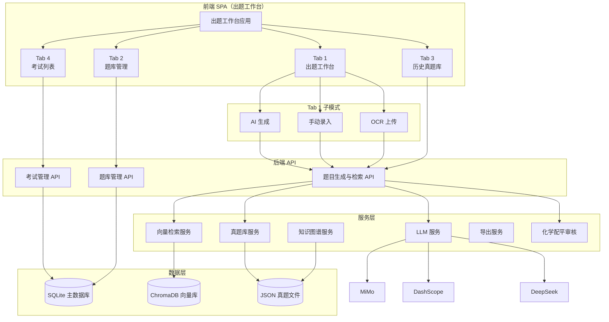
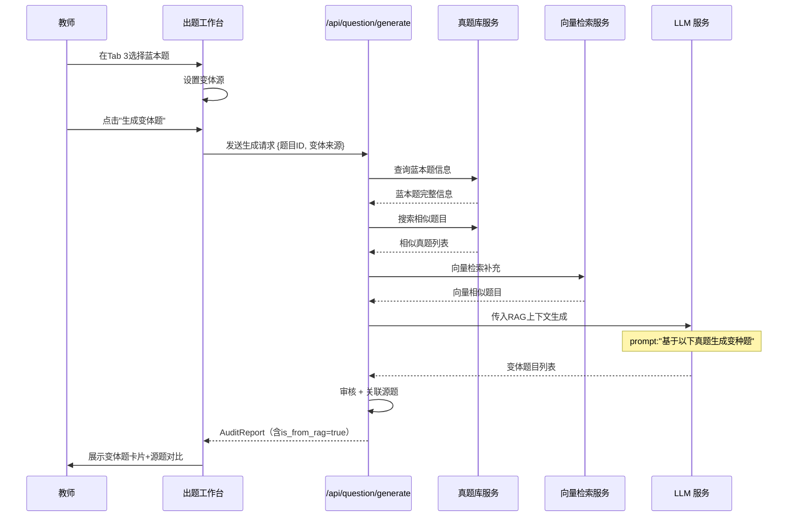
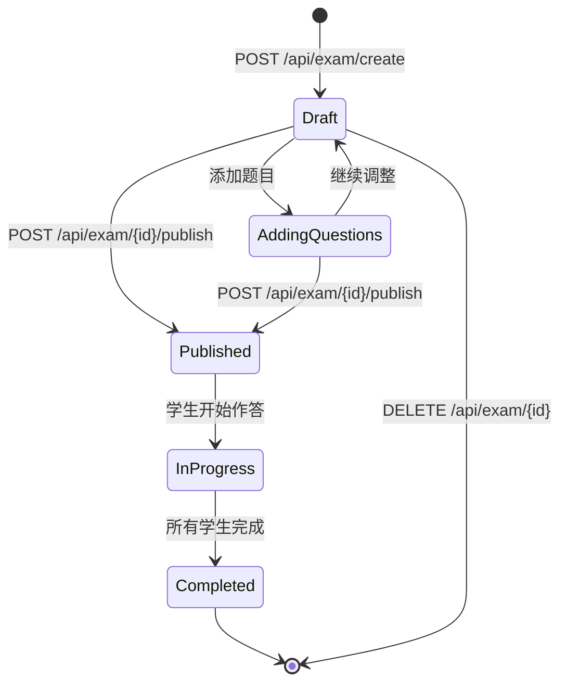
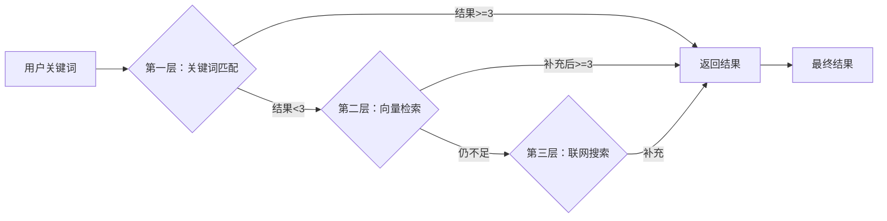
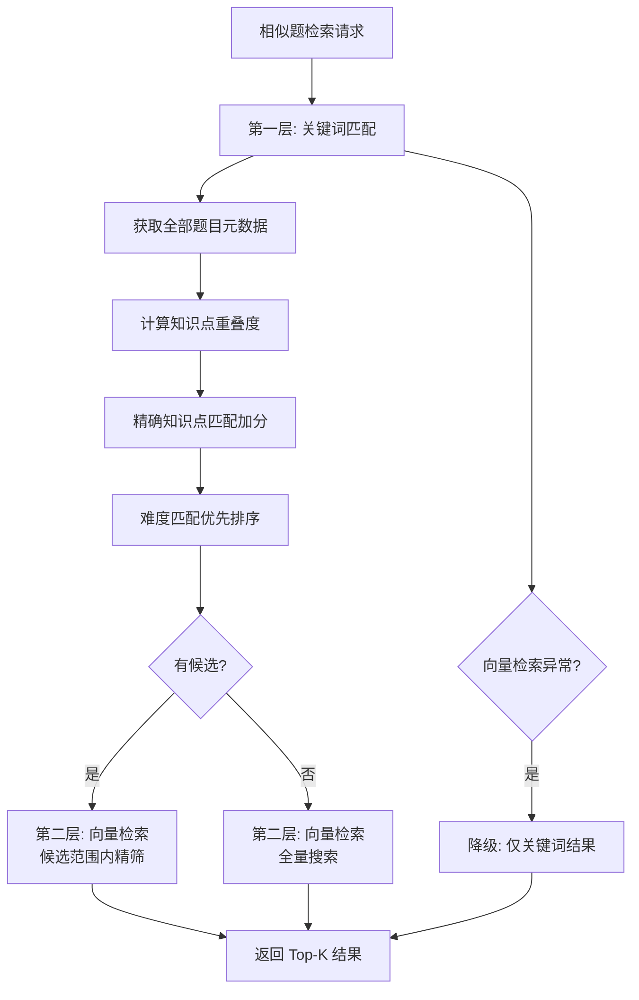
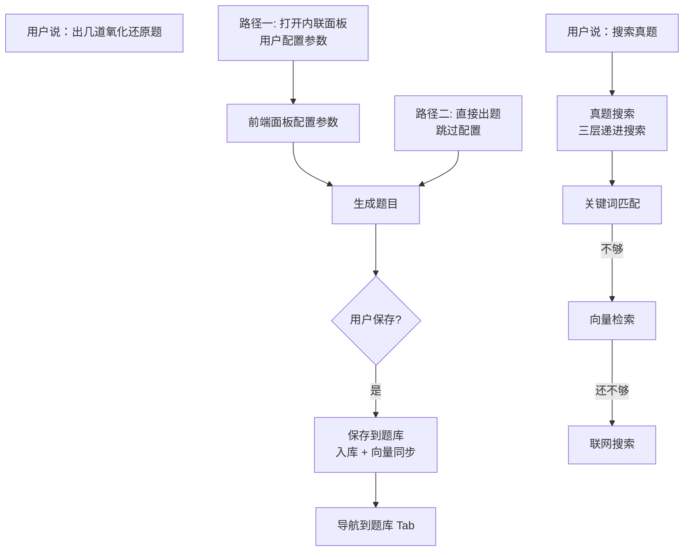

# 24. AI出题与题库管理系统设计

## 一、系统定位与设计目标

AIPM和传统PM：看企业要求：有些企业对AIPM（非常高-工程化设计-加分项-全栈全能-竞争力更强）

第一块：24号剩下的讲完 25-28快速过一遍（属于业务功能设计-挑一到二个文档做精读）

第二块：去讲一个PPT，这些设计文档怎么用workbuddy辅助你产出、标准的格式、方法论怎么迁移，

第三块：设计了这么多功能-agent化-30agent对话系统（核心）-给大家讲明白（怎么去设计业务类型的匹配的agent系统-通用agent（自由度））  piagent（read、write、bash、。。）高度自由化 agent（为什么不能，具体的业务场景不允许（所有的实际业务场景都是不允许的））

录播的内容-录播的文档（对工程化设计学习起来比较吃力的同学额，可以先看这个产品设计的思路。）

写完这个设计文稿，直接就可以通过AI agent工具（CC codex）复现MVP-设计文稿（功能设计+工程化落地设计-复合）-部分同学理解困难

### 1.1 系统定位

AI出题与题库管理系统（Exam Workbench）是ChemAI 智辅化学的内容生产中枢。它桥接教师的出题意图与学生的练习实践，是系统中从"教学规划"转向"练习落地"的关键环节。

在ChemAI整体架构中，该模块扮演三条角色：

- **内容工厂**：将知识点需求转化为可发布的化学题目，支撑日常练习、单元测试、考试模拟
- **知识锚点**：每道题目携带知识点标签与难度标定，为后续障碍诊断、错题归因、个性化推荐提供结构化数据
- **真题资产库**：历年高考真题与模拟题构成 RAG（检索增强生成）基础，支撑变体题生成和教学参考

### 1.2 设计目标

| 目标 | 描述 | 衡量标准 |
|------|------|----------|
| 三种出题模式 | AI生成、手动录入、OCR扫描导入三种途径覆盖全部出题场景 | 每种模式均可独立完成出题闭环 |
| 100%方程式审核通过率 | 所有AI生成题目经四维化学方程式审核后，系数配平/反应条件/产物正确性/结构正确性四个维度均无错误 | `AuditReport.overall_status = passed` |
| 历年真题RAG基座 | 全国卷+各省卷+模拟题作为变体生成参考，题库持续扩充 | 每道AI生成题关联1-2道源真题 |
| 教师时间节省 | 从传统2小时出卷缩短至10-15分钟 | 生成时间<30秒 + 人工审核5分钟 |

### 1.3 核心指标

- 题目生成质量：LLM生成题目经审核后通过率 > 95%
- 审核准确率：化学方程式配平审核准确率 100%
- 教师有效率：教师通过工作台出题并发布考试的成功闭环率
- 向量检索召回率：向量检索Top-5召回中至少1道与目标知识点高度相似（cosine similarity > 0.6）
- AI coding验收的主要标准之一

## 不在范围内的功能

- 不自动发布考试（需教师确认后手动发布）
- 不做跨学科出题
- 不出竞赛级难度题目（competition 仅支持手动录入）

---

## 二、出题工作台架构

### 2.1 整体架构

出题工作台是教师端应用中的四 Tab 单页工作台（React 组件化实现），承载 AI 生成、手动录入、OCR 上传三种出题模式。其要点：

- 组件化构建（React + antd），与教师端其他页面共用同一设计系统
- 通过 HTTP API 与后端服务通信
- KaTeX 渲染数学/化学公式
- 支持从Agent聊天中以 `_component: "exam-workbench"` 内联方式打开

出题工作台是一个四 Tab 单页应用，四个 Tab 分别对应不同后端 API 和服务模块。

### 2.2 四Tab结构

| Tab | 名称 | 功能描述 | 关键API |
|-----|------|----------|---------|
| Tab 1 | 出题工作台 | AI生成/手动录入/OCR扫描三种出题模式 | `POST /api/question/generate` |
| Tab 2 | 题库管理 | QuestionSet文件夹CRUD、题目浏览、批量操作 | `GET/POST/DELETE /api/exam-bank/exam-sets` |
| Tab 3 | 历史真题库 | 按地区/年份浏览真题，关键词搜索，选题作为变体蓝本 | `GET /api/question/historical` |
| Tab 4 | 考试列表 | 创建考试、管理题目、发布、导出、删除 | `POST /api/exam/create` 等 |

### 2.3 Tab 1 出题工作台（三种子模式）-理论来源（L1、L2（tom）、技术实现（你能实现MVP最好））

#### Mode 1: AI 生成（AI Generate）

界面控制组件：mermaid（mindmap）

api（不是你去找的，接入minerU和百度的api（占的比例很少）；api（后端开发），处理文档，然后做任务规划、claude code/codex）

- **题目类型选择器**：多选chip，5种题型（单选/填空/计算/实验/推断），每种可配置数量
  - 对应API参数 `question_types: ["choice:3", "fill:2", "calc:1"]`
- **难度选择**：下拉单选框，`easy` / `medium` / `hard` / `competition`
- **知识点选择**：可搜索chip输入框，从知识图谱服务获取候选列表
  - 搜索接口：`GET /api/question/kps`
  - 支持多选，自动补全
- **变体模式**（可选）：勾选"基于真题变体"，从Tab 3选择蓝本题
  - `variant_qid`：指定蓝本题ID
  - `variant_source: "historical"`：标识来源为历史真题
- **目标题库文件夹**：选择已有文件夹或"新建文件夹"，用于保存生成结果
- **生成按钮**：调用 `POST /api/question/generate`

#### Mode 2: 手动录入（Manual Entry）

表单字段：

- `content`：题目正文（Textarea，支持KaTeX语法）
- `options[]`：动态添加/删除选项，每题最多6个（A/B/C/D/E/F）
- `answer`：正确答案
- `knowledge_points`：chip选择器（同上）
- `difficulty`：下拉选择（easy/medium/hard/competition）
- `analysis`：题目解析（Textarea，可选）
- 提交调用：`POST /api/question/import`

#### Mode 3: OCR 扫描导入（OCR Upload）

- 拖拽区域：支持 JPG / PNG / PDF 拖拽
- 调用：`POST /api/question/import/ocr`
  - 后端处理：PDF用 `pdftotext -layout` 提取文本，图片用 `OCRService.recognize_answer_sheet()` 识别
  - 内部 `paper_cut_edu_vlm` 进行题目分割
- 识别完成后返回题目列表，用户确认后调用 `POST /api/question/import` 批量保存
- 如果OCR格式不规范，可通过 `POST /api/exam-bank/format-questions` 调用LLM格式化

### 2.4 弹窗系统

| 弹窗类型 | 用途 | 触发场景 |
|----------|------|----------|
| confirm | 确认删除/发布等操作 | 删除题库、删除考试 |
| prompt | 输入名称（新建文件夹、考试名称） | 创建QuestionSet、创建Exam |
| select | 选择目标（选题加入考试、选择变体蓝本） | 添加题目到考试、选择蓝本题 |
| preview | 预览题目内容和审核结果 | 查看题目详情 |
| manage | 管理题库文件夹内容（增删题目） | Tab 2 题库文件夹详情 |
| variant-browser | 浏览真题库，选择变体蓝本 | AI生成变体模式 |

### 2.5 KaTeX渲染

前端自定义化学式渲染函数（组件内注册），负责：

1. 识别`$...$`包裹的LaTeX公式并渲染
2. 处理化学方程式特殊符号：`\rightarrow`（箭头）、`\uparrow`（气体）、`\downarrow`（沉淀）、`\rightleftharpoons`（可逆）
3. 处理上下标：`H_2O`、`Fe^{3+}`
4. 处理反应条件：`\xrightarrow{MnO_2}`

---

> **前端设计规格详见**：[38-前端页面设计规格](./38-前端页面设计规格.md) §1.2

---

## 三、三种出题模式详细设计

### Mode 1: AI 生成

#### 3.1.1 请求结构

**API**: `POST /api/question/generate`

**请求体** (`QuestionGenerateRequest`)：

AI出题请求的数据结构（QuestionGenerateRequest），定义，包含以下字段：

- exam_type（字符串）：考试类型描述
- knowledge_points（字符串列表，必填）：目标知识点列表，每个元素为知识点名称字符串
- difficulty（字面量类型枚举，取值限于easy/medium/hard/competition四选一）：题目难度等级
- quantity（整数）：生成题目的数量
- barrier_type（可选字段，字面量类型枚举，取值concept概念型/reading审题型/expression表述型）：针对特定障碍类型生成题目，为空则不限
- question_types（可选字段，字符串列表）：题型指定，可选值包括choice选择题/fill填空题/calc计算题/experiment实验题/inference推断题
- variant_source（可选字段，字符串）：变体题来源标识，如"historical"表示基于历史真题
- variant_qid（可选字段，字符串）：变体蓝本题的唯一标识符，指定后系统将基于该题生成变体

**请求Schema** (`QuestionGenerateRequest`)：

| 字段 | 类型 | 必填 | 说明 |
|------|------|:--:|------|
| exam_type | string | 否 | 考试类型描述，如"期中考试""单元测试" |
| knowledge_points | string[] | 是 | 目标知识点列表，每个元素为知识点名称字符串 |
| difficulty | enum | 否 | 题目难度等级，取值 easy/medium/hard/competition，默认 medium |
| quantity | int | 否 | 生成题目数量，默认 10 |
| question_types | string[] | 否 | 题型指定，取值 choice/fill/calc/experiment/inference，默认 ["choice"] |
| variant_source | string | 否 | 变体来源标识，如 "historical" 表示基于历史真题 |
| variant_qid | string | 否 | 变体蓝本题ID，指定后系统将基于该题生成变体 |

**响应Schema**：

| 字段 | 类型 | 必填 | 说明 |
|------|------|:--:|------|
| questions | array | 是 | 生成的题目列表，每项为 Question 对象 |
| generated_count | int | 是 | 实际生成的题目数量 |
| total_available | int | 是 | 题库中与目标知识点匹配的可用题目总数 |

#### 3.1.2 LLM Prompt设计

出题服务模块的 相关模块。Prompt设计分为三个层次：

**第一层：System Prompt（教师角色定义）**

System Prompt 将 LLM 设定为"资深高中化学教师"角色，并注入题型占位符 `{题型描述}`。格式规范以中文列表形式严格约束五种题型的生成要求：选择题须提供4个选项（A/B/C/D）、标注正确选项、设置1到2个陷阱选项；填空题用下划线标记填空位置、答案仅包含填空内容、每道题可有1到3个空；计算题给出具体数值条件、答案须含分步计算（公式、数据代入、结果、结论）；实验题描述化学实验情境并包含2到3个子问题；推断题给出物质转化线索、要求学生推断未知物质并书写方程式。生产级设计的时候-每一个功能的子功能独立的行为规范（生产级-demo）

**第二层：化学式格式规范（强制约束）**

五条必须严格遵守的格式规则，适用于每道题和每条选项：

| # | 规则 | 正确示例 | 错误示例 |
|---|------|---------|---------|
| 1 | 所有化学式、离子式和方程式必须用 `$...$` LaTeX 行内公式包裹 | `$H_2O$`、`$Fe^{3+}$`、`$SO_4^{2-}$` | 直接写 H2O、Fe3+、SO42- 等裸字符串 |
| 2 | 下标用 `_` 表示，上标用 `^` 表示，元素符号首字母大写 | `$CO_2$`、`$Fe_2O_3$`、`$Cl^-$` | `$Co2$`（错把 Co 当 CO₂） |
| 3 | 方程式箭头用 `\rightarrow`，可逆反应用 `\rightleftharpoons` | `$2H_2 + O_2 \rightarrow 2H_2O$` | 用 Unicode `→` 或 `=` 替代箭头 |
| 4 | 反应条件用 `\xrightarrow{条件}`，加热用 `\xrightarrow{\triangle}` | `$2KClO_3 \xrightarrow{MnO_2}{\triangle} 2KCl + 3O_2$` | 条件写在方程式外部或未标注 |
| 5 | 中文正文中嵌入的化学式也必须用 `$` 包裹 | `$MnO_2$`是催化剂 | MnO2是催化剂 |

**第三层：User Prompt（分两种模式）**

模式A -- 有RAG上下文（>=3道相似真题）：提示词模板为"基于以下真题生成变种题"，逐条列出每道真题的内容（content字段）和答案（answer字段），然后要求生成指定数量、指定难度和指定题型的题目，并直接返回JSON格式。RAG-知识图谱和真题，有参考时模仿变体，没有参考从零创作（高考志愿-RAG）-system prompt

模式B -- 无RAG上下文（纯LLM生成）：提示词模板为"为以下知识点生成{quantity}道{difficulty}难度的{type_desc}"，列出目标知识点列表，要求从指定的活跃题型列表中选题，直接返回JSON格式。

LLM生成题目的输出JSON格式说明：顶层questions数组包含所有生成的题目对象，每个题目对象包含6个字段：

- content（字符串）：题目正文内容，$...$包裹的LaTeX格式书写化学式
- type（字符串）：题型标识，如"choice"选择题、"fill"填空题、"calc"计算题、"experiment"实验题、"inference"推断题
- options（字符串数组）：仅选择题有此字段，每个元素为选项文本，格式如"A. 选项内容"，支持LaTeX化学式
- answer（字符串）：正确答案，选择题为选项字母（如"D"），填空题为填空内容，计算题为分步答案
- knowledge_points（字符串数组）：对应的知识点列表，每项为知识点名称
- difficulty（字符串）：难度等级，取值easy/medium/hard/competition

#### 3.1.3 后处理流程

完整的后处理流程为七个步骤：

| 步骤 | 操作 | 说明 |
|:--:|------|------|
| 0 | RAG 检索 | 若用户指定了蓝本题则直接取用，否则从历史真题库中向量检索相似题目。不足 3 道时回退到关键词匹配 |
| 1 | LLM 生成 | 将 RAG 上下文传入 LLM，生成指定数量和难度的题目 |
| 2 | JSON 解析 | 解析 LLM 返回的 JSON，提取题目对象数组 |
| 3 | 方程式审核 | 每道题经四维安全审核引擎校验：系数配平、反应条件、产物稳定性、分子结构 |
| 4 | 真题关联 | 查找历年相似题目建立关联，标记 RAG 来源 |
| 5 | 陷阱提示 | 根据题目知识点自动生成教学提示（如"盐类水解"→"注意区分水解与电离的概念"） |
| 6 | 持久化 | 审核通过的题目写入题库，响应返回审核报告列表 |

**方程式审核（Step 3）**：基于四维安全审核引擎检测题目中的化学方程式。四维审核的完整设计（系数配平、反应条件、产物稳定性、分子结构）详见 [25-四维安全审核引擎设计](./25-四维安全审核引擎设计.md)。审核结果状态：`passed` / `warning` / `blocked`。

**Step 5：陷阱提示**
根据题目涉及的知识点自动生成教学提示：
- `盐类水解` → "注意区分'水解'与'电离'的概念"
- `电离` → "强电解质完全电离，弱电解质部分电离"
- `氧化还原` → "注意电子转移的方向和数目"

#### 3.1.4 题目卡片展示

每道生成的题目在下方面板中以卡片形式展示，包含：

- 题目内容（KaTeX渲染）
- 选项列表（选择题）
- 四维审核徽章（passed=绿色 / warning=黄色 / blocked=红色）
- RAG来源标识：`"基于 全国卷2024 T7 变体生成（相似度0.85）"`
- 陷阱提示（折叠面板）
- 操作按钮：编辑 / 删除 / 加入考试 / 加入题库

#### 3.1.5 Agent工具集成

教师可通过 Agent 对话直接出题。Agent 端的出题工具执行以下工作流：

1. 解析知识范围、难度、题型等参数
2. 查找 RAG 上下文（蓝本题或相似题）
3. 调用 LLM 生成题目
4. 化学式格式归一化（修复箭头、上下标等 LaTeX 细节）
5. 经四维安全审核引擎校验方程式
6. 返回题目列表并内联渲染出题面板

### Mode 2: 手动录入

**API**: `POST /api/question/import`

**接口位置**：

手动录入题目的请求结构（TeacherImportRequest，位于出题API模块）定义，包含4个字段：

- source_name（字符串）：来源名称，如"2024年长沙市一模"
- region（字符串）：地区标识
- year（整数）：年份
- questions（字典列表）：题目列表

每道题的格式规范包含以下字段：

- question_number（字符串）：题目在试卷中的编号，如"T1"
- original_number（字符串）：原始题号，如"1"
- question_type（字符串）：题目类型，如"single_choice"单选
- content（字符串）：题目正文内容
- options（字符串数组）：选项列表，每个元素格式为"A. 选项内容"
- answer（字符串）：正确答案
- analysis（字符串，可选）：题目解析内容
- knowledge_points（字符串数组）：知识点列表
- difficulty（字符串）：难度等级
- score（整数）：题目分值，如3分

导入时构建 `HistoricalQuestion` 对象，通过题库服务加入题库。前端表单字段：

| 字段 | 控件类型 | 必填 |
|------|----------|------|
| content | textarea（支持KaTeX语法高亮） | 是 |
| options[] | 动态输入行（+/-按钮控制数量） | 选择题必填 |
| answer | 文本输入 | 是 |
| knowledge_points | chip选择器（可搜索） | 是 |
| difficulty | 下拉框（4级） | 否（默认medium） |
| analysis | textarea | 否 |

### Mode 3: OCR 扫描导入

**API**: `POST /api/question/import/ocr`

**接口位置**：

流程：

流程：文件（JPG/PNG/PDF格式）上传后首先进行类型检测，分为两条处理路径。PDF文件 PDF 文本提取工具进行文本提取；图片文件则由 OCRService 的 recognize_answer_sheet 方法进行识别，内部调用 paper_cut_edu_vlm 进行题目分割。识别或提取完成后，调用 _parse_questions_from_text 函数进行文本解析，最终返回题目列表供用户预览。用户确认后调用 POST /api/question/import 接口批量保存入库。

文本解析逻辑 (`_parse_questions_from_text`，起)：
- 支持多种题号格式：`1.` `1．` `1、`
- 选项检测：`A.` `B.` `C.` `D.`（支持中英文标点）
- 知识点自动提取：基于44个关键词映射（氧化还原、电解、盐类水解等）
- 难度自动推断：根据内容关键词（"复杂"/"基础"等）
- OCR无法识别答案，需教师手动填写

如需LLM辅助格式化，可调用 `POST /api/exam-bank/format-questions`，将原始文本发给LLM进行结构化。

---

## 四、变体题生成逻辑

### 4.1 变体生成流程

教师选择蓝本题后，系统检索原题信息结合向量相似题目作为上下文，LLM 据此生成同知识点、同难度的变体题。

### 4.2 参数说明

| 参数 | 含义 | 示例 |
|------|------|------|
| `variant_qid` | 变体蓝本题ID | `nat_2024_t7` |
| `variant_source` | 变体来源标识 | `"historical"` — 来自历史真题库；留空 — 纯AI生成 |

当指定了蓝本题 ID 时，系统从题库服务中查询该题目的完整信息。蓝本题的 `knowledge_points`、`difficulty`、`content` 会被注入到LLM的prompt中：

此时LLM收到的提示词模板为：以"基于以下真题生成变种题"开头，列出选定的蓝本题的题目内容和正确答案作为参考，然后要求生成指定数量、指定难度和指定题型的变种题。

### 4.3 变体策略

LLM维护以下变体维度：
- **数值变体**：改变计算题的数字但保持计算逻辑
- **物质替换**：替换同族/同类物质（如KClO3 → KMnO4）
- **选项重组**：保留知识点但更换选项内容
- **题干重写**：同一考点换一种问法/情境
- **难度调整**：在原题基础上增加或减少信息量

### 4.4 变体题响应标识

变体题响应的AuditReport审核报告中携带的RAG标记字段：

- is_from_rag（布尔值）：标记该题是否基于检索增强生成（RAG），即是否引用了历史真题作为参考
- source_question_id（可选字符串）：若is_from_rag为True，此处记录源真题的唯一标识符
- source_question_preview（可选字符串）：源真题内容的前100字符预览，供前端展示参考
- similarity（可选浮点数）：与源题之间的向量相似度分数（余弦相似度），取值0到1之间，值越大越相似
- match_method（可选字面量类型，取值vector/simple/blueprint）：匹配方法标识——vector为向量检索匹配、simple为简单关键词匹配、blueprint为直接指定蓝本题

前端据此展示："基于全国卷2024 T7变体生成（相似度0.85）"。

---

## 五、题库管理系统

### 5.1 两级数据结构

题库采用两级结构管理：

层级关系以树形结构表示：QuestionSet 作为顶层文件夹，其下挂载多个 QuestionSetItem 作为题目引用，每个 QuestionSetItem 指向一个 Question 题目实体。QuestionSet 内可包含任意数量的题目引用和题目实体。

### 5.2 数据模型

**QuestionSet（题库文件夹）**：顶层组织单元，教师可创建多个文件夹分类管理题目。

核心属性：文件夹名称、所属教师、来源地区与年份、描述说明、题目数量统计、是否为系统预设（预设文件夹不可删除）、创建时间。

**QuestionSetItem（文件夹-题目关联）**：连接题库文件夹与具体题目的中间实体。

核心属性：所属文件夹、关联题目、排序顺序、加入时间。

### 5.3 API端点

| 方法 | 路径 | 说明 |
|------|------|------|
| GET | `/api/exam-bank/exam-sets` | 列表（支持 teacher_id/region/year/page 筛选） |
| POST | `/api/exam-bank/exam-sets` | 创建新文件夹 |
| GET | `/api/exam-bank/exam-sets/{set_id}` | 文件夹详情（含所有题目） |
| DELETE | `/api/exam-bank/exam-sets/{set_id}` | 删除文件夹（限非系统预设） |
| DELETE | `/api/exam-bank/exam-sets/{set_id}/questions/{question_id}` | 从文件夹移除单题 |
| POST | `/api/exam-bank/import-questions` | 批量导入题目到文件夹 |
| GET | `/api/exam-bank/papers` | 试卷树形分组（地区→年份） |
| GET | `/api/exam-bank/historical` | 历史真题分页查询 |
| POST | `/api/exam-bank/format-questions` | OCR文本格式化 |

### 5.4 Agent工具集成

**save_to_bank** ()：

工作流：
1. 解析JSON题目数据 → `q_list`
2. 自动生成文件夹名（如 "AI生成-氧化还原-07091045"）
3. 创建 `QuestionSet` + 逐题创建 `Question` + `QuestionSetItem`
4. 同步到 真题库服务和 `ChromaDB`（向量索引）
5. 返回 `_route` 字段：导航到 `exam-v2` 页面并打开 `bank` Tab

save_to_bank工具返回的导航指令结构：_route对象包含三个字段——navigate（布尔值，设为True表示需要触发页面导航跳转）、page（字符串，值为"exam-v2"表示目标页面为考试工作台）、populate（填充指令对象，包含target组件标识"exam-set"和data数据对象，数据对象中set_id为题库文件夹标识符和set_name为文件夹名称）、actions（操作指令数组，包含一个action类型为"openTab"且payload为"bank"的操作，表示打开题库管理Tab页）。

**list_banks** ()：
返回所有 QuestionSet 的 set_id、名称、题目数量。

**delete_bank** ()：
删除 QuestionSet 及其 QuestionSetItem 关联（题目实体保留）。需先调用 `request_approval` 确认。

---

## 六、考试生命周期

### 6.1 状态机

考试从创建草稿开始，经添加题目、发布、学生作答到完成，覆盖完整的考试生命周期。

### 6.2 各阶段API

| 阶段 | API | 说明 |
|------|-----|------|
| 创建(Draft) | `POST /api/exam/create` | 创建考试记录：`{class_id, name, exam_date}` → `record_id` |
| 添加题目 | `POST /api/exam/{id}/questions` | 批量关联已有题目（支持题库题和历史题） |
| 查看题目 | `GET /api/exam/{id}/questions` | 获取考试当前题目列表 |
| 移除题目 | `DELETE /api/exam/{id}/questions/{qid}` | 从考试中移除题目（解除关联） |
| 发布(Published) | `POST /api/exam/{id}/publish` | 设置发布状态，写入 `question_stats.published=true` |
| 完成(Finalized) | `POST /api/exam/{id}/finalize` | 统计参考人数、计算班级统计 |
| 导出试卷 | `GET /api/question/export/{record_id}` | 导出Word/PDF（含答案或不含答案） |
| 结果总览 | `GET /api/exam/{exam_id}/results` | 全班学生成绩总览 |
| 学生详情 | `GET /api/exam/{exam_id}/result/{student_id}` | 单个学生每题作答详情 |
| 删除 | `DELETE /api/exam/{exam_id}` | 级联删除：答题记录 + 题目关联 + 考试记录 |

### 6.3 发布后行为

调用 `POST /api/exam/{id}/publish` 后：
1. 验证考试至少有1道题
2. 设置 `question_stats.published = true`
3. 设置 `question_stats.published_at`（ISO时间戳）
4. 设置 `question_stats.question_count`
5. 统计 `total_students`（从 `Student` 表查询班级学生数）
6. 发布后考试出现在学生端练习任务列表中

### 6.4 题目关联的双渠道支持

`POST /api/exam/{id}/questions` 同时支持两种题目来源：

题目关联的双渠道支持逻辑：遍历请求中的question_ids题目ID列表，对每个qid执行以下判断：

- 渠道一（题库已有题目）：通过Question表按question_id查询，若找到匹配记录，则直接将该题目的record_id字段设置为当前考试ID，完成关联
- 渠道二（历史真题）：若Question表中未找到，则调用题库服务的历史真题查询能力从历史真题库中查找。若找到历史真题，则该真题的数据（题目内容、选项、答案、知识点、难度等）构造一个新的Question对象，将新对象写入数据库完成"复制到题库"操作，再自动关联到当前考试

---

## 七、历年真题库

### 7.1 数据规模与结构

| 来源 | 年份范围 | 题目数量 | 存储路径 |
|------|----------|----------|----------|
| 全国卷 | 2008-2020 | 已导入 2020 年全国卷，其余年份持续导入 | 真题题库目录 |
| 湖南卷 | 2021-2025 | 导入管线就绪，数据持续扩充 | 真题题库目录 |
| **合计** | | **持续扩充中** | |

### 7.2 数据格式

文件位于 真题题库目录，结构：

历史真题JSON文件的数据格式说明。每份试卷的JSON文件顶层包含以下字段：

- paper_name（字符串）：试卷全名，如"2020年全国卷高考化学试卷"
- region（字符串）：试卷所属地区，如"全国卷"或"湖南卷"
- year（整数）：试卷年份
- subject（字符串）：学科，固定为"化学"
- total_score（整数）：试卷总分，如115分
- question_count（整数）：题目数量，如12题
- questions（数组）：题目列表，每道题包含以下字段：
  - exam_id（字符串）：题目唯一标识符，命名格式为来源缩写加年份加题号，如"nat_2020_t1"表示全国卷2020年第1题
  - source（字符串）：来源描述，如"全国卷2020"
  - year（整数）：年份
  - region（字符串）：地区
  - question_number（字符串）：题号标识，如"T1"
  - content（字符串）：题目正文内容，可能包含LaTeX格式的化学式
  - options（字符串数组）：四个选项（A/B/C/D），仅选择题有此字段
  - answer（字符串）：正确答案
  - analysis（字符串）：题目解析内容
  - knowledge_points（字符串数组）：关联的知识点列表
  - difficulty（字符串）：难度等级
  - discrimination（浮点数）：区分度指标，取值0到1之间
  - score（整数）：题目分值
  - page_image（字符串）：题目在原始试卷中的截图文件名

### 7.3 加载机制

真题库加载：

1. 遍历 真题题库目录 下的地区文件夹（全国卷/湖南卷）
2. 逐年份目录加载JSON文件
3. 每道题构建为历史题目数据对象
4. 每份试卷构建为 `ExamPaper` 对象，存入试卷缓存
5. 启动时打印：`[ExamBank] 从 N 个文件加载了 M 道真题`

### 7.4 搜索策略（三层搜索）

真题搜索工具 `search_exam_bank` () 实现三层递进搜索：

真题搜索采用三级递进策略：先本地关键词匹配，不足时启用向量召回，仍不足则联网搜索补齐。

**第一层：关键词匹配**  
- 结构化过滤：source / year / region / knowledge_point / difficulty
- 关键词匹配：仅在 `knowledge_points` 字段中搜索（不在content/answer中搜索，避免噪音）
- 中文分词：按 `的与和、，+\s` 分割关键词，过滤停用词（"题目"、"真题"、"高考"等）

**第二层：向量检索补充**  
- 当关键词匹配结果 `< limit` 且 `use_vector=True` 时自动触发
- 查询候选ChromaDB，筛选 similarity >= 0.6 的结果
- 提取 `exam_id`（去除 `::kp-n` chunk后缀），去重后补充

**第三层：联网搜索兜底** (联网搜索)
- 仅在 `keyword_count < 3` 时触发（即关键词匹配极少）
- 调用 MiMo enable_search 联网搜索
- DeepSeek 二次总结搜索结果
- 返回时附带来源链接

### 7.5 前端展示

Tab 3 "历史真题库"支持：
- **树形浏览**：地区 → 年份 → 试卷（懒加载 `GET /api/question/exam-sets/{source}`）
- **关键词搜索**：输入框实时搜索，调用 `GET /api/question/historical?keyword=xxx`
- **题目卡片展示**：题目内容、选项、答案（默认折叠）、解析、知识点标签、难度徽章、配图
- **选题操作**：单选/多选题目 → "加入考试"或"设为变体蓝本"

---

## 八、向量检索架构

### 8.1 ChromaDB配置

| 配置项 | 值 |
|--------|-----|
| 客户端 | `chromadb.PersistentClient` |
| 存储路径 | `ChromaDB存储路径配置`（默认 ChromaDB持久化目录） |
| Collection名称 | `exam_questions` |
| 距离度量 | `cosine` + HNSW 索引空间 |
| Embedding模型 | `dashscope text-embedding-v3`（1024维） |
| 回退方案 | MD5哈希伪向量（测试环境）；ChromaDB 不可用时降级为纯关键词匹配，不中断搜索功能 |
| 维度保护 | 构建索引时检测已有向量维度，若与当前 embedding 模型输出维度不一致则自动清空 Collection 重建 |

### 8.2 索引策略

每个知识点生成一个独立向量（索引构建方法：

举例说明：题目 nat_2020_t1 标注了4个知识点，系统会为每个知识点生成一个独立向量。向量1的ID为 nat_2020_t1::kp-0，对应考点"乙醇的溶解性"；向量2的ID为 nat_2020_t1::kp-1，对应考点"次氯酸钠的氧化性"；向量3的ID为 nat_2020_t1::kp-2，对应考点"过氧乙酸的相对分子质量计算"；向量4的ID为 nat_2020_t1::kp-3，对应考点"氯仿的化学名称"。

Embedding文本构建（`_build_embed_text`：用于生成向量的文本内容格式为"考点：{知识点名称}。题型：{题型标识}。难度：{难度等级}。来源：{地区+年份+题号}。题目：{题目正文截取前500字符}。答案：{正确答案}"。这种语义化拼接将知识点、题型、难度、来源、题目内容和答案全部融入一条文本，使得向量相似度检索能够综合多个维度的信息进行匹配。

这种策略确保每道题可以从任意一个知识点维度被检索到。

### 8.3 两层检索

向量检索采用两层策略：第一层关键词匹配缩小候选范围，第二层 ChromaDB 向量检索精筛 Top-K 结果。

**第一层：关键词匹配**：将输入的知识点列表与题库中每道题的知识点标签进行集合重叠度计算。精确匹配的目标知识点名称额外加权。最终按重叠度降序排列，取 Top-20 候选进入第二层。

排序：`(overlap_score, difficulty_match)` -- 重叠度高且难度匹配的排在前面。取Top-20候选进入第二层。

**第二层 -- ChromaDB向量检索** ()：
- 有候选时：`where={"id": {"$in": candidate_ids[]}}` 限定范围
- 无候选时：全量搜索
- 结果按 `similarity (1 - distance)` 降序排列
- 最终返回 Top-limit 结果

### 8.4 索引构建与同步-可以不掌握的东西-可以去学

启动时构建（系统启动时调用）：系统通过调用向量搜索服务的build_index_from_exam_bank方法触发索引构建。该方法的智能判断流程：

1. 检查ChromaDB是否已有数据（即collection是否非空）
2. 检查向量维度是否匹配——比较ChromaDB中已有向量的维度与当前embedding模型输出的维度是否一致，防止因模型升级导致的维度不兼容
3. 检查数量是否达标——比较 ChromaDB 中已有向量数量是否超过预期（预期总数 = 已导入真题数量 × 每道题平均知识点数）
4. 综合判断：若以上三项检查全部通过，说明索引是最新的且兼容，跳过重建；若任一项不通过，则清空已有collection后重新构建全量索引

**增量同步**：
`save_to_bank` 工具和 `POST /api/exam-bank/import-questions` 在保存题目后，同时调用向量检索服务的索引构建方法（追加模式）增量写入。

### 8.5 RAG上下文注入

当向量检索返回3道及以上相似题目时，这些题目的内容（content字段）和答案（answer字段）被注入到LLM的用户提示词中。具体注入逻辑：首先判断rag_context上下文列表是否非空且长度大于等于3。若满足条件，则遍历上下文中的前5道题（最多5道），对每道题生成"真题{N}: {题目内容} 答案:{标准答案}"格式的文本行，用两个换行符连接。最终的提示词格式为"基于以下真题生成变种题:\n{拼接的真题上下文}\n生成{N}道..."。然后将此提示词作为user prompt发送给LLM。

如果RAG上下文不足3道题，则降级为纯LLM生成模式——提示词中不包含历史真题参考，直接基于知识点的自然语言描述生成题目。

---

## 九、知识图谱

### 9.1 知识点层级结构

知识点采用 category 分类的扁平结构：

知识点数据采用category分类的扁平结构存储，存放在data/knowledge_graph/knowledge_points.json文件中。每个知识点以知识点名称作为JSON对象的键，值为一个嵌套对象。该嵌套对象包含以下五个字段：

- category（字符串）：知识点所属的类别名称，与知识点名称相同时表示该知识点是类别
- description（字符串）：知识点的中文描述说明
- related_kps（字符串数组）：关联知识点的名称列表，用于知识图谱中节点之间的边关系
- difficulty（字符串）：该知识点的总体难度级别，取值为easy/medium/hard
- exam_frequency（字符串）：该知识点在考试中的出现频率，取值如very_high/medium/low

例如，"氧化还原反应"知识点属于其自身类别，描述为"反应中电子的转移"，关联知识点包括"电离""原电池""电解池"三个相关领域，难度为hard，考试频率为very_high。

目前覆盖约20+个核心知识点，分布在以下类别：

| 类别 | 包含知识点 |
|------|-----------|
| 电解质溶液 | 电解质溶液, 电离, 盐类水解 |
| 离子反应 | 离子反应 |
| 氧化还原反应 | 氧化还原反应 |
| 电化学 | 原电池, 电解池 |
| 化学计量 | 物质的量, 阿伏伽德罗常数, 摩尔质量 |
| 物质结构 | 元素周期律, 原子结构, 共价键, 离子键 |
| 化学反应速率与平衡 | 化学反应速率, 化学平衡, 勒夏特列原理 |
| 有机化学 | 有机化合物, 官能团, 同分异构体, 酯化反应 |

### 9.2 知识图谱服务

核心方法：

| 方法 | 用途 | 被调用场景 |
|------|------|-----------|
| `get_knowledge_point(name)` | 获取单个知识点详情 | 出题工作台知识点详情展示 |
| `search_knowledge_points(keyword)` | 按关键字模糊搜索 | 出题工作台知识点输入框搜索 |
| `get_related_knowledge_points(name)` | 获取关联知识点 | 知识点推荐、层级展开 |
| `add_knowledge_point(name, data)` | 动态添加知识点 | 扩展知识图谱 |
| `query_similar_knowledge(text, limit)` | 向量查询相似知识点 | 知识点语义关联 |

### 9.3 在出题系统中的应用

1. **AI出题 -- 知识点建议**：当教师输入知识点时，`search_knowledge_points` 提供自动补全
2. **出题工作台 -- 知识点选择器**：从 `GET /api/question/kps` 加载分类知识点树
3. **障碍诊断 -- 弱知识点检测**：对比学生错误题目的知识点分布，找出薄弱环节
4. **变体生成 -- 关联知识点推荐**：通过 `get_related_knowledge_points` 推荐可替换的关联知识点

---

## 十、试卷导出服务

### 10.1 Word导出

**API**: `GET /api/question/export/{record_id}?format=docx&with_answers=true`

试卷导出函数export_exam_to_docx的该函数接收四个参数——questions（字典列表，每道题的完整数据）、exam_name（字符串，作为Word文档中显示的考试名称）、school_name（字符串，默认空字符串，学校名称）、with_answers（布尔值，控制是否导出含答案的教师版）。函数返回io.BytesIO内存中的二进制数据流，可直接作为HTTP响应的文件下载。

**排版规格**：

| 属性 | 值 |
|------|-----|
| 页面大小 | A4 (21cm x 29.7cm) |
| 上边距 | 2.5cm |
| 下边距 | 2.0cm |
| 左边距 | 2.5cm |
| 右边距 | 2.0cm |
| 正文字体 | SimSun 11pt |
| 标题字体 | 16pt 加粗居中 |
| 密封线区域 | 姓名/班级/得分信息区 |

**题目分类渲染**：
- 选择题：`一、选择题` -- 题号 + 题干 + 缩进选项
- 填空题：`二、填空题` -- 题号 + 题干（保留 ___ 标记）
- 计算题：`三、计算题` -- 题号 + 题干 + 答题空白区
- 实验题：`四、实验题` -- 同上
- 推断题：`五、推断题` -- 同上

**两种导出模式**：
- `with_answers=false`：学生版，不含答案
- `with_answers=true`：教师版，红色标注答案 + 绿色标注解析，底部有"（含答案版）"标记

### 10.2 HTML报告生成

HTML报告生成函数generate_report_html的接收两个参数——exam_data（字典类型，包含考试的全部数据和统计结果）、report_type（字符串，决定报告类型为"teacher"教师版或"student"学生版）。函数返回字符串类型的完整HTML文档，可直接在浏览器中渲染或在转换为PDF后分发。

输出内容：
- 标题：班级错题分析报告 / 个人学习报告
- 统计卡：平均分、参考人数、题目数
- TOP5 高频错题表格
- 教师版额外：知识点错误分布表
- 鼓励语区块
- 打印/导出PDF按钮

---

## 十一、Agent 工具集成

### 11.1 工具清单

| 工具 | 触发意图 |
|------|----------|
| 搜索真题 | 搜索真题、"找高考题"、"有没有xx题" |
| 打开出题面板 | 出题意图、"出题"、"出卷"、"组卷" |
| 生成题目 | 参数齐全的直接出题 |
| 保存到题库 | 出题完成后的保存 |
| 查看题库列表 | 查看题库列表 |
| 删除题库 | 删除题库（需审批） |
| 联网搜索 | 联网搜索（搜索真题的兜底补充） |

### 11.2 工具协作关系

用户说出题意图后，系统可选择打开内联工作台面板让用户配置参数，或直接出题，完成后保存入题库并自动同步向量索引。agent

### 11.3 内联工作台机制-偏技术

`show_exam_workbench` 和 `generate_questions` 都通过 `_component` 字段返回内联面板：

内联工作台返回数据的JSON结构说明：顶层包含两个字段——message为面向用户的文本消息（如"参数已确认..."），_component为内联组件渲染指令。_component对象包含两个字段：component为组件类型标识（固定值"exam-workbench"表示考试工作台内联面板）；params为传递给工作台组件的参数对象，包含三个字段——knowledge_points知识点字符串数组（如["氧化还原反应"]）、difficulty难度等级（如"medium"）、types题型配置数组（每项包含val题型标识如"single_choice"、active是否激活为true、qty生成数量如3）。

前端检测到 `_component.component === "exam-workbench"` 时，在聊天界面中内嵌渲染出题工作台组件，用户无需离开对话即可完成出题全流程。

### 11.4 化学式归一化

化学式归一化处理负责后处理 LLM 输出的化学式格式：

1. 修复 `$...$` 内部箭头：`→` → `\rightarrow`、`⇌` → `\rightleftharpoons`
2. 修复气体/沉淀符号：`↑` → `\uparrow`、`↓` → `\downarrow`
3. 检测裸化学式（如 `Cl2`、`Fe3+`）并判断是否需要 `$...$` 包装

---

## 十二、设计决策与约束

### 12.1 关键设计决策

1. **组件化 SPA 而非多页拼接**：教师端以组件化 SPA 承载高频交互页面（Agent 对话、出题工作台、学情面板），共享设计系统与状态管理；移动端保持轻量页面。对于功能边界明确的业务模块，组件化是合理选择。

2. **每个知识点一个向量**：相比"一道题一个向量"，`kp::chunk` 策略允许从多个角度检索同一道题，提高了跨知识点检索的召回率。

3. **向量检索 + 关键词匹配的双层架构**：ChromaDB的embedding call是网络请求，先用内存关键词匹配缩小候选集可以有效减少embedding API调用量。

4. **联网搜索作为兜底而非主力**：联网搜索结果不可控（来源质量、内容一致性），因此仅在本地题库+向量检索都无法满足时触发，且结果明确标注"网络补充，仅供教学参考"。

5. **题目持久化两步走**：AI生成的题目先通过 `Question` 模型写入SQLite（结构化存储），再同步到 真题库服务和 `ChromaDB`（向量索引），保证三处数据一致。

### 13.2 约束与限制

- 向量embedding依赖 DashScope API，网络不稳定时回退到MD5伪向量（仅测试可用）
- OCR识别精度受限于 `paper_cut_edu_vlm` 模型能力，复杂排版试卷可能需要人工校正
- KaTeX渲染在前端进行，复杂化学式（如多步反应机理）可能出现溢出行宽的问题
- ChromaDB是嵌入式向量库，暂不支持分布式部署，数据量增长后可能需要迁移到Milvus等方案

---

## 十三、真题库服务加载策略

### 14.1 目录结构设计

真题 JSON 文件按**地区/年份/试卷名称**三层目录结构组织：

JSON文件按三层目录结构组织：第一层为地区目录（全国卷和湖南卷两个目录），第二层为年份子目录（全国卷从2008至2020共13个年份，湖南卷从2021至2025共5个年份），第三层为具体的试卷JSON文件（如"全国卷2008理综化学.json"）。整个目录树存放在 真题题库目录/ 路径下。

### 14.2 加载流程

相关模块执行以下步骤：

1. 读取配置 `真题题库路径配置` 获取真题根目录路径
2. **第一层遍历**：遍历根目录下的所有条目，跳过非目录项。目录名即为地区名（如"全国卷"、"湖南卷"）
3. **第二层遍历**：对每个地区目录，遍历其下的所有条目（年份目录），跳过非目录项。尝试将目录名转换为整数年份，转换失败则跳过
4. **第三层遍历**：对每个年份目录，遍历其中的所有 .json 文件，逐个解析为试题数据
5. **兼容旧目录结构**：如果上述三层遍历未能加载任何文件（loaded == 0），回退到旧的 national/ 和 hunan/ 平铺目录格式进行加载

### 14.3 文件加载逻辑

文件解析逻辑如下：

1. 打开 JSON 文件（utf-8 编码）
2. 解析 JSON 的 `questions` 数组，将每个字典解包为历史题目数据结构
3. 将题目实例追加到题目列表
4. 创建试卷索引：生成 paper_id（格式为 `{region}{year}`），构造 `ExamPaper` 对象（包含 paper_id、source、year、region、paper_name、subject="化学"、total_score、question_count 和 questions 列表），存入试卷缓存

---

## 十五、向量检索服务两层检索设计

### 15.1 设计定位

向量检索服务基于 ChromaDB 实现题目相似度检索。采用**两层检索策略**：第一层关键词匹配（初筛），第二层向量检索（精筛）。

### 15.2 初始化

初始化时读取配置 `CHROMA_DB_PATH` 获取 ChromaDB 持久化路径（默认 ChromaDB持久化目录），collection 名称固定为 "exam_questions"。相关模块通过 创建 ChromaDB 持久化客户端并获取或创建集合。若 chromadb 未安装，设置 chroma_client 和 collection 为 None，服务降级为仅关键词匹配。

### 15.3 索引构建策略

索引构建逻辑将题目索引到向量库。核心策略是**每个知识标签生成一个独立向量**而非每道题一个向量。mode 参数支持 "replace"（清空集合重建）和 "append"（追加到已有数据）。

索引执行流程：
1. 检查 Chroma 是否可用，不可用则打印警告并返回 0
2. 若 mode 为 "replace" 且集合中有数据，删除所有现有数据
3. **维度不匹配检测**：取集合中第一条已存在的向量与即将索引的第一个知识标签向量进行维度比较。若维度不一致，清空集合并重建（防止 Chroma 维度不匹配异常）
4. 遍历所有题目，对每个题目的每个 knowledge_points 列表项调用 `_build_embed_text` 构建嵌入文本（包含知识点名称、题型、难度、来源、年份、题号、内容、答案），调用 `_get_embedding` 获取向量
5. 批量 `collection.add()` 写入 ChromaDB

### 15.4 两层检索执行流程

相似题检索逻辑执行两层检索：

**第一层 — 关键词匹配**：遍历题目列表，计算 question_text 与题目 content 的关键词匹配度。返回匹配分数最高的 N 个候选题目作为初筛结果。

**第二层 — 向量检索**：将第一层候选或全部数据（若第一层为无关键词匹配）通过 `collection.query()` 进行 Chroma 向量相似度查询，返回 top_k 条最终结果。

若 Chroma 不可用（chroma_client 为 None），仅第一层关键词匹配结果。

---

## 十六、LLM 服务能力总览

LLM 服务是出题系统与 AI 模型之间的统一调用层，提供以下核心能力：

### 通用文本生成
支持自定义 System Prompt 和 User Prompt，可控制温度、最大 Token 数等生成参数。Provider 设为自动时按优先级依次尝试可用的 LLM 提供商。支持开启联网搜索能力以获取最新信息。

### 出题与题目处理
- **AI 出题**：根据知识点、难度、数量、题型等参数生成题目。支持变式题模式——指定蓝本题后，系统检索原题信息作为 few-shot 上下文，生成同知识点、同难度的变体题。支持 RAG 真题上下文增强。
- **题目审核**：以高中化学教研专家视角审核生成题目的科学性、准确性和适当性。
- **变式题生成**：基于指定蓝本题自动生成同类型的变体练习题。

### 诊断与学习
- **障碍类型诊断**：以教育心理学视角分析学生的错误作答，归类为概念理解型、审题障碍型或表述障碍型，输出置信度和教学建议。
- **学习计划生成**：根据学生的障碍类型和薄弱知识点，生成个性化的学习提升方案。

### 视觉分析
支持四种试卷类型的多模态识别：答题卡、印刷试卷、手写试卷和混合类型。自动检测图片格式（PNG/JPEG），优先使用视觉原生模型，失败时降级到备选模型。支持 120 秒超时和自动重试。

### Provider 路由与可靠性
- **多 Provider 回退**：auto 模式按 DashScope（通义千问）→ DeepSeek → MiMo 优先级依次尝试。各 Provider 的适用场景不同——出题和通用文本生成走主推理模型，视觉识别走多模态模型
- **超时配置**：通用文本 30s、DashScope 60s、视觉识别 120s。视觉模型处理大图片需要更长的等待时间
- **温度参数**：出题生成 0.7（需要创意和多样性）、题目审核 0.3（需要稳定准确）、视觉分析 0.1（需要精确识别）
- **max_tokens**：通用场景 2000 tokens、学习计划生成 4096 tokens（需要更长的输出）
- **指数退避重试**：遇到限流或临时故障时，以递增间隔自动重试（通用 3 次、视觉 2 次，退避间隔 `sleep(2^attempt)` 秒）
- **速率限制**：每个 Provider 独立维护每分钟调用上限（默认 30 次/分钟），滑动窗口计数
- **故障传播**：LLM 调用失败经重试耗尽后向上抛出异常，由上层 API 端点或 Agent 工具捕获，返回 500 错误或结构化错误信息给用户
- **可选本地部署**：支持接入本地部署的开源模型作为补充

---

## 错误处理

- **LLM 生成超时（30s）**: 返回部分结果 + 提示重试
- **LLM 返回非 JSON 格式**: JSON 解析兜底（正则提取）+ 标记需人工审核
- **ChromaDB 不可用**: 降级为纯关键词匹配
- **向量维度不匹配**: 自动清空 Collection 重建索引
- **RAG 上下文超 Token 预算**: 按知识点优先级截断
