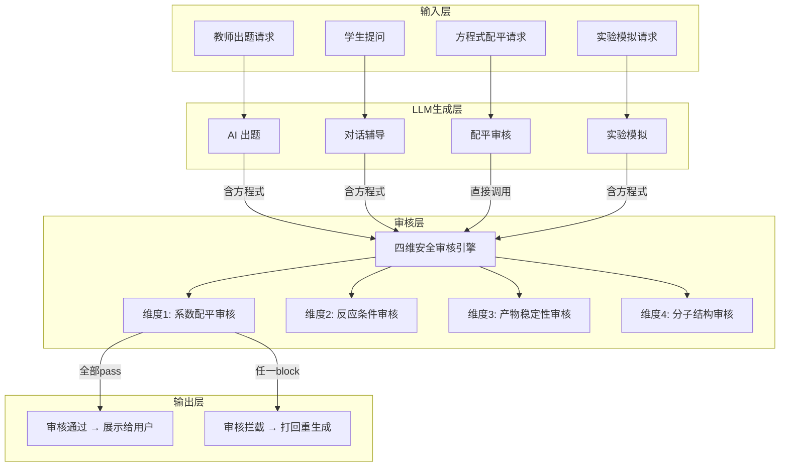
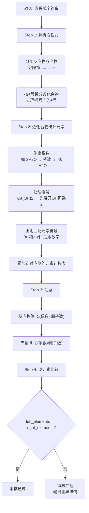
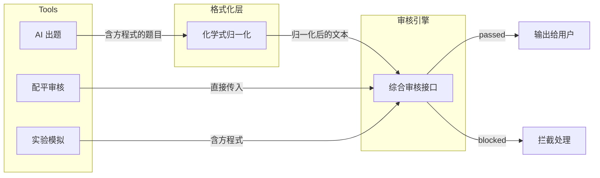
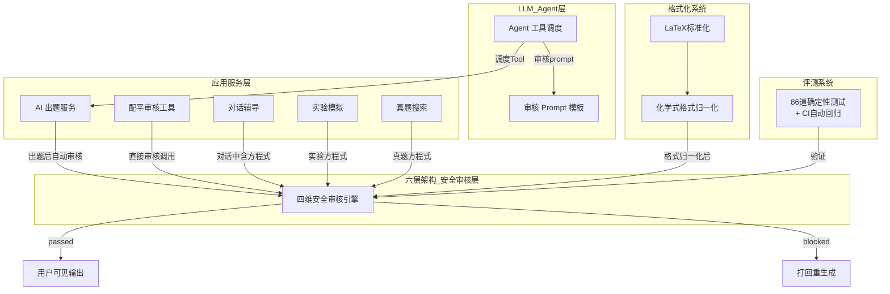

# 25. 四维安全审核引擎设计

> **文档性质**：核心安全设计文档 | **所属产品**：ChemAI（智辅化学） | **红线级别**：HARD RED LINE
>
> **一句话定位**：化学方程式系数配平必须零错误。本引擎是 ChemAI 所有输出化学方程式的最后一道安全门。

---

## 一、系统定位与设计目标

### 1.1 在整体架构中的位置

四维安全审核引擎位于 **LLM 生成层** 与 **用户可见输出层** 之间。任何产生化学方程式的路径——无论是由 AI 出题、方程式配平工具、学生对话还是实验模拟——其输出中的化学方程式都必须经过审核引擎的校验。

### 1.2 设计目标

| 目标 | 说明 | 衡量标准 |
|------|------|---------|
| 系数配平零错误 | 所有输出方程式的原子数配平必须 100% 正确 | 配平测试集 100% 通过 |
| 反应条件完整 | 检测条件关键词规则库（点燃/加热/催化剂等），缺条件则告警 | 条件审核召回率 ≥ 80% |
| 产物合理性 | 检测不稳定的产物模式、气体逸出、沉淀生成规则 | 产物审核召回率 ≥ 80% |
| 分子结构规范 | 校验元素符号格式、下标、括号、离子电荷、LaTeX 格式 | 基础通过率合格 |

### 1.3 核心指标

- **系数配平准确率**：目标 **100%**（不可协商的安全红线）
- **条件审核召回率**：目标 ≥ 80%
- **产物稳定性召回率**：目标 ≥ 80%
- **综合通过率**：四维度全部 PASS 的题目占比，目标 ≥ 95%
- **审核延迟**：单方程审核 < 50ms（纯算法部分，不含 LLM 补充）

审核引擎位于 LLM 生成层与用户可见输出层之间，所有产生化学方程式的路径都必须经过四维审核。

**关键集成点**：

| 调用方 | 调用位置 | 文件 | 说明 |
|--------|----------|------|------|
| `generate_questions` | 生成题目后逐题审核 |  | AI出题完成后自动遍历所有含方程式的题目进行审核 |
| `balance_equation` | 作为独立工具提供服务 | 教师/学生直接调用，触发四维审核 |
| 化学式归一化 | 审核前的前置格式化 | 归一化 LaTeX / 箭头格式，确保审核引擎能正确解析 |

**零错误要求**：
系数配平准确率 = 100%（不可协商的安全红线）。任何一道题的方程式配平错误，都意味着系统向学生输出了错误的化学知识。这是教学产品的底线，没有妥协空间。

## 不在范围内的功能

- 不检查电荷守恒（配平仅检查原子数守恒）
- 不做有机反应的完整配平（有机反应通常不写完整配平式）
- 不替代 LLM 的深度化学语义判断（仅做确定性规则校验）

---

## 二、维度 1：系数配平审核 (Coefficient Balancing)

### 2.1 算法原理：元素原子计数法

**核心思想**：分别统计反应物侧和产物侧每种元素的原子总数，然后逐元素比较。基本数学公式：

对于方程式 `aA + bB → cC + dD`，验证条件为 `a × A中E原子数 + b × B中E原子数 = c × C中E原子数 + d × D中E原子数`，对方程式中的所有元素 E 逐一验证。

### 2.2 算法流程

配平审核通过元素原子计数法实现：解析方程式→拆分化合物→逐元素统计→反应物与产物原子数逐一比对。

### 2.3 算法设计

配平审核按四个步骤执行：

| 步骤 | 操作 | 算法逻辑 |
|------|------|---------|
| **1. 解析方程式** | 分割反应物与产物 | 去除空格 → 按 `→`/`=`/`->` 三种分隔符之一拆分 → 按 `+` 号拆分化合物（保护括号内的 `+` 号不误拆） |
| **2. 统计反应物侧** | 逐化合物计数 | 对每个反应物：剥离系数 → 展开括号 → 正则匹配元素符号和下标 → 乘以系数后累加各元素原子数 |
| **3. 统计产物侧** | 同步骤 2 | 对每个产物执行相同的元素计数逻辑 |
| **4. 逐元素比较** | 判定配平 | 比较两侧各元素的原子总数是否完全一致。不配平时输出逐元素差异明细 |

**单个化合物的元素统计**（步骤 2 的核心子流程）：

| 子步骤 | 操作 | 示例 |
|--------|------|------|
| 剥离系数 | 提取化学式前导数字作为系数 | `2H2O` → 系数=2, 化学式=`H2O` |
| 展开括号 | 递归处理 `(原子团)n`，将括号内容乘以 n 后展开 | `Ca(OH)2` → 先展开 `OH`×2 = O:2, H:2 |
| 匹配元素 | 正则 `[A-Z][a-z]?` 匹配元素符号，后跟可选下标数字 | `H2O` → H:2, O:1 |

**方程式解析**（步骤 1 的核心逻辑）：去除空格后按分隔符优先级（`→` > `=` > `->`）分割。分割时跟踪括号嵌套深度，仅在深度为 0 时遇 `+` 才拆分化合物。

### 2.4 审核示例

**示例 1：配平正确，审核通过**

输入："2H2 + O2 → 2H2O"

解析结果：反应物列表为[2H2, O2]，产物列表为[2H2O]。

左端统计过程：2H2 拆分为系数=2、式=H2，统计得H: 2×2=4；O2 拆分为系数=1、式=O2，统计得O: 1×2=2。左端合计：{H: 4, O: 2}。

右端统计过程：2H2O 拆分为系数=2、式=H2O，统计得H: 2×2=4, O: 2×1=2。右端合计：{H: 4, O: 2}。

逐元素比较：H: 4==4 通过，O: 2==2 通过。审核结果：PASS。

**示例 2：未配平，审核拦截**

输入："Fe + O2 → Fe2O3"

解析结果：反应物列表为[Fe, O2]，产物列表为[Fe2O3]。

左端统计过程：Fe 统计得Fe: 1；O2 统计得O: 2。左端合计：{Fe: 1, O: 2}。

右端统计过程：Fe2O3 统计得Fe: 2, O: 3。右端合计：{Fe: 2, O: 3}。

逐元素比较：Fe: 1 vs 2 不匹配，O: 2 vs 3 不匹配。审核结果：BLOCK，方程式未配平，详细信息为"Fe: 左1 vs 右2, O: 左2 vs 右3"。正确配平应为：4Fe + 3O2 → 2Fe2O3。

**示例 3：含括号化学式**

输入："Ca(OH)2 + CO2 → CaCO3 + H2O"

以 Ca(OH)₂ 为例的元素计数过程：展开括号 (OH)₂ → O: 1×2=2, H: 1×2=2，加上 Ca: 1，最终 {Ca: 1, O: 2, H: 2}。对 CO₂ 计数得 {C: 1, O: 2}。左端合计：{Ca: 1, O: 4, H: 2, C: 1}。

右端：对 CaCO₃ 计数得 {Ca: 1, C: 1, O: 3}；对 H₂O 计数得 {H: 2, O: 1}。右端合计：{Ca: 1, C: 1, O: 4, H: 2}。

逐元素比较全部相等。审核结果：PASS。

**示例 4：非常见错误**

输入："Na + H2O → NaOH + H2"

左端：Na: 1, H: 2, O: 1。右端：Na: 1, H: 3（NaOH的1个H + H2的2个H = 3）, O: 1。

H: 2 vs 3 不匹配。审核结果：BLOCK，H: 左2 vs 右3。正确配平：2Na + 2H2O → 2NaOH + H2。

---

## 三、维度 2：反应条件审核 (Reaction Conditions)

### 3.1 14 条件关键词规则库

基于 化学配平审核模块 中 `COMMON_CONDITIONS` 字典及其检测逻辑，扩展为完整的 14 条件规则库：

| # | 条件名称 | 关键词 | 典型反应类型 | 检测逻辑 |
|---|----------|--------|-------------|----------|
| 1 | 点燃 | 点燃 | 燃烧反应、金属与氧气反应、非金属与氧气反应 | 含 CH4/C2H5OH/C6H12O6/S/P/Fe 的方程必须标注 |
| 2 | 加热 | 加热, △ | 热分解反应、部分合成反应 | 热分解类反应（如 CaCO3 分解）必须标注 |
| 3 | 高温 | 高温 | 工业冶炼（炼铁、制玻璃）、高温煅烧 | 工业高温制程必须标注 |
| 4 | 催化剂 | 催化剂, MnO2催化, Cu催化, Fe催化 | H2O2 催化分解、KClO3 催化分解、合成氨 | H2O2/KClO3/KMnO4 相关方程建议标注 |
| 5 | 通电 | 通电, 电解 | 电解水、电解熔融盐、电解饱和食盐水 | 电解类反应必须标注 |
| 6 | 光照 | 光照, 光 | 光化学反应（HClO 分解、AgX 光解、光合作用） | 光驱动反应必须标注 |
| 7 | 加压 | 加压, 高压 | 哈伯法合成氨、工业合成反应 | 高压反应必须标注 |
| 8 | 一定条件 | 一定条件 | 有机合成通称 | 有机合成无特定条件时的兜底标注 |
| 9 | 浓 | 浓, 浓硫酸, 浓硝酸, 浓盐酸 | Cu + 浓H2SO4、MnO2 + 浓HCl | 需要浓酸参与的反应必须标注 |
| 10 | 稀 | 稀, 稀硫酸, 稀硝酸, 稀盐酸 | Fe + 稀H2SO4、活泼金属与稀酸 | 需要稀酸参与的反应必须标注 |
| 11 | 过量 | 过量 | CO2过量通入NaOH → NaHCO3 | 生成物取决于试剂用量比时必须标注 |
| 12 | 足量 | 足量 | 与过量类似，强调足够量 | 生成物与用量相关时必须标注 |
| 13 | 适量 | 适量 | 化学计量比反应 | 需控制计量比的反应 |
| 14 | 高温高压 | 高温高压 | N2 + 3H2 ⇌ 2NH3 | 复合条件反应必须标注 |

### 3.2 反应类型-条件映射表

| 反应类型 | 典型物质/模式 | 应标注条件 | 判定 |
|----------|--------------|-----------|------|
| 燃烧反应 | CH4, C2H5OH, C6H12O6, S, P, Fe + O2 | 点燃 | 缺失则 FAIL |
| 催化分解 | H2O2, KClO3, KMnO4 | 催化剂(MnO2) | 缺失则 WARNING |
| 电解反应 | 含"电解"关键词 | 通电 / 电解 | 缺失则 FAIL |
| 工业合成氨 | N2 + H2 → NH3 | 高温高压, 催化剂 | 缺失则 FAIL |
| 浓硫酸反应 | Cu + 浓H2SO4 | 浓, 加热 | 缺失则 FAIL |
| 稀酸反应 | Fe/Zn + 稀H2SO4/稀HCl | 稀 | 缺失则 WARNING |
| 过量/足量反应 | CO2 + NaOH(过量), AlCl3 + NaOH(过量) | 过量/足量 | 缺失则 WARNING |
| 热分解 | CaCO3, NaHCO3 加热分解 | 加热/高温 | 缺失则 FAIL |
| 酯化反应 | 醇 + 酸 → 酯 + 水 | 浓H2SO4, 加热 | 缺失则 FAIL |
| 光化学反应 | HClO, AgCl, AgBr 见光分解 | 光照 | 缺失则 FAIL |

### 3.3 条件审核算法设计

条件审核按三步执行：

| 步骤 | 操作 | 判定逻辑 |
|------|------|---------|
| **1. 关键词扫描** | 遍历条件关键词规则库 | 在方程式中查找已知条件关键词（"点燃""加热""催化剂"等），记录已发现的条件 |
| **2. 燃烧判断** | 特殊规则：燃烧反应 | 若方程式中含 CH₄、C₂H₅OH、S、P、Fe 等燃烧物种但未标注"点燃"，标记为遗漏 |
| **3. 催化建议** | 建议规则：催化反应 | 若方程式中含 H₂O₂、KClO₃、KMnO₄ 等催化指示物但未标注催化剂，给出建议标注 |

**综合判定**：遗漏条件列表非空 → 条件审核未通过；否则通过。

### 3.4 条件审核示例

**示例1**："2H2 + O2 → 2H2O" —— 扫描条件关键词列表为空，且未匹配到燃烧物种（H2不在combustion_species列表中），判定为PASS（非燃烧反应不需要条件标注）。

**示例2**："CH4 + 2O2 → CO2 + 2H2O" —— 扫描条件关键词列表为空，但方程式包含燃烧物种CH4，触发燃烧判定。由于未标注"点燃"，缺失条件列表追加"点燃"。判定为FAIL，缺少必要条件"点燃"。

**示例3**："2H2O2 →(MnO2) 2H2O + O2↑" —— 扫描条件关键词列表包含"MnO2"，同时方程式包含催化指示物H2O2。由于已扫描到催化剂标注，判定为PASS。

**示例4**："2KClO3 → 2KCl + 3O2↑" —— 扫描条件关键词列表为空，但方程式包含催化指示物KClO3。缺失条件列表追加"催化剂(建议标注)"。判定为WARNING，缺少必要条件"催化剂(建议标注)"。

### 3.5 矛盾条件检测

算法还应检测同一方程中出现矛盾条件的情况：

| 矛盾组合 | 示例 | 判定 |
|----------|------|------|
| 浓 + 稀 同时出现 | 浓H2SO4 + 稀HCl | FAIL |
| 过量 + 适量 同时出现 | | FAIL |
| 点燃 + 通电 同时出现（非常规） | | WARNING |
| 高温 + 无加热标注的催化剂 | | WARNING |

---

## 四、维度 3：产物稳定性审核 (Product Stability)

### 4.1 化学合理性规则库

规则引擎通过正则匹配检测不稳定产物模式，按以下规则库执行审核：

#### 4.1.1 气体逸出规则

| 反应类型 | 应生成产物 | 不应生成产物 | 原因 |
|----------|-----------|-------------|------|
| 碳酸盐 + 酸 | CO2↑ | H2CO3 | H2CO3 = CO2 + H2O，不存在游离态 |
| 亚硫酸盐 + 酸 | SO2↑ | H2SO3 | H2SO3 不稳定分解 |
| 铵盐 + 碱（加热） | NH3↑ | NH4OH | NH4OH = NH3 + H2O |
| 硫化物 + 酸 | H2S↑ | | H2S 气体逸出 |

#### 4.1.2 沉淀生成规则

| 离子组合 | 沉淀产物 | 状态标记 |
|----------|----------|----------|
| Ca²⁺ + CO₃²⁻ | CaCO₃↓ | 白色沉淀 |
| Ba²⁺ + SO₄²⁻ | BaSO₄↓ | 不溶于酸的白色沉淀 |
| Ag⁺ + Cl⁻ | AgCl↓ | 白色沉淀 |
| Fe³⁺ + 3OH⁻ | Fe(OH)₃↓ | 红褐色沉淀 |
| Cu²⁺ + 2OH⁻ | Cu(OH)₂↓ | 蓝色沉淀 |
| Al³⁺ + 3OH⁻ | Al(OH)₃↓ | 白色胶状沉淀（溶于过量强碱） |
| Mg²⁺ + 2OH⁻ | Mg(OH)₂↓ | 白色沉淀 |
| Pb²⁺ + SO₄²⁻ | PbSO₄↓ | 白色沉淀 |

#### 4.1.3 氧化还原产物合理性

| 氧化剂/条件 | 与金属反应产物 | 说明 |
|-------------|--------------|------|
| 浓 H₂SO₄ | SO₂（非 H₂） | 浓硫酸氧化性来自 S(+6)，被还原为 SO₂ |
| 稀 H₂SO₄ + 活泼金属 | H₂ | 稀硫酸氧化性来自 H⁺ |
| 浓 HNO₃ | NO₂ | HNO₃ 被还原 |
| 稀 HNO₃ | NO | 浓度影响还原程度 |
| 极稀 HNO₃ + 活泼金属 | NH₄⁺ | 深度还原 |
| Fe + 弱氧化剂 | Fe²⁺ | Fe + 2H⁺ → Fe²⁺ + H₂ |
| Fe + 强氧化剂 | Fe³⁺ | 2Fe + 3Cl₂ → 2FeCl₃ |

#### 4.1.4 特殊反应类型

| 反应类型 | 示例 | 说明 |
|----------|------|------|
| 双水解 | Al³⁺ + CO₃²⁻ + H₂O → Al(OH)₃↓ + CO₂↑ | 两种离子互相促进水解 |
| 络合溶解 | Cu(OH)₂ + 4NH₃ → [Cu(NH₃)₄]²⁺ + 2OH⁻ | 沉淀可溶于过量络合剂 |
| 歧化反应 | Cl₂ + 2NaOH → NaCl + NaClO + H₂O | 同一元素既升又降 |
| 归中反应 | 2H₂S + SO₂ → 3S + 2H₂O | 同一元素高价/低价归中 |

### 4.2 产物稳定性审核算法说明

相关模块接收方程式和产物列表两个参数，遍历每个产物执行三条正则规则检查，返回结构检查结果（含 issues 列表）。

**规则1 — 有机物检测**：正则 `r'C\d*H\d*O\d*'` 匹配产物化学式。若匹配成功，向issues列表追加提示"该有机物应写分子式或结构简式"。

**规则2 — 碳单质检测**：正则 `r'C$'` 匹配恰好为"C"的产物（不跟数字）。若匹配成功，追加提示"碳应标注形态如CO₂"。

**规则3 — 水分子式检测**：正则 `r'H\d*O$'` 匹配类似"HO"或"H2O"的模式。若匹配成功，追加提示"水应写为H₂O"。

以上三条规则均为轻量级正则判定，不涉及深度化学语义判断。若 issues 列表非空，返回不通过结果（含问题明细）；否则返回通过结果。

**已知产品稳定性检查的局限**（采用轻量级正则匹配，完整的化学合理性判断由 LLM 侧的审核 prompt 补充完成）：
- 不判断"浓/稀"条件下的不同产物路径
- 不判断气体/沉淀的箭头标注（↑↓）
- 不验证沉淀溶解性表
- 不判断氧化剂强弱对产物价态的影响

这些深层次审核由 审核模板配置 中的 LLM prompt 补充完成。

---

## 五、维度 4：分子结构审核 (Structure Check)

### 5.1 审核内容

分子结构审核确保化学式的书写格式严格规范。引擎设计中此维度的逻辑分布在以下几处：

1. **化学配平审核模块** — 元素解析基于正则 `([A-Z][a-z]?)(\d*)` 进行（隐含格式校验）
2. **工具核心模块** — 化学式归一化处理（LaTeX 格式统一）
3. **LaTeX标准化模块** — 完整的 LaTeX 标准化引擎
4. **审核模板配置** — LLM prompt 中的 F4 维度补充审核

### 5.2 审核规则

#### 5.2.1 元素符号格式

| 规则 | 正确示例 | 错误示例 | 检测方式 |
|------|---------|---------|----------|
| 首字母大写 | Fe, Na, Cl | fe, nA, cL | 正则 `[A-Z][a-z]?` |
| 第二字母小写 | Fe, Cu, Mg | FE, CU, MG | 同上 |
| 单字母元素 | H, O, N, C, S, P | 不可多写 | 同上 |

#### 5.2.2 下标数字格式

| 规则 | 正确 | 错误 |
|------|------|------|
| 数字在元素符号后 | H₂O, CO₂, Fe₂O₃ | 数字必须在元素符号后面 |
| 括号后跟下标 | Ca(OH)₂ | Ca(OH)2（缺少下标标记） |
| 多原子离子下标 | Fe₂(SO₄)₃ | Fe2(SO4)3 |

#### 5.2.3 括号匹配

括号匹配检查逻辑（来源于 LaTeX标准化模块）栈结构验证：定义三对括号映射（小括号/方括号/花括号），遍历化学式中的每个字符——遇到左括号压入栈，遇到右括号检查栈顶是否匹配的左括号，匹配则弹出，不匹配则记录为"括号不匹配"问题。遍历结束后若栈非空，表示有未闭合的括号，记录为"未闭合的括号"问题。

#### 5.2.4 离子电荷表示

| 格式 | 正确 | 错误 |
|------|------|------|
| LaTeX | `$\ce{Fe^3+}$` / `$\ce{Fe^{3+}}$` | `$\ce{Fe+3}$` |
| Unicode | Fe³⁺ | Fe+3, Fe3+ |
| 硫酸根 | SO₄²⁻ | SO4²⁻, SO₄⁻² |

#### 5.2.5 LaTeX / mhchem 格式

| 元素 | 格式 |
|------|------|
| 化学方程式 | `$\ce{2H2 + O2 -> 2H2O}$` |
| 可逆反应 | `$\ce{N2 + 3H2 <=> 2NH3}$` |
| 离子电荷 | `$\ce{Fe^3+}$`, `$\ce{SO4^2-}$` |
| 同位素 | `$\ce{^235_92U}$` |
| 状态标记 | `$\ce{CO2(g)}$`, `$\ce{CaCO3(v)}$` |
| 条件标注 | `$\ce{2KClO3 ->[\text{MnO_2}][\triangle] 2KCl + 3O2}$` |

### 5.3 系统

该函数（工具核心模块 ）是整个系统的化学式格式归一化入口，在 `generate_questions` 生成题目后、审核引擎运行前被调用。该函数执行两项核心任务：

**任务1 — 修复LaTeX内部的箭头符号**：遍历 `$...$` 包裹的LaTeX片段，将Unicode箭头符号统一转换为LaTeX命令——`→` 替换为 `\rightarrow`，`⇌` 替换为 `\rightleftharpoons`，`↑` 替换为 `\uparrow`，`↓` 替换为 `\downarrow`。

**任务2 — 裸化学式自动包装**：若文本中没有 `$...$` 包裹，则检测裸化学式。系统维护一个约50个常见化学式的白名单（如H2O, CO2, NaCl, Fe2O3等），若文本匹配到白名单中的化学式，自动将数字下标转换为LaTeX格式（如 Cl2 → Cl_2, Fe2O3 → Fe_2O_3）并 `$` 符号包裹。另有一条重要规则：3个以上连续小写字母的字符串视为英文单词，不进行化学式处理，防止误将英文单词包装为化学式。

---

## 六、审核报告结构

### 6.1 完整 JSON 结构

每次审核产生包含以下字段的 JSON 报告：

- **question_id**：字符串，题目唯一标识，格式 `q_日期_序号`
- **equation**：字符串，被审核的原始化学方程式
- **audits**：对象，包含四个子维度审核结果：
  - **balance**：对象，包含status（passed/blocked）、message（人类可读描述）、detail对象（left_elements和right_elements两个字典，键为元素符号值为原子数）
  - **condition**：对象，包含status（passed/warning/failed）、message、conditions_found列表（已发现的条件）、missing_conditions列表（缺失的条件）
  - **product**：对象，包含status（passed/warning/failed）、message、issues列表（问题描述字符串数组）
  - **structure**：对象，包含status（passed/failed）和message
- **overall_status**：字符串，"passed"或"blocked"
- **overall_message**：字符串，综合审核结果描述

### 6.2 各维度状态定义

| 维度 | 可能状态 | 含义 |
|------|---------|------|
| balance | `passed` / `blocked` | 配平正确 / 配平错误（硬拦截） |
| condition | `passed` / `warning` / `failed` | 完整 / 建议补充 / 条件缺失 |
| product | `passed` / `warning` / `failed` | 稳定 / 可能不稳定 / 明显错误 |
| structure | `passed` / `failed` | 格式正确 / 格式错误 |

### 6.3 综合判定

四维度审核完成后执行综合判定：遍历各项审核结果，统计被拦截（blocked）的维度数量。任一维度被拦截，整体状态即为"blocked"；全部通过则为"passed"。

硬拦截与警告的区别：
- **block**：配平错误，打回重生成，不可输出给用户
- **warning**：条件缺失/格式不完美，标记但不拦截，仍可输出

---

## 七、化学方程式审核服务接口

### 7.1 数据模型

审核引擎为每个维度定义了标准化的结果结构：

**配平审核结果**：是否配平、反应物侧各元素原子计数、产物侧各元素原子计数、审核描述信息。

**条件审核结果**：是否通过、已检测到的条件关键词列表、缺失的条件关键词列表、审核描述信息。

**结构/稳定性审核结果**：是否通过、发现的问题列表、审核描述信息。

### 7.2 公开 API

| 接口 | 输入 | 输出 | 说明 |
|------|------|------|------|
| 综合审核 | 方程式字符串 | JSON 审核报告 | 四维综合审核 |
| 配平检查 | 方程式字符串 | 配平审核结果 | 单一维度：系数配平 |
| 条件检查 | 方程式字符串 | 条件审核结果 | 单一维度：反应条件 |
| 产物检查 | 方程式字符串 + 产物列表 | 结构审核结果 | 单一维度：产物稳定性 |
| 方程式解析 | 方程式字符串 | 解析后的反应物/产物 | 前置解析，也可独立使用 |

### 7.3 全局实例与快捷函数

审核引擎以全局单例模式提供服务，对外暴露两个核心接口：综合审核（传入方程式字符串，返回四维度完整审核报告）和配平检查（仅检查方程配平，返回两侧原子计数）。所有调用方通过审核引擎的公开接口进行校验。

**`audit_equation` 请求Schema**：

| 字段 | 类型 | 必填 | 说明 |
|------|------|:--:|------|
| equation | string | 是 | 待审核的化学方程式，LaTeX 格式，如 `$2H_2 + O_2 \rightarrow 2H_2O$` |

**`audit_equation` 响应Schema** (`AuditReport`)：

| 字段 | 类型 | 必填 | 说明 |
|------|------|:--:|------|
| question_id | string | 是 | 题目唯一标识，格式 `q_日期_序号` |
| equation | string | 是 | 被审核的原始化学方程式 |
| audits | object | 是 | 四维审核结果，包含 balance/condition/product/structure 四个子对象 |
| audits.balance | object | 是 | 系数配平审核结果，含 status(passed/blocked)、message、detail(含left_elements和right_elements) |
| audits.condition | object | 是 | 反应条件审核结果，含 status(passed/warning/failed)、message、conditions_found、missing_conditions |
| audits.product | object | 是 | 产物稳定性审核结果，含 status(passed/warning/failed)、message、issues |
| audits.structure | object | 是 | 分子结构审核结果，含 status(passed/failed)、message |
| overall_status | enum | 是 | 综合审核状态，passed 或 blocked |
| overall_message | string | 是 | 综合审核结果描述 |

### 7.4 各 Tool 的集成方式

各工具通过审核引擎的公开接口进行校验：generate_questions 和 balance_equation 是主要调用方，输出中的方程式在展示前统一过审。

**`generate_questions` 中的集成逻辑**（工具核心模块 ）：

生成题目后，对每道题执行两步处理。第一步：前置归一化 —— 对题目正文和答案内容进行化学式格式标准化（统一 LaTeX 箭头、上下标等）。第二步：方程式审核 —— 检查题目中是否包含方程式关键词（→、=、->、"方程式"、"反应"），若包含则提取方程式片段送审。

**`balance_equation` Tool 中的集成**（工具核心模块 ）：

该工具为一个异步函数，接收 `equation` 字符串参数，导入 系统，直接调用审核并返回 JSON 格式的审核结果。

---

## 八、LaTeX / mhchem 格式规范

### 8.1 mhchem 标准语法

| 元素 | 语法 |
|------|------|
| 普通方程式 | `$\ce{2H2 + O2 -> 2H2O}$` |
| 可逆反应 | `$\ce{N2 + 3H2 <=> 2NH3}$` |
| 离子电荷 | `$\ce{Fe^3+}$`, `$\ce{SO4^2-}$` |
| 同位素 | `$\ce{^235_92U}$` |
| 状态标注 | `$\ce{CO2(g)}$`, `$\ce{CaCO3(v)}$` |
| 箭头上下标 | `$\ce{->[\text{催化剂}][\triangle]}$` |
| 气体/沉淀 | `$\ce{CO2 ^}$`, `$\ce{CaCO3 v}$` |

### 8.2 系统内部的格式转换链路

原始用户输入或LLM生成的文本可能包含多种格式的化学式表示——Unicode箭头（→）、HTML转义箭头（-&gt;）、LaTeX命令（\\rightarrow）、mhchem包装（$\\ce{...}$）以及裸化学式（无任何标记的数字+元素符号组合）。

第一站：化学式归一化（工具核心模块），执行四项统一转换：→替换为\\rightarrow，⇌替换为\\rightleftharpoons，↑/↓替换为\\uparrow/\\downarrow，裸化学式自动包裹为$...$格式。

第二站：方程式解析 —— 去除空格，按分隔符（→/=/->）拆分反应物与产物，按 + 号拆分化合物（保护括号内的 + 号）。

第三站：元素统计与配平比对 —— 逐化合物统计两侧各元素原子数，逐元素比较，输出审核结果。

### 8.3 格式兼容性矩阵

| 输入格式 | 方程式解析是否支持 | 说明 |
|----------|----------------------|------|
| `2H2 + O2 → 2H2O` | 支持 | 标准格式 |
| `2H2 + O2 = 2H2O` | 支持 | 等号格式 |
| `2H2 + O2 -> 2H2O` | 支持 | ASCII 箭头 |
| `$\ce{2H2 + O2 -> 2H2O}$` | 支持（需先剥离 `$`） | LaTeX 格式 |
| `2H₂ + O₂ → 2H₂O` | **不支持**（Unicode 下标阻断元素匹配） | 需先归一化为 ASCII 数字 |
| `2H_{2} + O_{2} → 2H_{2}O` | **不支持**（LaTeX 下标阻断元素匹配） | 需先通过化学式归一化处理 |

---

## 九、评测指标

### 9.1 核心指标

| 维度 | 指标 | 目标 | 红线？ |
|------|------|------|--------|
| 系数配平（维度1） | 准确率 | **100%** (86/86 确定性测试) | **是 — HARD RED LINE** |
| 反应条件（维度2） | 召回率 | ≥ 80% | 否 |
| 产物稳定性（维度3） | 召回率 | ≥ 80% | 否 |
| 分子结构（维度4） | 基础通过率 | 合格 | 否 |
| 综合 | 四维度全部 PASS | 95%+ 题目通过 | 否 |

### 9.2 指标说明

- **系数配平 100%**：这是非协商的安全红线。原因：本维度确定性算法（元素原子计数法），对任意正确格式的化学方程式应能给出确定性的正确/错误判断。不存在"不确定性"空间。
- **条件/产物 ≥ 80% 召回率**：这两个维度存在化学领域的"灰色地带"——某些反应的条件标注方式可灵活（加热 vs △），某些产物的写法可多样（分子式 vs 结构简式）。因此设定 ≥ 80% 的召回率作为合理目标。
- **配平确定性测试集**：涵盖高中化学全部核心反应类型（化合、分解、置换、复分解、氧化还原、有机反应、离子方程式），每道题的配平结果有且仅有一个正确答案。

### 9.3 确定性测试覆盖范围

测试用例总数为86道确定性验证题，覆盖9种反应类型：化合反应12道、分解反应10道、置换反应8道、复分解反应8道、氧化还原反应14道、有机反应8道、离子方程式10道、电极反应6道、工业流程反应10道。通过标准为86/86全部通过。

---

## 十、已知边界 Case

以下场景为当前审核引擎的已知局限：

### 10.1 复杂有机方程式

有机反应通常不写完整配平式（如 C2H5OH + O2 → CO2 + H2O 仅写燃烧通式）。方程式解析器可以解析这类通式，但系数配平审核会因配平不完整而误拦截。对于有机燃烧，如果配平不完全但正确，需要人工审核/LLM补充判断。

### 10.2 离子方程式

离子方程式需要单独处理电荷平衡（而非仅原子守恒）。例如 Fe + Cu²⁺ → Fe²⁺ + Cu 中，原子守恒（Fe:1=1, Cu:1=1）通过检查，但还需验证电荷守恒（左侧+2, 右侧+2）。当前配平审核仅检查原子守恒，不检查电荷守恒。改进方向为增加电荷守恒审核子维度。

### 10.3 含热化学符号（△）的方程式

当 △ 出现在方程式中间（如条件标注"→(△,MnO2)"）时，可能被误解析为化学式的一部分。方程式解析当前假设 △ 不在化学式内部出现。

### 10.4 多步反应写为单方程式

多步反应合成写成单步总方程式（如 FeS₂ + O₂ → SO₂ → SO₃ → H₂SO₄ 工业制硫酸三步合写）时，其中的条件标注可能混合。当前不处理多步合写，建议拆分为单步审核。

### 10.5 催化剂标注在箭头上方/下方

催化剂和条件标注位置多样性（箭头上方、下方、后方括号）——格式1为"→(MnO2)"、格式2为"--MnO2-->"、格式3为"→ ... (MnO2催化)"——方程式解析当前对非标准分隔符的处理能力有限。

### 10.6 非标准化学式表示

某些教材/地区的化学式表示法有所不同（如 NaOOC-CH₃ vs CH₃COONa 乙酸钠的两种写法）。元素计数纯正则，不涉及化学语义。

---

## 十一、与其他系统的集成

### 11.1 集成全景图

六层架构中，审核引擎位于安全审核层的核心位置，向下接收应用服务层各模块的方程式输出，向上确保用户可见内容全部经过校验。

### 11.2 集成接口清单

| 集成点 | 调用方式 | 调用时机 | 失败处理 |
|--------|---------|---------|----------|
| **AI出题** (`generate_questions`) | 四维审核引擎 | 每次出题完成后，逐题审核 | blocked → 标记问题题，可选重新生成 |
| **方程式配平工具** (`balance_equation`) | 四维审核引擎 | 教师/学生主动调用 | 返回审核报告 JSON |
| **学生对话** (Agent 路由) | Agent 判断含方程式 → 调用 `balance_equation` | 学生提及方程式配平 | 返回配平结果 |
| **实验模拟** (`simulate_experiment`) | 实验步骤中的方程式 | 实验报告生成后 | 标记审核结果 |
| **评测系统** | 配平正确性校验 | CI 管道，每次代码提交 | 配平测试集必须 100% 通过 |

### 11.3 安全红线保障机制

任何输出给用户的化学方程式必须满足四项条件：(1) 通过系数配平审核，(2) 通过反应条件合理性审核，(3) 通过产物稳定性审核，(4) 通过结构格式规范性审核。

违反第(1)项的方程式触发 **HARD BLOCK**——无论如何不能输出给用户，同时触发方程式重新生成并上报监控告警。

违反第(2)(3)(4)项的方程式触发 **SOFT WARNING**——标记但不拦截，用户可见但附带"审核建议"标识，同时计入质量统计用于持续改进。

### 11.4 文件引用清单

| 功能模块 | 角色 |
|----------|------|
| 审核引擎核心模块 | 四维审核引擎核心实现 |
| 工具核心模块 | 化学式格式归一化、AI出题审核集成、方程式配平工具 |
| 配平检查模块 | 系数配平检查（委托到配平审核引擎） |
| 审核模板配置 | LLM 侧四维审核 prompt 模板 |
| LaTeX标准化模块 | LaTeX 化学式标准化引擎（格式维度补充） |

---

## 错误处理

- **方程式无法解析（分隔符缺失/格式异常）**: 返回 parse_error + 跳过审核 + 标记需人工检查
- **含 Unicode 下标无法处理**: 降级为仅检查条件/产物/结构，跳过配平
- **审核引擎内部异常**: 按 HARD BLOCK 处理（宁可拦截不输出错误方程式）

---
