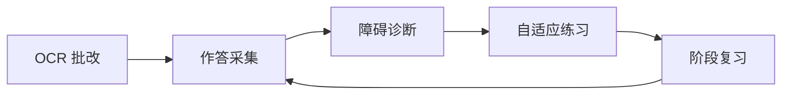
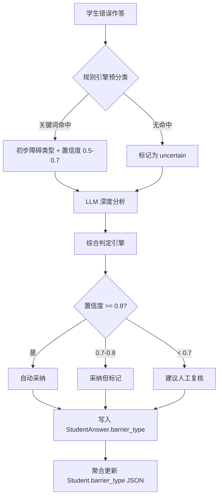
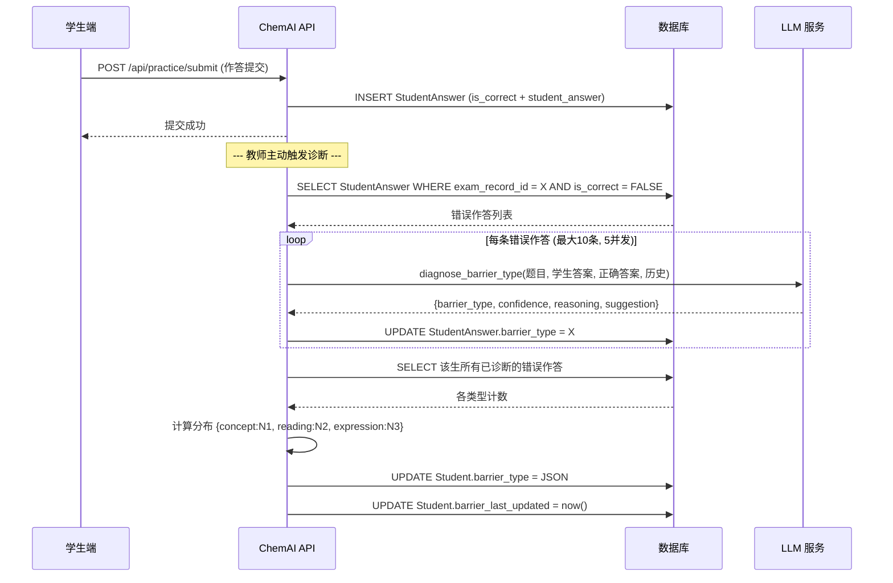
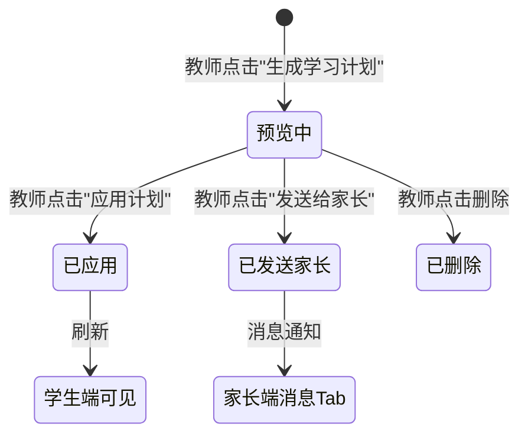

# 26. 错题诊断与障碍分类系统设计

> 关联模块：F4 学生障碍类型AI诊断 | 基于 [22-权限分级与访问控制系统设计](./22-权限分级与访问控制系统设计.md) 中定义的教师与学生角色

---

## 一、系统定位

### 1.1 核心差异化价值

传统教辅产品的做法是告知教师"这道题全班65%学生做错了"——这是结果统计。ChemAI 的回答是"**这个学生错在概念混淆**，不是审题问题"——这是根因诊断。

错题诊断与障碍分类系统的核心命题：**从"知道谁错了"进化到"知道为什么错"**。

### 1.2 设计目标

| 目标 | 说明 | 衡量标准 |
|------|------|---------|
| 三维障碍分类 | 将学生错误归因为概念理解型、审题障碍型或表述障碍型 | 三种类型全覆盖，支持教师自定义阈值 |
| LLM 深度诊断 | 对规则引擎无法判定的复杂错误进行语义分析 | LLM 诊断置信度均值 ≥ 0.7 |
| 教师可干预 | 教师可查看诊断依据、手动推翻 AI 判定 | 覆盖操作记录到日志 |
| 班级聚合 | 从单生诊断汇总为班级障碍分布 | 每次考试后自动更新 |

### 1.3 核心指标

- **诊断覆盖率**：考试中答错的题目中被诊断覆盖的比例，目标 > 90%
- **高置信度占比**：LLM 诊断中置信度 ≥ 0.8 的占比，目标 > 60%
- **教师复核通过率**：教师对 AI 诊断结果的认可率，目标 > 85%
- **诊断延迟**：从成绩保存到诊断完成的时间，目标 < 30 秒/班

### 1.4 在学习闭环中的位置

诊断引擎采用三段式架构：规则引擎初筛→LLM 深度分析→综合判定，兼顾速度和准确度。

- **上游**：OCR 批改系统（见 23 号文档）完成答题卡识别后，每道题的作答结果写入 `StudentAnswer` 表
- **本系统**：对所有错误作答进行障碍类型判定，聚合为学生级障碍画像
- **下游**：自适应练习引擎根据障碍类型匹配合适难度和类型的题目；学习计划生成器输出个性化干预方案

## 不在范围内的功能

- 不做单次作答实时诊断（当前仅支持批量诊断）
- 不自动发送诊断结果给学生（需教师确认后手动推送）
- 不跨学科诊断

---

## 二、三维障碍分类模型

### 2.1 模型定义

系统将学生的化学学习障碍划分为三个维度，对应数据库枚举 `BarrierType`（定义于对应数据模型）：

| 枚举值 | 中文名称 | 核心特征 | 典型表现 |
|--------|----------|----------|----------|
| `concept` | 概念理解型 | 不理解底层化学概念和原理 | 选错基本原理、混淆相似概念、无法解释推理过程 |
| `reading` | 审题障碍型 | 读题不完整或落入陷阱 | 答案体现概念掌握但应用错误、遗漏题干关键词、答非所问 |
| `expression` | 表述障碍型 | 理解正确但表达不规范 | 方程式书写错误但推理正确、计算方法对但结果错、漏写单位/有效数字 |

### 2.2 分类依据

这三个维度来源于高中化学学科的认知特点：

- **化学概念高度抽象**（摩尔、化学平衡、氧化还原本质），学生容易停留在记忆层面而非理解层面
- **化学题干信息密度大**（方程式、图表、实验装置、数据表格），信息提取能力是独立的技能
- **化学用语规范严格**（方程式配平、条件标注、符号体系），表述本身是考查点

> 设计原则：这三个维度相互独立。一个学生可能同时存在多种障碍（通过占比体现），但每次错误的主因归入其中一类。

### 2.3 数据模型

学生维度的障碍画像存储在 `students` 表的两个字段中：
- `barrier_type`：JSON 类型，存储三个障碍类型的占比，格式为 `{"concept": 0.30, "reading": 0.50, "expression": 0.20}`（三个值之和为 1.0）
- `barrier_last_updated`： 类型，记录最近一次诊断更新时间

每条作答记录的障碍判定存储在 `student_answers` 表的三个字段中：
- `barrier_type`：Enum(BarrierType) 枚举类型，取值为 concept / reading / expression
- `is_correct`： 类型，该次作答是否正确
- `consecutive_errors`： 类型，连续错误计数
- `consecutive_correct`： 类型，连续正确计数

---

## 三、诊断流程

### 3.1 总体架构（混合型）

系统采用 **规则引擎初筛 + LLM 深度分析 + 综合判定** 的三段式架构：

诊断流程从学生作答数据出发，经规则引擎和 LLM 双重分析后，综合判定障碍类型并更新学生画像。

### 3.2 实际 API 调用路径

设计中（相关服务模块），教师触发诊断的流程如下：

1. 教师选择班级 + 考试 → 前端调用 `GET /api/diagnosis/barrier/{class_id}/{exam_id}`
2. 该端点从 `StudentAnswer` 表中读取该考试中所有学生的答题记录，按已有 `barrier_type` 字段统计分布
3. 如果答题记录尚未诊断（`barrier_type` 为 NULL），教师手动触发 `POST /api/diagnosis/run-llm/{exam_record_id}`
4. `run-llm` 端点筛选最多 10 条未诊断的错误作答，并发（最多 5 线程）调用 LLM 进行障碍分析
5. 每条分析的 LLM 结果写入 `StudentAnswer.barrier_type`，然后聚合更新对应 `Student.barrier_type`

### 3.3 诊断触发时机

| 触发场景 | 触发方式 | 处理范围 |
|----------|----------|----------|
| 考试后批量诊断 | 教师手动点击"开始诊断" | 该考试全部未诊断作答（上限 10 条/次） |
| 单次作答实时诊断 | 作答提交后异步触发（规划中） | 当前作答 |
| 教师手动覆盖 | PUT `/api/diagnosis/override/{student_id}` | 覆盖学生整体障碍画像 |
| Agent 对话诊断 | `diagnose_barrier` 工具 | 单学生或全班级 |

### 3.4 API 接口Schema

**`GET /api/diagnosis/barrier/{class_id}/{exam_id}` 响应Schema**：

| 字段 | 类型 | 必填 | 说明 |
|------|------|:--:|------|
| class_id | string | 是 | 班级ID |
| exam_record_id | string | 是 | 考试记录ID |
| students | array | 是 | 学生诊断结果列表 |
| students[].student_id | string | 是 | 学生ID |
| students[].student_name | string | 是 | 学生姓名 |
| students[].barrier_type | object | 是 | 三维障碍分布对象，包含 concept/reading/expression 三个浮点数字段 |
| students[].dominant_barrier | string | 是 | 主导障碍类型名，取占比最高的类型 |
| students[].weak_knowledge_points | string[] | 是 | 薄弱知识点列表 |
| class_barrier_distribution | object | 是 | 班级障碍分布统计 |
| class_barrier_distribution.concept | int | 是 | 概念理解型障碍人数 |
| class_barrier_distribution.reading | int | 是 | 审题障碍型人数 |
| class_barrier_distribution.expression | int | 是 | 表述障碍型人数 |

**`POST /api/diagnosis/run-llm/{exam_record_id}` 响应Schema**：

| 字段 | 类型 | 必填 | 说明 |
|------|------|:--:|------|
| success | bool | 是 | 诊断操作是否成功 |
| analyzed_count | int | 是 | 成功诊断的学生数 |
| failed_count | int | 是 | 诊断失败的学生数 |

**`PUT /api/diagnosis/override/{student_id}` 请求Schema**：

| 字段 | 类型 | 必填 | 说明 |
|------|------|:--:|------|
| barrier_type | enum | 是 | 教师判定的障碍类型，取值为 concept/reading/expression |
| reason | string | 是 | 覆盖原因说明，如"该学生考试当天发烧，并非概念问题" |

**`PUT /api/diagnosis/override/{student_id}` 响应Schema**：

| 字段 | 类型 | 必填 | 说明 |
|------|------|:--:|------|
| success | bool | 是 | 覆盖操作是否成功 |
| message | string | 是 | 结果描述信息 |
| student_id | string | 是 | 被覆盖的学生ID |
| old_barrier | object | 是 | 覆盖前的障碍画像对象 |
| new_barrier | object | 是 | 覆盖后的障碍画像对象 |

---

## 四、规则引擎设计

### 4.1 设计原则

规则引擎作为第一道过滤器，目标是低成本快速初筛。其输出置信度控制在 0.5-0.7 之间，避免过于自信的错误判定。命中的结果和未命中的结果均进入 LLM 深度分析环节。

### 4.2 关键词规则库

#### 概念理解型关键词

匹配到以下任一模式即倾向判定为 `concept`：概念、原理、定义、不理解、混淆、分不清、不知道、没见过、记错了、没学过、搞混了、一直以为、本质、规律、理解错误、化学式错了、方程式不会、反应原理、判断依据。

#### 审题障碍型关键词

匹配到以下任一模式即倾向判定为 `reading`：看错、漏看、审题、陷阱、没注意、以为是、粗心、看漏、没看到、忽略了、读错、没仔细、理解错题意、答非所问、题目说的是、我当成、没注意到。

#### 表述障碍型关键词

匹配到以下任一模式即倾向判定为 `expression`：写错、表述、方程式、计算错、符号、单位、忘了写、没写全、配平错了、条件写漏、箭头、气体符号、沉淀符号、有效数字、没化简、格式不对、忘写单位、少写了。

### 4.3 规则引擎的局限性

规则引擎预分类是诊断管线的增强方向。主诊断链路以 LLM 语义分析为主：错误作答直接交由 LLM 分析并完成分类，依赖 LLM 自身的语义理解能力。规则引擎预分类作为增强能力，在以下场景发挥作用：

- **离线批量处理**：对历史错题数据进行快速初标
- **LLM 不可用时的降级方案**：纯规则引擎提供基础分类
- **LLM 结果的校验**：当规则引擎结果与 LLM 结果严重矛盾时触发人工审核

规则引擎预分类规则设计如下：
> - 概念理解型：错题集中在基础概念题，审题类题目正确率高
> - 审题障碍型：错题集中在长题干题目，概念类题目正确率高
> - 表述障碍型：错题集中在填空题/计算题，选择题正确率高

---

## 五、LLM 诊断 Prompt 设计

### 5.1 调用接口

LLM 障碍诊断接收四部分输入，返回结构化的诊断结论。

### 5.2 输入结构

| 输入 | 说明 | 示例 |
|------|------|------|
| 历史错题列表 | 该学生近期错题，最多 5 条 | 每条含题文、错误答案、正确答案 |
| 当前题目正文 | 截断至 500 字 | "下列关于盐类水解的说法正确的是" |
| 学生实际答案 | 学生的作答内容 | "A" |
| 正确答案 | 题目的标准答案 | "D" |

### 5.3 System Prompt

> 你是教育心理学专家。分析学生障碍类型: concept(概念理解偏差) / reading(审题信息不全) / expression(无法规范表述)。

### 5.4 User Prompt 模板

提示词包含四项变量：题目内容、学生答案、正确答案、以及序列化后的历史错误数据。要求 LLM 返回 JSON 格式的诊断结果。

### 5.5 输出格式规范

LLM 返回的 JSON 对象包含四个字段：

| 字段 | 含义 | 取值 |
|------|------|------|
| `barrier_type` | 障碍类型 | `"concept"` / `"reading"` / `"expression"` |
| `confidence` | 置信度 | 0.0 ~ 1.0 |
| `reasoning` | 判定依据 | 基于学生答案与正确答案差异的自然语言分析 |
| `suggestion` | 干预建议 | 针对该学生的具体教学建议 |

### 5.6 调用参数

- 低温度设置（0.3），确保诊断分类的稳定性和一致性
- 支持多 Provider 自动回退（详见 [37-技术选型与工具链](./37-技术选型与工具链.md)）
- 支持并发诊断：通过线程池（最多 5 个工作线程）并发调用 LLM 诊断多个学生。使用线程池而非协程的原因：LLM HTTP 调用为同步阻塞操作，线程池可充分利用等待 I/O 的时间
- LLM max_tokens：2000（诊断输出为固定 JSON，不需要大量文本生成）

**学习计划缓存**：生成的计划在内存中缓存 24 小时（86400 秒），减少重复 LLM 调用。缓存以 `student_id` 为键，带 `expires_at` 过期时间戳。若计划更新则主动刷新缓存。

**诊断数据一致性**：LLM 诊断完成后统一提交事务，然后遍历所有被更新的学生重新聚合班级障碍分布。聚合时补充缺失的类型为 0，确保 JSON 始终包含三个键 `{"concept": 0.0, "reading": 0.0, "expression": 0.0}`。

### 5.7 结果解析

API 端点中的解析逻辑执行两个步骤：

**步骤1 — 正则提取 JSON**：从 LLM 返回的 content 字符串中正则 `r'\{[\s\S]*\}'` 匹配最外层花括号包裹的 JSON 片段。

**步骤2 — 验证并写入**：解析 JSON 后提取 `barrier_type` 字段值，检查是否为三个合法值（"concept"、"reading"、"expression"）之一。若合法，转换为 `BarrierType` 枚举并写入 `StudentAnswer.barrier_type` 字段。

---

## 六、置信度分级与处理策略

### 6.1 三级置信度体系

| 置信度区间 | 级别 | 处理策略 |
|-----------|------|----------|
| >= 0.8 | 高置信度 | 自动采纳，直接写入 StudentAnswer.barrier_type |
| 0.7 - 0.8 | 中等置信度 | 采纳但标注"需关注"，聚合时降权处理 |
| < 0.7 | 低置信度 | 标记"建议人工复核"，教师端展示覆盖入口 |

### 6.2 置信度的聚合计算

学生整体障碍画像的置信度由其各次作答的置信度加权平均得出。在实际实现中，聚合逻辑为五个步骤：

**步骤1**：查询该学生所有已诊断的错误作答（筛选条件为 `barrier_type IS NOT NULL`）。

**步骤2**：初始化计数字典 `counts = {"concept": 0, "reading": 0, "expression": 0}`，遍历所有已诊断作答记录，按 `barrier_type.value` 累加对应类型的计数。

**步骤3**：计算总错误数 `total = sum(counts.values()) or 1`（避免除零），然后对每种类型归一化为占比：每种类型数量除以总错误数，四舍五入保留两位小数。

**步骤4**：将计算结果写入 `Student.barrier_type` JSON 字段。

**步骤5**：更新时间戳 `barrier_last_updated = 当前时间`。

> 注：设计中每条诊断结果的 LLM 置信度（`confidence` 字段）未被持久化存储。`StudentAnswer` 表仅存储 `barrier_type` 枚举值，不存储置信度分数。这是未来迭代的优化点。

---

## 七、BarrierConfig 教师自定义

### 7.1 数据模型

教师可为自己的班级自定义障碍诊断的触发阈值：

| 配置项 | 默认值 | 说明 |
|--------|:----:|------|
| 概念理解型触发阈值 | 3 | 连续错误 N 次触发该类型诊断 |
| 审题障碍型触发阈值 | 2 | 审题类错误更敏感，阈值较低 |
| 表述障碍型触发阈值 | 3 | 连续错误 N 次触发该类型诊断 |
| 掌握判定阈值 | 3 | 连续答对 N 次视为已掌握 |
| 自动同步学生端 | 否 | 诊断结论是否自动通知学生 |

### 7.2 设计意图

不同教师对"障碍"的敏感度不同：

- **高三教师**可能希望 `concept_threshold=2`：概念类错误哪怕出现 2 次就要警觉
- **高一新教师**可能希望 `expression_threshold=5`：给新生更多适应化学用语的时间

### 7.3 API 接口

| 方法 | 路径 | 说明 |
|------|------|------|
| `GET` | `/api/diagnosis/config/{teacher_id}` | 获取教师配置；无历史配置时返回
| `PUT` | `/api/diagnosis/config/{teacher_id}` | 创建或更新教师配置（upsert 逻辑） |

默认配置：concept_threshold 为 3，reading_threshold 为 2，expression_threshold 为 3，mastery_threshold 为 3，auto_sync_to_student 为 false。

---

## 八、教师覆盖机制

### 8.1 设计原则

AI 诊断并非不可质疑。教师在查看学生障碍画像后，可以手动推翻 AI 的判定。覆盖操作记录到操作日志，支持回溯。

### 8.2 API 接口

`PUT /api/diagnosis/override/{student_id}`

**请求体**：包含两个字段——`barrier_type`（字符串，取值为 concept/reading/expression 之一，指定教师判定的障碍类型）和 `reason`（字符串，说明覆盖原因，例如"该学生考试当天发烧，并非概念问题"）。

**处理逻辑**：
1. 校验学生存在且障碍类型合法
2. 保存旧画像（用于操作日志回溯）
3. 写入新画像：教师指定的类型占 90%，其余两种各占 5%
4. 记录操作日志（覆盖动作 + 新旧画像对比 + 覆盖原因）
5. 更新画像时间戳

**返回值**：操作是否成功、新旧障碍画像分布、结果描述信息。

### 8.3 覆盖的后续影响

覆盖后的障碍画像在下一次 LLM 批量诊断前保持不变。当该学生产生新的作答数据后，`POST /run-llm` 的聚合逻辑会重新计算分布，逐步稀释手动覆盖的权重。

---

## 九、数据写入链路

### 9.1 完整时序

成绩保存后自动触发诊断，系统查询学生错题→LLM 逐题分析→更新障碍画像→重新聚合班级分布，全程异步执行。

### 9.2 关键实现细节

**处理上限**：每次最多分析 10 条错误作答，避免单次请求 LLM 调用过多。

**优先级**：优先诊断尚未诊断的作答——查询排序 `barrier_type IS NULL` 降序，确保 `NULL` 记录排在最前面。

**并发控制**： `ThreadPoolExecutor(max_workers=5)` 创建包含5个工作线程的线程池来并发调用 LLM。

**聚合时机**：LLM 诊断完成后统一 commit，然后遍历所有被更新的 student_id 重新聚合。

**数据完整性**：聚合时补充缺失的类型为 0.0，确保 JSON 始终包含三个键 `{"concept": 0.0, "reading": 0.0, "expression": 0.0}`。

---

## 十、班级障碍分布聚合

### 10.1 单次考试的班级聚合

`GET /api/diagnosis/barrier/{class_id}/{exam_record_id}`

**聚合逻辑**（六个步骤）：
1. 遍历该班级所有学生
2. 对每个学生，查询其在指定考试中的所有 `StudentAnswer`
3. 统计已诊断作答中各障碍类型的数量
4. 若该学生在本次考试中无诊断数据，回退到 `Student.barrier_type` 历史累计值
5. 确定每个学生的主要障碍类型（`dominant_barrier`，即占比最高的类型）
6. 汇总全校班级分布：`class_barrier_distribution = {concept: 15人, reading: 22人, expression: 13人}`

**返回值**包含三个顶级字段：
- `class_id`（班级ID）和 `exam_record_id`（考试记录ID）
- `students` 数组，每项包含 student_id、student_name、barrier_type（三维分布对象）、dominant_barrier（主导障碍类型名）、weak_knowledge_points（薄弱知识点字符串列表）、recommended_intervention（推荐干预文本）、last_updated（日期字符串）
- `class_barrier_distribution` 对象，三个键 concept/reading/expression 各对应整数人数
- `avg_mastery` 浮点数，班级平均掌握度

### 10.2 班级整体统计

`GET /api/diagnosis/class/{class_id}/stats`

直接从 `Student.barrier_type` 字段聚合，计算全班的主要障碍类型分布（各取 dominant 值）。返回值包含 class_id、class_name、total_students（整数）和 distribution 对象（三个键各对应 count 整数和 percentage 浮点数百分比）。

### 10.3 知识点维度的障碍分析

`GET /api/diagnosis/class/{class_id}/kp/{kp}`

查询指定知识点的题目集合，统计班级在该知识点上的错误率和障碍分布。帮助教师发现"盐类水解"这个知识点上大部分学生的障碍是概念型还是审题型。

### 10.4 学生诊断历史

`GET /api/diagnosis/history/{student_id}`

按考试分组，返回该学生每次考试/练习的准确率和障碍分布变化趋势。

### 10.5 干预建议字典

定义于对应数据模型：

| 障碍类型 | 干预建议 |
|----------|----------|
| concept | 建议加强基础概念复习，思维导图梳理知识体系，重点理解"为什么"而非死记硬背 |
| reading | 建议练习审题技巧，划线法提取题目关键信息，注意题目中的限定词和隐含条件 |
| expression | 建议加强规范化表述训练，参考标准答案的表述方式，练习用专业化学用语回答 |

---

## 十一、前端诊断页面

### 11.1 页面文件

| 文件 | 说明 |
|------|------|
| 对应前端页面 | 诊断页面结构与样式 |
| 对应前端模块 | 诊断交互逻辑 |

### 11.2 页面布局

页面布局从上到下依次为：
- 顶部：标题"障碍诊断"和"已生成计划"按钮
- 工具栏：班级下拉选择器、考试下拉选择器、"开始诊断"按钮
- 中间区域左列：环形图展示三种障碍类型分布（概念/审题/表述），右列：班级障碍分布统计摘要
- 下方：需关注学生模块，包含搜索框和三个筛选标签（全部/概念理解/审题/表述），展开列表显示每个学生卡片——姓名、障碍占比进度条、百分比。点击后展开详情区域：障碍置信度分布、薄弱知识点标签、"生成学习计划"和"查看计划"按钮
- 底部：可折叠的"已生成计划面板"，每个计划卡片含学生姓名和"发送给家长"按钮

### 11.3 核心交互流程

1. **页面加载**：从客户端本地存储恢复已保存的学习计划；加载班级列表
2. **选择班级**：触发考试列表加载（`GET /api/exam/list/{class_id}`）
3. **点击"开始诊断"**：调用 `GET /api/diagnosis/barrier/{class_id}/{exam_id}`
4. **渲染概览**：柱状图 + 环形图 + 统计卡片
5. **渲染学生列表**：按障碍严重度排序，支持搜索和按类型筛选
6. **点击学生行**：展开详情（调用 `GET /api/diagnosis/plan/{student_id}`），展示障碍置信度分布条、薄弱知识点标签、干预建议
7. **生成学习计划**：调用 `POST /api/diagnosis/learning-plan/generate`，结果保存在客户端本地并实时渲染
8. **应用计划**：调用 `POST /api/diagnosis/learning-plan/apply/{student_id}`，持久化到 `students.current_plan` 字段
9. **发送给家长**：调用 `POST /api/diagnosis/learning-plan/send-to-parent/{student_id}`，写入 `parent_notifications` 表

### 11.4 可视化方案

- **班级分布**：环形图，三种颜色分别代表三种障碍类型
- **学生详情**：CSS 进度条（progress bar），展示三种障碍的占比
- **严重度标记**：
  - 占比 >= 60%：红色高严重度
  - 40%-60%：黄色中等
  - < 40%：绿色低严重度

---

> **前端设计规格详见**：[38-前端页面设计规格](./38-前端页面设计规格.md) §1.5

---

## 十二、Agent 工具集成

诊断相关的 Agent 工具（diagnose_barrier、show_diagnosis、show_students、assign_adaptive_practice、generate_learning_plan 等）的完整定义、参数规格和路由逻辑详见 [29-Agent对话系统设计](./29-Agent对话系统设计.md)。

---

## 十三、学习计划生成子系统

### 13.1 LLM 调用

学习计划生成同样基于 LLM，调用学习计划生成服务：

**输入**：
- `student_name`: 学生姓名
- `barrier_type`: 障碍类型（映射为中文描述）
- `weak_knowledge_points`: 薄弱知识点列表
- `recent_performance`: 近期表现数据（可选）

**障碍类型中文映射**：
- concept → "概念理解型-基础概念和原理掌握不扎实"
- reading → "审题障碍型-读题时容易忽略关键条件或掉入陷阱选项"
- expression → "表述障碍型-化学用语书写不规范或答题逻辑不清晰"

**System Prompt**："你是资深高中化学教师，在制定学习计划时始终围绕高考化学大纲和高中生的实际学习需求。"

**要求**：
1. 知识点必须为高中化学内容
2. 每日任务具体可执行
3. 障碍干预结合化学学科特点
4. 激励建议真诚不空洞

**参数**：`temperature=0.3`, `max_tokens=4096`

### 13.2 计划生命周期

学习计划从草稿生成开始，经教师预览确认、学生查看、完成反馈，最终标记为完成或废弃。

### 13.3 相关 API

| 方法 | 路径 | 说明 |
|------|------|------|
| `POST` | `/api/diagnosis/learning-plan/generate` | LLM 生成学习计划 |
| `POST` | `/api/diagnosis/learning-plan/apply/{student_id}` | 保存计划到 `students.current_plan` |
| `POST` | `/api/diagnosis/learning-plan/send-to-parent/{student_id}` | 推送计划给绑定家长 |
| `GET` | `/api/diagnosis/learning-plan/{student_id}` | 获取学生当前计划（24h 内存缓存优先） |
| `GET` | `/api/diagnosis/plan/{student_id}` | 获取诊断详情（含障碍分布 + 薄弱知识点 + 答题统计） |

---

> **下一份文档**：[27-自适应练习引擎设计](./27-自适应练习引擎设计.md) — ZPD模型、策略矩阵、闭环逻辑

## 错误处理

- **LLM 诊断超时或返回非 JSON**: 降级为规则引擎兜底（基于关键词的障碍类型推断）
- **学生无错题数据**: 返回"暂无足够数据" + 不生成诊断
- **并发线程池耗尽**: 剩余学生排队等待，不丢弃
- **置信度过低（<0.7）批量出现**: 标记整批需教师人工复核

---

## 关联文档

- [25-四维安全审核引擎设计](./25-四维安全审核引擎设计.md) — 诊断结果中的化学内容需经安全审核引擎验证
- [29-Agent对话系统设计](./29-Agent对话系统设计.md) — 诊断工具 diagnose_barrier 的 Agent 集成定义与审批流程

---

## 十四、未来迭代方向

1. **规则引擎独立实现**：将关键词规则抽取为独立模块，在 LLM 调用前执行预分类，将规则结果作为额外上下文传入 LLM
2. **置信度持久化**：在作答记录中增加置信度字段，存储每次 LLM 诊断的置信度分数
3. **实时诊断**：作答提交后异步触发 LLM 诊断（非等待教师手动点击），打通 `POST /api/practice/submit` → LLM 诊断的数据流
4. **诊断反馈闭环**：利用 `POST /{diagnosis_id}/feedback` 端点收集的教师/学生反馈数据，进行诊断准确率的持续评估
5. **跨科扩展**：将三维障碍模型（概念/审题/表述）推广至物理、生物等其他理科
