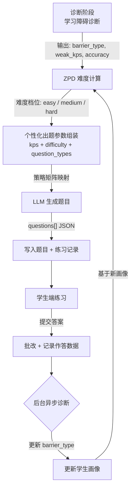
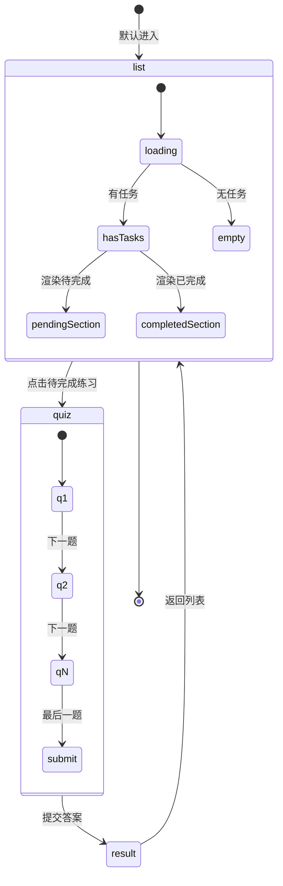

# 27. 自适应练习引擎设计

## 一、系统定位

自适应练习引擎（Adaptive Practice Engine）是 ChemAI 诊断-干预闭环中的"行动"环节。其核心逻辑链为：

**诊断告诉你"错在哪"，自适应练习帮你"改过来"。**

在 ChemAI 的整体架构中，学习障碍诊断服务输出学生的障碍类型分布（概念理解障碍 / 审题障碍 / 表述障碍）、薄弱知识点列表和历史答题正确率。自适应练习引擎消费这些诊断结果，为每个学生生成恰好处于"最近发展区"（Zone of Proximal Development, ZPD）的个性化练习题——难度略高于当前水平但又不至于让学生产生挫败感。

**ZPD 模型核心理念：**

- 太简单（正确率 > 90%）：学生已经掌握，做再多也是浪费时间
- 太难（正确率 < 30%）：学生无从下手，产生习得性无助
- 最佳区间（正确率 40%~70%）：有挑战但可达成，学习效率最高

本引擎通过 ZPD 难度计算模块动态计算每个学生的 ZPD 难度档位，结合薄弱知识点定位模块确定出题方向，最终组装个性化出题参数传递给 LLM 出题服务生成练习题。

### 1.2 设计目标

| 目标 | 说明 | 衡量标准 |
|------|------|---------|
| ZPD 精准匹配 | 为每个学生生成恰好处于最近发展区的练习题 | 正确率 40%-70% 区间的练习占比 > 70% |
| 障碍自适应 | 根据学生障碍类型自动调整题型配比和难度 | 三种障碍类型各有独立策略 |
| 全自动闭环 | 诊断→出题→练习→反馈全流程无需教师干预 | 单次出题 < 30 秒 |
| 效果可追踪 | 每次练习记录进步率，支持教师查看 | 对比最近两次练习的正确率变化 |

### 1.3 核心指标

- **ZPD 命中率**：出题难度与学生实际 ZPD 档位的匹配率，目标 > 80%（通过练习正确率 40%-70% 验证）
- **练习完成率**：学生完成布置练习的比例，目标 > 75%
- **进步率**：最近练习正确率对比前次提升的比例，目标均值 > 0.05
- **出题响应时间**：从教师触发到题目生成完毕，目标 < 30 秒/5 名学生

## 不在范围内的功能

- 初始版本不做全题型差异化出题（仅选择题，填空/计算/实验/推断题为后续版本）
- 不做无历史数据学生的精准 ZPD（冷启动默认 medium）
- 不替代教师的人工判断（练习布置需教师最终确认）

---

## 二、ZPD 模型设计

### 2.1 输入参数

ZPD 计算消费以下学生画像数据：

| 参数 | 来源 | 说明 |
|------|------|------|
| 障碍分布 | 学生画像中的障碍类型记录 | 三维障碍权重，如 concept:0.7 / reading:0.15 / expression:0.15 |
| 薄弱知识点 | 错题统计（作答记录关联题目汇总） | 高频错误知识点，默认取 Top 3 |
| 近期正确率 | 最近 30 条作答记录（按 `answered_at` 降序排列，取最新数据） | 答对题数 / 总题数 |
| 冷启动 | 无历史数据的新学生 | 默认返回 medium 难度 |
| 练习完成量 | 学生历史完成练习总数 | 用于冷启动判断和练习量追踪 |

### 2.2 ZPD 难度计算

系统查询该学生最近 30 条答题记录，按作答时间降序排列以获取最新数据。若查询结果为空（新学生无历史数据），直接返回。若查询到记录，统计其中答对的数量，计算正确率 = 答对数 / 总题数。根据正确率三档映射：正确率低于 40% 返回 "easy"；在 40% 到 70% 之间（含 70%）返回 "medium"；高于 70% 返回 "hard"。

**设计要点：**

1. **样本窗口 = 30 题**：足够反映近期水平，又不至于过度平滑。只取最近 30 条，确保对进步的敏感性。
2. **三档映射**：`easy / medium / hard` 对应三个难度级别。第 4 档 `competition` 仅用于竞赛场景，ZPD 不自动分配。
3. **冷启动**：无历史数据的学生默认 `medium`，而非盲目给 `easy`。这避免了对新学生过度低估。
4. **"稍微超出"原则**：ZPD 的关键不是严格的 0.4/0.7 阈值，而是阈值区间的含义——正确率低于 40% 的学生需要降级到 easy 以建立信心；40-70% 的学生处于最佳学习区；高于 70% 的学生已有能力挑战更难题目。

### 2.3 薄弱知识点提取

系统查询该学生所有答错的作答记录。频次统计方式，遍历每条错误作答，通过题目 ID 关联查询题目表，提取题目的 `knowledge_points` 列表（一道题可能标记了多个知识点），对每个知识点进行累加计数。最后返回错误频次最高的前 N 个知识点名称（默认 N=3）。

**设计要点：**

1. **全量错题统计，不设时间窗口**：不同于 ZPD 的 30 题滑动窗口，薄弱知识点的是全部错题历史。弱点的形成是长期的，短窗口可能遗漏重要的薄弱领域。
2. **Top 3 默认**：选取错误频次最高的 3 个知识点作为出题重点。若可用知识点不足 3 个，由教师传入的知识点参数补足。
3. **一题多知识点**：一道错题可能标记了多个知识点（如"氧化还原反应"和"电子转移"），每个都计入计数，不丢失任何关联信息。

### 2.4 主导障碍类型识别

系统查询学生记录的障碍类型字段，检查其是否存在且为字典类型。若满足条件，取占比分数最高的障碍类型键名作为主导障碍。若不满足（字段为空或格式异常），返回（概念理解型）。

该字段在每次练习提交后由后台异步更新。

### 2.5 输出参数

ZPD 计算完成后，系统组装以下参数传递给 LLM 出题服务：

| 参数 | 来源 | 说明 |
|------|------|------|
| 知识点列表 | 薄弱知识点提取 + 教师指定 | 出题目标知识点 |
| 难度 | ZPD 难度计算 | easy / medium / hard |
| 题型 | 策略矩阵（见第三节） | choice / fill / calc / experiment / inference |
| 数量 | 教师指定或默认 10 | 出题数量 |
| RAG 上下文 | 题库服务相似题检索 | 真题参考素材 |

---

## 设计决策

以下记录 ZPD 模型和出题引擎中的关键设计决策及其依据。

### 决策一：ZPD 窗口 = 30 题（而非 50 或 10）

**选择**：取最近 30 条作答记录计算正确率。

**依据**：
- **50 题窗口**的问题：化学教学中，一个章节通常包含 15-25 道练习。50 题跨越 2-3 个章节，会混入学生在较早章节的表现，这些章节可能已被后续教学覆盖。窗口过大会导致"平滑过度"——学生已在当前章节取得进步，但正确率被旧数据拖低，ZPD 判定为 easy，浪费练习机会。
- **10 题窗口**的问题：样本量过小，单次练习恰好 10 题。若学生某次练习运气成分大（全蒙对或全蒙错），10 题窗口无法平滑这种随机波动，ZPD 判定会剧烈震荡（一天 easy、一天 hard）。
- **30 题窗口**的合理性：通常覆盖 1-2 次练习 + 1 次考试，既能反映近期状态，又有足够样本量缓冲随机波动。30 题约对应 2 周的学习量，与化学教学进度（每周 1-2 次练习）匹配。

### 决策二：冷启动默认 = medium（而非 easy）

**选择**：无历史数据的新学生默认返回 medium 难度。

**依据**：
- 若默认给 **easy**，系统隐式假设新学生"什么都不会"，这既不符合实际（新学生可能是转班生，已有基础），也会让学生产生"系统看不起我"的负面体验。
- 若默认给 **hard**，新学生可能一开始就被挫败感击退，降低留存率。
- **medium** 是风险最小的选择：如果学生实际水平较低，首次练习正确率会低于 40%，系统会在下一次 ZPD 计算中自动降级到 easy；如果学生实际水平较高，正确率会高于 70%，系统会在下一次自动升级到 hard。medium 作为起点，让系统用一次练习的代价完成自适应校准。

### 决策三：批次限制 = 5 名学生

**选择**：每批最多为 5 名学生生成个性化练习。

**依据**：
- **LLM API 调用成本**：每个学生的出题流程包含 RAG 检索（1 次题库查询）+ LLM 出题（1 次 API 调用）+ 题目解析与写入（N 次数据库操作）。5 名学生的批量处理可在 30 秒内完成，符合设计目标中的"单次出题 < 30 秒"。
- **教师操作习惯**：化学教师通常按"小组"布置差异化练习（如"前 5 名薄弱生额外练习"），而非一次性为全班 40 人出题。5 人批次匹配教师的分层教学场景。
- **失败隔离**：若单批处理中某个学生的出题失败（如 LLM 返回格式异常），影响范围控制在 5 人以内，其他学生不受影响。若改为全量 40 人一批，单点故障会导致整批失败。
- 对于全班出题场景，教师可分 8 批执行，或通过定时任务（每日练习推送）在后台逐批完成。

---

## 三、自适应策略矩阵

不同类型的化学学习障碍需要不同的教学干预策略。自适应策略矩阵根据学生的主导障碍类型决定出题的难度偏移、知识点选择倾向和题型配比。

### 3.1 策略总表

| 障碍类型 | 难度策略 | 知识点策略 | 题型策略 | 干预原理 |
|----------|---------|-----------|---------|---------|
| **concept**（概念理解障碍） | 降低难度，聚焦基础 | 优先基础性知识点（如"物质的量""化学键"等基础章节） | 增加选择题（概念辨析）和填空题（基础填空），减少计算/实验题 | 学生未建立概念体系，需要降低认知负荷，先巩固基础概念 |
| **reading**（审题障碍） | 保持 ZPD 计算难度 | 混合知识点，不限定章节 | 增加推断题和带陷阱选项的选择题，强调审题细度 | 学生知识掌握尚可但容易忽略关键条件，需要设计"陷阱"训练审题习惯 |
| **expression**（表述障碍） | 保持 ZPD 计算难度 | 侧重需要写方程式的知识点（如氧化还原、离子反应） | 增加计算题和实验题，要求学生写出完整过程和方程 | 学生理解但表述不规范，需要强化化学符号和方程式的规范书写 |

### 3.2 题型对应关系

LLM 出题服务支持 5 种题型，每种题型有独立的生成规范：

| 题型标识 | 中文名称 | 特点 | 适用障碍 |
|---------|---------|------|---------|
| `choice` | 选择题 | 4 选项(A/B/C/D)，标注正确答案，设置 1-2 个陷阱选项 | concept, reading |
| `fill` | 填空题 | 用空位标记填空位置，1-3 个空，不设选项 | concept |
| `calc` | 计算题 | 具体数值条件，答案含分步计算过程 | expression |
| `experiment` | 实验题 | 描述化学实验情境，含 2-3 个子问题 | expression |
| `inference` | 推断题 | 给出物质转化线索，推断未知物质并写方程式 | reading, expression |

### 3.2.1 全题型 x 全障碍类型设计

以下为五种题型在三种障碍类型下的完整设计矩阵。初始版本仅启用 `choice` 题型，其余题型为后续迭代的设计蓝图。

#### concept（概念理解障碍）

| 题型 | 设计策略 | 示例场景 | 版本状态 |
|------|---------|---------|---------|
| `choice` | 设置概念辨析选项：正确选项 1 个 + 常见迷思概念选项 2 个 + 无关选项 1 个。题干明确指向单一概念，不设陷阱。 | "下列物质中，属于电解质的是？" 选项包含：NaCl溶液（迷思：溶液≠电解质）、熔融NaOH（正确）、蔗糖（迷思：有机物混淆）、铜丝（迷思：能导电≠电解质） | v1.0 启用 |
| `fill` | 关键概念术语填空，1-2 个空，填空位置是概念核心词（如"氧化剂"、"还原产物"）。提供语境线索降低认知负荷。 | "在反应 2Na + Cl₂ → 2NaCl 中，Na 是____剂，发生了____反应。" | 规划中 |
| `calc` | 降级为带公式提示的基础计算。题干给出完整公式和分步指引，学生仅需代入数值。 | "计算 0.1mol NaCl 的质量（已知 M(NaCl)=58.5 g/mol，公式：m = n × M）" | 规划中 |
| `experiment` | 降级为实验步骤排序题。给出一组乱序的实验操作步骤，学生按正确顺序排列。不要求书写方程式。 | "配制 100mL 0.1mol/L NaCl 溶液的正确步骤顺序是？" | 规划中 |
| `inference` | 降级为"已知→未知"单向推断。给出一条完整的转化路径，学生仅需填写最后一个产物。 | "已知 A 是 Fe，A 与盐酸反应生成 B，B 与 NaOH 反应生成 C。则 C 是____。" | 规划中 |

#### reading（审题障碍）

| 题型 | 设计策略 | 示例场景 | 版本状态 |
|------|---------|---------|---------|
| `choice` | 核心策略："陷阱选项"设计。题干中埋入易忽略的条件关键词（如"过量"、"稀溶液"、"标准状况"），设置 2 个针对漏读条件的陷阱选项。 | "将过量的铁粉加入稀硝酸中，充分反应后溶液中主要存在的离子是？" 陷阱选项：Fe³⁺（漏读"过量铁粉"，Fe 会将 Fe³⁺还原为 Fe²⁺） | v1.0 启用 |
| `fill` | 设计"条件敏感型"填空。同一个操作在不同条件下结果不同，学生必须根据题干条件判断。每个空对应一个条件判断点。 | "在____（酸性/碱性/中性）条件下，KMnO₄的还原产物是 Mn²⁺。" | 规划中 |
| `calc` | 设计"多步条件链"计算。题干给出 3-4 个条件，其中 1-2 个是冗余信息（无关数据），学生必须筛选有效条件。分步计分，条件筛选占 30% 分值。 | "将 5.6g 铁粉（纯度 90%）加入 100mL 2mol/L 盐酸中。已知铁的密度为 7.86g/cm³。计算生成氢气的体积（标准状况）。" 密度为无关条件。 | 规划中 |
| `experiment` | 设计"实验现象与条件匹配"题。描述一组实验现象，每种现象对应特定的操作条件，学生需将现象与条件一一匹配。训练"条件→现象"的细读能力。 | "某学生进行三组实验：(1)向FeCl₃中滴加NaOH (2)向FeCl₃中加入过量Fe粉后滴加NaOH (3)向FeCl₃中通入SO₂后滴加NaOH。请匹配各组实验最终产物的颜色。" | 规划中 |
| `inference` | 设计"多路径分叉推断"题。给出一条含分叉的反应路线图，其中某一步的条件决定了后续路径走向。学生需识别条件关键词才能选对路径。 | "A 在加热条件下生成 B，在催化剂条件下生成 C。已知反应使用了催化剂，则最终产物是？" | 规划中 |

#### expression（表述障碍）

| 题型 | 设计策略 | 示例场景 | 版本状态 |
|------|---------|---------|---------|
| `choice` | 设置"规范表述"对比选项。题干给出一个化学现象，四个选项是不同的文字表述方式，仅一个完全规范（正确使用化学符号、状态标注、配平）。 | "下列对'铁与稀硫酸反应'的描述中，最规范的是？" A: Fe+H₂SO₄→FeSO₄+H₂↑ B: Fe+H₂SO₄=FeSO₄+H₂↑ C: Fe(s)+H₂SO₄(aq)=FeSO₄(aq)+H₂(g)↑ D: 铁加硫酸生成硫酸亚铁加氢气 | v1.0 启用 |
| `fill` | 设计"方程式补全"填空。给出反应物和部分产物，学生需填写缺失的产物、配平系数或反应条件。每个空 1 分，配平和条件单独计分。 | "___Al + ___Fe₂O₃ ——(____) ___Al₂O₃ + ___Fe" 学生需填写系数和条件"高温"。 | 规划中 |
| `calc` | 设计"分步书写"计算题。要求按"已知→公式→代入→计算→答"五步格式作答。每一步单独计分（各 20%），即使最终答案错误，过程正确也能得 80% 分数。 | "计算 0.5mol 的 H₂SO₄ 的质量。请按以下步骤书写：(1)列出已知条件 (2)写出计算公式 (3)代入数值 (4)计算结果 (5)写出答案。" | 规划中 |
| `experiment` | 设计"实验报告补全"题。给出一段不完整的实验报告（含目的、步骤、现象、结论），学生需补全缺失部分，重点关注化学用语和方程式书写的规范性。 | "实验报告：鉴别 Na₂CO₃ 和 NaHCO₃。步骤：分别取少量固体于试管中，____。现象：Na₂CO₃试管中____，NaHCO₃试管中____。结论：____。" | 规划中 |
| `inference` | 设计"推断+方程式"组合题。给出物质转化线索，学生需：(1)推断未知物质 A/B/C 的化学式，(2)书写每步转化的化学方程式（要求配平、标注条件、标注状态符号）。 | "已知白色固体 A 加热分解生成气体 B 和固体 C，B 能使澄清石灰水变浑浊。请：(1)推断 A、B、C 的化学式 (2)写出加热分解的化学方程式。" | 规划中 |

### 3.3 策略实现计划

题型差异化策略分阶段实现。初始版本（v1.0）统一使用选择题型，策略矩阵中的题型映射表作为完整设计规范。后续版本（v1.1+）将按障碍类型逐步启用：concept 学生增加填空题、expression 学生增加计算题与实验题、reading 学生增加推断题，使每个障碍类型对应其最优题型组合。

---

## 四、出题参数计算详细流程

完整的自适应出题流程包含七个步骤：

**Step 1 — 读取学生画像**：
- 查询学生的主导障碍类型
- 计算学生的 ZPD 难度档位
- 提取薄弱知识点 Top 3

**Step 2 — 确定出题知识点**：
- 若薄弱知识点列表非空，则薄弱知识点；否则教师指定的知识点作为兜底
- 薄弱知识点优先，教师指定的知识点用于补足数量

**Step 3 — RAG 真题增强**：
- 调用题库服务从历史真题库中检索与目标知识点和难度匹配的题目
- 将检索到的真题（题目内容、答案、知识点）组装为 RAG 上下文列表，作为 LLM 生成变式题的参考素材
- 如果题库服务不可用，RAG 上下文设为空，LLM 将仅基于知识点列表和难度从零生成

**Step 4 — 确定题型**：初始版本统一选择题型，未来按策略矩阵动态分配

**Step 5 — 调用 LLM 出题**：传递知识点、难度、数量、题型、RAG 上下文五个参数给 LLM 出题服务

**Step 6 — 解析并写入**：解析 LLM 返回的题目数据，逐题创建题目记录。每道题生成唯一 ID，来源标记为 AI 生成，审核状态设为已通过（AI 生成题目的审核由四维安全审核引擎异步处理）

**Step 7 — 创建练习记录**：类型设为练习模式，关联所有题目

最终输出包含每个学生的 ID、姓名、ZPD 难度档位、障碍类型、薄弱知识点和题目数量。

### 4.1 批次限制

为防止 LLM API 过载，系统对每批处理的学生数量做了硬限制——每次最多为 5 名学生生成个性化练习。如需覆盖全班，教师需分批执行或通过定时任务触发。

---

## 五、闭环逻辑

自适应练习引擎是 ChemAI "诊断-出题-练习-反馈"闭环的关键环节。完整流程如下：

自适应练习是诊断-干预闭环的核心：障碍诊断输出学生画像→ZPD 难度计算→个性化出题→学生练习→新诊断数据回流，形成持续改进的飞轮。

### 关键闭环时间点

- **实时**：学生提交答案后立即获得正确/错误判定、正确答案和解析
- **近实时**（后台线程）：提交后数秒内完成 LLM 障碍诊断和障碍类型更新
- **下次出题**：障碍类型和最新正确率已反映在下一次 ZPD 计算中

---

## 六、Agent 工具集成

自适应练习引擎通过 Agent 工具供教师在对话中通过自然语言触发。教师可指定班级、知识点范围和题目数量，系统为班级学生生成符合 ZPD 的个性化练习题。

该工具需要教师审批确认后才会下发。完整的工具定义、参数规格、审批门控流程和状态管理机制详见 [29-Agent对话系统设计](./29-Agent对话系统设计.md)。

> **设计说明**：Agent 版本的自适应练习工具与 REST API 版本逻辑相似但独立实现——Agent 版本用于教师预览和确认（不写数据库），确认后由前端调用 API 完成持久化。

---

> **前端设计规格详见**：[38-前端页面设计规格](./38-前端页面设计规格.md) §2.2

---

## 七、练习效果追踪

### 7.1 API 端点

`GET /api/practice/effect/{student_id}`

### 7.2 请求参数

| 参数 | 位置 | 说明 |
|------|------|------|
| `student_id` | 路径参数 | 学生 ID |

### 7.3 响应结构

响应包含以下字段：
- `student_id`（字符串）和 `student_name`（字符串）
- `improvement` 对象，包含五个字段：
  - `before_practice_date`（前次练习日期）
  - `before_accuracy`（前次正确率，浮点数）
  - `after_practice_date`（本次练习日期）
  - `after_accuracy`（本次正确率，浮点数）
  - `improvement_rate`（进步率 = 本次正确率 - 前次正确率）

### 7.4 计算逻辑

取最近两次练习记录（最近一次和前一次）。对每次练习，计算该次练习的正确率（答对数除以总题数）。进步率 = 最近一次正确率 - 前一次正确率。

### 7.5 效果判断标准

| improvement_rate | 结论 | 含义 |
|-----------------|------|------|
| > 0.1 | 显著进步 | 自适应策略有效，继续保持 |
| 0 ~ 0.1 | 略有进步 | 策略方向正确，可微调难度 |
| -0.05 ~ 0 | 持平 | 需关注是否题目过难或策略不匹配 |
| < -0.05 | 退步 | 可能需要重新诊断障碍类型，调整策略 |

### 7.6 局限性与改进方向

效果追踪分为三个层级：**基础级**（两次练习正确率对比，反映整体进步方向）、**知识点级**（per-KP 趋势，定位具体知识域的进退步）、**综合级**（ZPD 档位流转，呈现难度适应曲线）。初始版本实现基础级追踪，知识点级和综合级为后续迭代方向。

当前基础级追踪的局限性：

- **样本不足**：若两次练习的题量和难度不同，简单比较正确率参考价值有限
- **无知识点粒度**：无法定位具体是哪个知识点的进步/退步
- **无难度变化追踪**：看不到 ZPD 难度档位随时间的变化曲线

改进方向：增加练习时间序列分析，引入知识点粒度的正确率变化，呈现 ZPD 档位流转图。

### 7.7 练习任务与提交 API Schema

**`GET /api/practice/student/{uid}/tasks` 响应Schema**：

| 字段 | 类型 | 必填 | 说明 |
|------|------|:--:|------|
| tasks | array | 是 | 练习任务列表 |
| tasks[].practice_id | string | 是 | 练习唯一标识 |
| tasks[].title | string | 是 | 练习标题 |
| tasks[].knowledge_points | string[] | 是 | 知识点标签列表 |
| tasks[].difficulty | string | 是 | 难度等级 |
| tasks[].status | string | 是 | 任务状态（pending/completed） |
| tasks[].question_count | int | 是 | 题目数量 |
| tasks[].deadline | string | 否 | 截止日期（"YYYY-MM-DD HH:MM" 字符串），无截止日期则为 null |
| pending_count | int | 是 | 待完成练习数量 |
| completed_count | int | 是 | 已完成练习数量 |

**`POST /api/practice/submit` 请求Schema**：

| 字段 | 类型 | 必填 | 说明 |
|------|------|:--:|------|
| practice_id | string | 是 | 练习记录ID |
| answers | array | 是 | 答案列表 |
| answers[].question_id | string | 是 | 题目ID |
| answers[].answer | string | 是 | 学生提交的答案（选择题为选项如 "A"，主观题为文本） |

**`POST /api/practice/submit` 响应Schema**：

| 字段 | 类型 | 必填 | 说明 |
|------|------|:--:|------|
| score | int | 是 | 得分 |
| total | int | 是 | 总题数 |
| accuracy | float | 是 | 正确率（0.0 ~ 1.0） |
| questions | array | 是 | 逐题结果 |
| questions[].q_number | int | 是 | 题号 |
| questions[].is_correct | bool | 是 | 是否答对 |
| questions[].correct_answer | string | 是 | 正确答案 |
| questions[].analysis | string | 否 | 题目解析 |

**`GET /api/practice/effect/{student_id}` 响应Schema**：

| 字段 | 类型 | 必填 | 说明 |
|------|------|:--:|------|
| student_id | string | 是 | 学生ID |
| student_name | string | 是 | 学生姓名 |
| improvement | object | 是 | 进步指标对象 |
| improvement.before_practice_date | string | 是 | 前次练习日期 |
| improvement.before_accuracy | float | 是 | 前次正确率 |
| improvement.after_practice_date | string | 是 | 本次练习日期 |
| improvement.after_accuracy | float | 是 | 本次正确率 |
| improvement.improvement_rate | float | 是 | 进步率（本次正确率 - 前次正确率） |

---

## 效果追踪升级设计

本节描述练习效果追踪从"两次练习正确率对比"升级为"多维度纵向追踪"的完整设计，是未来迭代目标。

### 知识点粒度追踪

为每个知识点维护独立的时间序列数据：

- **数据结构**：per-KP 元组 `(kp_name, date, accuracy, question_count)`，每次练习完成后更新涉及的知识点数据。
- **聚合视图**：以知识点为行、周次为列的矩阵热力图。颜色深度表示该知识点当周的正确率（深绿 > 80%，浅绿 60-80%，黄 40-60%，橙 20-40%，红 < 20%）。
- **趋势判定**：连续 3 周正确率上升 → 标记"持续改善"；连续 3 周正确率下降 → 标记"持续恶化"，升级预警至教师端和学情预警系统。
- **识别"假性掌握"**：若某知识点正确率长期 > 90%，但最近一次 ZPD 升级到 hard 后正确率骤降 < 40%，说明学生在 easy/medium 难度下的高正确率可能来自题目过于简单的"虚假掌握"。系统自动标记该知识点为"需巩固"，并在下次出题时维持 medium 难度并增加变式题。

### ZPD 难度档位流转图

追踪学生 ZPD 难度档位随时间变化的轨迹：

- **核心指标**：记录每次 ZPD 计算时的档位（easy/medium/hard）和时间戳，形成 `(timestamp, zpd_level, accuracy_at_time, question_count)` 序列。
- **可视化**：以时间为 X 轴、难度为 Y 轴的阶梯图。easy 映射为 Y=1，medium 为 Y=2，hard 为 Y=3。
- **流转模式识别**：
  - **稳步上升**（easy→medium→hard）：自适应策略有效，学生持续进步。标记为正向案例。
  - **震荡**（easy↔medium↔hard 反复）：策略不够稳定，可能原因：ZPD 窗口过小（解决：扩大至 50 题）或题目难度校准偏差（解决：检查题目与难度标签的一致性）。
  - **长期停滞**（连续 8 周以上停留在同一档位）：需教师人工介入。可能原因：知识点难度跨越过大，学生缺乏必要的阶梯练习。
  - **回落**（hard→medium→easy）：持续退步信号，触发学情预警。
- **流转概率矩阵**：统计全班学生的档位转移概率 P(当前档位 → 下次档位)，识别系统性问题。例如若 P(easy→easy) > 0.8，说明 easy 学生难以升级，需检查 easy 到 medium 的题目难度跨度是否过大。

### 练习时间序列分析

对学生练习数据进行纵向分析：

- **数据粒度**：每 7 天为一个分析周期（化学教学以周为单位），汇总该周期内的所有练习数据。
- **分析维度**：
  - **练习量时序**：每周完成的练习题总量。识别"断崖式下降"（连续 2 周练习量 < 前 4 周均值的 30%）→ 可能辍学风险。
  - **正确率时序**：每周加权正确率（各次练习题量加权，避免题量差异导致的偏差）。与班级均线叠加对比。
  - **效率指标**：正确率变化 / 练习量变化。正值表示练习有效，负值表示练习无效（盲目刷题）。
  - **知识点覆盖时序**：每周涉及的不同知识点数量。过少（只练 1-2 个知识点）→ 知识面窄化；过多（> 8 个知识点）→ 深度不够。
- **输出形式**：学生个人学习日历视图——以日历热力图展示每日练习情况，颜色深浅 = 当日练习量，叠加正确率标记（绿色上三角 = >70%，黄色方块 = 40-70%，红色下三角 = <40%）。

---

## 八、前端学生练习页

### 8.1 页面概述

学生练习页采用移动端卡片式布局，提供练习任务列表、答题交互和结果展示三个核心视图。

### 8.2 页面状态机

学生练习页有三个核心视图：任务列表（待完成/已完成）→ 答题界面（逐题作答）→ 结果展示（得分和正确率），状态在三个视图间单向流转。

### 8.3 页面组件

| 组件 | 说明 |
|------|------|
| 任务列表 | 分"待完成"和"已完成"两组展示 |
| 任务卡片 | 显示知识点标签、题目数量、截止日期、状态 |
| 答题界面 | 题目区 + 选项区 + 底部导航（上一题/下一题/提交） |
| 结果展示 | 显示得分、总题数和正确率 |

### 8.4 数据流

页面初始化后先通过认证获取用户身份。随后调用练习任务列表接口获取所有练习任务，按状态字段分为待完成和已完成两组渲染。

用户点击待完成练习卡片时，调用题目获取接口拉取该练习的题目列表，逐一渲染题目，选项渲染为可点击卡片。

用户完成全部题目后，调用提交接口提交答案。结果页展示得分、总题数和正确率。

### 8.5 关键交互细节

1. **答题进度**：底部导航栏显示"第 X/Y 题"，支持前后翻阅（已选题目标记选中样式）
2. **状态持久化**：答案以题目 ID 为键、选中选项为值存储，切换题目时不丢失已选答案
3. **加载态**：居中显示"加载中..."
4. **空态**：显示"暂无练习任务"
5. **错误态**：显示"加载失败: {错误信息}"

## 错误处理

- **学生无历史数据**: 冷启动：默认 medium 难度
- **LLM 出题失败**: 从题库中随机抽取同知识点题目作为兜底
- **薄弱知识点列表为空**: 使用教师指定的知识点
- **RAG 真题检索失败**: 纯 LLM 生成（不注入 RAG 上下文）

---

## 安全与权限

- 出题和布置练习需 teacher 角色（含 admin/教务管理员），学生不可自行布置
- 练习提交需 student 角色，系统校验 practice_id 归属该学生
- 布置练习操作记录到操作日志（action=assign_practice）
- 学生仅可查看自己的练习记录和效果追踪数据

---

## 关联文档

- [26-错题诊断与障碍分类系统设计](./26-错题诊断与障碍分类系统设计.md) — ZPD 计算直接消费诊断引擎输出的 barrier_type 和薄弱知识点
- [24-AI出题与题库管理系统设计](./24-AI出题与题库管理系统设计.md) — LLM 出题服务与 RAG 题库检索的完整设计

---

## 接口说明

### 诊断结果如何触发练习参数计算

自适应练习引擎与学习障碍诊断服务之间通过以下数据流衔接：

1. **诊断输出**：学生在完成每次练习或考试后，系统自动触发 `DiagnosisService.diagnose_student(student_id)` 异步任务。该任务遍历学生的错题记录和作答历史，调用 LLM 进行障碍分类，最终更新 `Student` 画像中的 `barrier_type` 字段（JSON 格式：`{"concept": 0.7, "reading": 0.15, "expression": 0.15}`）和 `weak_knowledge_points` 字段（知识点名称列表）。

2. **ZPD 消费诊断结果**：当教师触发自适应练习（通过 Agent 对话或直接 API 调用）时，`AdaptivePracticeService.create_practice()` 首先查询学生的 `barrier_type` 和 `weak_knowledge_points`。ZPD 难度计算模块独立查询最近的 30 条作答记录计算正确率，不直接消费诊断结果中的正确率字段（诊断结果中的正确率是快照数据，ZPD 使用实时查询确保时效性）。

3. **数据依赖关系**：

| 自适应引擎使用的数据 | 来源服务 | 数据新鲜度要求 |
|---------------------|---------|---------------|
| barrier_type（障碍分布） | DiagnosisService 异步更新 | 最近一次诊断结果，通常 < 5 分钟 |
| weak_knowledge_points（薄弱知识点） | DiagnosisService + 错题统计聚合 | 实时（每次 ZPD 计算时重新统计） |
| 近期正确率 | 作答记录表实时查询 | 实时（取最近 30 条数据） |
| 知识点列表（教师指定） | Agent 工具参数或 API 请求体 | 由调用方传入 |

### barrier_type 更新时机

障碍类型的更新不在 ZPD 计算时触发，而是由独立的后台诊断流程管理：

- **触发时机**：每次学生提交练习或考试答案后，在批改结果入库的同时，系统通过消息队列或后台任务触发异步诊断。
- **更新延迟**：诊断任务通常在提交后 5-30 秒内完成（取决于 LLM API 响应时间）。在诊断任务完成前，ZPD 计算使用上一次诊断的结果。
- **兜底策略**：若学生从未进行过诊断（新学生无 barrier_type），系统默认返回 `concept`（概念理解型），因为概念理解是化学学习最基础的障碍类型，以此类型出题最不容易产生方向性错误。
- **与 ZPD 的解耦**：ZPD 难度计算（基于正确率）与障碍类型更新（基于 LLM 诊断）是两个独立的流程。正确率的变化是即时反映的（每次 ZPD 计算时实时查询），障碍类型的变化有延迟（等待 LLM 诊断完成）。这种解耦设计确保 ZPD 计算的响应速度（不需要等待 LLM），同时障碍类型的深度分析不受 ZPD 实时性要求的约束。

### 与 Agent 诊断工具的交互

自适应练习引擎与 Agent 诊断工具在"诊断-出题-练习"闭环中协作：

1. **Agent 触发路径**：教师在 Agent 对话中发出练习指令（如"给高一3班出氧化还原的练习题"）→ Agent 解析意图为 `adaptive_practice` 工具调用 → 工具调用 `AdaptivePracticeService.create_practice()` → 返回出题结果给教师预览 → 教师确认后前端调用 API 持久化。

2. **Agent 诊断触发路径**：教师在 Agent 对话中发出诊断指令（如"分析张三最近的学习障碍"）→ Agent 调用 `diagnose_student` 工具 → 工具内部调用 `DiagnosisService.diagnose_student()` → 更新 `barrier_type` 和 `weak_knowledge_points` → 教师立即在对话中看到诊断报告。

3. **数据干涉**：Agent 版本的练习预览不会写入数据库（仅用于教师预览），确认后才持久化。这意味着在预览阶段触发的 ZPD 计算不会产生副作用，学生画像不会因教师预览而改变。只有学生实际完成练习后，新的作答记录才会影响后续 ZPD 计算。

4. **状态一致性**：若教师在 Agent 中先触发诊断再触发练习，由于诊断是异步的，存在诊断尚未完成就计算 ZPD 的竞态条件。系统通过以下方式处理：ZPD 计算不等待诊断结果，始终使用 `Student` 表中当前已持久化的 `barrier_type`。教师看到的诊断报告是基于最新 LLM 分析的，但若要该诊断结果影响出题，需要等待诊断写入完成后再触发练习（Agent 会在诊断任务完成后提示教师"分析已完成，是否立即生成本次练习？"）。
