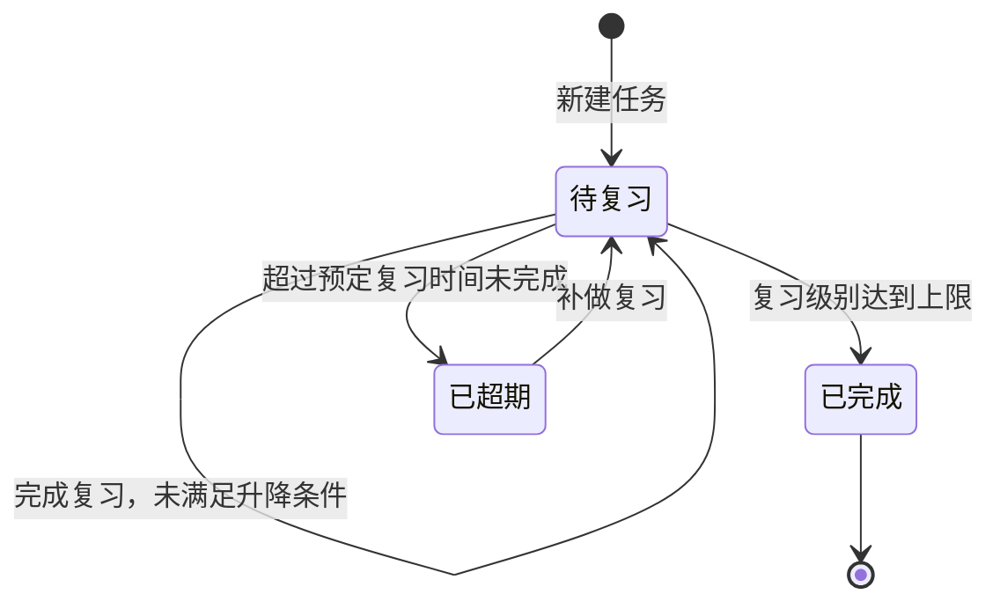
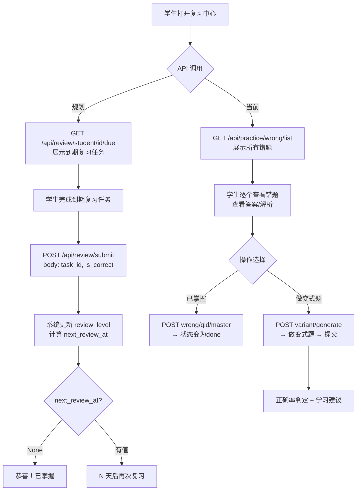

# 28. 间隔复习与错题强化训练系统设计

## 一、系统定位

ChemAI 的复习体系由两个互补子系统构成：

| 系统 | 定位 | 触发时机 | 核心机制 | 目标 |
|------|------|---------|---------|------|
| **间隔重复复习**（Spaced Repetition） | 长期记忆巩固 | 答错后自动创建 → 按遗忘曲线定时提醒 | 艾宾浩斯 6 级螺旋复习 | 将知识从短期记忆转化为长期记忆 |
| **错题强化训练**（Wrong Question Training） | 即时针对性补救 | 学生主动查看错题 → 生成变式题重练 | LLM 生成同知识点变式题 | 快速消除当前知识盲区 |

**两者关系：**

- 间隔重复是"被动系统"——学生不需要主动操作，到时间了系统自动提醒复习
- 错题强化是"主动系统"——学生打开错题本，选择错题进行针对性训练
- 任何一道错题都可能同时存在于两个系统中：一个 ReviewTask 用于长期记忆，一个错题记录用于即时强化
- 当学生在错题强化训练中连续正确后，对应的 ReviewTask 也会被标记为已掌握

### 1.2 设计目标

| 目标 | 说明 | 衡量标准 |
|------|------|---------|
| 艾宾浩斯 6 级复习 | 按遗忘曲线科学安排复习间隔，从 1 天到 30 天递进 | 到达 Level 5 的学生对该知识点长期正确率 > 85% |
| 错题即时补救 | 学生可随时查看错题并生成变式题强化训练 | 变式题生成 < 10 秒/3 道 |
| 自动同步 | 答题答错后自动创建复习任务，无需手动操作 | 同步延迟 < 5 秒 |
| 每日推送 | 每天 08:00 自动为每个学生生成个性化练习 | 练习生成 < 1 分钟/全班 |

### 1.3 核心指标

- **复习覆盖率**：有错题的学生中被创建 ReviewTask 的比例，目标 > 95%
- **升级率**：首次复习后能升级到 Level 2 的比例，目标 > 60%
- **掌握率**：到达 Level 5（已掌握）的复习任务比例，长期目标 > 50%
- **每日练习完成率**：学生完成每日练习的比例，目标 > 70%

- 复习任务模型：相关服务模块（`ReviewTask`、`SPIRAL_REVIEW_DAYS`）
- 间隔复习引擎：相关服务模块（`SpacedRepetitionEngine`）
- 错题训练服务：相关服务模块（`WrongQuestionTrainer`）
- 复习 API：相关服务模块
- 错题 API：相关服务模块、相关服务模块
- 学生前端：对应前端页面、对应前端页面

## 不在范围内的功能

- 不做跨学生复习统计
- 不做复习效果与考试成绩的因果分析
- 不做自定义间隔配置（固定 6 级艾宾浩斯模型）

---

## 二、艾宾浩斯 6 级掌握度模型

### 2.1 级别定义

系统采用 6 级螺旋复习模型（从 0 到 5），每级对应一个复习间隔：

- 级别 0：初次学习，下次 1 天后复习，当天完成
- 级别 1：第 1 次复习，下次 3 天后复习，累计 1 天
- 级别 2：第 2 次复习，下次 7 天后复习，累计 4 天
- 级别 3：第 3 次复习，下次 14 天后复习，累计 11 天
- 级别 4：第 4 次复习，下次 30 天后复习，累计 25 天
- 级别 5：已掌握，不再安排复习，累计 55 天

### 2.2 设计原理

- **指数增长间隔**：间隔从 1 天 → 3 天 → 7 天 → 14 天 → 30 天，符合艾宾浩斯遗忘曲线的核心结论——记忆在初期衰退最快，随着巩固次数增加，遗忘速度减缓
- **6 级封顶**：到达第 5 级意味着学生在一轮完整复习后仍能正确作答，系统认为该知识点已稳定掌握，不再占用学生复习时间
- **到达第 5 级后**：下次复习时间清空，复习引擎检测到此状态后自动将任务标记为已完成

### 2.3 首次创建时的行为

当创建新的复习任务时：复习级别设为 0，首次学习时间记录为当前时间，下次复习时间也设为当前时间（第 0 级立即可以复习，趁热打铁），连续正确和连续错误计数均从 0 开始，复习历史初始为空。

设计意图：第 0 级复习任务立即可做，表示"这道题刚错过，趁热打铁，马上重温一遍"。真正的间隔等待从第 0 级升到第 1 级后才开始（1 天后）。

---

## 三、ReviewTask 状态机

### 3.1 数据模型

每条复习任务记录以下信息：

- **关联信息**：属于哪个学生、关联哪道题目
- **复习级别**：0-5 级，每级对应不同的复习间隔（详见第二节）
- **任务状态**：待复习 / 超期未复习 / 已掌握
- **时间追踪**：首次学习时间、下次复习到期时间、最近完成时间
- **升降级计数**：连续正确次数、连续错误次数，用于判断是否该升级或降级
- **复习历史**：每次复习的时间、结果、级别变化的完整记录，用于排查异常和后续效果分析

### 3.2 状态迁移图

复习任务从创建开始，经历多次复习和升降级后到达已掌握终态。超期未复习的任务进入超期状态，补做后恢复。

### 3.3 三个状态的含义

| 状态 | 含义 | 何时进入 | 何时退出 |
|------|------|---------|---------|
| 待复习 | 等待学生完成复习（正常状态） | 创建时或完成复习后 | 复习到期未做 → 超期；级别到达 5 → 已掌握 |
| 超期 | 超过预定时间未复习 | 下次复习时间已过但学生仍未操作 | 学生补做 → 待复习 |
| 已掌握 | 复习完成，知识点已稳定掌握 | 复习级别达到 5 级，或教师手动标记 | 不会再进入其他状态 |

### 3.4 到期任务的查询逻辑

系统查询所有状态为"待复习"或"超期"且下次复习时间已过的任务。超期状态的任务也会被查出——学生曾经错过复习时间，但仍可补做，不因一次错过就永久排除。

---

## 四、升降级规则

### 4.1 规则总表

| 场景 | 条件 | 操作 | 说明 |
|------|------|------|------|
| 升级 | 连续答对达到 2 次 | 复习级别 +1（上限 5），连续正确计数归零 | 连续 2 次答对才升级，防止偶然答对导致过早推进 |
| 降级 | 答错且当前级别大于 0 | 复习级别 -1，连续错误计数归零 | 答错立即降级，知识遗忘需要回到更频繁的复习节奏 |
| 保底 | 答错且当前级别为 0 | 级别保持不变 | 最低级别不再降 |
| 维持 | 答对但连续正确不足 2 次 | 级别不变 | 单次答对不足以证明稳固掌握 |
| 单次正确但不升级 | 答对，连续正确从 0 变为 1 | 级别不变，等待再次答对 | 需要再答对一次才升级 |
| 单次错误从正确态回落 | 上次答对（连续正确=1），本次答错 | 连续正确归零，连续错误变为 1，级别不变 | 一次回退不降级——可能是粗心而非遗忘 |

### 4.2 升降级判定逻辑

学生每次完成复习后，系统根据作答正误执行升降级：

**答对时**：连续正确计数 +1，连续错误计数清零。若连续正确达到 2 次且当前级别未达上限（5 级），则升级并重置连续正确计数。

**答错时**：连续错误计数 +1，连续正确计数清零。若当前级别大于 0（非最低级），则立即降级并重置连续错误计数。处于最低级（0 级）时不再降级，但重置连续正确计数以重新积累。

### 4.3 实际场景推演

**场景：学生张三的"氧化还原反应"错题复习轨迹**

| 复习次数 | 日期 | 答题结果 | 连续正确 | 连续错误 | 级别 | 下次复习 |
|---------|------|---------|:------:|:------:|:---:|---------|
| 创建 | Day 0 | 首次答错 | 0 | 0 | 0 | 当天 |
| 第1次 | Day 0 | 答对 | 1 | 0 | 0（维持） | Day 1 |
| 第2次 | Day 1 | 答对 | 2→0 | 0 | 0→1（升级） | Day 4 |
| 第3次 | Day 4 | 答错 | 0 | 1→0 | 1→0（降级） | Day 4（重置） |
| 第4次 | Day 5 | 答对 | 1 | 0 | 0（维持） | Day 6 |
| 第5次 | Day 7 | 答对 | 2→0 | 0 | 0→1（升级） | Day 10 |
| 第6次 | Day 10 | 答对 | 1 | 0 | 1（维持） | Day 13 |
| 第7次 | Day 13 | 答对 | 2→0 | 0 | 1→2（升级） | Day 20 |
| ... | ... | ... | ... | ... | ... | ... |
| 最终 | Day 55+ | 连续正确 | ... | ... | 5 | 已掌握 |

**关键观察：**

1. Day 4 答错导致降级回 level 0——间隔从"3 天后"退回到"1 天后"，符合"遗忘→回到频繁复习"的直觉
2. 降级后再升回来需要再连续答对 2 次，确保降级不是由于粗心
3. 整个周期从创建到掌握至少需要 55 天（假设每次都答对），反映了长期记忆形成的真正时间需求

### 4.4 复习历史记录

每次完成复习后，复习历史追加一条记录，包含：复习时间、是否答对、复习前的级别。该记录用于排查升降级异常和后续的复习效果可视化。

---

## 五、同步机制

### 5.1 自动同步路径

错题与复习系统之间通过以下路径自动同步：学生答题答错 → 错题记录写入数据库 → 自动触发或下次练习提交后触发同步任务 → 遍历学生最近的错误记录 → 检查是否已存在对应的复习任务 → 若不存在则自动创建。

### 5.2 自动同步触发点

1. **练习提交后（实时）**：练习提交后系统通过后台线程触发障碍诊断，复习任务同步通过去重逻辑自动完成，保证同一道错题不会重复创建复习任务
2. **手动同步（按需）**：教师或学生可手动触发某个学生的复习任务同步

### 5.3 去重保证

创建复习任务前，先查询该学生是否已有相同题目的复习任务。若已存在则不重复创建。同一学生对同一道题目最多只有一个复习任务，多次同步安全。

---

## 六、到期复习与用户反馈

### 6.1 到期判断

复习任务在以下情况标记为"到期"：
- 新建的第 0 级任务：立即到期，学生可马上开始复习
- 第 1 级及以上任务：到达预设的下次复习日期后到期
- 之前已超期的任务：仍然出现在到期列表中，学生可随时补做

### 6.2 学生端提示

学生端展示到期复习任务的数量角标。到期任务按紧急程度排序——最早到期但还没做的排在最前面。

### 6.3 完成复习后的反馈

完成复习后，系统根据结果给出反馈：如果已达第 5 级（已掌握），提示"恭喜，该题目已掌握"；否则提示当前级别名称和距离下次复习的天数（如"第 1 次复习，3 天后再次复习"）。

---

## 七、错题强化训练子系统

### 7.1 系统定位

错题强化训练是间隔复习的"主动版"——学生可以随时打开错题本，选择任意错题进行集中强化训练，而不必等待系统推送的复习任务。

### 7.2 核心服务

相关服务模块 → `WrongQuestionTrainer` 类

### 7.3 数据模型（训练会话）

训练会话是临时的内存对象，不持久化到数据库。会话记录包含学生标识、训练题目列表、逐题答案和最终得分。训练产生的作答记录通过特殊标识前缀与普通考试记录区分。

### 7.4 错题列表获取

`WrongQuestionTrainer.get_student_wrong_questions()`

核心逻辑（4步骤）：
1. 从 `StudentAnswer` JOIN `Question` 查询所有答错的记录
2. 按 `question_id` 分组，统计每道题的累计错误次数
3. 按 `错误次数 DESC, 最近错误时间 DESC` 排序
4. 支持 `knowledge_point_filter` 按知识点筛选

返回结构每道错题包含：`question_id`（题目ID）、`content`（题目正文）、`options`（选项数组）、`answer`（正确答案）、`analysis`（解析文本）、`knowledge_points`（知识点标签数组）、`difficulty`（难度）、`wrong_count`（累计错误次数，用于排序——错得多的排前面）、`last_error_at`（最后答错时间）。在 API 层中还追加了 `your_answer` 字段（学生最后一次作答的答案）。

### 7.5 变式题生成

`WrongQuestionTrainer.generate_variant_questions()`

核心逻辑（3步骤）：
1. 加载原题信息（content, answer, knowledge_points, difficulty）
2. 调用变式题生成服务生成同知识点、同难度、不同题面/条件/数据的变式题
3. 返回 JSON：`{"success": true, "variants": [...]}`

**变式题设计原则：**
- **相同知识点（KP）**：确保练习的针对性
- **相同难度**：不因为变式而增加或降低难度
- **不同题面**：改变数据、情境、选项表述，确保不是机械记忆原答案
- 默认生成 3 道变式题

### 7.6 训练流程

学生进入错题本（错题本页面），前端调用 `GET /api/practice/wrong/list?student_id={sid}&limit=50` 获取错题列表（含 your_answer, correct_answer, analysis, wrong_count）。

学生选择某道错题，点击"做变式题"，前端调用 `POST /api/practice/wrong-topic/variant/generate` 并传递原题ID和生成数量3道，LLM 返回3道变式题。

学生确认开始训练，调用 `POST /api/practice/wrong-topic/training/create` 传递 student_id 和 question_ids 列表，返回 session_id 和题目列表。

学生逐一作答后，调用 `POST /api/practice/wrong-topic/training/submit` 提交答案（session_id、student_id、answers 数组），返回正确率、每道题的判定结果和学习建议。

建议分级：正确率 >= 90% 建议"已掌握，可尝试更高难度"；>= 70% 建议"做得不错，继续练习可达完美"；>= 50% 建议"还需努力，查看解析理解思路"；< 50% 建议"需要先复习知识点再练习"。

### 7.7 API 端点汇总

| 方法 | 路径 | 说明 |
|------|------|---------|------|
| GET | `/api/practice/wrong/list` | 相关服务模块 | 获取错题列表（全局） |
| POST | `/api/practice/wrong/{question_id}/master` | 相关服务模块 | 标记错题已掌握 |
| GET | `/api/practice/wrong-topic/student/{sid}/wrong-questions` | 相关服务模块 | 获取学生错题（训练用） |
| POST | `/api/practice/wrong-topic/variant/generate` | 相关服务模块 | 生成变式题 |
| POST | `/api/practice/wrong-topic/training/create` | 相关服务模块 | 创建训练会话 |
| POST | `/api/practice/wrong-topic/training/submit` | 相关服务模块 | 提交训练结果 |
| GET | `/api/practice/wrong-topic/training/history/{sid}` | 相关服务模块 | 训练历史（规划中） |
| GET | `/api/practice/wrong-topic/knowledge-points` | 相关服务模块 | 有错题的知识点列表 |

### 7.8 "标记已掌握"功能

`POST /api/practice/wrong/{question_id}/master`

当学生认为某道错题已经完全掌握时，可以手动标记。处理逻辑分为两种情况：若该题已有 `ReviewTask`，将 `status` 设为 `done`，`completed_at` 设为当前时间；若该题没有 `ReviewTask`，新建一个 level=5、status=done 的 ReviewTask（不经过正常复习流程）。这意味着"标记已掌握"等同于告诉系统"这道题不需要再推给我复习了"。

### 7.9 复习与错题 API Schema

**`GET /api/review/student/{student_id}/due` 响应Schema**：

| 字段 | 类型 | 必填 | 说明 |
|------|------|:--:|------|
| tasks | array | 是 | 到期复习任务列表，按 next_review_at 升序排列 |
| tasks[].task_id | string | 是 | 复习任务ID |
| tasks[].question_id | string | 是 | 题目ID |
| tasks[].content | string | 是 | 题目正文内容 |
| tasks[].review_level | int | 是 | 当前复习级别（0-5） |
| tasks[].next_review_at | string | 否 | 下次复习时间（ISO 格式），level=5 时为 null |
| tasks[].consecutive_correct | int | 是 | 连续答对次数 |
| due_count | int | 是 | 到期任务总数 |

**`POST /api/review/submit` 请求Schema**：

| 字段 | 类型 | 必填 | 说明 |
|------|------|:--:|------|
| task_id | string | 是 | 复习任务ID |
| is_correct | bool | 是 | 本次复习是否答对 |

**`POST /api/review/submit` 响应Schema**：

| 字段 | 类型 | 必填 | 说明 |
|------|------|:--:|------|
| success | bool | 是 | 提交是否成功 |
| new_review_level | int | 是 | 更新后的复习级别 |
| next_review_at | string | 否 | 下次复习时间（ISO 格式），已掌握时为 null |

**`GET /api/practice/wrong/list` 响应Schema**：

| 字段 | 类型 | 必填 | 说明 |
|------|------|:--:|------|
| wrong_questions | array | 是 | 错题列表，按错误次数降序排列 |
| wrong_questions[].question_id | string | 是 | 题目ID |
| wrong_questions[].content | string | 是 | 题目正文内容 |
| wrong_questions[].options | string[] | 否 | 选项列表（选择题） |
| wrong_questions[].answer | string | 是 | 正确答案 |
| wrong_questions[].analysis | string | 否 | 题目解析 |
| wrong_questions[].knowledge_points | string[] | 是 | 知识点标签列表 |
| wrong_questions[].difficulty | string | 是 | 难度等级 |
| wrong_questions[].wrong_count | int | 是 | 累计错误次数 |
| wrong_questions[].your_answer | string | 否 | 学生最后一次作答的答案 |
| count | int | 是 | 错题总数 |

---

## 八、前端设计

### 8.1 错题本页面（错题本页面）

**页面路径：** 对应前端页面

**数据源：** `GET /api/practice/wrong/list?student_id={uid}&limit=50`

**页面结构**：顶部 Header 显示"错题本"标题和错题总数。内容区由错题卡片列表组成，每张卡片显示题目内容（通过 renderMD 渲染）、知识点标签、错误次数、学生答案（红色）与正确答案（绿色）的对比，以及"展开详情"按钮。点击展开后显示解析文本、"做变式题"按钮（对应按钮样式 轮廓按钮样式）和"已掌握"按钮。

**关键交互：**

| 交互 | 实现 | 说明 |
|------|------|------|
| 卡片点击 | 点击展开/折叠详情区，手风琴模式（同一时间只有一个卡片展开） |
| 你的答案 vs 正确答案 | 错误答案红色、正确答案绿色，颜色语义化对比 |
| "做变式题"按钮 | 跳转或弹窗 → 调用变式题 API | 当前为 对应按钮样式 样式占位 |
| "已掌握"按钮 | 调用 `POST /api/practice/wrong/{qid}/master` | 标记后该题从列表消失 |
| 加载态 | 居中灰色文字"加载中..." | — |
| 空态 | 绿色 Material Icons 对勾图标 + "暂无错题，继续保持！" | — |
| 错误态 | 内联错误信息"加载失败: {message}" | — |

### 8.2 复习中心页面（复习中心页面）

**页面路径：** 对应前端页面

**数据源：** `GET /api/practice/wrong/list?student_id={uid}&limit=50`（首版复用错题列表）

**页面结构**：顶部有返回按钮和"复习中心"标题。内容区由复习卡片列表组成，每张卡片显示题目内容（renderMD 渲染）、知识点标签、错误次数、学生答案与正确答案对比、以及截取前100字的解析。空态显示"暂无错题，继续保持！"。

**数据源设计：** 复习中心拥有独立的到期复习任务 API（`GET /api/review/student/{id}/due`），按 `next_review_at` 升序排列，返回已到期的 ReviewTask 列表及每道题对应的题目信息、当前复习级别、连续正确/错误计数。此 API 与错题本 API（`/api/practice/wrong/list`，返回全部错题历史）相互独立，前端可通过 Tab 切换分别展示"到期复习"与"错题历史"两个视图。为控制首版范围，复习中心第一版以错题历史视图先行上线，到期复习视图在独立 API 就绪后的迭代中接入。

### 8.3 预期交互流程（含待实现部分）

学生打开复习中心后，系统按版本能力展示错题历史视图（首版）或到期复习任务视图（后续迭代），学生可选择做变式题或标记已掌握。

### 8.4 CSS 设计系统（错题本 & 复习中心）

| 设计令牌 | 值 | 用途 |
|---------|-----|------|
| 背景色 | #f7f9fc（冷调主背景） | 整体页面背景 |
| 卡片背景 | 白色 #ffffff | 卡片底色 |
| 主色调 | #002147（Oxford Blue） | 页面标题、主按钮、链接 |
| 错误/阻断色 | #b43c28（暗红） | 错误答案、标签、按钮边框 |
| 成功色 | #2c6e49（深绿） | 正确答案、解析文字 |
| 详情区背景 | #fbeae7（浅红） | 展开详情区域 |
| 详情区边框 | #b43c28 半透明边框 | 展开区边框线 |
| 按钮样式 | 轮廓按钮（#002147 边框 + 文字） | 次要操作按钮 |
| 空态图标 | 对应图标 40px | 绿色对勾 |
| 最大宽度 | `480px` | 移动端卡片式布局 |

### 8.5 两个系统的 UI 差异

| 维度 | 错题本（wrong） | 复习中心（review） |
|------|---------------|------------------|
| 数据源 | 全部错题历史 | 到期复习任务（当前复用错题列表） |
| 排序方式 | 按错误次数降序 | 按 `next_review_at` 升序（最紧急优先） |
| 卡片信息 | 你的答案 + 正确答案 + 解析 + 错误次数 | 复习级别 + 进度条 + 连续正确/错误计数 |
| 操作按钮 | "做变式题" "已掌握" | "答对" "答错" |
| 页面入口 | TabBar 的 wrong Tab | TabBar 的 review Tab 或 report 页内入口 |
| 空态文案 | "暂无错题，继续保持！" | "暂无错题，继续保持！"（复用） |

---

> **前端设计规格详见**：[38-前端页面设计规格](./38-前端页面设计规格.md) §2.3、§2.4

---

## 九、每日练习自动推送调度器

### 9.1 调度器设计

每日练习推送任务由调度器模块实现。该任务通过 APScheduler 注册为 Cron 定时任务，触发时间为每天 08 UTC。

### 9.2 每日练习调度任务

该函数被 APScheduler 定时调用，执行三个主要步骤：

**步骤1 — 为每个学生生成/推送今日练习**：获取数据库会话，查询所有已通过审核的学生。为每个学生创建今日练习记录。若成功创建，更新学生的 `last_exercise_at` 为当前 UTC 时间并提交。

**步骤2 — 为已绑定家长的学生发送通知**：查询 `StudentParentBinding` 表中该学生的所有 `status == "active"` 的绑定关系。对每条绑定，创建一条 `ParentNotification` 记录——notification_id 格式为 `daily_{student_id}_{parent_id}_{timestamp}`，type 设为 `daily_report`，title 包含学生姓名和"今日练习已推送"的提示文本，content 列出练习知识点（盐类水解、电离平衡等）。

**步骤3 — 检查复习到期情况并发送复习提醒**：查询该学生的 `ReviewTask` 表中 `status.in_(["pending", "overdue"])` 且 `next_review_at <= 当前时间` 的记录数。若到期复习任务数量大于 0，向家长推送一条 `ParentNotification`——type 设为 `reminder`，title 提示学生有 N 道错题待复习。

### 9.3 每日练习创建逻辑

为单个学生创建每日练习，若当日已存在练习则直接返回已有记录。

**去重逻辑**：首先获取今天的日期（UTC），查询该学生所在班级当天是否已存在 `type == RecordType.PRACTICE` 的 `ExamRecord`（exam_date 在今天范围内）。若存在则直接返回该记录，避免重复创建。

**创建逻辑**：生成 practice_id 格式为 `daily_{student_id}_{YYYYMMDD}`。根据学生的障碍类型推断应练习的知识点——若 concept 占比 > 0.4 则返回"盐类水解、电离平衡、水解平衡"；若 reading 占比 > 0.4 则返回"化学实验设计、题干分析技巧"；若 expression 占比 > 0.4 则返回"化学用语规范、表述练习"；默认返回"盐类水解、电离平衡、氧化还原反应"。创建练习类型的考试记录，name 格式为"每日练习 YYYY-MM-DD"，question_stats JSON 包含知识点列表、题目数量 10 道、难度 medium 和目标障碍类型。

### 9.4 障碍类型映射

从障碍分布字典中取占比最高的类型，映射为中文名（concept→概念理解型、reading→审题障碍型、expression→表述障碍型）。若数据格式异常，默认返回"概念理解型"。

---

## 十、工程设计参数

| 参数 | 设计值 | 说明 |
|------|:-----:|------|
| 复习日期基准 | **当前时间 + 间隔天数** | 关键：非「上次复习日 + 间隔」，而是从现在起算。每次完成复习后以当前时刻为起点重新计算 |
| 每日练习触发 | Cron 每天 08:00 UTC | APScheduler 定时触发 |
| 每日练习去重 | `date + student_id + type=PRACTICE` | 同一学生同一天不重复创建 |
| 同步去重 | `student_id + question_id` | 同一学生对同一题最多一个 ReviewTask |
| 变式题生成 | 默认 3 道，LLM 生成 | 同知识点、同难度、不同题面 |
| 审批门控工具 | `assign_adaptive_practice`、`delete_bank` | 仅这两个工具需要审批，其余无需 |

---

## 十一、系统集成边界

三个系统的协作关系：
1. **诊断引擎**识别学生的障碍类型和薄弱知识点
2. **自适应练习引擎**基于诊断结果生成个性化练习题
3. **间隔复习 + 错题强化**确保学生的薄弱点得到长期巩固和即时补救
4. 学生的答题结果回流到诊断引擎，形成持续改进的闭环

## 错误处理

- **同步时学生/题目数据不存在**: 跳过该条记录，记录到 sync_errors 日志
- **变式题 LLM 生成失败**: 返回原题 + 提示"变式生成失败，请稍后重试"
- **每日练习去重冲突**: 返回已存在的练习记录（幂等）
- **复习任务创建失败**: 下次同步时自动补创建

---

## 安全与权限

- 复习任务仅学生本人可见，教师可查看班级整体复习完成率但不可替学生完成复习
- 错题数据仅学生本人和该班级任课教师可见
- 标记已掌握操作记录到操作日志（action=master_question）
- 家长无法查看子女的具体错题内容（仅在学习报告中看到知识薄弱点摘要）

---

## 关联文档

- [27-自适应练习引擎设计](./27-自适应练习引擎设计.md) — 自适应引擎输出的练习结果触发复习任务自动同步
- [26-错题诊断与障碍分类系统设计](./26-错题诊断与障碍分类系统设计.md) — 诊断引擎输出的 barrier_type 影响每日练习的知识点选择
