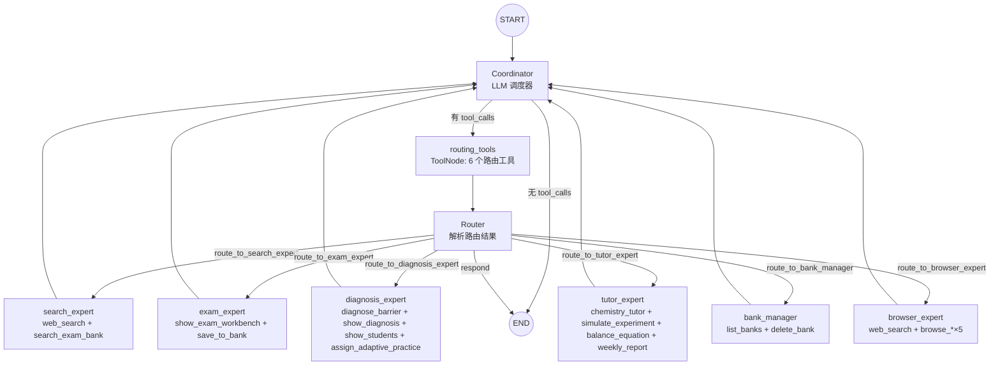
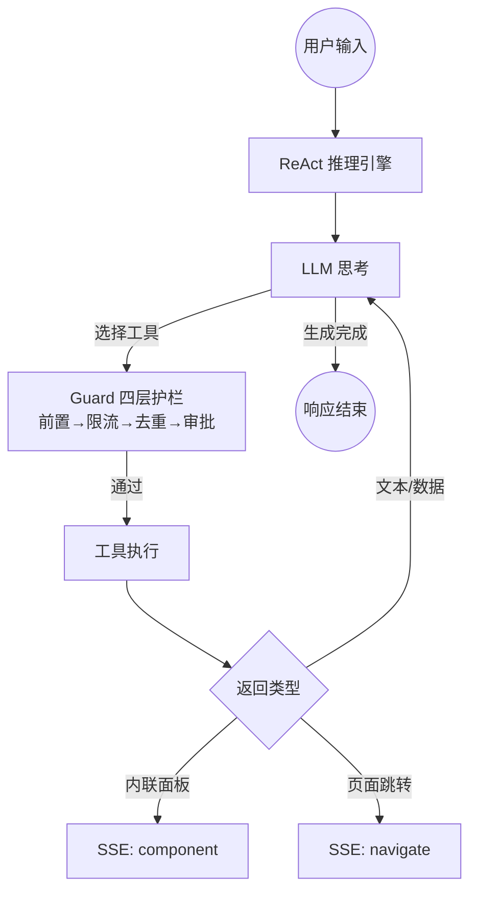
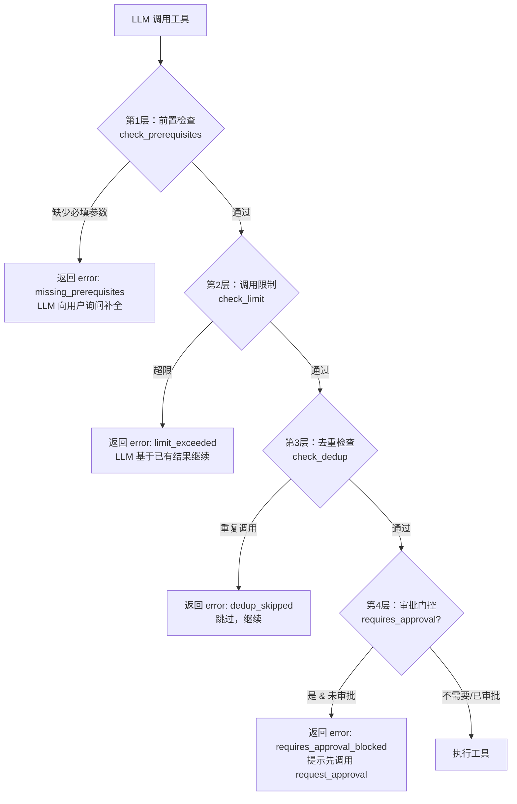
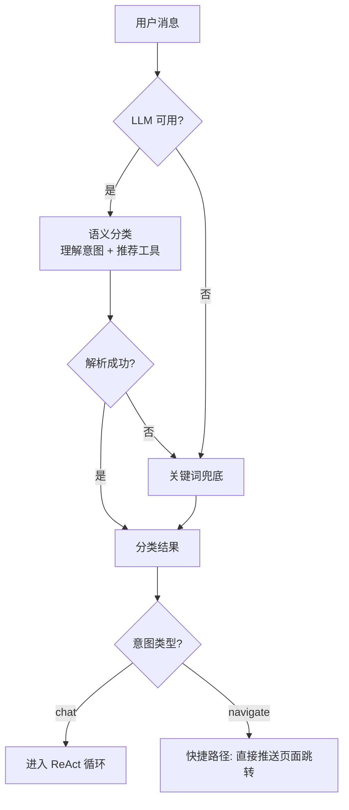
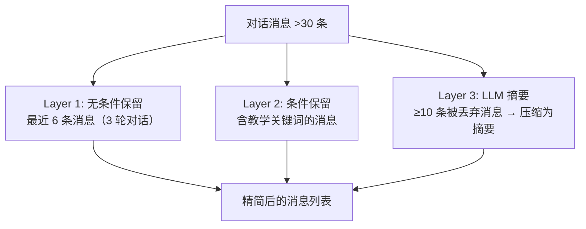

# 29. Agent 对话系统设计

> **定位**：ChemAI（智辅化学）的 AI 大脑 —— 自然语言输入 → 意图理解 → 工具执行 → 结构化响应
> **架构**：单智能体 ReAct 模式，42 个领域工具 + 5 个浏览器工具、4 套 Persona、Gateway 分类器、Guard 护栏、Planner、MCP、SSE 协议完整设计

---

## 一、系统定位

ChemAI Agent 系统是整个平台的智能核心，负责将教师的自然语言指令、学生的提问、家长的查询转化为可执行的工具调用链，并通过 SSE (Server-Sent Events) 实时推送执行过程与结果。

**核心能力闭环**：用户自然语言输入 → Gateway 分类 → Persona 筛选工具集 → ReAct 循环（思考→选工具→执行→观察）→ SSE 推送结果。

**与前端的关系**：Agent 通过 `_component` 字段输出内联面板（如出题工作台、学生列表、诊断图表），通过 `_route` 字段触发页面跳转。前端通过 Agent 对话流端点建立 SSE 长连接，接收 `tool_call` / `tool_result` / `text` / `component` / `navigate` 等结构化事件。

### 1.2 设计目标

| 目标 | 说明 | 衡量标准 |
|------|------|---------|
| 意图分类准确 | Gateway 正确区分 chat 与 navigate 两类意图 | 分类准确率 ≥ 85% |
| 工具选择精准 | ReAct Agent 在 40+ 个工具中选中符合用户意图的工具 | 工具选择准确率 ≥ 80% |
| 安全可控 | 破坏性操作需教师审批，重复调用自动去重 | 无未授权工具执行 |
| 流式响应体验 | SSE 推送实现逐字输出和实时状态反馈 | 首 Token 延迟 < 3 秒 |
| 多角色适配 | 教师/学生/家长/辅导 4 套 Persona 行为差异化 | 每角色工具集无越权 |

### 1.3 核心指标

- **路由准确率**：Gateway 意图分类的正确率，目标 ≥ 85%
- **工具首选中率**：ReAct 循环中首次选择的工具即为正确工具的比例，目标 ≥ 65%
- **审批覆盖率**：破坏性操作中被审批门控拦截的比例，目标 = 100% 没有可谈空间
- **SSE 首 Token 延迟**：P95 < 3 秒
- **对话成功率**：用户对话未被 Error 中断的比例，目标 > 95%

## 不在范围内的功能

- 不做多 Agent 协作（当前 v2 为单 Agent ReAct）
- 不做离线 Agent（需实时 LLM 连接）
- 不替代 Gateway 的意图分类（Agent 处理 chat，Gateway 处理 navigate）

---

## 二、架构演进：v1 → v2

### 2.1 v1 多智能体架构（已保留为回退）

v1 采用 **Coordinator + Router + 6 Sub-Agent** 的多智能体模式：

V1 多智能体架构采用 Coordinator 调度 + Router 分发模式，由 Coordinating LLM 在 6 个专家子智能体间做路由选择。



**v1 核心设计**：

6 个子智能体通过字典定义，每个子智能体包含指定的工具列表和专用的 system prompt。search_expert 具备 web_search 和 search_exam_bank 两个工具；exam_expert 具备 show_exam_workbench 和 save_to_bank；diagnosis_expert 具备 diagnose_barrier、show_diagnosis、show_students、assign_adaptive_practice；tutor_expert 具备 chemistry_tutor、simulate_experiment、balance_equation、weekly_report；bank_manager 具备 list_banks、delete_bank；browser_expert 具备 web_search 和 5 个浏览器工具。

6 个路由工具由 Coordinating LLM 调用来选定专家子智能体，通过工厂函数创建。v1 的递归上限设置为 8（每步子智能体单独调用对 LLM 消耗更大）。

**v1 工厂函数**为每个子智能体创建独立的 ReAct Agent 节点。函数接收 name、tool_names、system_prompt、approval_tools 四个参数。内部创建 GuardState 实例，遍历 tool_names 生成工具列表（每个工具通过 Guard 包装，审批工具额外标记）。然后创建 ReAct Agent 传入模型、工具列表、name 和特化的 system prompt。每个子智能体只看到自己分区的 2-4 个工具，形成工具隔离。

**v1 问题总结**：

| 问题 | 根因 | 影响 |
|------|------|------|
| 路由准确率仅 70-75% | Coordinator LLM 需在 6 个子智能体间做一次路由决策，分类粒度粗 | "出题"走错到 search_expert，"诊断"走错到 tutor |
| 复杂状态管理 | MultiAgentState 含 12 个字段（shared_context, route_decision, target_agent, agent_query, last_component, last_route, reroute, pre_routed_agent, suggested_tools...） | 调试困难，状态传递易丢失 |
| 子智能体协调开销 | Coordinator → Router → SubAgent → Coordinator 一次往返即为 2 次 LLM 调用 | 总 LLM 调用次数是 v2 的 1.5-2 倍 |
| 工具分区导致的盲区 | 每个子智能体只能看到自己分区的工具，"诊断后出题"需要两轮 Coordinator 调度 | 多步任务需要多个往返 |

### 2.2 v2 单智能体架构（当前主版本）

v2 采用 **单一 ReAct Agent + Persona 过滤工具集** 的设计：

V2 单智能体架构将 42 个领域工具全量注入单个 ReAct Agent，LLM 通过工具描述文档自主选择，省去了路由决策环节。



**v2 核心设计**：

v2 的递归上限设为 12（无子智能体协调开销，每步更轻量）。全量工具列表包含 42 个领域工具加上 5 个浏览器工具。

Agent 工厂函数接收 persona、provider 等可选参数。其工具过滤逻辑分两层：先加载 Persona 的 YAML 配置，获取 available_skills 列表；然后计算 YAML 白名单集合与 TOOL_META 注册的该 Persona 可用工具集合的交集。最终 domain_tools 为交集内的工具列表，所有 Persona 都自动加上 5 个浏览器工具。然后创建 ReAct Agent 传入模型、过滤后的工具集、Persona 特化的 system prompt 和 checkpointer。

**架构对比总结**：

| 维度 | v1 Multi-Agent | v2 Single-Agent |
|------|---------------|-----------------|
| 路由方式 | LLM 路由工具（6 选 1）→ 子智能体 | LLM 直接从 40+ 个工具中自选（通过 docstring） |
| 路由准确率 | ~70-75% | ~85%+ |
| LLM 调用次数 | 1 次路由 + 1 次工具选择 + 子智能体内循环 | 1 次工具选择 + ReAct 循环 |
| 实现规模 | 大（6 个子图 + 路由层 + 状态映射） | 小（单图 + 工具注册表） |
| 状态复杂度 | `MultiAgentState` 12 个字段 | `MessagesState`（LangGraph 内置） |
| 递归上限 | 8 | 12 |
| 工具可见性 | 子智能体分区（2-4 工具） | 全量可见（按 Persona 过滤后 10-30 工具） |
| 维护性 | 新工具需同步修改路由映射和子智能体 | 只需在 TOOL_META 中注册 |

### 2.3 共存策略

在 Agent 工厂函数中，根据 version 参数选择 v1 或 v2 的 Agent 和 SSE 适配器。若 version 为 "v2"，加载 v2 Agent 和 SSE 适配器；否则加载 v1 Agent 和 SSE 适配器。

前端默认显式请求 v2（当前主版本），v1 作为回退保留，可通过 `request.version` 参数显式指定。两个版本共享 GuardState、checkpointer、TOOL_META 等基础设施。v2 独立的 SSE 适配器（更简洁，无 sub_agent_start/sub_agent_end 事件）。

---

---

## 三、工具完整目录

所有工具在系统中统一定义，按功能模块组织。工具数量不做硬限制——新增工具只需在元数据注册表中增加条目并指定所属 Persona 和调用限制即可。当前 **42 个领域工具**覆盖 9 个核心领域，另有 **5 个浏览器工具**自动附加给所有 Persona。

每个工具遵循统一的设计规范：明确描述"何时用"（触发场景）、"会发生什么"（执行逻辑）、"下一步"（后续操作）和"NOT for"（排除的误用场景，防止 LLM 选错工具）。

### 3.1 工具元数据注册

工具元数据注册表以工具函数对象为键，注册每个工具的可用 persona 角色列表和每轮最大调用次数 call_limit。系统在模块加载时执行**编译时完整性校验**：断言所有注册工具都有元数据、所有元数据对应已注册工具——配置与注册双向闭合，任何遗漏都会在启动阶段直接暴露。

### 3.2 出题与题库（9 工具）

| # | 工具 | 所需输入 | 限次 | 角色 | 行为描述 | 返回内容 |
|---|------|---------|:--:|------|----------|----------|
| 1 | 搜索真题 `search_exam_bank` | 搜索关键词、年份、难度、数量 | 3 | 教师、辅导 | 三级搜索：本地关键词匹配 → 向量召回补充 → 联网补齐。返回结构化题目列表逐题展示 | 文本 + 题目图片列表 |
| 2 | 联网搜索 `web_search` | 搜索查询词 | 2 | 全体 | 多路联网搜索，结果经 LLM 摘要到 400 字内 | 查询词 + 搜索结果摘要 |
| 3 | 打开出题面板 `show_exam_workbench` | 知识点、难度、题型、变体来源、题库名 | 3 | 教师、辅导 | 在聊天中内联渲染出题工作台面板，用户可在面板中配置参数并生成题目 | 面板消息 + 组件渲染指令 |
| 4 | 保存到题库 `save_to_bank` | 题目列表、知识点、题库名、描述 | 1 | 教师、辅导 | 创建题库文件夹，逐题入库，同步向量索引 | 保存确认 + 页面跳转指令 |
| 5 | 生成题目 `generate_questions` | 知识点、难度、数量、题型、变体题ID（可选） | 5 | 教师、辅导 | LLM 出题：RAG 检索→生成→化学式标准化→审核→返回 | 题目列表 + 内联面板 |
| 6 | 查看题库列表 `list_banks` | 无 | 1 | 教师、辅导 | 查询所有题库文件夹，返回名称和题目数 | 文件夹列表 |
| 7 | 删除题库 `delete_bank` | 题库ID | 1 | 教师、辅导 | 删除题库文件夹及题目关联（题目实体保留）。需审批确认 | 删除确认 |
| 8 | 列出名下考试 `list_teacher_exams` | 教师身份（自动） | 3 | 教师 | 列出教师名下的考试列表，供"这批答题卡是哪场考试"的反问场景使用 | 考试候选列表 |
| 9 | 导入题库 `import_question_bank` | 题库文件/文档 | 2 | 教师、辅导 | 将结构化题目文档批量导入题库，自动构建向量索引 | 导入结果摘要 |

**`search_exam_bank` 三级搜索策略**：
- Tier 1 — 本地关键词精确匹配：按知识点、年份、难度在题库中检索，支持数量限制
- Tier 2 — 向量召回：当关键词匹配结果不足时自动启用，通过 ChromaDB 向量检索补充
- Tier 3 — 联网补齐：若前两层结果仍不足 3 条且有 keyword，调用联网搜索，返回标记为"AI辅助搜索（本地题库仅 N 道，以下为AI补充）"

**`generate_questions` 的化学式标准化**分三步：

Step 0 保护 SMILES 等特殊片段，防止被后续规则误改写；

Step 1 将 $...$ 内部的 LaTeX 符号统一替换（→ 替换为 \rightarrow，⇌ 替换为 \rightleftharpoons，↑/↓ 替换为 \uparrow/\downarrow）；

Step 2 检测裸化学式——维护一个包含 50+ 常见化学式的白名单（H2O、CO2、NaCl、NaOH、HCl、Fe2O3、H2SO4、CuSO4、KMnO4、K2Cr2O7、Fe(OH)3 等），将匹配到的化学式的数字下标转换为 LaTeX 格式并包装为 `$...$`。

### 3.3 诊断与教学（10 工具）

| # | 工具 | 所需输入 | 限次 | 角色 | 行为描述 | 返回内容 |
|---|------|---------|:--:|------|----------|----------|
| 10 | 诊断障碍 `diagnose_barrier` | 学生ID/姓名、班级ID | 2 | 教师、家长 | 个体或班级两级诊断：个体返回三维障碍分布和主导类型；班级返回全班的统计分布 | 障碍分布 + 主导类型 + 页面跳转/组件渲染指令 |
| 11 | 展示诊断面板 `show_diagnosis` | 学生ID/姓名、班级ID | 1 | 教师 | 在聊天中内联渲染诊断图表面板 | 面板消息 + 诊断组件渲染指令 |
| 12 | 展示学生列表 `show_students` | 班级ID/名称、障碍过滤条件（可选） | 1 | 教师 | 三模式：无班级→列出全部班级；有班级→学生卡片；有过滤→按障碍筛选 | 学生列表 + 组件渲染指令 |
| 13 | 通用辅导 `chemistry_tutor` | 问题、学生水平、角色 | 3 | 全体 | 教师模式 800 字教研分析 / 学生模式 500 字引导教学 | 教学回复 |
| 14 | 生成周报 `weekly_report` | 学生ID/姓名、班级名 | 2 | 教师、家长 | LLM 生成 200 字自然语言周报（通俗语言，不制造焦虑） | 学生姓名 + 周报文本 |
| 15 | 布置自适应练习 `assign_adaptive_practice` | 班级ID、知识点、题目数 | 1 | 教师 | 为班级学生生成个性化 ZPD 练习。需审批确认 | 布置确认 + 每生参数详情 |
| 16 | 生成学习计划 `generate_learning_plan` | 学生ID、姓名 | 5 | 教师 | 基于诊断结果生成个性化学习计划 | 计划内容 + 详情面板 |
| 17 | 发送学习计划 `send_learning_plan` | 学生ID、计划数据 | 2 | 教师 | 持久化学习计划并通知学生 | 成功确认 |
| 18 | 生成家长报告 `generate_parent_report` | 学生姓名、ID | 5 | 教师 | 聚合练习、诊断、知识点数据，生成家长可读报告预览 | 报告预览文本 + 需确认标记 |
| 19 | 发送报告给家长 `send_report_to_parent` | 学生ID、报告数据 | 3 | 教师 | 推送周报到已绑定家长的通知列表 | 发送确认 |

**智能名称解析**：诊断工具支持纯数字 ID 和中文姓名两种输入方式。非数字输入时进行模糊匹配，多结果时返回候选列表。

**班级名灵活匹配**：支持"高一一班""高一(1)班""高一（一）班"等多种写法，通过数字规范化（中文数字→阿拉伯数字）统一匹配。

### 3.4 辅导（6 工具，工厂生成）

| # | 工具 | 所需输入 | 限次 | 角色 | 行为描述 |
|---|------|---------|:--:|------|----------|
| 20 | 离子方程式辅导 `ionic_equation_tutor` | 方程式、题目、学生输入 | 5 | 学生 | 苏格拉底四步法：判断可拆物质→写成离子→删不变离子→检查守恒 |
| 21 | 化学计量辅导 `stoichiometry_tutor` | 方程式、题目、学生输入 | 5 | 学生 | 提取已知量→选公式→列关系式→分步计算 |
| 22 | 氧化还原辅导 `redox_tutor` | 方程式、题目、学生输入 | 5 | 学生 | 标化合价→找升降→电子守恒配平 |
| 23 | 化学平衡辅导 `equilibrium_tutor` | 方程式、题目、学生输入 | 5 | 学生 | 分析平衡体系→勒夏特列原理→三段式计算 |
| 24 | 周期律辅导 `periodic_law_tutor` | 方程式、题目、学生输入 | 5 | 学生 | 位置→结构→性质推断 |
| 25 | 有机推断辅导 `organic_tutor` | 方程式、题目、学生输入 | 5 | 学生 | 逆合成分析+官能团转化 |

6 个苏格拉底式辅导工具由同一工厂函数生成，详见[§22 逻辑工厂模式](#22-逻辑-工厂模式)。

### 3.5 实验与配平（2 工具）

| # | 工具 | 所需输入 | 限次 | 角色 | 行为描述 |
|---|------|---------|:--:|------|----------|
| 26 | 模拟实验 `simulate_experiment` | 实验名称 | 2 | 学生、辅导 | LLM 生成实验报告：目的、仪器、步骤、现象、方程式、原理、安全提醒、考点 |
| 27 | 配平方程式 `balance_equation` | 方程式 | 3 | 辅导、教师 | 四维审核方程式配平，返回两侧各元素原子计数 |

### 3.6 OCR 批改与考试（4 工具）

| # | 工具 | 所需输入 | 限次 | 角色 | 行为描述 | 返回内容 |
|---|------|---------|:--:|------|----------|----------|
| 28 | 查询OCR进度 `query_ocr_progress` | 教师ID、批次ID | 3 | 教师 | 按批次聚合 OCR 任务进度（完成/失败/等待百分比） | 批次摘要 + 每张状态 |
| 29 | 批改答题卡 `grade_answer_sheets` | 教师ID、批次ID、考试ID | 2 | 教师 | 对已完成 OCR 的任务批量执行 LLM 批改 | 批改汇总 + 逐题判定 |
| 30 | 保存批改结果 `save_grading_results` | 教师ID、批次ID | 2 | 教师 | 逐学生写入作答记录，自动触发障碍诊断 | 保存数量 + 诊断触发确认 |
| 31 | 查询答题卡成绩 `query_batch_grades` | 批次ID/考试ID | 3 | 教师 | 查询批改结果或已保存的考试成绩 | 成绩列表 |

### 3.7 记忆（2 工具）

| # | 工具 | 所需输入 | 限次 | 角色 | 行为描述 | 返回内容 |
|---|------|---------|:--:|------|----------|----------|
| 32 | 读取学生记忆 `memory_student_get` | 学生ID、记忆类型 | 1 | 全体 | 从长期存储中读取学生诊断历史（最近 5 条）和当前学习计划 | 诊断历史 + 学习计划 |
| 33 | 读取教师记忆 `memory_teacher_get` | 教师ID | 1 | 教师 | 读取教师偏好设置（教学风格、难度偏好、班级配置） | 教师配置数据 |

### 3.8 文档解析（2 工具）

| # | 工具 | 所需输入 | 限次 | 角色 | 行为描述 | 返回内容 |
|---|------|---------|:--:|------|----------|----------|
| 34 | 解析化学文档 `parse_chemistry_document` | 文件路径/上传文件 | 3 | 教师、辅导 | 解析 PDF/Word/图片 中的题目与化学式，输出结构化题目或知识点 | 解析结果 + 标准化化学式 |
| 35 | 检查解析服务 `check_parser_services` | 无 | 2 | 教师、辅导 | 查询各文档解析引擎（OCR/PDF/公式识别）的可用性状态 | 服务状态列表 |

### 3.9 开发与文件（6 工具）

| # | 工具 | 所需输入 | 限次 | 角色 | 行为描述 |
|---|------|---------|:--:|------|----------|
| 36 | 读取文件 `read` | 文件路径、偏移/行数 | 5 | 教师、辅导 | 按需读取本地文件内容（支持分段读取），用于教研资料查阅 |
| 37 | 写入文件 `write` | 文件路径、内容 | 3 | 教师、辅导 | 创建或整体覆盖文本文件 |
| 38 | 编辑文件 `edit` | 文件路径、定位、替换 | 3 | 教师、辅导 | 精确替换文件中的指定文本片段，支持增量修改 |
| 39 | 查找文件 `find` | 路径、匹配模式 | 3 | 教师、辅导 | 按文件名模式递归查找文件 |
| 40 | 搜索内容 `grep` | 路径、正则 | 3 | 教师、辅导 | 在文件内容中按正则检索，返回匹配行 |
| 41 | 执行命令 `bash` | 命令串 | 2 | 教师、辅导 | 执行指定命令并返回输出（用于数据处理类任务，与教师审批机制联动） |

### 3.10 规划（1 工具）

| # | 工具 | 所需输入 | 限次 | 角色 | 行为描述 |
|---|------|---------|:--:|------|----------|
| 42 | 复杂任务规划 `plan_task` | 目标文本 | 2 | 教师、辅导 | 将多步复杂任务拆解为结构化执行计划（目标 + 最多 6 步），支持步骤间依赖注入 |

### 3.11 浏览器（5 工具，自动附加）

| # | 工具 | 所需输入 | 行为描述 | 并发策略 |
|---|------|---------|----------|----------|
| 43 | 打开网页 `browse_navigate` | 目标URL、等待策略 | 打开 URL 等待加载完成，返回页面标题和文本（上限 8000 字） | 单浏览器实例 + 60s 空闲超时自动回收 |
| 44 | 读取内容 `browse_read` | 元素选择器 | 提取指定页面元素的文本内容（上限 8000 字符） | 复用同一页面实例 |
| 45 | 点击元素 `browse_click` | 元素选择器 | 点击页面元素并等待 0.5s，返回跳转前后的 URL | 复用同一页面实例 |
| 46 | 输入文本 `browse_input` | 元素选择器、输入文本 | 清空输入框并填入文本 | 复用同一页面实例 |
| 47 | 截图 `browse_screenshot` | 元素选择器 | 截取指定区域的 PNG 截图并 Base64 编码返回 | 复用同一页面实例 |

**浏览器生命周期**：系统维护单一浏览器实例。每次使用前检查实例是否存在及空闲超时（60 秒无操作自动关闭），按需启动新的无头 Chromium。

---

## 四、Persona 系统

### 4.1 YAML 配置 Schema

四个 Persona 通过 YAML 配置文件定义，位于系统 Persona 配置目录中。

YAML 结构包含以下顶层字段：
- `name`：显示名称，如"化学助教"
- `description`：Persona 的功能描述
- `system_prompt`：注入 Agent 的 system prompt（多行文本）
- `available_skills`：工具白名单列表（与工具元数据注册表中的 personas 取交集）
- `data_access`（仅 parent Persona）：定义 can_see（可见数据项，如 own_child_scores、own_child_barriers、own_child_practice）和 cannot_see（不可见数据项，如 other_students、class_stats、teacher_notes）

### 4.2 四个 Persona 详情

#### Teacher（教研助手）

- **定位**：面向教师的 AI 教学分析助手，帮助管理班级、分析学情、准备考试
- **system_prompt**：简洁，强调"根据实际需求选择合适的工具辅助分析"
- **工具集**（近全量，35 个领域工具）：出题题库、诊断教学、OCR 批改、记忆、文档解析、开发文件与规划工具全量开放；`chemistry_tutor` 遇到 teacher persona 时自动切换为教研分析模式（800 字，考点分布 + 教学策略 + 学生误区）
- **特点**：数据与教研工具为主，不含学生端 tutoring 工具

#### Student（化学助教 - 学生端）

- **定位**：面向学生的 AI 辅导老师，绝对不直接给答案
- **system_prompt 核心原则**：苏格拉底式提问（先问"你觉得这道题考什么知识点？"）；化学方程式、计算过程必须用 LaTeX 格式；禁止直接给答案、代劳计算、无输入时预设反应
- **工具集**（10 个领域工具）：chemistry_tutor、6 个 tutoring 工具、simulate_experiment、web_search、memory_student_get

#### Tutor（化学助教 - 通用）

- **定位**：默认 Persona，兼具辅导和出题能力
- **工具集**（21 个领域工具）：出题题库、通用辅导、模拟实验、配平、文档解析、开发文件与规划工具；不含诊断与批改工具

#### Parent（家长助手）

- **定位**：面向家长的 AI 学情报告助手
- **system_prompt 核心原则**：用通俗语言，不用教育学术语；鼓励为主（"成长空间"代替"问题"，"薄弱点"代替"不会"）；保护隐私（只汇报自己孩子，不透露其他学生信息）；不制造焦虑；支持 `{student_context}` 模板变量（注入孩子姓名、学习特点、练习次数）
- **工具集**（4 个领域工具）：weekly_report、diagnose_barrier、web_search、memory_student_get（最精简的工具集）
- **数据权限**：`data_access.can_see` / `cannot_see` 定义可见范围

所有 Persona 均自动附加 5 个浏览器工具。

### 4.3 Persona 工具过滤机制

Agent 工厂函数中实现两层过滤：自动注册 = 工具元数据表中注册该 persona 的工具集合，与配置白名单 = Persona 配置中 available_skills 列表的集合取交集。最终工具名称列表取两者交集，确保配置白名单中不存在（或元数据表未注册）的工具不会被加入。

**工具分布总览**（完整矩阵见文档内容，覆盖 4 个 Persona 对全部 42 个领域工具的可用性）：

- search_exam_bank：仅 Tutor 和 Teacher 可用
- web_search：所有四个角色（Student/Tutor/Teacher/Parent）均可用
- show_exam_workbench：Tutor 和 Teacher 可用
- show_diagnosis、show_students、diagnose_barrier：Teacher 可用（diagnose_barrier 额外对 Parent 开放）
- chemistry_tutor：Student/Tutor/Teacher 可用
- simulate_experiment：Student 和 Tutor 可用
- balance_equation、query_ocr_progress、grade_answer_sheets、save_grading_results：Teacher（部分也向 Tutor 开放）
- 6 个 tutoring 工具（ionic/stoichiometry/redox/equilibrium/periodic_law/organic）：仅 Student 可用
- weekly_report：Teacher 和 Parent 可用
- assign_adaptive_practice、generate_learning_plan、send_learning_plan、generate_parent_report、send_report_to_parent：仅 Teacher 可用
- save_to_bank、list_banks、delete_bank、generate_questions：Tutor 和 Teacher 可用
- memory_student_get：所有角色可用；memory_teacher_get：仅 Teacher 可用
- 5 个浏览器工具：所有角色可用

---

## 五、Guard 护栏层

Guard 是请求级安全基础设施，每位 Agent 调用创建一个新实例，跟踪去重、限制、审批状态。

### 5.1 四层安全防护

Guard 是请求级安全基础设施，每次 Agent 调用创建一个新实例，跟踪去重、限制、审批状态。所有工具调用按顺序经过四层检查，任一层拦截都会返回结构化错误（含错误码），由 LLM 决定如何继续——询问用户补全参数、基于已有结果继续、跳过重复调用或先请求审批。



### 5.2 各层实现细节

**第1层：前置条件检查**

系统为每个工具定义必填参数，调用前校验：

| 工具 | 前置条件 |
|------|---------|
| `search_exam_bank` | `keyword` 参数长度 > 2 字符 |
| `diagnose_barrier` | `student_id` 或 `class_id` 至少一个非空 |
| `weekly_report` | 至少一个学生/班级标识非空 |
| `assign_adaptive_practice` | 学生或班级标识至少一个非空 |

**第2层：调用次数限制**

每个工具在元数据注册表中定义 call_limit，按工具的重要性和破坏性分四级：

| 限制级别 | 每轮最大调用次数 | 典型工具 |
|---------|:--------------:|---------|
| 严格 | 1 次 | `assign_adaptive_practice`、`delete_bank`、`save_to_bank`、`list_banks`、`show_diagnosis`、`show_students`、`memory_student_get`、`memory_teacher_get` |
| 中等 | 2 次 | `web_search`、`diagnose_barrier`、`simulate_experiment`、`grade_answer_sheets`、`save_grading_results`、`weekly_report`、`import_question_bank`、`check_parser_services`、`bash`、`plan_task` |
| 宽松 | 3 次 | `search_exam_bank`、`show_exam_workbench`、`chemistry_tutor`、`balance_equation`、`query_ocr_progress`、`query_batch_grades`、`list_teacher_exams`、`write`、`edit`、`find`、`grep` |
| 开放 | 5 次 | 6 个 tutoring 工具、`generate_questions`、`generate_learning_plan`、`generate_parent_report`、`read` |

**第3层：去重**

以"工具名 + 排序后的参数字符串"为标识，已执行过的相同调用自动跳过，防止 LLM 陷入工具调用循环。

**第4层：审批门控**

破坏性操作（布置练习、删除题库）需先触发审批流程：Agent 暂停执行 → 前端展示确认卡片 → 教师确认后恢复执行。未审批的工具调用被拦截，提示需要先请求审批。

### 5.3 特殊字段剥离

工具返回值中的内联面板指令和页面跳转指令为前端专用字段，在 Guard 层被自动剥离。剥离后的数据分别存入路由状态和组件状态，返回给 LLM 的数据只含纯净的业务结果。LLM 不需要理解前端渲染细节，前端从 SSE 事件中获取剥离后的指令。

### 5.4 补充机制

- **自然语言确认门**：审批工具支持"确认/同意/可以"等自然语言确认语句识别，教师口头确认即可推进审批流，无需固定按钮流程。
- **审批状态确定性重放**：审批请求被持久化，确认/取消通过确定性重放恢复执行，避免 LLM 在审批点重新决策。
- **服务端身份注入**：教师身份由服务端注入工具调用上下文，工具不信任 LLM 自行声明的身份。
- **文件工具按次审批**：文件与命令类工具（read/write/edit/bash）在越出工作区范围时触发按次审批，单次放行不累积权限。

---

## 六、Gateway 意图分类器

系统提供意图分类器，在请求进入 Agent 前进行**预分类**。

### 6.1 双路径分类架构

Gateway 采用"LLM 优先 + 关键词兜底"的双路径设计，确保分类可靠性：

1. **主路径（LLM 语义分类）**：用户消息首先送入轻量级 LLM（低温度、短输出），判断意图类型并推荐合适的工具。LLM 能理解"出几道氧化还原题"→ 出题工具的语义映射。
2. **兜底路径（关键词匹配）**：当 LLM 调用失败或返回格式异常时，降级到约 16 组中文关键词模式匹配。"出"+"题"→ 出题工具，"班"+"学生"→ 学生管理工具。
3. **结果合并**：两条路径的结果合并去重后输出。LLM 结果优先级高于关键词匹配。

此外，分类结果为 `navigate` 类型时走**快捷路径**——跳过 Agent 引擎，直接推送页面跳转 SSE 事件，省去 ReAct 循环开销。



### 6.2 分类 Prompt

分类器的核心 Prompt 定义了意图判断规则：判断用户消息是需要调用工具（chat 类型）还是纯页面跳转（navigate 类型）。分类规则要求：不确定时一律走 chat；只有明确说"打开XX页面""跳转到XX"的才走 navigate。要求返回 JSON 包含四个字段：type（"chat" 或 "navigate"）、tools（最多3个建议工具）、page（可选，目标页面标识，如 exam-v2/diagnosis/students/teacher）和 provider（可选，模型选择，涉及图片/拍照/OCR/识别/上传的消息建议视觉模型）。Provider 选择规则：涉及图片/拍照/OCR/识别/上传的消息视觉模型；其他通用推理模型。

### 6.3 关键词兜底

当 LLM 分类失败时，关键词兜底提供约 16 组中文意图模式：
- Provider 检测：包含"图片/照片/图像/识别/OCR/上传"关键词的消息视觉模型 provider
- 纯页面跳转：包含"打开考试工作台/打开学生管理/打开诊断页面/去首页"的消息返回 navigate 类型
- 工具推荐按中文关键词匹配："出"+"题" → show_exam_workbench + generate_questions；"班"+"学生" → show_students + diagnose_barrier；"诊断/学情/薄弱" → diagnose_barrier；"周报/学习报告" → weekly_report；"网上/上网/搜一搜" → web_search；"什么是/怎么做/原理/怎么理解" → chemistry_tutor

### 6.4 navigate 快捷路径

当 Gateway 分类结果为 navigate 类型且指定了目标页面时，系统跳过 Agent 引擎，直接通过快速完成异步生成器返回导航事件流。该生成器依次发送三个 SSE 帧：navigate 事件（含 page 和 params）、done 事件和结束标记。纯页面跳转不经过 Agent 引擎，直接返回导航事件。

---

## 七、规划系统（Planner）

系统中的 Planner 提供目标拆解能力，将复杂教学任务（如"诊断全班 + 针对出题 + 发给家长"）分解为结构化执行步骤。

### 7.1 数据模型

两个核心数据结构：
- **PlanStep**：包含 step（步骤编号）、skill（执行技能名）、args（调用参数字典）、depends_on（依赖的前序步骤编号列表，如 [1, 2]）、description（中文步骤描述）、status（字符串，默认 "pending"，可取 pending/running/completed/failed/skipped）
- **Plan**：包含 goal（原始目标文本）和 steps（PlanStep 列表，最多6步）

### 7.2 拆解 Prompt

`PLAN_PROMPT` 定义规划器的核心任务：将用户的复杂目标拆解为结构化执行步骤。预设方案包含可用技能列表 `{skills}` 的占位符。要求返回 JSON（只返回 JSON），结构为 goal（复述原始目标）和 steps 数组（每项含 step 编号、skill 技能名、args 参数对象、depends_on 依赖列表、description 中文描述）。核心规则：最多 6 个步骤，depends_on 引用前序步骤编号，需要前序步骤输出时 `${step_N.field}` 变量引用（如 `${step_1.question_ids}`），禁止循环依赖，如果不需要拆解则返回单步 Plan。

### 7.3 关键方法

**Planner 包含四个核心方法：**

`generate` — 异步方法：调用 LLM 进行目标拆解，解析返回的 JSON 并构建 Plan 对象，若 LLM 调用或解析失败则 fallback 到单步 Plan。

`validate` — 校验步骤（内联执行）：检查技能名是否存在于可用技能列表中、step 编号是否去重（无重复编号）、步骤数是否不超过上限6步；自引用步骤会被剔除而非放行。

`single_step_fallback` — 兜底方法：进行关键词匹配，从可用技能列表中选取最佳匹配的单个技能，构建单步 Plan。

`inject_dependencies` — 依赖注入方法：正则模式匹配变量引用，从之前步骤的执行结果中提取对应的实际值进行替换（例如将"为 ${step_1.student_id} 出题"替换为"为 2024001 出题"）。

---

## 八、上下文管理

系统实现**三层保留策略**，解决对话历史过长导致的 token 爆炸。

### 8.1 三层裁剪策略

对话消息超过阈值时，系统通过以下三层规则进行裁剪：



### 8.2 裁剪参数与流程

裁剪函数接收两个可调参数：保留最近条数（默认 6）、触发阈值（默认 30 条消息）。执行流程：获取当前对话状态 → 若消息数 ≤ 阈值则跳过 → 否则依次执行三层裁剪 → 将裁剪后的消息列表写回 Agent 检查点。关键词保留设有上限（最多 10 条），防止关键词命中过多导致裁剪失效。

### 8.3 摘要成本约束与上下文计量

**摘要输入约束**：LLM 摘要阶段对输入做成本控制——单条被丢弃消息截断至 120 字、最多取 20 条，保证一次摘要调用的输入约 1.5k tokens，摘要本身 ≤ 200 字中文。摘要失败时降级为纯裁剪（仅保留关键词命中与最近消息），不阻塞对话。

**上下文占用计量**：前端对话界面的"上下文占用"指示器由专门的计量器提供——以模型流式响应末尾上报的 token 用量（Provider 权威值）作为已用 token 锚点，system / tools / messages 三段在无权威值时按固定密度估算（约 4 字符 ≈ 1 token + 结构开销）。计量器输出已用 / 剩余 / 占用百分比三个值，随 SSE 事件推送，供前端实时展示。

裁剪函数接收两个可调参数：保留最近条数（默认 6）、触发阈值（默认 30 条消息）。

执行流程：获取当前对话状态 → 若消息数 ≤ 阈值则跳过 → 否则依次执行三层裁剪 → 将裁剪后的消息列表写回 Agent 检查点。

裁剪后的消息结构为：摘要消息（如有）→ 关键词命中的历史消息 → 最近 6 条消息 → 当前用户输入。详细设计见 [§9.3 上下文裁剪](#93-上下文裁剪)。

---

## 九、记忆管理

Agent 的"记忆"分为三个层次，各由不同的机制负责。

### 9.1 三层记忆架构

| 层次 | 存储位置 | 容量 | 生命周期 | 用途 |
|------|---------|------|---------|------|
| 工作记忆 | 内存滑动窗口 | 最近 20 条消息 | 单次请求 | 当前对话的即时上下文 |
| 情景记忆 | 内存字典 | 无硬上限 | 单次请求内 | 本次对话中产生的关键事件（诊断结果、考试记录） |
| 学生档案 | 数据库查询 | 每生一份 | 跨请求持久 | 学生姓名、障碍类型、练习完成数等画像数据 |

**工作记忆**：固定容量滑动窗口，满时自动丢弃最旧消息。20 条约为 10 轮师生对话，对化学辅导场景足够。

**情景记忆**：存储本次对话中提取的结构化事件。例如诊断完成后结果写入情景记忆，后续轮次 LLM 可直接引用。当前版本随请求销毁，不跨请求持久化。

**学生档案**：每次请求从数据库查询学生画像（姓名、障碍分布、累计练习数），以 System Message 形式注入消息列表最前面。LLM 将其视为权威背景知识，而非对话中的事实陈述。

### 9.2 消息组装

每次 Agent 调用前，上下文信息按以下顺序组装为消息列表发往 LLM：

```
[System Message: 学生档案 — 姓名、障碍类型、练习数]
[历史对话消息...]
[当前用户输入]
```

学生档案以 System Message 注入消息列表最前面，LLM 将其视为权威背景知识；情景记忆（本次对话产生的关键事件）不进入消息组装，由工具通过运行上下文直接访问。

### 9.3 上下文裁剪

对话检查点会无限累积消息。若不裁剪，每轮对话发给 LLM 的 Token 量持续增长。裁剪在每次 Agent 调用前自动执行：

- **触发条件**：消息超过 30 条
- **无条件保留**：最近 6 条消息（约 3 轮对话）
- **关键词过滤**：更早的消息中，含教学关键词的额外保留（学生、诊断、障碍、考试、题目、知识点、分数、薄弱、学习计划、错题、成绩、练习、班级、教师）
- **LLM 摘要**：被丢弃消息 ≥ 10 条时，调用 LLM 压缩为 ≤ 200 字中文摘要。摘要失败则直接丢弃，仅保留关键词命中部分

裁剪后的消息结构：`[摘要] → [关键词命中历史] → [最近 6 条] → [当前输入]`。

### 9.4 对话持久化

对话状态通过 LangGraph Checkpointer 持久化到 SQLite。Checkpointer 为进程级单例，服务重启后对话不丢失。

- **多轮保持**：每次调用后自动保存状态，下次调用从上次恢复
- **中断恢复**：审批流程中 Agent 暂停等待教师确认，确认后从检查点恢复执行
- **对话隔离**：每个 `conversation_id` 对应独立检查点。不同对话互不干扰。学生切换时建议创建新对话 ID

### 9.5 跨会话长期记忆

LangGraph AsyncSqliteStore 提供跨会话的键值存储：

- **学生诊断历史**：保留最近 5 条诊断记录（障碍类型 + 分布 + 时间戳）
- **教师偏好**：教学风格、难度偏好、班级配置
- **写入策略**：best-effort。写入失败不阻塞主流程

长期记忆通过 `memory_student_get` / `memory_teacher_get` 工具对外提供读取能力，与工具链的接入按需扩展。

### 9.6 对话重置

重置操作将对话检查点的消息清空，重置后如同新建对话。

---

## 十、审计日志

系统提供审计日志功能，以 JSONL 格式记录所有技能执行。

### 10.1 设计决策

**审计条目**包含以下字段：
- `timestamp`（ISO 时间字符串）
- `persona`（当前 Persona 名称）
- `skill_name`（被调用的技能名称）
- `args`（已脱敏的参数字典）
- `result_summary`（结果摘要，截断至 200 字符）
- `duration_ms`（执行耗时，毫秒浮点数）
- `error`（可选字符串，异常描述）

**审计日志器**的核心设计：
- 环形缓冲区：deque 双端队列，maxlen=100，内存中保留最近 100 条日志
- 日志文件默认路径为 data/audit/ 目录，磁盘上以 JSONL 格式追加写入
- **写入策略**：绝不阻塞主流程——在 try-except 块中执行，JSON 序列化后追加写入文件，任何异常（磁盘满、权限不足等）均被静默捕获
- **脱敏方法**：定义敏感字段集合包含 password、phone、parent_phone、token、api_key、secret 六个敏感字段名。遍历参数字典，若键名在敏感字段集合中则替换值为 "***"，否则保留原值

---

## 十一、错误处理

### 11.1 错误层次结构

系统定义完整的异常体系，以基础错误类为基类，所有子类均包含 `code`（错误码字符串）和 `recoverable`（是否可恢复）两个属性，并实现将错误转换为 SSE 事件字典格式的方法（type: "error", code, message, recoverable）。

六个子类及其属性和触发条件：
- `SkillExecutionError`：code="SKILL_EXECUTION_ERROR"，recoverable=True。工具执行失败，LLM 可尝试其他方法
- `SkillNotFoundError`：code="SKILL_NOT_FOUND"，recoverable=False。技能未注册，属于致命错误
- `SkillPermissionError`：code="SKILL_PERMISSION_DENIED"，recoverable=False。Persona 无权该技能
- `ProviderError`：code="PROVIDER_ERROR"，recoverable 取决于 HTTP 状态码（429/500/502/503 时可重试）。构造函数接收 status_code 参数
- `PlanError`：code="PLAN_ERROR"，recoverable=True。规划失败，可 fallback 到单步 Plan
- `ToolError`：code="TOOL_ERROR"，recoverable=True。通用工具异常

### 11.2 安全工具调用包装器

安全工具调用包装器接收 tool_name（工具名称）、fn（原始函数）及其他参数。在 try-except 块中执行 fn。若成功则返回原函数的返回值；若异常则构造 ToolError 实例（包含 tool_name 和错误消息），返回包含 error、code 和 _tool_error: true 的结构化错误信息。这确保工具抛出异常时 LLM 能收到结构化错误信息而非原始 traceback。

### 11.3 SSE 错误传播

在 SSE 流顶层对异常进行捕获。若异常消息中包含 'recursion' 字样（大小写不敏感），判定为递归耗尽错误，将消息改为用户友好的"处理超时，Agent 重试次数用尽。请重试或换个方式提问。"。然后发送 SSE 错误帧（type: "error", message, recoverable: true），最后发送结束帧。

---

## 十二、MCP 工具服务器

系统提供独立的 MCP (Model Context Protocol) 工具服务器，与 Agent 工具分工明确。

### 12.1 MCP vs Agent 工具

| 维度 | Agent 工具 | MCP 工具 |
|------|-----------|---------|
| 调用方 | LLM 在 ReAct 循环中自选 | 外部系统通过 API 调用 |
| 端点 | Agent 对话流端点 | MCP 通用调用端点 / 按名称调用端点 |
| 注册方式 | 工具列表 + 元数据注册表 | 工具装饰器注册 |
| 工具数量 | 42 领域 + 5 浏览器 + 审批工具 | 16（实际注册的 MCP 工具数） |
| 典型用途 | LLM 驱动的对话式工具执行 | 系统集成、定时任务、外部调用 |

### 12.2 MCP 工具清单

| # | 工具名 | 用途 | 与 Agent 工具的关系 |
|---|--------|------|-------------------|
| 1 | `ocr_recognize` | 识别图片中的答题内容 | Agent 通过文件上传触发 OCR 管道，不直接调用此工具 |
| 2 | `generate_questions` | 根据知识点生成练习题 | Agent 版本走完整出题管线（含 RAG 检索 + 四维审核），MCP 版本仅 LLM 生成 |
| 3 | `generate_variant` | 根据原题生成变式练习 | Agent 通过 generate_questions(variant_qid=...) 实现 |
| 4 | `get_wrong_questions` | 获取学生错题列表 | Agent 无直接对应工具，通过 diagnose_barrier 间接获取 |
| 5-6 | `create_training` / `submit_training` | 错题强化训练创建/提交 | 仅 MCP 暴露 |
| 7-8 | `get_review_tasks` / `complete_review` | 间隔复习任务查询/完成 | 仅 MCP 暴露 |
| 9-10 | `get_class_overview` / `get_student_stats` | 班级/学生统计 | Agent 通过组合工具实现 |
| 11-12 | `trigger_warning_check` / `get_pending_warnings` | 预警触发/查询 | 仅 MCP 暴露，用于定时巡检 |
| 13 | `send_notification` | 发送通知 | 仅 MCP 暴露 |
| 14-15 | `diagnose_question` / `get_barrier_distribution` | 障碍诊断 | Agent 通过 diagnose_barrier 实现 |
| 16 | `get_knowledge_heatmap` | 知识点热力图 | Agent 无直接对应 |

### 12.3 MCP 端点

MCP 路由前缀为 `/api/mcp`，提供三个端点：`GET /tools` 列出所有可用 MCP 工具及其参数 Schema；`POST /call` 通用工具调用（请求体含 tool 名称和 arguments 参数字典）；`POST /tools/{name}` 按名称直接调用指定工具。

---

## 十三、SSE 事件协议

SSE 适配器负责将 Agent 执行过程转换为结构化事件流。

### 13.1 事件类型

| 事件类型 | 触发时机 | 样例内容 |
|----------|----------|----------|
| `phase` | 状态切换 | 5 种状态：`thinking`（分析中，LLM 选择工具阶段）、`executing`（执行中，工具开始执行）、`planning`（规划中，复杂任务拆解阶段）、`reply`（回复中，LLM 生成文本阶段）、`awaiting_approval`（等待审批，确认/取消卡片阶段）。工具执行进度由 tool_call/tool_args/tool_result 表达，规划进度由 plan_summary/plan_progress 表达。phase 取值与 39 号文档一致 |
| `tool_call` | 工具调用开始 | 包含 toolCallId（调用标识）、name（工具名）和 tool（工具分类如 "search"），参数对象经 `tool_args` 事件流式传入 |
| `tool_args` | 工具参数流式 | 包含 toolCallId 和 delta（参数对象的 JSON 片段），前端按片段增量填充参数骨架（39 号文档定义） |
| `tool_result` | 工具调用结束 | 包含 name、tool、success（布尔值）和 result（结果字符串） |
| `text` | LLM 流式文本 | content 字段逐 token 推送 LLM 生成的文本 |
| `component` | 内联面板渲染 | 包含 component（组件名如 "exam-workbench"）和 params（参数对象） |
| `navigate` | 页面跳转 | 包含 page（目标页面如 "exam-v2"）和 params（跳转参数） |
| `populate` | 数据填充 | 包含 target（目标组件标识如 "exam-set"）和 data（填充数据） |
| `action` | 前端行为 | 包含 action（动作类型如 "openTab"）和 payload（载荷如 "bank"） |
| `exam_images` | 真题图片 | 包含 q_index（题目索引）、title（图片标题）和 urls（URL 列表） |
| `plan_summary` / `plan_progress` | 规划任务 | 复杂任务拆解后推送计划总览与逐步骤进度，驱动前端步骤卡片 |
| `context` | 上下文占用 | 已用 / 剩余 / 占用百分比，供前端"上下文占用"指示器实时展示 |
| `error` | 异常 | 包含 message（错误描述）和 recoverable（是否可重试） |
| `done` | 对话结束 | 对话结束标记，之后推送流结束标记（`[DONE]`） |

v1 适配器额外发送 `route`、`sub_agent_start`、`sub_agent_end`、`subagent_text` 事件（多智能体阶段专用）。

### 13.2 文本去重算法

SSE 适配器中实现文本去重，解决 LLM 有时逐字复述辅导工具引导内容的问题。

去重算法维护四个状态：上一条工具输出文本（用于对比）、LLM 新回复的前缀累积（用于前缀匹配）、去重决策锁（一旦做出判断后续不再重复判断）、工具完整性标记（工具返回完整答案时跳过后续 LLM 文本）。

核心逻辑：计算 LLM 流式输出文本与上次工具输出文本的字符级重叠比例。若重叠超过 70%，判定为 LLM 在回显工具输出，跳过该文本片段。辅导工具返回的引导内容（含引导步骤的结构化输出）自动标记为完整，触发跳过逻辑。

---

## 十四、LLM Provider 多路回退

### 14.1 Provider 配置

系统中的模型工厂函数维护一个 provider 配置字典，包含多家提供商的模型名和 base_url，通过统一的 ChatOpenAI 兼容接口访问（temperature=0.3, max_tokens=4096）。

### 14.2 Provider 选择策略

系统采用**多 Provider 分工 + 三级回退**策略（完整论证见 [37-技术选型与工具链](./37-技术选型与工具链.md)）：

| Provider | 场景 | 特有能力 |
|----------|----------|----------|
| **通义千问 qwen-turbo** | 主链路：意图分类、ReAct 工具选择、通用辅导、复杂 JSON 生成 | 延迟最低（1.8s）、可用率最高（99.9%）、提供 Embedding |
| **DeepSeek（deepseek-chat）** | 备选：批量生成与回退 | 化学能力突出、成本最低 |
| **MiMo-V2.5** | 联网搜索、图像类请求 | 原生支持视觉 + 联网搜索 |
| **视觉模型（qwen-vl-ocr / glm-4v）** | 图片识别、OCR、文档解析复核 | 视觉理解 |

主链路以外的请求按场景选择 Provider：涉及"图片/拍照/OCR/识别/上传"关键词的消息走视觉模型；需要联网的请求走 MiMo。

### 14.3 主 Provider 重试逻辑

主 Provider 采用指数退避重试策略：最多 3 次尝试，遇到限流时以递增间隔重试（1s→2s→4s）。三次全部失败后向上抛出异常，由调用方处理。

---

## 十五、依赖注入容器

### 15.1 数据类定义

系统的依赖注入容器用作 Agent 运行上下文对象，通过每请求上下文（contextvars）注入，所有工具函数通过上下文访问此对象中的字段。包含 5 个字段：

| 字段 | 说明 |
|------|------|
| `student_id` | 当前学生 ID |
| `student_profile` | 学生画像数据 |
| `persona` | 当前 Persona 角色名 |
| `episodic` | 情景记忆数据（关键事件记录） |
| `provider_name` | LLM Provider 名称 |

### 15.2 场景

当 Agent 注册工具时，工具函数接收运行上下文参数。在工具内部，通过上下文获取当前学生 ID、学生画像数据、当前角色名来适配不同角色的行为逻辑。

---

## 十六、模型工厂

系统通过统一的模型工厂接口获取 LLM 实例，屏蔽不同 Provider 的 API 差异。

Agent 引擎和工具系统使用两套并行的工厂——Agent 引擎侧重对话推理（返回通用对话模型接口），工具系统侧重函数调用（返回带工具绑定的模型接口）。工厂函数根据 Provider 标识返回对应模型；未识别的 Provider 标识回退到默认配置。

各 Provider 通过环境变量配置 API 端点和密钥，详见 [37-技术选型与工具链](./37-技术选型与工具链.md) 和 [33-数据模型设计 §12](./33-数据模型设计.md)。

---

## 十七、Skills 注册

系统启动时自动扫描并注册所有可用技能。注册内容包括：加载各技能模块的 YAML 配置、执行工具元数据注册表的完整性断言（确保每个已注册工具都有元数据、每条元数据都对应已注册工具——任何遗漏在启动阶段直接暴露）、初始化技能处理函数。

注册在应用启动阶段执行，确保第一个用户请求到达前所有工具已就绪。工具完整性由注册表断言保障，不依赖运行时检查。

---

## 十八、Provider 目录结构

系统的 LLM Provider 目录结构如下：

- **主 Provider**：唯一有独立实现的 Provider，包含自定义的重试和退避策略，不依赖通用接口封装
- **其他 Provider**：通过统一兼容接口访问，因其 API 已兼容标准格式，无需定制实现。新增 Provider 只需配置端点 URL 和密钥即可接入

---

## 十九、Agent 对话管理 CRUD

### 19.1 设计

系统提供对话线程生命周期管理与流式对话两组端点，共 9 个：

### 19.2 对话管理端点

**`GET /api/agent/chat/conversations`** — 列出对话列表。接收 prefix 查询参数（默认 "t-"，t-表示教师、s-表示学生、p-表示家长，支持逗号分隔多前缀如 "t-,c"）。直接从 Checkpoint 数据库的 checkpoints 表查询 thread_id。对每个 thread_id，通过 checkpointer 获取最新 checkpoint，提取第一条用户消息的前 50 字作为 title、前 100 字作为 preview，统计消息总数。返回 conversations 数组（每项含 thread_id、title、preview、last_at、message_count）和 total 总计数字。

辅助函数处理消息的两种格式：字典格式（通过 role/type 和 content 键取值）和 LangChain 对象格式（通过 .type 和 .content 属性取值）。消息提取函数从 checkpoint 的 channel_values 中提取 messages 列表，若主 messages channel 为空则回退到 __start__ channel。

**`GET /api/agent/chat/history/{thread_id}`** — 获取指定对话的完整消息历史。通过 checkpointer 获取该 thread_id 的最新 checkpoint 数据，提取消息列表，按角色分类返回（user / assistant / 工具卡片三类，过滤审批请求内部消息）。

**`POST /api/agent/chat/new`** — 创建新对话。生成新的 thread_id 格式为 `m-{Unix毫秒时间戳}`，返回包含 thread_id 的 JSON 对象。

**`DELETE /api/agent/chat/conversations/{thread_id}`** — 删除对话。通过 SQLite 直接操作 Checkpoint 数据库：先从 writes 表删除该 thread_id 的所有记录，再从 checkpoints 表删除该 thread_id 的所有记录。提交事务后返回 success 和 message。

**`POST /api/agent/chat/langgraph/reset`** — 重置对话。将对话检查点的消息清空，重置后如同新建对话。

### 19.3 对话流端点

**`POST /api/agent/chat/langgraph/stream`** — 流式对话（SSE）。接收 message、thread_id、context 与 version 参数，按 §13 事件协议推送完整事件流。

**`POST /api/agent/chat/langgraph`** — 非流式对话。返回完整 JSON 响应（供非流式客户端使用）。

**`POST /api/agent/chat/langgraph/resume`** — 审批中断恢复。审批确认/取消后调用，从检查点恢复被中断的执行流。

**`POST /api/agent/upload`** — 对话中上传文件（图片/PDF/Word）。返回 OCR 预览与操作建议（导入/批改/搜题）。

---

## 二十、chem_skills 目录设计

### 20.1 目录结构

`chem_skills/` 包含 10 个化学技能子目录和一个共享模板目录：

| 子目录 | 用途 | 与 Agent 工具的关系 |
|--------|------|-------------------|
| `chemistry_exam/` | AI 出题与题库管理 | 内含四维审核包装类和 LLM 审核模板配置 |
| `chemistry_diagnosis/` | 障碍诊断与分析 | — |
| `chemistry_equilibrium/` | 化学平衡辅导 | — |
| `chemistry_ionic/` | 离子反应辅导 | — |
| `chemistry_redox/` | 氧化还原辅导 | — |
| `chemistry_stoichiometry/` | 化学计量辅导 | — |
| `chemistry_improvement/` | 学习改进建议 | — |
| `chemistry_memory/` | 学习记忆管理 | — |
| `chemistry_notification/` | 通知推送 | — |
| `chemistry_parser/` | 化学式解析与 LaTeX 标准化 | 内含 LaTeX 标准化引擎 |
| `_templates/` | 共享模板 | — |

### 20.2 与 Agent 工具的关系

chem_skills 目录中的模块是 Agent 工具层的**底层实现**。以 chemistry_exam 为例：
- Agent 工具 `generate_questions` 是面向 LLM 的工具封装
- 审核包装层通过 delegate 模式调用化学方程式审核服务
- `chem_skills/chemistry_exam/prompts/audit_template.yaml` 是 LLM 审核 prompt 模板的 YAML 定义

每个 skills 子目录具有统一的模块结构：engine/ 子目录包含核心业务逻辑，prompts/ 子目录包含 LLM prompt 模板，requirements.txt 列出该技能模块的 Python 依赖。

---

## 二十一、前端 SSE 客户端处理

### 21.1 核心文件

| 文件 | 功能 |
|------|------|
| Agent 对话引擎 | SSE 对话引擎：事件处理、消息管理、对话生命周期 |
| Agent 渲染器 | SSE tool_result 的富 HTML 渲染：题目卡片、诊断图表、学习计划等 |

### 21.2 Agent 对话引擎核心架构

维护全局状态变量：消息历史数组、发送锁、当前对话 ID（从客户端会话存储读取）、Agent 上下文（包含 class_id、class_name、exam_id、exam_name、student_id、student_name）。

**SSE 事件处理**：前端通过 POST 请求发送消息到 Agent 对话流端点（body 含 message、thread_id、context），通过流式读取 SSE 响应，逐事件解析分发：
- `phase` 事件 → 更新 Agent 状态栏。各状态下分别显示不同文案：thinking→"分析中..."、reply→"回复中..."、awaiting_approval→"等待审批"；规划阶段由 plan_summary/plan_progress 事件驱动步骤卡片
- `tool_call` 事件 → 渲染工具调用卡片（含"⚡ AI 出题"等标题），启动实时计时器（JetBrains Mono 红色等宽字体，精确到秒）
- `tool_result` 事件 → 停止计时器，调用渲染器中的对应渲染函数生成富 HTML
- `thinking` 阶段 → 显示思考气泡：三个跳动圆点动画，逐点闪烁，指示 LLM 正在思考

**Agent 状态栏**：固定在聊天区顶部，接收 SSE 的 `phase` 事件实时切换。背景色与当前阶段关联：执行中为浅蓝色、等待审批为浅黄色、错误为浅红色。状态栏左侧显示当前工具名或阶段名，右侧在工具执行时显示实时计时器。
- `text` 事件 → 追加流式文本到聊天区域
- `component` 事件 → 内联渲染对应组件面板（如 exam-workbench、diagnosis、student-list）
- `navigate` 事件 → 将导航数据写入页面桥接存储，供目标页面读取
- `done` 事件 → 关闭流，保存对话到客户端会话存储

**对话管理**：新建对话清空当前对话状态；加载对话优先从服务端加载，否则使用客户端会话缓存；从服务端同步对话列表，将服务端数据（title、message_count、last_at）与本地会话存储合并（服务端为 Source of Truth），合并后写回会话存储。

**审批卡片**：在聊天区创建确认/取消的交互卡片（黄色边框、米黄背景），确认按钮调用 callback(true) 向后端发送恢复执行请求，取消按钮调用 callback(false)。

### 21.3 Agent 渲染器

提供一系列将 SSE tool_result JSON 渲染为富 HTML 组件的函数：

- **题目卡片渲染**：解析题目数组，每道题生成一个带审核徽章（passed/warning/blocked 三色标记）的卡片。卡片包含题目内容、选项（JetBrains Mono 字体显示）、答案标签（青底深青文字）、难度标签、解析文本和知识点标签。 CSS 动画实现卡片入场效果，通过 animation-delay 实现交错动画。
- **障碍诊断总览渲染**：从班级障碍分布提取三类障碍的人数，按比例绘制纯 CSS 柱状图（概念紫色、审题深蓝、表述青色）。底部两张迷你卡片显示掌握度百分比和诊断学生数。Top 5 需关注学生列表按障碍严重度降序排列，每行显示学生姓名、障碍类型标签和弱知识点数量。
- **学习计划渲染**：兼容多种数据格式（新版 plan_text+plan_data 格式和旧版 plan 格式），渲染学习计划的每日任务列表和计划标题。

**辅助函数**：HTML 转义函数（&、<、>、" 四个字符的转义），防止 XSS 注入。

### 21.4 页面桥接协议

Agent 通过页面桥接机制与前端页面通信，实现 AI 驱动导航。数据格式为 JSON 对象，包含三个顶级字段：
- `navigate`：目标页面标识 page（如 exam-v2、diagnosis、students、teacher）和页面参数 params
- `populate`：目标组件 target 和填充数据 data
- `actions`：动作列表，每项含 action 类型和 payload

工作流程：Agent 工具返回 _route 或 _component → Guard 层剥离 → SSE 适配器转为对应事件 → 前端写入桥接存储 → 目标页面加载时读取桥接数据自动配置页面状态。

---

> **前端设计规格详见**：[38-前端页面设计规格](./38-前端页面设计规格.md) §4.1（Agent 导航桥接协议）

---

## 二十二、逻辑 工厂模式

6 个苏格拉底式辅导工具（ionic_equation_tutor, stoichiometry_tutor, redox_tutor, equilibrium_tutor, periodic_law_tutor, organic_tutor）均由同一工厂函数生成。

### 22.1 工厂定义

工厂函数接收 7 个参数：name（工具名称）、title（显示标题）、step_guidance（第一步的引导提示文本）、step2_guidance（第二步的引导提示文本）、docstring（工具的文档字符串）、default_msg（无参数时的默认消息）、step_titles（可选，步骤标题列表，如 ["第一步", "下一步"]）。

工厂内部创建异步闭包函数，根据输入参数实现三模式交互：

| 输入 | 输出 | 含义 |
|------|------|------|
| 传入 equation 或 problem 但无 student_input | 返回 step=1、title=步骤标题、input=输入内容、guidance=第一步引导问题的 JSON | 收到方程式/问题，展示第一步提示 |
| 传入了 student_input 和 equation/problem | 返回 feedback="你的回答：{student_input}"、guidance=第二步引导问题的 JSON | 学生回答后，给出反馈 + 下一步提示 |
| 无任何参数 | 返回 title=标题、guidance=默认消息的 JSON | 进入辅导模式，提示用户输入方程式 |

### 22.2 与 SSE 去重的配合

当 tutoring 工具返回包含 "guidance" 或 "step" 键的 JSON 时，SSE 适配器检测到这些键后将完整标记设为 True，跳过后续所有 LLM 流式文本。这防止了 LLM 将工具的引导语又用自己的话复述一遍。

---

> **下一份文档**：[30-学情分析与预警系统设计](./30-学情分析与预警系统设计.md) — 三维分析面板、3类学情预警、APScheduler调度引擎

---

## 附录：架构要点速查

**请求处理流水线**：客户端向 Agent 对话流端点发送请求后，消息首先经过 Gateway 分类器判断意图类型——若为页面跳转类意图则直接返回导航事件，若为对话类意图则进入工具执行流程。然后加载 Persona 配置，通过配置白名单与工具元数据注册表的交集构建该角色的可用工具集。若累计消息超过 30 条，触发智能上下文管理进行裁剪。接着进入 ReAct Agent 执行循环：LLM 选择工具、Guard 护栏逐层检查（前置条件、调用限制、去重、审批门控）、执行工具、观察结果，循环往复直至完成。最后通过 SSE 适配器依次推送 tool_call、tool_result、text、component、navigate、done 等事件。若遇到需要审批的操作，暂停执行流，前端展示确认卡片，用户确认后前端调用恢复端点继续执行。

**工具安全策略矩阵**：

| 安全层 | 触发条件 | 响应 | 可恢复性 |
|--------|----------|------|----------|
| 前置检查 | 关键词 ≤2 字符 / 缺 student_id | {error, missing_prerequisites} | 是（询问用户） |
| 调用限制 | 超过 call_limit | {error, limit_exceeded} | 是（用已有结果） |
| 去重 | 相同 tool+args 调用 | {error, dedup_skipped} | 是（跳过） |
| 审批门控 | assign_adaptive_practice / delete_bank 未审批 | {error, requires_approval_blocked} | 是（中断→确认→继续） |
| 工具执行异常 | 工具内部抛出异常 | {error, _tool_error} | 是（LLM 尝试其他方法） |
| Provider 异常 | 429/500/502/503 | 指数退避重试 3 次 | 是 |
| 递归耗尽 | 递归执行超出上限 | SSE error, 提示重试 | 是 |
