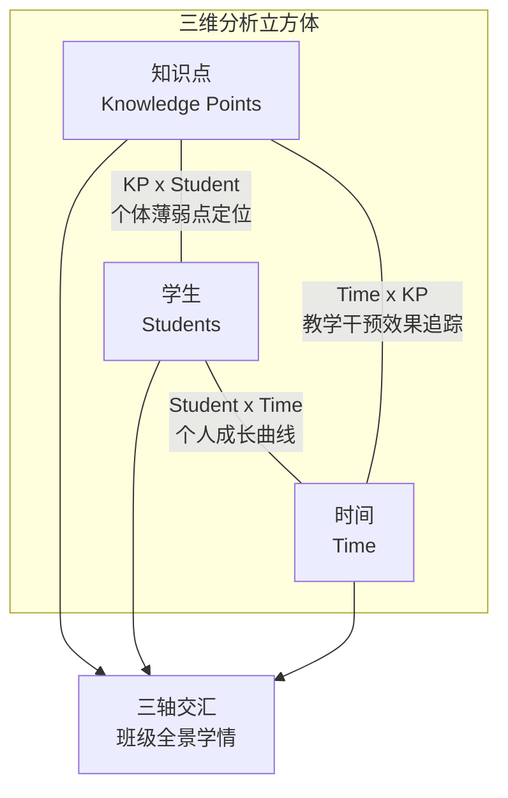
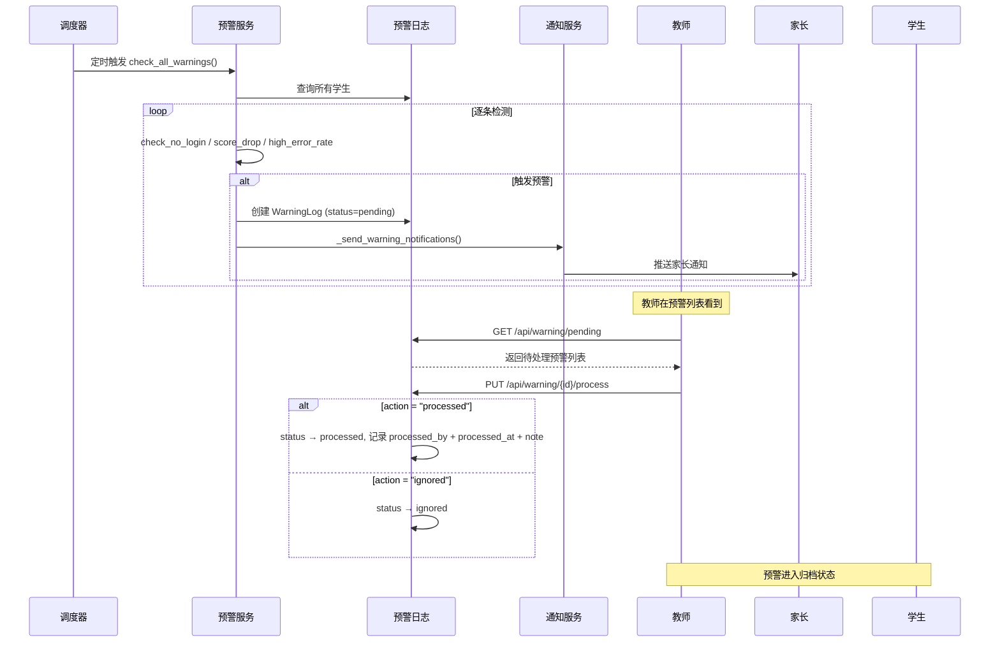
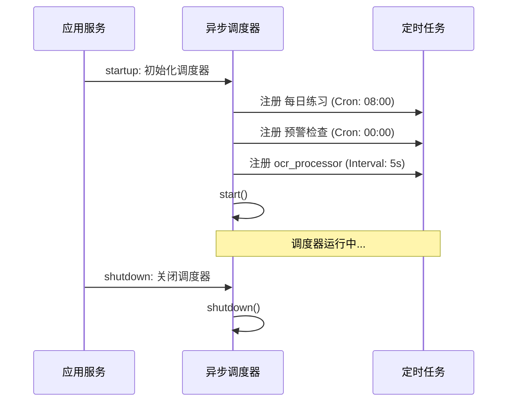

# 30. 学情分析与预警系统设计

> 产品设计文档 | ChemAI 智辅化学
> 所属模块：第四部分 · 教师工作台
> 产品设计文档 | ChemAI 智辅化学

---

## 一、系统定位与设计目标

### 1.1 在整体架构中的位置

学情分析与预警系统是 ChemAI 教师工作台的**数据可视化中枢**。它消费 OCR 批改、障碍诊断、练习提交等上游模块产生的数据，将其聚合为教师可直观理解的统计视图，并在数据异常时主动推送预警通知。

### 1.2 设计目标

| 目标 | 说明 | 衡量标准 |
|------|------|---------|
| 三维分析 | 从知识点、学生、时间三个维度呈现学习状态 | 面板包含 4 张 KPI 概要卡 + 3 个图表 |
| 重点关注识别 | 自动筛选需教师介入的学生 | 按障碍严重度排序 |
| 主动预警 | 未登录/成绩下滑/错题率过高时自动告警 | 三级预警（提示/警告/紧急） |
| 家长同步 | 周报和预警自动推送至家长端 | 已绑定家长的推送覆盖率 100% |

### 1.3 核心指标

- **面板加载时间**：班级学情面板首次加载，目标 < 3 秒
- **预警及时性**：从数据异常到预警生成，目标 < 5 分钟（由定时任务周期决定）
- **预警覆盖率**：符合阈值条件的学生中被正确触发预警的占比，目标 > 95%
- **误报率**：触发预警但教师标记为"无效"的占比，目标 < 10%

## 不在范围内的功能

- 不做年级排名公开
- 不做教师绩效评估
- 不做预测性分析（仅展示历史和当前数据，不做未来成绩预测）

---

## 二、三维分析模型

学情分析系统的核心抽象是一个三维立方体：**知识点 x 学生 x 时间**。三个维度两两相交，每个交叉面揭示一种不同的洞察维度。

分析覆盖三个维度：知识点维度（各知识点的掌握分布）、学生维度（个体学习轨迹）、时间维度（班级成绩趋势），三维交叉构成完整的学情视图。



**三个分析切面：**

| 切面 | 视角 | 核心问题 | 对应API |
|------|------|----------|---------|
| 知识点 x 学生 | 微观诊断 | 某个知识点上哪些学生最薄弱？ | `GET /api/panel/class/{id}/knowledge/{kp}` |
| 学生 x 时间 | 个体追踪 | 某位学生有没有进步？障碍类型在变化吗？ | `GET /api/panel/class/{id}/student/{sid}` |
| 时间 x 知识点 | 教学效果 | 教学干预后，某个知识点的错误率下降了吗？ | `GET /api/panel/class/{id}/trend` |
| 三轴交汇 | 宏观决策 | 整个班级的学情剖面是什么样的？ | `GET /api/panel/class/{id}` |

### 2.1 核心指标数学定义

以下为学情分析系统的核心量化指标及其计算公式。

**知识点错误率**：

对于知识点 kp 和班级 c，错误率定义为该班级学生在该知识点相关题目上的错误比例：

```
E(kp, c) = errors(kp, c) / total(kp, c)
```

其中：
- `errors(kp, c)` = 班级 c 中所有学生在标记为知识点 kp 的题目上的答错总次数
- `total(kp, c)` = 班级 c 中所有学生在标记为知识点 kp 的题目上的作答总次数（包含正确与错误）
- 若 `total(kp, c) = 0`（该知识点从未被练习），则 `E(kp, c)` 不参与排名，前端显示为"暂无数据"

**障碍分数归一化**：

学生的三维障碍分布在原始 LLM 诊断输出中为置信度分数（0-1 之间的浮点数，三维度之和为 1.0）。为在班级间进行可比性分析，障碍分数经过以下归一化处理：

```
S_normalized(barrier_i) = S_raw(barrier_i) / max(S_raw_barriers_in_class)
```

其中 `max(S_raw_barriers_in_class)` 为全班学生该障碍维度的最大原始分数。此归一化确保不同班级、不同批次的 LLM 诊断输出具有可比性（消除 LLM 输出分布的批次间偏移）。

**班级均分聚合（加权衰减）**：

班级平均正确率采用指数衰减加权，使近期数据具有更高权重：

```
Avg_weighted(c) = SUM_i [ w_i * accuracy_i ] / SUM_i [ w_i ]

w_i = exp(-lambda * (t_now - t_i) / T_week)
```

其中：
- `accuracy_i` = 班级 c 第 i 次练习/考试的平均正确率
- `t_now` = 当前时间
- `t_i` = 第 i 次练习/考试的时间
- `T_week` = 一周的时间长度（604800 秒），作为衰减时间常数
- `lambda = ln(2)` ≈ 0.693，使得一周前的数据权重衰减为当前的 50%

此加权方案确保班级均分对近期教学效果变化敏感（如最近一次考试的进步会显著影响均分），同时不会被单次异常数据（如某次全班性的意外低分）过度影响。

---

## 三、班级学情面板设计

### 3.1 页面结构

班级学情面板（前端页面）是教师进入工作台后的核心页面，提供对单个班级学情的全景视图。

**布局规划**：左侧 232px 固定侧边栏，右侧主区域从上到下依次为：班级选择器下拉框、4 列 KPI 概要卡片网格（考试次数/需关注学生/班级人数/最近均分）、2 列图表区域（左侧知识点错误率柱状图 Top8，右侧障碍类型分布环形图）、全宽成绩趋势折线图、底部横向滚动的重点关注学生横条（展示障碍程度最高的5名学生）。

### 2.2 KPI 概要卡片

四张统计卡片提供班级层面的核心指标，每张卡片由大号数字 stat-value 和标签 stat-label 组成：

| 卡片 | 数据来源 | 视觉特征 |
|------|----------|----------|
| 考试次数 | `class_overview.exam_count` | 默认样式（灰色左边条） |
| 需关注学生 | 障碍分布合计（barrier_distribution 三类人数之和） | warn 样式（红色左边条 + 红色数字） |
| 班级人数 | `class_overview.total_students` 或学生列表长度 | ok 样式（绿色左边条 + 绿色数字） |
| 最近均分 | `class_overview.recent_exam_avg * 100`，取整显示百分数 | 默认样式 |

面板数据加载逻辑：
1. 用户选择班级获取 class_id
2. 并行请求三个 API：GET /api/panel/class/{cid}（班级面板数据）、GET /api/diagnosis/class/{cid}/stats（障碍诊断统计）、GET /api/classes/{cid}/students（班级学生列表）
3. 渲染四张概要卡片
4. 渲染三个图表（柱状图、环形图、折线图）
5. 渲染重点关注学生横条

### 2.3 三个核心图表

**图表一：知识点错误率柱状图**
- 展示前 8 个高错误率知识点，X 轴为知识点名称，Y 轴为错误率百分比
- 8 色调色板，无图例，Y 轴范围 0-100%
- 数据来源：班级面板数据中的知识点错误率

**图表二：障碍类型分布环形图**
- 三个扇区对应三种障碍类型（概念=紫色、审题=蓝色、表述=青色）
- 图例置于底部，圆点样式，白色扇区间隔线
- 数据来源：诊断统计 API

**图表三：成绩趋势折线图**
- X 轴为日期，Y 轴为班级平均分
- 主题色线条 + 浅色填充区域，曲线平滑，无图例
- 兜底策略：若趋势 API 返回空，从班级概要数据中构建虚拟趋势

### 2.4 重点关注学生横条

位于面板底部，以横向滚动横条（overflow-x: auto，隐藏滚动条）展示障碍程度最高的 5 名学生。

算法逻辑：遍历班级学生列表，取每个学生障碍分布中的最大值作为障碍分数，按分数降序排列，取前 5 名（若最高分为 0 则隐藏该模块）。每个卡片包含：学生头像（姓名首字）、姓名、主导障碍类型标签（三种配色：概念=紫色、审题=蓝色、表述=青色，标签显示"障碍名 + 百分比"）。点击卡片通过页面间数据传递跳转至学生管理页，自动打开该学生的详情抽屉。

---

## 四、学生详情抽屉

学生管理页面（前端页面）右侧设有 480px 宽的滑出抽屉组件，用于查看单个学生的详细学情。

### 3.1 抽屉布局结构

从上到下依次为：标题栏（关闭按钮、学生姓名、班级和学号信息、操作按钮行：转班/重置密码/生成学习计划/历史计划）；4 列 KPI 网格（练习次数、平均正确率、近势趋势符号、最后活跃日期）；障碍诊断水平条形图（三种障碍类型各一条，concept 紫色 、reading 蓝色 、expression 青色 ，条形宽度 0.4s 过渡动画）；成绩趋势迷你折线图（160px 高，仅显示数据不显示坐标标尺）；薄弱知识点标签云（灰色底色 、灰色字色  的标签）；最近活动时间线（每行包含日期图标、正确/错误标记、描述文本）。

### 3.2 数据加载流程

打开抽屉时前端执行两步数据加载：第一步即时渲染——学生列表中的缓存数据填充基本信息和障碍条形图；第二步异步加载详情——请求 `GET /api/users/student/{sid}/detail` 获取 weak_knowledge_points（薄弱知识点列表，渲染为标签云）、recent_activity（最近活动时间线）和成绩趋势数据（用于迷你折线图的滚动准确率计算）。

### 3.3 各模块说明

**KPI 网格（4列）**：练习次数取 exercises_completed（纯数字），平均正确率取 accuracy * 100（百分比），近势根据正确率阈值（>60% 显示↗，>40% 显示→，否则显示↘），最后活跃取 last_exercise_at（YYYY-MM-DD 格式）。

**成绩趋势迷你图**：从近期活动数据反向遍历，计算滚动正确率（累计正确数 / 累计总数），以折线图展示，Y 轴范围从最低分减 10 到 100。

### 3.4 抽屉交互

- 点击学生卡片打开
- 点击遮罩层或关闭按钮关闭
- 按 ESC 键关闭
- 支持从学情面板跳转自动打开（通过页面间数据传递指定目标学生）
- 支持从 AI Agent 页面通过 URL 参数 `?focus=SID&action=plan` 跳转并自动弹出学习计划

---

## 五、数据分析 API 全景

系统通过两个路由模块提供完整的分析 API 覆盖：

| 路由模块 | 前缀 |
|----------|----------|------|
| 学情面板 API | 后端服务模块 | `/api/panel` |
| 数据可视化 API | 后端服务模块 | `/api/analytics` |

### 4.1 学情面板 API (`/api/panel`)

| 端点 | 方法 | 描述 |
|------|------|------|
| `/api/panel/class/{class_id}` | GET | 获取班级学情面板完整数据（ClassLearningPanel 响应模型） |
| `/api/panel/class/{class_id}/knowledge/{knowledge_point}` | GET | 按知识点查看班级错误率分布及出错学生列表 |
| `/api/panel/class/{class_id}/student/{student_id}` | GET | 按学生查看学习详情（错题历史、障碍类型、薄弱点） |
| `/api/panel/class/{class_id}/trend` | GET | 按时间维度查看班级学情变化（各知识点错误率趋势） |
| `/api/panel/export/{class_id}` | GET | 导出班级学情报告（PDF） |
| `/api/panel/dashboard/{teacher_id}` | GET | 获取教师首页概览数据（班级均分、练习统计、障碍分布） |

**ClassLearningPanel 响应模型**包含：class_overview（class_id、class_name、total_students、exam_count、avg_score_trend 数组（最多10次）、recent_exam_avg、recent_exam_date）；knowledge_points（按错误率降序，最多10个，每项含 knowledge_point、class_error_rate、trend、related_barrier_distribution）；top_errors（前5个高错误知识点）；barrier_distribution（concept/reading/expression 三类各对应整数人数）；top_improvers 和 top_declining 数组。

### 4.2 数据可视化 API (`/api/analytics`)

该模块 `DataVisualizationService` 服务层，所有端点需通过 JWT Token 认证。

**班级分析类**（7 个端点）：overview（概览）、ranking（排名，支持 avg_score/completion_rate/error_rate/consecutive_days 四种 metric）、top-bottom（TOP 和 BOTTOM 学生）、barrier-distribution（障碍类型分布百分比）、knowledge-heatmap（知识点掌握热力图，按错误率分 high/medium/low 三级）、score-distribution（成绩分布直方图，不及格/及格/中等/良好/优秀五段）、practice-trend（练习完成趋势，默认7天）。

**教师分析类**（2 个端点）：workload（教师工作量：出题数/批改数/预警处理数/练习布置数）、class-comparison（多班级对比，支持 metric 参数）。

**学生分析类**（1 个端点）：personal-stats（个人统计：练习数/正确率/连续天数/障碍分项正确率/知识点掌握度）。

**Dashboard 聚合端点**（3 个端点）：teacher dashboard（教师端数据大盘，可选 class_id 参数）、student dashboard（学生端个人看板，含 7 天每日练习趋势）、parent dashboard（家长端子女学习概览：核心指标/薄弱知识点/障碍分解）。

### 4.3 DataVisualizationService 核心服务

数据可视化服务提供以下分析能力：班级概况、学生排名、优差生对比、障碍分布聚合、知识点热度图、分数分布、练习趋势、教师工作量统计、学生个人统计、班级对比。每个分析维度从多个数据表中聚合计算后返回。

---

## 班级/年级对比

班级对比视图帮助教师和年级组长从横向对比中发现班级间的系统性差异，定位教学薄弱班级和优势班级。

### 班级对比视图

以班级为行的对比表格，在教师任教多个班级时提供 side-by-side 知识点评分比较：

- **对比维度**：整体正确率、各知识点错误率、障碍类型分布比例、练习完成率、预警触发率（每百名学生预警数）。
- **可视化方式**：每个对比维度使用热力图配色——绿色表示该维度上表现最好的班级，红色表示最差的班级，中间值使用渐变色。教师可一目了然地发现"哪个班级在'氧化还原反应'上最薄弱"。
- **差异显著性标记**：对每个班级-维度组合，计算其与年级均值的偏差（以标准差为单位）。偏差超过 1.5 个标准差的单元格标记星号（*偏差显著偏优，**偏差显著偏差），作为自动化的重点关注标记。
- **排序与筛选**：支持按任意列排序，默认按总体正确率降序。支持按年级筛选（教师可能跨年级任教）。

### 年级基准线

为每个年级建立参考基准线，用于评估班级表现是否处于正常范围：

- **基准线计算**：取同年级所有班级的加权平均正确率，使用与班级均分相同的指数衰减加权方案（见 §2.1）。
- **基准线更新频率**：每周一自动更新（与周报生成同频），确保基准线反映最新教学进度。
- **异常班级识别**：若某班级连续 3 周正确率低于年级基准线 10% 以上，系统在教师 Dashboard 中标记该班级为"需关注班级"，并推送通知给年级组长（若有配置）。
- **基准线分层**：针对不同知识点，基准线可以差异显著（如"物质的量"通常全班较低，"化学实验安全"通常全班较高）。因此基准线按知识点独立计算，而非使用单一的全科均分。

### 跨班级知识点对比矩阵

知识点 x 班级的二维热力图矩阵：

- **行**：知识点（按教学大纲排序，约 15-25 个核心知识点）
- **列**：班级（教师任教的全部班级）
- **单元格颜色**：该班级在该知识点上的错误率（与 §3.1 知识点错误率柱状图使用相同数据源），绿色（低错误率）到红色（高错误率）
- **用途**：发现"特定知识点上的普遍性问题"——如果某知识点在所有班级都是红色，说明该知识点本身的教学设计或教材呈现可能存在问题（而非某个班级的教学问题），需要教研组级别的介入。

### 年级趋势对比折线图

以时间为 X 轴，叠加展示教师任教的所有班级的正确率趋势线：

- 每条线一个班级，使用不同颜色（最多 8 种颜色，对应教师通常任教不超过 8 个班）
- 年级基准线以加粗虚线叠加在图表上
- 支持点击图例（班级名称）切换显示/隐藏某条线
- 时间范围默认为最近 8 周，支持切换至"全学期"

---

## 六、学情预警引擎

### 5.1 预警系统架构

预警引擎由三个层次组成：EarlyWarningService 入口层（check_all_warnings 遍历所有学生）、规则检测层（检测连续未登录 / 检测成绩下滑 / 检测高错题率）、通知处理层（_create_warning 创建 WarningLog 记录，_send_warning_notifications 通知家长，process_warning 教师处理/忽略）。

### 5.2 预警检测规则

系统检测三种预警条件，阈值配置在 `EarlyWarningService` 类的常量中：

| 预警类型 | 类型标识 | 检测规则 | 级别判定 | 阈值 |
|----------|----------|----------|----------|------|
| 连续未登录 | `no_login` | `(now - student.last_exercise_at).days >= 3`（若从未登录则为 `(now - created_at).days >= 3`） | 固定 `warning` | NO_LOGIN_DAYS = 3 |
| 成绩下滑 | `score_drop` | 取最近两次考试成绩，计算 `(前次均分 - 最近均分) / 前次均分` | drop >= 10% 且 < 20% → warning；drop >= 20% → critical | SCORE_DROP_THRESHOLD = 0.1 |
| 错题率过高 | `high_error_rate` | 取学生最近一次考试/练习的答题记录，`错误数 / 总题数` | error_rate >= 50% 且 < 70% → info；error_rate >= 70% → warning | HIGH_ERROR_RATE_THRESHOLD = 0.5 |

**检测逻辑流程图：**

数据从原始作答记录出发，经过聚合计算和 LLM 分析，最终在教师面板上呈现为可视化的仪表盘和重点关注学生列表。

```mermaid
flowchart TD
  START(["开始检测: 定时触发"])"]) --> GET_STUDENTS["获取所有 status=approved 的学生"]
  GET_STUDENTS --> LOOP{"遍历每个学生"}

  LOOP --> CHECK_LOGIN["检测连续未登录()"]
  CHECK_LOGIN --> LOGIN_COND{"last_exercise_at 为空?"}

  LOGIN_COND -->|"是: 从未登录"| LOGIN_CREATE{"(now - created_at).days\n>= 3 ?"}
  LOGIN_COND -->|"否: 曾登录"| LOGIN_DAYS{"(now - last_exercise_at).days\n>= 3 ?"}

  LOGIN_CREATE -->|是| CREATE_WARN["创建 no_login 预警"]
  LOGIN_CREATE -->|否| CHECK_SCORE
  LOGIN_DAYS -->|是| CREATE_WARN
  LOGIN_DAYS -->|否| CHECK_SCORE

  CHECK_SCORE["检测成绩下滑()"] --> SCORE_EXAMS{"最近2次考试成绩\n都存在?"}
  SCORE_EXAMS -->|否| CHECK_ERROR
  SCORE_EXAMS -->|是| SCORE_CALC["计算 drop_rate\n= (前次 - 最近) / 前次"]
  SCORE_CALC --> SCORE_COND{"drop_rate >= 0.1 ?"}
  SCORE_COND -->|是| SCORE_LEVEL{"drop_rate >= 0.2 ?"}
  SCORE_LEVEL -->|是| CREATE_CRIT["创建 critical 级别预警"]
  SCORE_LEVEL -->|否| CREATE_WARN_SCORE["创建 warning 级别预警"]
  SCORE_COND -->|否| CHECK_ERROR

  CHECK_ERROR["检测高错题率()"] --> ERROR_RECORD{"最近一次考试记录\n存在?"}
  ERROR_RECORD -->|否| NEXT
  ERROR_RECORD -->|是| ERROR_CALC["计算 error_rate\n= 错误数 / 总题数"]
  ERROR_CALC --> ERROR_COND{"error_rate >= 0.5 ?"}
  ERROR_COND -->|否| NEXT
  ERROR_COND -->|是| ERROR_LEVEL{"error_rate >= 0.7 ?"}
  ERROR_LEVEL -->|是| CREATE_WARN_ERR["创建 warning 级别预警"]
  ERROR_LEVEL -->|否| CREATE_INFO_ERR["创建 info 级别预警"]

  CREATE_WARN --> DEDUP
  CREATE_CRIT --> DEDUP
  CREATE_WARN_SCORE --> DEDUP
  CREATE_WARN_ERR --> DEDUP
  CREATE_INFO_ERR --> DEDUP

  DEDUP{"同student+同type\n已有 pending?"}
  DEDUP -->|是: 跳过| NEXT
  DEDUP -->|否: 新建| SAVE["保存 WarningLog 到数据库"]
  SAVE --> NOTIFY["_send_warning_notifications()\n查询活跃家长绑定 → 推送通知"]
  NOTIFY --> NEXT(["处理下一个学生"])

  NEXT --> LOOP
  LOOP -->|遍历完成| END(["返回 warnings_created 数组"])
```

> **扩展规则（规划）**：新障碍检测（`new_barrier`）——对比学生最近两次诊断的 `barrier_type` 主导类型，若主导类型发生变化且新类型占比增长超过阈值（0.3），判定为障碍类型发生显著迁移（如从概念问题转为审题问题），提示教师调整教学策略。该规则在诊断数据积累到足够样本后启用，当前版本以三类基础规则为准。

**重复预警去重**：创建预警前检查是否已存在相同学生、相同类型、仍处于待处理状态的预警。若已存在则不重复创建。

### 5.3 阈值设计依据

以下记录三个核心预警阈值的选取依据。阈值的选择遵循"宁可误报、不可漏报"原则，在教师人工确认环节消除误报。

**NO_LOGIN_DAYS = 3 天的依据（weekend + 1 weekday buffer）**：

- 化学课程在中国高中的典型安排为每周 2-3 节，学生在校期间通常每天使用系统完成练习。若学生周五使用系统后，周六/周日为休息日，周一未使用，则连续未使用天数为 3（周六、周日、周一），此时触发预警是合理的——学生可能出现了懈怠或困难。
- 若阈值设为 2 天：周五使用后周日即触发预警，周末本应休息，误报率高。
- 若阈值设为 5 天：周一未使用需等到周三才触发预警，教师介入的窗口期被压缩到几乎没有，学生可能已落后一周课程。
- 3 天是最小可接受的缓冲：覆盖一个完整周末（2 天）+ 一个返校工作日的缓冲（1 天），在此之后若仍未使用系统，说明学生大概率脱离了学习节奏。

**SCORE_DROP_THRESHOLD = 0.1 的依据（一个标准差）**：

- 在典型的高中化学考试中，班级平均分通常在 60-80 分之间（满分 100），标准差约为 8-12 分。10%（即 0.1 的比例降幅）约等于 6-8 分的绝对下降，这正好处于一个标准差的量级。
- 中学教育统计学的经验法则：成绩波动在一个标准差以内属于"正常波动"，超过一个标准差属于"显著变化"，需要教师介入。
- 0.1 作为相对比例阈值（而非 10 分的绝对阈值）的优点：对满分 50 分的小测验和满分 100 分的期中考试均适用，避免需要为不同考试类型配置不同绝对阈值。
- 二级判定 drop >= 0.2（两个标准差）：在正态分布假设下，约 95% 的随机波动位于两个标准差以内，超过此值几乎不可能是随机因素导致。

**HIGH_ERROR_RATE_THRESHOLD = 0.5 的依据（低于随机猜测线）**：

- 化学选择题通常有 4 个选项，随机猜测的正确率期望为 25%。如果学生的错误率 >= 50%（即正确率 <= 50%），则正确率仅比随机猜测高出不到 25 个百分点，说明学生的知识掌握程度极低，接近"随机作答"状态。
- 这个阈值标志着"系统性失败"而非"个别知识点薄弱"：正常学习的学生在个别薄弱知识点上错误率可能达到 50-60%（因为该知识点的题目恰好全错），但整体错误率通常不会超过 40%。当整体错误率超过 50% 时，问题已从"某个知识点没掌握"升级为"整个学习状态出问题"。
- 二级判定 error_rate >= 0.7 提升到 warning 级别：正确率仅 30%，在化学四选一题型中仅比随机猜测高 5 个百分点。这通常意味着学生已完全脱离学习（可能长期未参与课堂或存在严重的学习障碍）。

### 5.4 WarningLog 数据模型

**WarningLog 实体**：记录每次学情预警的详细信息。

核心属性：
- **预警标识**：唯一预警 ID
- **关联学生**：触发预警的学生
- **预警类型**：连续未登录 / 成绩下滑 / 错题率过高 / 新障碍出现
- **严重级别**：提示 / 警告 / 紧急 三级
- **标题与内容**：预警概要标题和详细描述文本
- **结构化数据**：附带触发预警的量化指标（如缺勤天数、成绩变化幅度）
- **处理状态**：待处理 / 已处理 / 已忽略
- **处理信息**：处理人、处理时间、处理备注
- **通知标记**：是否已分别通知教师、家长、学生
- **时间戳**：触发时间、处理时间

---

## 七、预警处理流程

### 6.1 完整生命周期

预警检测定时触发，系统逐条扫描学生数据，命中规则后创建预警记录、通知相关方，教师处理后关闭预警。



### 6.2 预警 API 端点

预警路由 后端服务模块 提供完整的 CRUD 操作：

| 端点 | 方法 | 描述 |
|------|------|------|
| `/api/warning/pending` | GET | 获取待处理预警列表（可选 `class_id` 筛选） |
| `/api/warning/student/{student_id}` | GET | 获取指定学生的预警历史 |
| `/api/warning/{warning_id}/process` | PUT | 处理预警（action 取 processed/ignored，可选 note） |
| `/api/warning/check` | POST | 手动触发全量预警检查 |
| `/api/warning/class/{class_id}/summary` | GET | 班级预警汇总（总预警数、按类型/级别统计、紧急预警数） |

**处理预警请求体**包含两个字段：note（字符串，教师备注如"已与学生沟通，近期家中有事"）和 action（字符串，取值为 "processed" 或 "ignored"）。

**班级预警汇总响应体**包含 success、class_id、class_name 和 summary 对象（total 总数、by_type 按类型分布对象、by_level 按级别分布对象、critical_count 紧急预警数）。

### 6.3 预警通知链

相关模块负责将预警推送给相关方：
1. 查询 `student_parent_bindings` 表，获取该学生所有活跃的家长绑定（status = "active"）
2. 向每个绑定家长发送通知
3. 教师端通过主动查询 `/api/warning/pending` 获取预警列表

---

## 八、APScheduler 调度系统

### 7.1 调度器架构

调度器模块基于异步任务调度框架实现，支持 Cron 定时触发和间隔轮询两种触发模式。

三个定时任务按各自的调度规则运行：OCR 轮询 5 秒一次保证实时性，每日练习和预警检查按固定时间点触发。



**调度器初始化**：创建异步调度器实例，时区设为 UTC。系统启动时注册三个定时任务：每日练习推送（Cron，每天 08:00 UTC）、学情预警检查（Cron，每天 00:00 UTC）、OCR 答题卡轮询（间隔 5 秒）。注册完成后启动调度器。

### 7.2 调度任务时间线

调度器随应用启动注册三个任务，随应用关闭优雅终止。OCR 轮询处理待办队列，日检任务覆盖练习生成和预警扫描。

```mermaid
gantt
  title APScheduler 调度任务时间线 (24小时)
  dateFormat HH:mm
  axisFormat %H:%M

  section OCR轮询
  OCR处理 (每5秒) :active, ocr, 00, 24h

  section 每日推送
  每日练习任务 :milestone, dp, 08, 0m

  section 预警检查
  全量预警检测 :milestone, cw, 00, 0m
```



### 7.3 三个定时任务详解

**任务一：OCR 答题卡识别轮询**：每 5 秒执行一次，查询 ocr_tasks 表中 status = "pending" 的最早一条记录，标记为 processing，调用 OCR provider 提取图片内容，更新为 done 或 failed。单条顺序处理（order_by(created_at).first()），通过 asyncio.to_thread() 包装以适配 AsyncIO 环境。

**任务二：每日练习推送**：每天 08 UTC 执行。获取所有 status = "approved" 的学生，为每个学生调用 create_daily_practice() 创建今日练习 ExamRecord（type=PRACTICE，10 题）。为绑定了家长的活跃关系发送 ParentNotification（type=daily_report）。检查 ReviewTask 表中到期未完成的复习任务，发送复习提醒（type=reminder）。去重逻辑：create_daily_practice() 检查当天是否已有练习记录。知识点推荐根据学生的 barrier_type 主导类型匹配：concept → 盐类水解/电离平衡/水解平衡，reading → 化学实验设计/题干分析技巧，expression → 化学用语规范/表述练习，默认 → 盐类水解/电离平衡/氧化还原反应。

**任务三：学情预警检查**：每天 00 UTC 执行，调用 EarlyWarningService.check_all_warnings()，打印创建预警数量到控制台日志。

### 7.4 调度器在主应用中的集成

应用启动时自动初始化调度器并注册三个定时任务，应用关闭时优雅终止调度器。

---

## 九、前端面板页面设计

### 8.1 页面布局

教师学情面板采用左侧固定导航 + 右侧主内容区的经典布局。主内容区从上到下依次为：页面标题和副标题、班级选择工具栏、4 列 KPI 概要卡片网格（考试次数、需关注学生、班级人数、最近均分）、2 列图表网格（知识点错误率柱状图 + 障碍类型分布图）、全宽成绩趋势折线图、条件渲染的关注学生横滑列表（按障碍严重度取 Top 5）。

### 8.2 数据流

面板加载时并行请求三个 API 获取数据：班级面板概要数据、班级障碍分布统计数据、班级学生列表。三个数据源在前端融合后分发到各图表组件和关注学生列表渲染。成绩趋势图额外请求趋势 API。图表组件使用 Canvas 渲染，支持自适应宽度。

### 8.3 图表配色与样式

- **柱状图**：使用与设计系统一致的多色渐变色系
- **障碍分布图**：三种障碍类型各对应一种颜色（概念=紫色、审题=蓝色、表述=青色）
- **趋势折线图**：单色主题色线条，浅色填充区域
- **字体**：标题使用衬线字体，正文和图表标签使用无衬线字体，数据标注使用等宽字体
- **响应式**：图表区采用双列网格布局，Canvas 元素自适应容器宽度

### 8.4 演示模式

当后端 API 不可用时，面板自动降级为演示模式。班级选择器显示"演示班级"，使用内置的静态示例数据渲染所有图表和学生列表，并显示模拟数据标识。

---

> **前端设计规格详见**：[38-前端页面设计规格](./38-前端页面设计规格.md) §1.3、§1.4

---

## 附录：关键文件清单

| 文件路径 | 功能 |
|----------|------|
| 后端服务模块 | 学情面板 API（4 个核心端点 + 导出 + 教师 Dashboard） |
| 后端服务模块 | 数据可视化 API（13 个分析端点 + 3 个 Dashboard 聚合端点） |
| 后端服务模块 | DataVisualizationService 服务层（10 个分析方法） |
| 后端服务模块 | EarlyWarningService 预警引擎（3 种检测规则 + 通知推送 + 预警处理） |
| 后端服务模块 | WarningLog 数据模型（16 个字段 + 类型/级别映射） |
| 后端服务模块 | 预警管理 API（5 个端点：查询 + 处理 + 手动触发 + 班级汇总） |
| 后端服务模块 | APScheduler 初始化与生命周期管理 |
| 后端服务模块 | OCR 轮询任务（每 5 秒） |
| 后端服务模块 | 每日练习推送任务（每天 08） + 创建练习 + 家长通知 |
| 后端服务模块 | 学情预警检查任务（每天 00） |
| 前端页面 | 班级学情面板前端页面（4 KPI + 3 图表 + 重点关注横条） |
| 前端页面 | 学生管理页面（卡片网格 + 抽屉组件 + 添加/转班 Modal） |
| 前端JS模块 | 学生管理前端逻辑（筛选、分页、抽屉渲染、学习计划生成） |
| 后端服务模块 | 主应用入口（路由注册 + 调度器启动/关闭） |

---

## 错误处理

- **班级无考试数据**: 面板显示"暂无数据"空态
- **API 数据融合失败（三个并行请求任一失败）**: 部分展示 + 失败模块显示重试按钮
- **单个图表渲染失败**: 该图表区显示错误信息，不影响其他图表
- **演示模式降级**: API 不可用时自动切换到内置静态示例数据

---

## 安全与权限

- 学情面板仅教师角色可见（含 admin/教务管理员/学科组长/teacher），学生和家长不可访问
- 学生详情抽屉中不显示其他学生的任何对比信息
- 导出的 PDF 报告仅包含当前班级数据，不含其他班级信息
- 预警通知仅发送给对应班级的任课教师和已绑定家长

---

## 关联文档

- [31-评测体系设计](./31-评测体系设计.md) — 学情面板数据的准确性由评测体系的三级门禁保障
- [28-间隔复习与错题强化训练系统设计](./28-间隔复习与错题强化训练系统设计.md) — 预警中的连续未登录检测依赖 ReviewTask 到期查询
