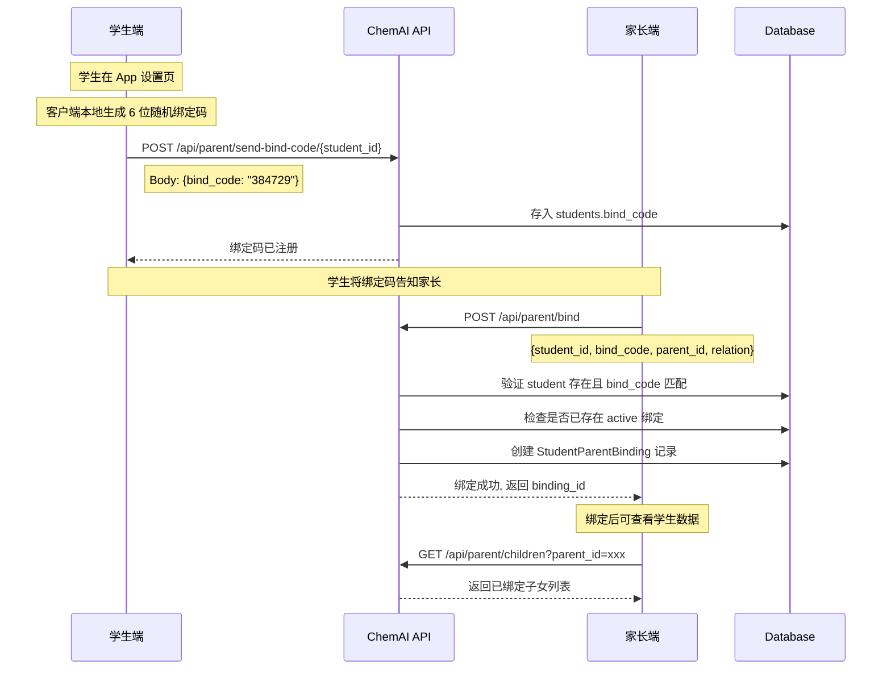

# 32. 家长端与通知系统设计

> 产品设计文档 | ChemAI 智辅化学
> 前端: 前端页面、前端页面
> 数据模型: 后端服务模块 (Parent, StudentParentBinding, ParentNotification)

---

## 一、系统定位与设计目标

### 1.1 在整体架构中的位置

家长端是 ChemAI 三端架构中的**低频但高价值触点**。家长不参与日常教学操作，但需要了解子女的学习状态——成绩变化、薄弱环节、教师反馈。系统通过周报推送和被动查询两种方式满足这一需求，让家长从"不知情"变为"有方向"。

### 1.2 设计目标

| 目标 | 说明 | 衡量标准 |
|------|------|---------|
| 移动端优化 | 家长主要在手机上查看，需窄屏优先 | 430px 宽度完整可用 |
| 低认知负荷 | 不排名的数据呈现，通俗语言解读学业状态 | 周报无教育术语堆砌 |
| 多通道通知 | 系统通知为主要通道，钉钉/企微/LTI 为扩展 | 通知送达率 > 90% |
| 数据安全 | 仅显示已绑定子女的授权数据，无跨生访问 | 每次查询前置绑定关系校验 |

### 1.3 核心指标

- **绑定完成率**：已注册家长中完成学生绑定的比例，目标 > 80%
- **月活跃率**：每月至少登录一次的家长比例，目标 > 40%
- **周报打开率**：推送周报后被家长查看的比例，目标 > 50%
- **通知延迟**：从预警触发到家长收到通知，目标 < 10 分钟

### 1.4 目标用户

- 频率: **月均 2-4 次** (非高频)
- 核心需求: "了解孩子的化学学习情况"
- 设备: 手机 (移动端优化, 430x900 视口)

### 设计原则

1. **不制造焦虑**: 不显示排名、不与其他学生比较、不负面词汇
2. **通俗易懂**: 化学专业术语 → 日常用语转换 (如 "氧化还原" → "学习物质与氧气的反应")
3. **可操作建议**: 每个报告都附带 1-2 条具体的家庭配合建议
4. **隐私保护**: 家长看不到其他同学的信息，看不到原始试卷详情

### 数据权限模型

| 数据项 | 家长可见 | 家长不可见 |
|--------|----------|------------|
| 子女练习量/正确率 | 可 | - |
| 子女薄弱知识点 (通俗化描述) | 可 | - |
| 子女学习特点报告 | 可 | - |
| 学习建议 | 可 | - |
| 周报通知 | 可 | - |
| 子女原始答题详情 | - | 不可 |
| 子女排名 | - | 不可 |
| 其他学生信息 | - | 不可 |
| 教师对学生的详细评语 | - | 不可 |

## 不在范围内的功能

- 不做家长直接注册（需通过学生端发起绑定）
- 不做家长间社交功能
- 不做钉钉/企微/LTI/SFTP 渠道接入（不在本版本范围）

---

## 二、2 个 HTML 页面

### parent-login.html

家长登录页面, 。功能为手机号 + 密码登录 / 注册。API 调用 `POST /api/parent/login` 和 `POST /api/parent/register`。登录成功后执行 302 跳转到 `parent.html` 并携带 token。

### parent.html

家长主页面, , 约 48KB, 包含 3 个 Tab（概览/学习报告/消息）、浮动 AI 助手按钮、周报展示。

---

## 三、parent.html 3 个 Tab

### Tab 1: 概览 (Overview)

展示子女学习总体状态的统计卡片：4 张学习概览卡片（本周练习数量、正确率百分比、连续学习天数、累计练习总量）、学习特点通俗版描述（如"孩子对概念的理解比较扎实，在审题时偶尔会漏看条件，需要在读题习惯上多加注意"）、本周学习动态时间线（按日期列出完成的练习和未学习的日期）。

数据来源: `GET /api/parent/child/{student_id}/report`（子女报告摘要）和 `GET /api/parent/child/{student_id}/weekly`（子女周报）。

### Tab 2: 学习报告 (Learning Report)

以通俗语言呈现知识掌握情况：知识掌握概览表格（知识点名称 + 掌握程度进度条，标注良好/需要加强/熟练）、学习特点分析（如"孩子的计算能力不错，但对实验现象的描述有时不够准确"）、家庭配合建议（如"可以和孩子一起看看厨房中的化学现象"、"建议每周花15分钟聊聊最近学的化学知识点"）、AI 解读按钮（点击调用 `POST /api/parent/child/{student_id}/report/ai-summary` 获取通俗解读）。

### Tab 3: 消息 (Messages)

通知列表, 支持展开/收起，区分已读/未读状态。每条消息显示图标、标题（如"张三本周学习周报已生成"）、日期时间和展开按钮。API 调用 `GET /api/parent/notifications?parent_id=xxx&limit=20&offset=0` 获取列表，`PUT /api/parent/notifications/{notification_id}/read` 标记已读。

---

## 四、浮动 AI 助手

家长端右下角悬浮一个 AI 助手按钮, 点击展开对话面板。

### Parent-role Agent

 `parent-role` 的 Agent, 预设 5 个提示词：孩子最近学了什么化学知识（触发知识概览）、哪些知识点比较薄弱（触发薄弱点分析）、怎么在家帮孩子学化学（触发家庭建议）、孩子的学习状态怎么样（触发学习特点）、有什么需要我注意的吗（触发预警检查）。

### SSE 覆盖层

AI 助手 SSE 流式输出, 在 parent.html 上覆盖半透明对话面板, 不影响底层内容的浏览。面板包含用户消息区、AI 回复区（含化学方程式/学习报告/建议等内容）和底部的输入框和发送按钮。

---

## 五、绑定流程

家长与学生的绑定通过**绑定码**机制完成, 确保只有授权的家长能查看学生数据。

学生在自己客户端获取 6 位绑定码并分享给家长，家长输入后完成绑定。教师端可查看绑定状态并在必要时解除绑定。



绑定码特性：6 位字母数字（不含 0/O/1/I 等易混淆字符，学生端生成右侧展示、自动转大写），每个学生同时只有一个有效绑定码，调用 `POST /api/parent/send-bind-code/{student_id}` 会重新生成（旧码失效），绑定后可解绑（`DELETE /api/parent/bind/{binding_id}`）。

---

## 六、数据权限模型

家长端的数据访问遵循严格的权限隔离：School → Grade → Class → Student → StudentParentBinding → Parent，家长只能访问绑定子女的数据。

权限检查实现（后端服务模块 中）：所有需要查看子女数据的接口都先验证绑定关系——查询 `StudentParentBinding` 表中是否存在 `student_id`、`parent_id` 和 `status="active"` 同时匹配的记录。若不存在返回 HTTP 403 状态码，错误详情为"未绑定该学生"。

---

## 七、周报生成 Prompt 设计

周报生成是家长端的核心功能。以下为完整的 Prompt 工程设计，确保 LLM 产出符合家长端设计原则的内容。

### System Prompt 模板

```
你是 ChemAI 的家长助手。你的任务是将学生的化学学习数据转化为家长（40-55 岁，无化学专业背景）能理解的周报。

核心规则：
1. 永远不提及排名、不与其他学生比较、不使用"落后""差"等负面词汇
2. 化学专业术语必须转换为日常用语（参见术语转换表）
3. 先肯定进步（至少 1 条），再给出 1-2 条具体的家庭配合建议
4. 总字数控制在 150-250 字之间
5. 语气温暖、鼓励，让家长获得方向感而非焦虑感
6. 如果当周没有练习数据，说明"本周暂无练习记录"，不编造内容

术语转换表（必须遵守）：
- "氧化还原反应" → "物质与氧气反应/电子的转移"
- "盐类水解" → "某些盐溶于水后改变水的酸碱性"
- "勒夏特列原理" → "化学反应平衡的移动规律"
- "电解质溶液" → "能导电的溶液"
- "配平化学方程式" → "让方程式两边原子数量相等"
- "离子反应" → "带电粒子之间的反应"
- "物质的量" → "化学中计数微粒数量的单位"
- "化学键" → "原子之间的连接方式"
- "摩尔质量" → "每摩尔物质的质量"
- "阿伏加德罗常数" → "1摩尔物质中包含的微粒数量"

输出格式约束：
- 第一段：概述（1-2 句，先说本周练习概况）
- 第二段：具体表现（2-3 句，结合数据描述掌握情况，使用日常语言）
- 第三段：家庭建议（1-2 句，具体可操作的建议）
- 如果当周无数据，仅输出一段简短说明
```

### User Prompt 模板

```
以下是 {student_name} 本周（{week_start} 至 {week_end}）的学习数据，请生成本周学习周报。

本周练习数据：
- 完成练习次数：{practice_count} 次
- 总练习题数：{total_questions} 题
- 正确题数：{correct_count} 题
- 正确率：{accuracy_percent}%

薄弱知识点（按错误频率排序）：
{weak_knowledge_points_list}

学习特点（基于最近诊断）：
{learning_characteristics}

障碍类型分布：
{barrier_distribution}

周度对比（与上周比较）：
- 练习次数变化：{practice_count_change}
- 正确率变化：{accuracy_change}
```

### User Prompt 变量说明

| 变量名 | 数据来源 | 类型 | 示例值 |
|--------|---------|------|--------|
| `{student_name}` | 学生信息表 | string | "张三" |
| `{week_start}` | 系统计算（本周一日期） | date | "2026-07-14" |
| `{week_end}` | 系统计算（本周日日期） | date | "2026-07-20" |
| `{practice_count}` | 作答记录聚合（本周） | int | 3 |
| `{total_questions}` | 作答记录聚合（本周） | int | 25 |
| `{correct_count}` | 作答记录聚合（本周） | int | 18 |
| `{accuracy_percent}` | correct_count / total_questions * 100 | float | 72.0 |
| `{weak_knowledge_points_list}` | 学生画像薄弱知识点 Top 3 | string | "氧化还原反应(错5次), 离子反应(错3次), 物质的量(错2次)" |
| `{learning_characteristics}` | AI 诊断报告摘要 | string | "概念理解较扎实，在审题时偶尔会漏看条件" |
| `{barrier_distribution}` | 学生画像 barrier_type | string | "概念理解型 70%, 审题型 15%, 表述型 15%" |
| `{practice_count_change}` | 本周 - 上周练习次数 | string | "+1（上周 2 次，本周 3 次）" |
| `{accuracy_change}` | 本周 - 上周正确率差值 | string | "+5%（上周 67%，本周 72%）" |

### 输出格式约束

LLM 生成的周报文本需满足以下结构化约束：

1. **JSON 结构**：周报以 JSON 格式返回，包含以下字段：
   ```json
   {
     "summary": "概述段文本",
     "detail": "具体表现段文本",
     "advice": "家庭建议段文本",
     "no_data": false
   }
   ```
   若当周无数据，`no_data` 为 `true`，仅填充 `summary` 字段。

2. **长度约束**：`summary` 不超过 60 字，`detail` 不超过 120 字，`advice` 不超过 80 字。

3. **家长友好语言转换规则**：
   - 数字不直接呈现，转换为感受描述（如正确率 72% → "大部分题目都做对了"）
   - 知识点名称不直接出现，替换为主题描述（如"氧化还原反应"→"最近在学习和氧气相关的反应"）
   - 障碍类型不直接提及，转换为行为描述（如"审题障碍"→"读题时偶尔会漏看条件"）
   - 不使用"薄弱""差""缺陷"等负面词，替换为"正在加强""需要多练习""有进步空间"

### 周报生成触发时机

- **自动触发**：每周一上午 8:00（UTC）由每日练习推送调度器触发，为所有已绑定家长的活跃学生生成周报
- **手动触发**：家长在消息 Tab 点击"刷新周报"时，调用 `POST /api/parent/child/{student_id}/weekly/generate` 手动生成
- **去重**：同一周内（周一到周日）每个学生只生成一份周报，重复触发返回已缓存的周报内容

---

## 八、通知渠道

通知系统支持多渠道推送（后端服务模块 + 后端服务模块）：

系统内置通知（System Notification）：通过 ParentNotification 数据库记录，直接在家长端消息 Tab 展示。

外部主动推送（External Push）：通过钉钉 DingTalkConnector 和企业微信 WeComConnector 向家长手机端推送通知消息。

外部被动同步（External Pull）：通过 LTI 1.3 协议和 SFTP 批量文件同步与学校教务系统对接。

| 渠道 | 类型 | 状态 | 实现位置 |
|------|------|------|----------|
| 系统通知 | ParentNotification 数据库记录 | 设计支持 | `通知服务模块` |
| Telegram | Bot API 推送 | 不在范围 | - |
| 钉钉 | DingTalkConnector | 不在范围 | `LMS连接器模块` |
| 企业微信 | WeComConnector | 不在范围 | `LMS连接器模块` |
| LTI 1.3 | Deep Linking / 成绩回传 | 不在范围 | `LMS连接器模块` |
| SFTP | 定时批量文件同步 | 不在范围 | - |
| Webhook | 事件回调 | 设计支持 | `LMS连接器模块::WebhookService` |

---

## 九、通知类型

通知通过 `ParentNotification.type` 字段区分：

| 类型 | type 值 | 标题示例 | 触发条件 | 优先级 |
|------|---------|----------|----------|--------|
| 周报生成 | `weekly_report` | "张三本周学习周报已生成" | 教师端生成周报后推送 | 普通 |
| 成绩预警 | `score_alert` | "成绩下滑预警 - 张三" | 对比最近两次考试均分，下滑 ≥10% 警告 / ≥20% 紧急 | 警告/紧急 |
| 学习计划 | `learning_plan` | "新的学习计划已生成" | AI 生成新的学习计划 | 普通 |
| 学习提醒 | `reminder` | "连续3天未练习提醒" | 学生连续3天未打开 App | 警告 |
| 每日报告 | `daily_report` | "张三今日练习已推送" | 教师布置练习后 | 普通 |

通知生成流程：每种通知类型有独立的发送逻辑。周报通知根据学生 ID 生成当周学习报告；练习推送通知包含练习名称和完成情况；预警通知支持三种子类型（连续未登录/成绩下滑/错题率过高），附带预警详情。

---

## 十、LMS 集成详细设计

> **版本范围声明**：以下 4 个 LMS 连接器（钉钉、企业微信、LTI 1.3、SFTP）均已纳入当前版本。`LMSConnector` 抽象基类统一连接器接口，各连接器按学校对接情况配置启用；通知系统默认走系统内通知，LMS 连接器作为对外渠道按需启用。

### 10.1 LMSConnector 抽象基类

抽象基类 `LMSConnector` 定义三个抽象方法：`send_assignment`（发送作业/练习到 LMS）、`get_student_scores`（获取学生成绩）、`sync_users`（同步用户）。

### 10.2 连接器设计概要

**DingTalkConnector（已纳入）**

- **接口**：钉钉开放平台新版 API，`POST https://api.dingtalk.com/v1.0/oauth2/accessToken` 获取令牌 + `POST https://api.dingtalk.com/v1.0/notification/grades/send` 推送成绩通知
- **认证方式**：OAuth2 AppKey + AppSecret，获取 access_token 后调用 API
- **数据格式**：消息体为 JSON，支持 Markdown 格式的 msgcontent 字段
- **推送内容**：周报摘要、成绩预警通知

**WeComConnector（已纳入）**

- **接口**：企业微信应用消息 API，`POST https://qyapi.weixin.qq.com/cgi-bin/message/send`
- **认证方式**：CorpID + CorpSecret，获取 access_token
- **数据格式**：消息体 JSON，`msgtype` 支持 text / markdown / news 等类型
- **推送内容**：与钉钉相同（通知内容共用模板）

**LTI13Connector（已纳入）**

- **接口**：LTI 1.3 Core Specification，基于 OIDC 的第三方登录流程
- **认证方式**：JWT 签名（RS256 算法），Platform ↔ Tool 双向认证。通过 JWKS（JSON Web Key Set）端点交换公钥
- **数据格式**：LTI Launch JWT 携带用户身份、角色、课程上下文。Deep Linking 声明用于将 ChemAI 内容嵌入 LMS
- **用途**：学生从 LMS 无缝进入 ChemAI 练习、教师从 LMS 管理 ChemAI 作业

**SFTP 批量同步（已纳入）**

- **接口**：标准 SFTP 协议，定时上传/下载 CSV 文件
- **认证方式**：SSH 密钥对认证（禁用密码认证）
- **数据格式**：CSV 文件，编码 UTF-8 BOM，列按固定 schema（student_id, name, class, score, date）
- **同步方向**：ChemAI → 学校教务系统（成绩数据上传），学校教务系统 → ChemAI（学生花名册更新）
- **调度**：每日凌晨 2:00 执行，失败自动重试 3 次

### 10.3 Webhook 事件系统

支持 7 种事件类型的注册和推送：`practice.assigned`（练习布置）、`practice.completed`（练习完成）、`exam.created`（考试创建）、`exam.graded`（考试成绩发布）、`warning.triggered`（预警触发）、`student.login`（学生登录）、`review.due`（复习任务到期）。

### 10.4 API 端点

LMS 集成相关的 API 端点：
- `GET /api/integration/lms/config` — 获取 LMS 配置
- `POST /api/integration/lms/config` — 保存 LMS 配置
- `POST /api/integration/lms/test` — 连接器连通性测试
- `GET /api/integration/webhooks` — 列出注册的 Webhook
- `POST /api/integration/webhooks` — 注册 Webhook
- `DELETE /api/integration/webhooks/{event_type}` — 取消注册 Webhook
- `POST /api/integration/webhooks/test` — Webhook 测试发送

---

*数据来源: 后端服务模块（绑定、周报、通知三个服务模块）*
*前端: 前端页面、前端页面*
*数据模型: 后端服务模块 (Parent, StudentParentBinding, ParentNotification)*

---

## 设计决策

以下记录家长端与通知系统中的关键设计决策及其依据。

### 决策一：绑定码 = 6 位字母数字（而非 4 位或 8 位）

**选择**：6 位字母数字（不含 0/O/1/I 等易混淆字符，学生端生成、右侧展示并自动转大写，家长输入自动转大写）作为绑定码。

**依据**：
- **4 位数字**（10000 种组合）：安全性不足。攻击者可以在较短时间内暴力枚举所有可能的绑定码，尝试绑定任意学生。
- **8 位数字**（1 亿种组合）：安全性充足但用户体验差。家长需要记忆或输入 8 位数字，在手机上输入时容易出错。且绑定码是一次性的（绑定后立即失效），8 位对于一次性凭证来说过度设计。
- **6 位字母数字**（去混淆字符后约 10.7 亿种组合）：兼顾安全与体验。安全空间是 6 位数字的 1000 倍（10^6 → 32^6），暴力枚举窗口极小；长度仍与手机验证码一致，符合用户认知习惯；输入框自动转大写并滤除混淆字符，避免 O/0、I/1 输错导致的绑定失败。

### 决策二：家长通过学生绑定码注册（而非直接注册后搜索学生）

**选择**：家长不能通过搜索学生姓名或学号直接绑定，必须由学生主动生成绑定码并分享给家长。

**依据**：
- **数据安全与隐私**：如果家长可以直接搜索学生，任何注册为家长角色的用户都可以尝试搜索任意学生姓名并发起绑定请求。即使后端做绑定审批流程，也会产生大量无效的绑定请求，并可能引发隐私投诉（"为什么陌生家长能看到我孩子的名字"）。
- **授权模型**：绑定必须由学生端发起，体现"学生授权家长查看"的模型。符合 FERPA（家庭教育权利和隐私法案）和 GDPR 的数据最小化原则——学生是数据主体，学生有权决定谁可以查看其数据。
- **防止越权访问**：绑定码机制确保只有学生知情并同意的家长才能绑定。如果学生不愿意让某人查看数据，只需不把绑定码分享出去即可。
- **适用场景**：家长切换手机、新增家庭成员（如父亲和母亲分别绑定同一学生）时，学生可以随时生成新的绑定码。

### 决策三：移动 Web 而非微信小程序

**选择**：家长端使用移动优化的 Web 页面（430px 视口适配），而非微信小程序。

**依据**：
- **跨平台覆盖**：小程序依赖微信生态，家长如果不使用微信（如使用支付宝、仅用浏览器）则无法访问。Web 端无需下载安装，任何现代手机浏览器均可访问，覆盖 100% 的家长设备。
- **开发与维护成本**：维护一个 Web 版本比同时维护 Web + 小程序便宜。家长端功能相对简单（3 个 Tab + AI 助手），Web 版本足以满足需求。
- **通知推送**：小程序的通知能力依赖微信订阅消息模板，审核流程复杂且推送频次受限。Web 端通过系统通知（ParentNotification 数据库记录）和未来可接入的短信/邮件推送更灵活。
- **未来可扩展**：如果后续需要小程序，Web 端的接口设计和数据模型无需改动，前端重新实现即可。移动 Web 是"最少可行"的选择，不阻塞未来选项。
- **低频率场景适配**：家长月均使用 2-4 次，属于低频场景。对于低频场景，要求用户下载小程序或 App 往往是使用障碍，Web 即用即走更适合。

## 错误处理

- **绑定码过期或不匹配**: 提示"绑定码错误" + 引导联系学生重新获取
- **学生未绑定**: 显示引导页
- **周报生成失败**: 显示"报告生成中" + 后台重试
- **通知推送失败**: 按渠道分别处理（系统通知直接失败、Webhook 记录到重试队列）

---

## 关联文档

- [30-学情分析与预警系统设计](./30-学情分析与预警系统设计.md) — 预警引擎触发后通过 ParentNotification 推送至家长端消息 Tab
- [28-间隔复习与错题强化训练系统设计](./28-间隔复习与错题强化训练系统设计.md) — 每日练习推送调度器同时为家长生成 daily_report 通知
