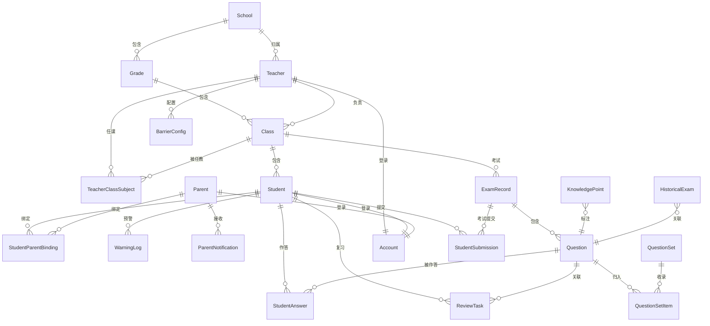

# 33. 数据模型设计

> 产品设计文档 | ChemAI 智辅化学 | 设计阶段

---

## 一、实体关系总览

以下 ER 图展示 ChemAI 核心数据实体及其业务关系。去掉关系线，这张图回答的是"系统里有哪些东西"；加上关系线，回答的是"这些东西之间怎么关联"。

### 四条核心数据链

**组织链：学校 → 年级 → 班级 → 学生。** 这是系统的骨骼。所有数据查询沿这条链路向下展开，确保同一所学校的教师只能看到本校数据。

**教学链：考试 → 题目 → 学生作答。** 一次考试包含多道题目，每道题目被多名学生作答。这条链支撑了错题诊断、学情分析、自适应练习的全部数据需求。

**家校链：家长 ← 绑定关系 → 学生。** 家长通过绑定码与学生建立关联，一个家长可绑定多个子女。绑定后，家长端可接收通知、查看学习报告。

**身份链：账户 ← 教师/学生/家长。** 所有用户通过统一的账户体系登录。账户通过角色字段区分身份，每个账户一对一关联到教师、学生或家长中的一种。

---

## 二、核心业务实体

### 2.1 组织层级：学校、年级、班级

学校是顶层容器，包含多个年级（如"高一"、"高二"、"高三"）。每个年级下包含多个班级（如"高一(3)班"）。学生归属于某个班级。

一条学校记录存储学校基本信息：名称、所在地区、地址、联系电话、当前学期。一条年级记录存储年级名称和所属学年。一条班级记录存储班级名称、所属年级、班主任、当前学生人数、所属学段（高中/初中）和学科（化学）。

### 2.2 教师

教师归属于某所学校。除基本信息（姓名、手机号）外，教师记录包含两个关键字段：账号状态（待审核/已通过/已拒绝，控制教师能否登录使用系统）和角色（系统管理员/教务管理员/学科组长/普通教师，控制功能权限范围）。

教师与班级之间通过"任课关系表"关联——一个教师可以在多个班级任课，一个班级也可以有多位任课教师。任课关系记录中标注该教师是否为班主任。

### 2.3 学生

学生是系统的核心实体。除基本信息和班级归属外，学生记录存储了三类关键数据：

- **障碍画像**：由诊断引擎异步更新的障碍类型分布（概念理解型/审题障碍型/表述障碍型各自占比），以及画像最后更新时间
- **练习追踪**：累计完成练习数、最近练习时间，用于判断学生活跃度和冷启动
- **家长绑定**：6 位绑定码，家长在家长端输入此码建立亲子关联

### 2.4 统一账户

系统采用统一账户体系。一条账户记录包含：用户名（全局唯一）、加密密码、所属角色和对应的角色 ID（教师 ID/学生 ID/家长 ID）。登录时，系统根据角色字段确定该用户应进入哪个端（教师端/学生端/家长端），并根据对应的角色 ID 加载该用户的个性化数据。

### 2.5 考试、题目与作答

一次考试（或练习、作业）记录归属于某个班级，包含考试类型（月考/练习/作业）、考试日期、参考人数、平均分、以及各题的错题统计数据。

一道题目是一份完整的化学试题，包含：题目正文、选项列表（选择题为 A/B/C/D 四个选项）、正确答案、题目解析、所属知识点标签、难度等级（简单/中等/困难/竞赛）、题目来源（AI 生成/手动录入/每日练习/OCR 导入）、四维安全审核状态和审核报告。

一条学生作答记录关联了学生、题目和考试。存储学生的作答内容、是否正确、系统判定的障碍类型标签，以及连续错误和连续正确次数的计数器（用于障碍诊断的阈值判断）。

---

## 三、诊断与学习

### 3.1 障碍诊断配置

每位教师可自定义自己班级的诊断阈值。四个可配置参数：

- 概念理解型障碍触发阈值：学生同一知识点连续答错多少次，判定为概念理解障碍（教师默认值：3）
- 审题障碍型触发阈值：同上（教师默认值：2）
- 表述障碍型触发阈值：同上（教师默认值：3）
- 掌握标准：同一知识点连续答对多少次，视为已掌握（教师默认值：3）
- 自动同步开关：诊断结论是否自动推送给学生端（教师默认值：关闭，需教师确认后手动推送）

### 3.2 知识图谱节点

系统为每个化学知识点维护一条记录。字段包括：知识点名称（如"盐类水解"）、所属分类（如"电解质溶液"）、关联的 PubChem 化合物编号（用于化学结构检索）、关联题目数（系统中标记了该知识点的题目总数）、动态错误率（所有学生的答错次数÷作答次数，随每次提交实时更新）。

### 3.3 间隔复习任务

每道学生做错的题目会自动创建一个复习任务，按艾宾浩斯遗忘曲线安排复习：

- 第 0 级：1 天后复习（初次创建，当天可完成首次重温）
- 第 1 级：3 天后复习（第 0 级答对则升级）
- 第 2 级：7 天后复习
- 第 3 级：14 天后复习
- 第 4 级：30 天后复习
- 第 5 级：不再安排（已掌握）

任务状态有三种：待复习、超期（到期未完成）、已掌握。每次复习的结果（答对/答错、复习时间）记录在复习历史中，用于追踪遗忘曲线。级别编号与三个状态名以 28 号文档为准。

### 3.4 学情预警

系统自动监控每个学生的学习状态，触发以下四类预警：

- 连续未登录预警（级别：警告）：学生在设定天数内无任何登录或练习活动
- 成绩下滑预警（级别：严重）：最近一次考试成绩相比前次下降超过阈值
- 高错误率预警（级别：警告）：某知识点的近期错误率超过预设阈值
- 新障碍出现预警（级别：提示）：诊断引擎识别出学生出现了之前不存在的障碍类型

每条预警记录追踪三个通知状态：是否已通知教师、是否已通知家长、是否已通知学生本人。防止同一条预警对人重复发送。

---

## 四、家校互通

家长端涉及三张表：

- **家长信息**：存储家长的姓名、手机号、邮箱和登录密码
- **亲子绑定**：通过绑定码关联学生和家长，记录绑定状态和双方关系（父亲/母亲/其他监护人）
- **通知记录**：系统推送给家长的消息，包含通知类型（学习报告/预警提醒/教师消息）、标题、正文、已读状态和发送时间

---

## 五、OCR 批改

### 5.1 上传会话

教师上传答题卡图片后，系统创建一个上传会话追踪整个处理流程。状态流转如下：

已上传 → 处理中 → 处理完成 / 处理失败

如果 OCR 识别效果不佳，系统会自动降级——从 OCR 引擎切换到视觉模型重新识别。降级过程中的会话标记为"降级处理中"，待视觉模型完成后再流转到"处理完成"。

### 5.2 学生提交

一次考试中，每个学生的答题卡独立提交。提交记录关联到考试和班级，存储原始图片、批改后的图片（含批改痕迹标注）、学生的答案列表、总分、提交时间和批改完成时间。

### 5.3 批改任务

批改任务是教师视角的操作单元——教师上传一批答题卡，系统为每张答题卡创建一个批改任务。任务状态为待处理→处理中→完成/失败。任务记录存储 OCR 原始识别结果和批改结果（含每道题的判定）。

---

## 六、题库

### 6.1 真题集

真题集是对历年高考真题和模拟题的组织归类。一条真题集记录包含：名称、来源地区（如"全国卷"、"湖南卷"）、年份、来源说明。系统预设了一批真题集，教师也可以创建自定义合集。

### 6.2 真题集与题目的关联

题目与真题集之间是多对多关系（一道题可归入多个真题集，一个真题集包含多道题），通过排序字段控制题目在真题集中的展示顺序。

### 6.3 历年真题库

系统预置的历年高考真题和模拟题，是 RAG（检索增强生成）的知识底座。每条真题记录包含：试卷来源、年份、题号、知识点标签、难度、区分度（衡量题目区分优生和差生的能力，统计指标）、题目正文、答案和解析。

---

## 七、Agent 对话记忆

ChemAI 的对话系统需要两种记忆能力：

### 7.1 对话检查点（短期记忆）

存储单次对话的状态快照。支撑三个核心场景：多轮对话中正确引用前几轮的内容、教师审批中断后恢复对话（不丢失上下文）、对话异常时回退到上一个正常状态。

### 7.2 长期记忆

存储跨对话的持久化信息，不会因对话结束而清空。包括：学生的学情历史（障碍类型变化轨迹、历次正确率）、教师的偏好设置（常用知识点、出题习惯）。这些信息在每次新对话开始时自动加载，让 Agent 拥有"记得上次聊了什么"的能力。

---

## 八、枚举类型定义

系统中以下概念通过枚举类型约束取值范围，确保数据一致：

| 概念 | 可选值 | 代码（API 层） | 说明 |
|------|--------|--------------|------|
| 障碍类型 | 概念理解型 / 审题障碍型 / 表述障碍型 | concept / reading / expression | 诊断引擎对错误作答的根因分类（代码与 26 号文档一致） |
| 考试类型 | 月考 / 练习 / 作业 | monthly / practice / homework | 决定统计口径（月考影响学情报告，练习影响 ZPD 计算） |
| 题目来源 | AI 生成 / 手动录入 / 日常练习 / OCR 导入 | ai / manual / daily_practice / ocr | 用于溯源和审核策略差异化 |
| 题目审核状态 | 通过 / 警告可用 / 阻断不可用 | passed / warning / blocked | 安全审核结果，阻断的题目不可下发给学生（代码与 34 号文档一致） |
| 题目难度 | 简单 / 中等 / 困难 / 竞赛 | easy / medium / hard / competition | 竞赛级不自动分配，仅支持手动录入（代码与 24 号文档一致） |

---

## 九、关键数据结构说明

以下数据在系统中以结构化形式存储（JSON 格式），本节说明各自包含的业务信息。

### 9.1 学生障碍画像

每个学生维护一份障碍类型分布，包含三个维度各自的占比（三个值之和为 1）。例如：概念理解型 0.3、审题障碍型 0.5、表述障碍型 0.2。这份数据由诊断引擎在学生每次提交练习后异步更新。

### 9.2 考试错题统计

每次考试完成后，系统生成一份错题统计，包含：逐题的错题数据（题号、错误人数、错误率、涉及的知识点、常见错误描述）、高错误率知识点排行（按错误率降序排列）、班级平均分。

### 9.3 复习历史

每个复习任务维护一条复习历史，记录每次复习的级别、日期和结果（答对/答错）。用于追踪学生的遗忘曲线和复习效果，同时也作为间隔复习算法的输入——连续答对则升级，答错则降级。

### 9.4 题目安全审核报告

每道 AI 生成的题目经过四维安全审核后，生成一份审核报告。四个维度分别为：系数配平审核、反应条件审核、产物审核、分子结构审核。每个维度包含审核结果（通过/警告）和详细说明。报告同时包含综合判定（通过/警告）和审核耗时。

### 9.5 学生学习计划

教师可为学生制定个性化学习计划。一份计划包含：计划标题、创建日期、每日任务列表（每天的任务包含天数序号、学习主题、练习题数量）。

---

## 十、数据隔离设计

系统通过"学校→年级→班级"的层级链路实现多租户数据隔离：

- **班级级隔离**：班级是数据隔离的核心边界。一条考试记录归属于某个班级，向上追溯到年级和学校。同一学校的教师只能看到本校范围的数据。
- **教师权限**：教师通过任课关系表确定可访问的班级范围。教师只能看到自己任教班级的学生数据和考试数据。
- **家长权限**：家长通过亲子绑定关系，只能看到自己绑定子女的学习数据，看不到班级内其他学生。
- **学生权限**：学生只能看到自己的答题记录、错题、练习和诊断结果。班级统计数据（如平均分）以匿名化形式展示，不暴露其他学生个人数据。

---

*本文档为数据模型的设计规格，实体共 24 个，映射为数据库 26 张表，枚举类型 5 个。具体字段定义和数据库实现细节在开发阶段根据本文档确定。*
