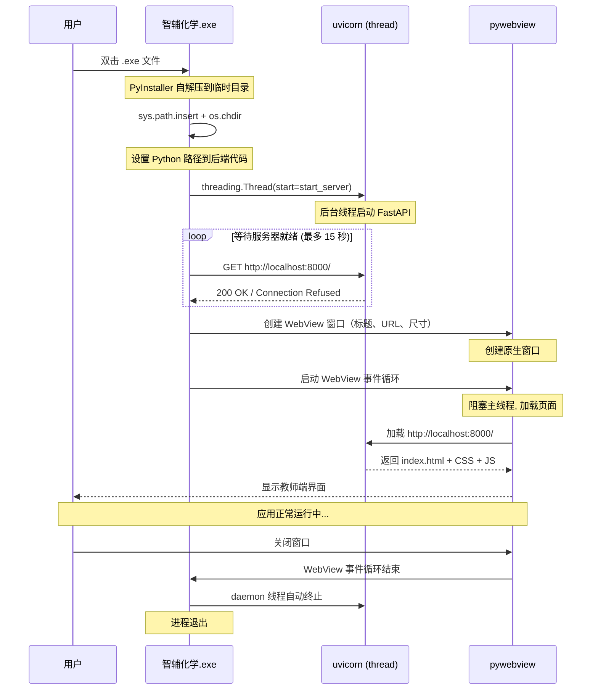

# 36. 桌面应用与打包设计

> 产品设计文档 | ChemAI 智辅化学
> 产成品: `智辅化学-教师端.exe`、`智辅化学-学生端.exe`、`智辅化学-家长端.exe`

---

## 一、pywebview 三入口架构

ChemAI 桌面应用采用 **pywebview** 内嵌 WebView 方案, 将同一套前端代码以三种不同窗口形态呈现。

| 入口 | 文件名 | 窗口尺寸 | 最小尺寸 | 加载 URL | 目标用户 |
|------|--------|----------|----------|----------|----------|
| 教师端 | `智辅化学-教师端.exe` | 1200x800 | 800x600 | `http://localhost:8000/` | 教师 (学校电脑) |
| 学生端 | `智辅化学-学生端.exe` | 430x900 | 380x600 | `http://localhost:8000/m/index.html` | 学生 (个人电脑/平板) |
| 家长端 | `智辅化学-家长端.exe` | 430x900 | 380x600 | `http://localhost:8000/m/parent-login.html` | 家长 (个人电脑) |

设计思路：教师端大屏幕横向布局，适合数据密集操作（班级管理、出题、批改）；学生端/家长端窄窗口模拟手机尺寸（430px），确保移动端优先的 UI 在桌面上也有良好体验。

---

## 二、内嵌 uvicorn 服务器

每个桌面应用启动时, 会在本地启动一个 **内嵌 uvicorn 服务器**, 完全自包含, 不依赖外部服务器。

### 启动逻辑 (教师端示例)

启动脚本执行以下步骤：首先将后端项目目录加入 Python 搜索路径，切换工作目录到后端项目目录。然后定义服务器启动函数，通过 uvicorn 在 127.0.0.1:8000 启动 FastAPI 应用（日志级别为 warning）。最后在后台 daemon 线程中启动服务器，确保主线程退出时服务线程自动终止。

关键设计决策：

| 决策项 | 选择 | 原因 |
|--------|------|------|
| 服务器地址 | `127.0.0.1:8000` | 仅本地访问, 安全 |
| 线程模型 | daemon 线程 | 应用关闭时自动终止 |
| 日志级别 | `warning` | 桌面用户不需要看到 debug 日志 |
| 数据库 | SQLite (本地文件) | 不需要安装额外数据库 |

### 等待服务器就绪

启动 WebView 前, 需要确保 uvicorn 已经绑定端口。 通过 HTTP 请求轮询。通过 for 循环重试最多 30 次，每次间隔 0.5 秒（ `time.sleep(0.5)`），总计最多等待 15 秒。若请求成功（不抛出异常）则 break 退出循环。

### WebView 窗口创建

通过原生窗口 API 创建窗口，传入 title（如"智辅化学 · 教师端"）、url（`http://localhost:8000/`）、width=1200、height=800 和 min_size=(800, 600)。然后调用 启动窗口事件循环 阻塞主线程直到窗口关闭。

---

## 三、PyInstaller 打包流水线

### 构建脚本执行流程

构建脚本为三个目标（教师端、学生端、家长端）各生成一个独立的启动脚本，然后对每个启动脚本单独执行 PyInstaller 打包（ --onefile 单文件模式），输出到对应目录后重命名为中文文件名（智辅化学-教师端.exe / 智辅化学-学生端.exe / 智辅化学-家长端.exe）。

### PyInstaller 公共参数

采用单文件打包模式，显式声明动态依赖，清理构建缓存。构建输出目录、临时目录和 spec 文件目录分别指定。

### 隐藏依赖问题

PyInstaller 无法自动检测以下通过动态导入加载的依赖, 必须通过 `--hidden-import` 显式声明：uvicorn.loops.auto（FastAPI 的事件循环自动选择器）、uvicorn.protocols.http.auto（HTTP 协议自动选择器）、starlette（FastAPI 底层框架）、webview.platforms.winforms（pywebview 的 Windows GUI 后端）。

### 输出结构

构建输出位于 桌面应用输出目录，包含三个 exe 文件（每个约 80-120 MB）、构建脚本和已清理的 _build_tmp 临时目录。

---

## 四、Docker 部署方案（服务器端替代方案）

### Dockerfile

ChemAI 项目根目录提供 `Dockerfile`，支持通过 Docker 容器化部署服务端。Dockerfile 基于 `python:3.11-slim` 镜像构建：

**构建步骤**：
1. 设置工作目录为 `/app`
2. 安装系统依赖：gcc 编译器和 libsqlite3-dev（SQLite 开发库）
3. 复制 requirements.txt 并安装 Python 项目依赖
4. 复制所有应用代码到容器中
5. 创建数据目录 `data/chromadb`（用于 Chroma 向量数据库持久化）
6. 暴露端口 8000
7. 配置 HEALTHCHECK：每 30 秒通过 HTTP 健康检查探测 `/docs` 端点是否可访问，超时 5 秒，启动宽限期 10 秒，重试 3 次
8. CMD 启动 uvicorn：`通过 uvicorn 启动 FastAPI 应用（监听 8000 端口）`

### docker-compose.yml

项目提供 `docker-compose.yml` 定义两个服务的编排配置：

**chemai 服务**（主服务）：build 当前目录的 Dockerfile，端口映射 8000，通过 volumes 挂载三个数据目录（./data、./主数据库、./Agent检查点数据库、./Agent长期记忆数据库）实现数据持久化，通过 env_file 加载 .env 环境变量文件，restart 策略为 unless-stopped。

**frontend 服务**（可选前端开发服务）： node-alpine 镜像，工作目录 /app，执行 `npx vite --host 0.0.0.0 --port 3000` 启动 Vite 开发服务器，端口映射 3000，volumes 挂载 ./frontend 目录到容器中，depends_on 依赖 chemai 服务。此服务 profiles 限定（profile 名为 full），仅在显式指定 `--profile full` 时启动。

### 部署命令

构建并启动主服务：`docker compose up -d chemai`。构建并启动全部服务（含前端开发服务器）：`docker compose --profile full up -d`。停止服务：`docker compose down`。

---

## 五、CI/CD 流水线

### GitHub Actions CI 配置

CI 工作流名为 "ChemAI CI"，配置三个触发条件：push 到主分支或 Agent 开发分支时触发；pull_request 到主分支时触发。

工作流包含 4 个并发 Job：

| Job | 用途 | 触发条件 | 需要 API Key | 核心步骤 |
|-----|------|---------|:-----------:|---------|
| **确定性评测** | 单元测试、安全隔离、基线行为 | 每次 push / PR | 否 | 安装依赖 → pytest 运行确定性测试 |
| **导入检查** | 验证所有 Agent 模块可正常导入 | 每次 push / PR | 否 | 安装依赖 → python -c 逐模块验证导入 |
| **边界与回归** | 边界输入、回归验证、SSE 流测试 | 仅 PR 事件 | 是 | 安装依赖 → 注入 API Key → pytest 运行完整评测 |
| **Docker 构建** | 验证 Dockerfile 正确性 | 每次 push / PR | 否 | docker build 构建镜像 |

### 门禁策略

- **每次 push**：确定性评测 + 导入检查 + Docker 构建（并行执行）
- **每次 PR**：上述全部 + 边界与回归评测（额外需要 API Key）
- **发布前**：全量评测（包含 LLM-as-Judge 评估，需另行触发）

---

## 六、桌面端 vs Web 端差异

| 特性 | 桌面端 | Web 端 |
|------|--------|--------|
| 运行环境 | pywebview (系统 WebView2/WebKit) | 浏览器 |
| 服务器 | 内嵌 uvicorn (127.0.0.1:8000) | 远程部署（或 Docker） |
| CORS | 无需 CORS (同源) | 需要 CORS 配置 |
| 文件系统 | 可访问本地文件系统 | 受浏览器沙箱限制 |
| 窗口管理 | 创建原生窗口 控制 | 浏览器 Tab |
| 数据存储 | 本地 SQLite | 服务器数据库 (可配置) |
| 更新方式 | 重新下载 exe | 服务器端部署 |
| 离线支持 | 完全离线可用 | 需要网络连接 |
| 打印 | 系统原生打印 | 浏览器打印 |

### 文件系统访问

桌面端可以访问本地文件系统, 适用场景：OCR 上传（直接浏览本地文件夹选择答题卡图片）、批量导入（读取本地 Excel/CSV 文件导入学生名单）、报告导出（直接保存到本地 Downloads 文件夹）、题库导入（读取本地 PDF 文件导入真题）。

### 窗口管理

pywebview 提供原生窗口控制：最小化、恢复、全屏切换。

### 无 CORS 限制

由于前后端运行在同一个本地服务器上 (`http://localhost:8000`), 不存在跨域问题, 前端请求不需要经过 CORS 中间件校验, 生产部署更简单。

---

## 七、代码复用策略

### 前端复用

桌面端和 Web 端**完全相同**的前端代码：

前端目录结构：`index.html` 教师端加载、`login.html` 共用登录、`app.js` 共用业务逻辑、`common.css` 共用组件样式、`design-system.css` 共用设计系统、`js/` 目录含 化学式渲染模块 等共用 JS 模块、`m/` 目录含学生端/家长端移动页面（index.html 学生端加载、parent-login.html 家长端加载、parent.html 家长面板）、`pages/` 目录含教师端子页面。

区别仅在于**窗口 URL 不同**：教师端加载 `/` → index.html，学生端加载 `/m/index.html`，家长端加载 `/m/parent-login.html`。

### 后端复用

所有后端代码完全共用, 三种桌面入口加载相同的 FastAPI 应用。数据库文件共用：`主数据库`（主数据库）、`Agent检查点数据库`（Agent 对话状态）、`Agent长期记忆数据库`（长期记忆）。

---

## 八、启动流程

完整的桌面应用启动序列：用户双击 exe → 启动内嵌 uvicorn → 健康检查等待 → 创建 WebView 窗口 → 加载前端页面。

---

## 九、窗口生命周期

### 创建

通过原生窗口 API 创建，传入 title（窗口标题）、url（加载地址）、width（宽度）、height（高度）和 min_size（最小尺寸元组）。

### 显示与交互

窗口创建后自动显示。用户可以进行所有 Web 操作 (点击、输入、拖拽等), WebView 作为透明的浏览器容器。

### 最小化

窗口可最小化到任务栏。系统托盘图标（规划中）：点击关闭按钮时最小化到托盘而非退出, 保持后台运行。

### 关闭

用户点击窗口关闭按钮时：WebView 事件循环结束 → Python 进程退出 → daemon uvicorn 线程随进程终止 → SQLite 连接自动关闭（WAL checkpoint）。

### 错误处理

三种错误场景的处理：服务器启动失败时弹窗提示"服务启动失败, 请重新运行"；WebView 加载失败时显示离线页面（static HTML）；数据库损坏时自动重建空白数据库。

### 优雅关闭

在构建脚本中 后台守护线程方式创建服务器线程，确保主线程退出时 uvicorn 线程自动终止，不会留下僵尸进程。

---

## 十、部署与分发

### 分发方式

- 教师: 学校 IT 管理员批量安装 / U 盘拷贝
- 学生: 下载链接 / 班级群共享
- 家长: 下载链接 (附带说明)

### 文件大小

单个 exe 约 80-120 MB (包含完整 Python 运行时、FastAPI、所有依赖包), 这是 PyInstaller onefile 模式的正常尺寸。

### 更新策略

更新策略：手动覆盖安装，数据库文件独立不受影响。下载新版本 exe 后直接覆盖旧文件即可完成升级，SQLite 数据库文件（`chemai.db`、`chemai_checkpoints.db`、`chemai_store.db`）独立存储在用户数据目录，覆盖安装不会丢失任何数据。

### 已知限制

- 仅支持 Windows (pywebview 的 winforms 后端)
- 不支持 macOS/Linux (需要额外的打包配置)
- 需要 Windows WebView2 Runtime (Win10 1809+ 内置, 旧系统需安装)

---

*构建脚本: 项目目录下的构建脚本*
*后端入口: `app.main:app` (FastAPI)*
*窗口框架: pywebview + WinForms 后端*
*打包工具: PyInstaller 6.x*
*Docker 部署: `Dockerfile` + `docker-compose.yml`*
*CI/CD: GitHub Actions 工作流（4 个并行 Job）*
