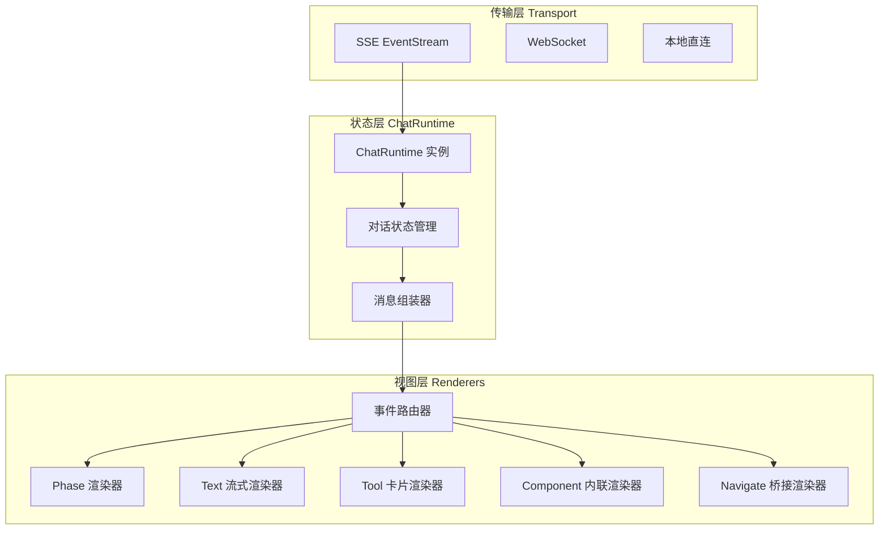

# 39. Agent 输出界面前端 SSE 渲染策略

> 本文档定义 ChemAI Agent 的 SSE 事件流如何在前端转化为结构化、可交互的用户界面。作为 [29-Agent对话系统设计](./29-Agent对话系统设计.md) 的渲染层对应文档，29 号定义了 Agent 的事件协议，本文档定义前端如何处理这些事件、组装消息、管理渲染状态。

---

## 一、系统定位与设计目标

### 1.1 在整体架构中的位置

SSE 渲染层位于 **Agent 输出** 与 **用户可见界面** 之间，是将 Agent 的流式事件序列转化为连贯对话体验的核心转化层。

```
Agent 执行 → langgraph_sse_v2.py → EventStream → ChatRuntime → 消息组装器 → 渲染器群 → DOM
                                              ↑ 传输层      ↑ 状态层         ↑ 视图层
```

### 1.2 设计目标

| 目标 | 说明 | 衡量标准 |
|------|------|---------|
| 事件全覆盖 | 10 种 SSE 事件类型每种有独立的生命周期渲染 | 每种事件对应明确的状态机和 UI 组件 |
| 流式连贯性 | 文本逐字追加、工具调用渐进展示、状态无缝切换 | 用户感知延迟 < 100ms |
| 组件可扩展 | 新增 Component 类型只需注册渲染器 | 新增渲染器 < 30 行 |
| 传输层可替换 | SSE / WebSocket / 本地直连三种传输可切换 | 切换传输不改变视图层代码 |

### 1.3 核心指标

- **首 Token 到 UI**：SSE 连接建立 → 第一个文字出现在气泡中，P95 < 3s
- **文本渲染帧率**：连续 text 事件到达时 ≥ 30fps，帧同步批量提交
- **对话容量**：200 条消息以内无感知性能退化，超出启用虚拟滚动
- **SSE 断连恢复**：断开后 3 秒内自动重连，通过 Last-Event-ID 从断开处继续

---

## 二、三层渲染架构

### 2.1 架构总览



### 2.2 ChatRuntime 抽象

`ChatRuntime` 是传输层与视图层之间的中间层。它不关心事件来自 SSE、WebSocket 还是本地函数调用——它只接收统一的 `ChatEvent` 结构，维护对话状态，并将事件分发给渲染器。

**ChatRuntime 接口**：

| 方法 | 说明 |
|------|------|
| `connect(transport)` | 绑定传输层实例，开始接收事件 |
| `subscribe(handler)` | 注册事件处理器，返回取消订阅函数 |
| `getState()` | 获取当前完整对话状态（消息列表、当前阶段、活跃工具调用） |
| `sendMessage(text)` | 发送用户消息，返回消息 ID |
| `cancel()` | 取消当前正在执行的 Agent 调用 |
| `retry()` | 重试上次失败的发送 |
| `addToolResult(toolCallId, result)` | 向等待审批的工具调用提交用户决策 |

**传输层可替换**：ChatRuntime 通过适配器模式对接不同传输协议。默认使用 SSE 适配器，切换为 WebSocket 或本地直连时，替换适配器即可，视图层代码不变。

### 2.3 消息组装器

消息组装器负责将 SSE 事件流拼接为结构化的 `UIMessage` 对象。一条 UIMessage 由一个或多个 `MessagePart` 组成——文本片段、工具调用、内联组件可以在同一条消息中交错排列，按时间顺序追加。

```
UIMessage {
  id: "msg_xxx",
  role: "assistant",
  parts: [
    { type: "text", content: "根据搜索结果，" },
    { type: "tool_call", toolCallId: "tc_1", name: "search_exam_bank", state: "completed" },
    { type: "text", content: "2020年全国卷T7考察了..." },
    { type: "component", component: "exam-workbench", params: {...} },
  ]
}
```

这种 part-based 结构使消息历史可以精确还原 Agent 的执行过程——哪些文本是在工具调用前生成的、哪些是在工具返回后生成的，都能在 UI 中正确呈现。

---

## 三、事件→渲染映射

### 3.1 phase — Agent 阶段切换

**事件数据**：`{ type: "phase", phase: "thinking" | "executing" | "planning" | "reply" | "awaiting_approval" }`

**生命周期**：阶段切换事件不属于任何消息，直接作用于全局 Agent 状态栏。

| phase 值 | 状态栏文案 | 状态栏背景 | 附加渲染 |
|----------|----------|-----------|---------|
| `thinking` | 分析中 | 浅蓝 | 在对话区底部显示思考气泡（三个圆点依次跳动） |
| `executing` | 执行中 | 浅蓝 | 状态栏右侧显示实时计时器（等宽字体，秒级更新） |
| `planning` | 生成计划 | 浅蓝 | 如 Planner 返回多个步骤，渲染步骤预览条 |
| `reply` | 回复中 | 默认 | 无特殊渲染 |
| `awaiting_approval` | 等待确认 | 浅黄 | 在消息流中插入审批卡片（确认/取消按钮） |

### 3.2 text — 流式文本

**事件数据**：`{ type: "text", content: "氢氧化钠与盐酸反应..." }`

**生命周期**：text 事件追加到当前 assistant UIMessage 的最后一个 TextPart。若最后一个 Part 不是 TextPart，则创建新的 TextPart。

**流式 Markdown 渲染**：text 内容是 Markdown 格式，但流式到达时不保证语法完整——代码块可能只收到开头 ``` 还没收到结尾，表格可能只收到部分列。渲染器维护一个流式解析状态机：

| 状态 | 触发条件 | 渲染行为 |
|------|---------|---------|
| `normal` | 无未闭合的格式标记 | 直接追加渲染 |
| `code_block_open` | 收到 ``` 开头但未收到闭合 | 内容缓存，不渲染，等待闭合或超时 |
| `inline_math_open` | 收到 `$` 开头但未收到闭合 | 内容缓存为原始文本 |
| `block_math_open` | 收到 `$$` 开头但未收到闭合 | 同 code_block_open |
| `table_header` | 收到表头行但未收到分隔行 | 缓存行数据，等待分隔行到达后整体渲染 |
| `table_body` | 表格已确认但未结束 | 新行到达时追加到表格 |

**闭合触发**：
- 收到对应闭合标记 → 立即渲染缓存内容
- 收到非 text 事件（如 tool_call）→ 强制闭合，渲染为未完成状态
- 超过 5 秒无新 text 事件 → 强制闭合

**KaTeX 增量渲染**：`$...$` 包裹的 LaTeX 公式在确认闭合后通过 KaTeX 渲染。未闭合时保留原始文本（含 `$` 符号），闭合后替换为渲染结果。

### 3.3 tool_call / tool_args — 工具调用

**事件数据**：
- `{ type: "tool_call", toolCallId: "tc_1", name: "search_exam_bank" }`
- `{ type: "tool_args", toolCallId: "tc_1", delta: "{...}" }`（流式参数）

**生命周期状态机**：

```
tool_call 到达 → state: "preparing"（参数正在流式接收）
tool_args 流式到达 → 参数骨架逐段填充
最后一个 tool_args → state: "executing"（参数完整，工具开始执行）
tool_result 到达 → state: "completed" 或 "failed"
```

**渲染策略**：

| 状态 | UI 表现 |
|------|--------|
| `preparing` | 卡片骨架（灰色占位块），显示工具图标 + "准备中..." |
| `executing` | 卡片内容填充：工具名 + 参数摘要（JSON格式化，部分折叠）+ 实时计时器启动 |
| `completed` | ✅ 绿色图标 + 耗时显示 + 卡片可展开查看完整参数和结果 |
| `failed` | ❌ 红色图标 + 错误摘要 + [重试] 按钮 |

**工具参数流式渲染**：`tool_args` 事件以 JSON 片段（delta）形式到达。前端维护每个 toolCallId 的参数累积缓冲区，将 delta 追加后尝试增量渲染。对于嵌套对象，展示到第一层键值对，深层内容默认折叠。

### 3.4 tool_result — 工具结果

**事件数据**：`{ type: "tool_result", toolCallId: "tc_1", name: "search_exam_bank", result: {...} }`

**渲染策略**：停止对应 tool_call 卡片的计时器，将卡片状态切换为 `completed`。根据工具名将结果分发到对应的富 HTML 渲染器。

**结果分发映射**：每种工具对应一个渲染函数，函数签名 `(result: object) => string`，输出 HTML 片段。

| 工具 | 渲染器 | 输出形式 |
|------|--------|---------|
| `search_exam_bank` | `renderQuestionCards` | 真题卡片列表：题干 + 选项 + 答案折叠 + 来源标签 |
| `generate_questions` | `renderQuestionCards` | 同上 + 审核徽章 + RAG 来源标识 |
| `diagnose_barrier` | `renderBarrierOverview` | 三种障碍占比柱状图 + Top 5 关注学生列表 |
| `show_diagnosis` | `renderBarrierOverview` | 同上 |
| `show_students` | `renderStudentList` | 学生卡片网格 + 障碍标签 + 分数 |
| `weekly_report` | `renderReport` | 格式化报告文本块 + 学生姓名标题 |
| `generate_learning_plan` | `renderLearningPlan` | 每日任务列表 + 计划标题 + 发送按钮 |
| `query_ocr_progress` | `renderOcrProgress` | 批次进度摘要 + 每张答题卡状态 |
| `simulate_experiment` | `renderExperiment` | 实验目的/步骤/现象/方程式结构化卡片 |
| 其他 | `renderGenericResult` | JSON 折叠面板 |

结果默认折叠为一行摘要（文本结果取前 100 字，数组结果显示"共 N 项"），点击展开查看完整内容。渲染器模块与事件路由器完全解耦，新增工具渲染器只需注册映射。

### 3.5 component — 内联可交互面板

**事件数据**：`{ type: "component", component: "exam-workbench", params: { knowledge_points: [...], difficulty: "medium" } }`

**渲染策略**：在对话流中嵌入一个完整的可交互面板。面板不是静态 HTML，而是有独立的生命周期——数据加载、用户操作、二次渲染。

**面板生命周期**：
1. `component` 事件到达 → 在消息流中插入面板容器 + 骨架占位
2. 面板组件初始化 → 根据 `params` 请求所需数据 → 数据到达后渲染
3. 用户操作（如点击"生成题目"）→ 面板内触发新的 Agent 调用 → 新消息追加在面板之后
4. 面板可被手动关闭 → 关闭后收缩为一行摘要

**面板类型注册表**：

| component 名 | 面板功能 | 交互能力 |
|-------------|---------|---------|
| `exam-workbench` | 出题工作台（4 Tab：出题/题库/真题/考试） | 参数配置、题目生成、保存到题库、跳转 |
| `diagnosis` | 障碍诊断图表（分布图+学生列表） | 展开学生详情、生成学习计划 |
| `student-list` | 班级学生列表 | 搜索筛选、展开抽屉、批量操作 |

面板容器通过 `_component` 类型名查找注册的渲染函数，创建独立 DOM 子树。面板内的交互操作（如点击按钮）触发 ChatRuntime.sendMessage()，从而开启新的 Agent 调用循环。

### 3.6 navigate / populate / action — 页面跳转与数据传递

**渲染策略**：这三个事件不产生视觉输出，数据写入桥接存储后触发目标页面加载。

桥接存储是一个命名的跨页面数据通道。写入方（当前页面）将数据 JSON 序列化后写入，读取方（目标页面）在 `onload` 时检查并消费。

**数据格式**：
```json
{
  "navigate": { "page": "exam-v2", "params": { "tab": "bank" } },
  "populate": { "target": "exam-set", "data": { "set_id": "qset_xxx" } },
  "actions": [{ "action": "openTab", "payload": "bank" }]
}
```

目标页面读取后立即清除桥接数据，防止刷新时重复执行。

### 3.7 exam_images — 图片

**事件数据**：`{ type: "exam_images", q_index: 0, title: "...", urls: [...] }`

**渲染策略**：不立即加载图片。在题目卡片中创建灰色占位区域，通过 IntersectionObserver 监听。元素进入视口 200px 范围时才开始加载。加载完成后淡入替换占位。

### 3.8 done — 对话结束

**事件数据**：`{ type: "done" }`

**渲染策略**：清除所有活跃计时器、强制闭合所有未完成的 Markdown 块、将当前对话状态持久化到客户端会话存储、解除发送锁。

---

## 四、对话气泡渲染管线

### 4.1 气泡类型

| 角色 | 样式 | 对齐 |
|------|------|------|
| 用户 | 白底 + 浅灰边框，12px 圆角（右上直角） | 右对齐 |
| AI 助手 | Teal 浅色底（#e0f2f1），12px 圆角（左上直角） | 左对齐 |
| 系统消息 | 灰底小字，居中，无气泡框 | 居中 |

### 4.2 思考气泡

当 Agent 处于 `thinking` 阶段且没有进行中的工具调用时，在对话流底部显示"思考中"气泡。三个灰色圆点依次跳动（animation-delay: 0s / 0.2s / 0.4s），无限循环。收到第一个 `text` 事件时移除思考气泡，其位置被正式的 AI 气泡替代。

### 4.3 内容块交错渲染

一条 AI 消息可能包含交替的文本块和工具调用块。消息组装器按时间顺序维护 `parts` 数组，渲染器遍历 `parts` 依次渲染：

```
[TextPart: "让我搜索相关真题..."]
[ToolPart: search_exam_bank → completed]
[TextPart: "全国卷2020年T7考察了..."]
[ToolPart: generate_questions → completed]
[ComponentPart: exam-workbench]
[TextPart: "已生成5道题目，你可以在上面的面板中查看和编辑。"]
```

这种交错渲染让用户看到 Agent 的完整思考过程——先找素材、再分析、最后输出——而不是一个"请稍候"的加载动画。

---

## 五、工具调用卡片

### 5.1 卡片生命周期

每张工具卡片经历四个阶段：

| 阶段 | 视觉 | 持续时间 |
|------|------|---------|
| 准备（preparing） | 灰色骨架占位 + 工具图标 + "准备中..." | 通常 < 1s |
| 执行（executing） | 完整卡片：工具名 + 参数预览 + 右侧计时器，边框脉冲动画 | 取决于工具耗时 |
| 完成（completed） | ✅ 绿色图标 + 耗时 + 结果摘要（可展开） | 持续可见 |
| 失败（failed） | ❌ 红色图标 + 错误信息 + [重试] 按钮 | 持续可见，直到重试成功 |

计时器从 `tool_call` 事件到达时启动，到 `tool_result` 到达时停止，显示格式 `X.Xs`。卡片按到达顺序在消息流中纵向排列，每张卡片独立维护自己的状态。

### 5.2 审批卡片

当工具执行需要教师确认时（`phase: awaiting_approval`），在消息流中插入特殊的审批卡片：

- 黄色边框 + 米黄底色（#fef9f0 / #f0d89c）
- 居中排版，全宽 90%
- 标题："[工具名] 需要您的确认"
- 两个按钮：确认（实心 Oxford Blue）+ 取消（灰色轮廓）
- 点击确认 → ChatRuntime.addToolResult(id, "approved") → Agent 恢复执行
- 点击取消 → ChatRuntime.addToolResult(id, "rejected") → Agent 收到拒绝信号

---

## 六、组件注册与扩展

### 6.1 渲染器注册表

系统维护三个全局注册表：

```javascript
// 工具结果渲染器——根据工具名路由 tool_result
const toolRendererRegistry = {
  'search_exam_bank': renderQuestionCards,
  'generate_questions': renderQuestionCards,
  'diagnose_barrier': renderBarrierOverview,
  // ...
};

// 内联面板渲染器——根据 component 名路由 component 事件
const componentRendererRegistry = {
  'exam-workbench': renderExamWorkbench,
  'diagnosis': renderDiagnosisPanel,
  'student-list': renderStudentListPanel,
};

// 工具显示名称+图标
const toolDisplayRegistry = {
  'search_exam_bank':  { name: '搜索真题', icon: '\uD83D\uDD0D' },
  'generate_questions': { name: 'AI 出题', icon: '\u26A1' },
  // ...
};
```

### 6.2 扩展流程

新增一个工具类型的渲染器只需注册三步，不修改核心代码：

1. 定义渲染函数 `(result: object) => string`
2. 在 `toolRendererRegistry` 中注册映射
3. 在 `toolDisplayRegistry` 中注册名称和图标

---

## 七、性能策略

### 7.1 帧同步文本渲染

text 事件到达频率不可控。采用 `requestAnimationFrame` 驱动消费——text 事件到达时推入字符队列，每帧开始时一次性消费队列中所有字符，合并为一次 DOM 更新。确保渲染帧率 ≤ 60fps。

### 7.2 虚拟滚动

对话超过 100 条消息时启用虚拟列表。仅渲染视口内可见的消息（上下各保留 5 条缓冲区）。视口外的消息以预估值高度占位，保证滚动条位置准确。消息高度变化时动态更新占位值。

### 7.3 图片渐进加载

1. 创建灰色占位区域
2. 加载低分辨率缩略图（若 URL 支持参数裁剪）
3. 加载全分辨率原图，加载完成后 0.3s 淡入替换
4. 滚动出视口的图片 30 秒后释放内存

### 7.4 SSE 断连与恢复

断开后立即重连，失败则指数退避（1s → 2s → 4s → 8s，max 30s）。连接恢复后通过 HTTP header `Last-Event-ID` 告知后端最后收到的事件序号，后端从该位置继续推送。

---

> **关联文档**：[29-Agent对话系统设计](./29-Agent对话系统设计.md)——Agent 架构与 SSE 事件协议定义；[38-前端页面设计规格](./38-前端页面设计规格.md)——14 页完整组件规格
