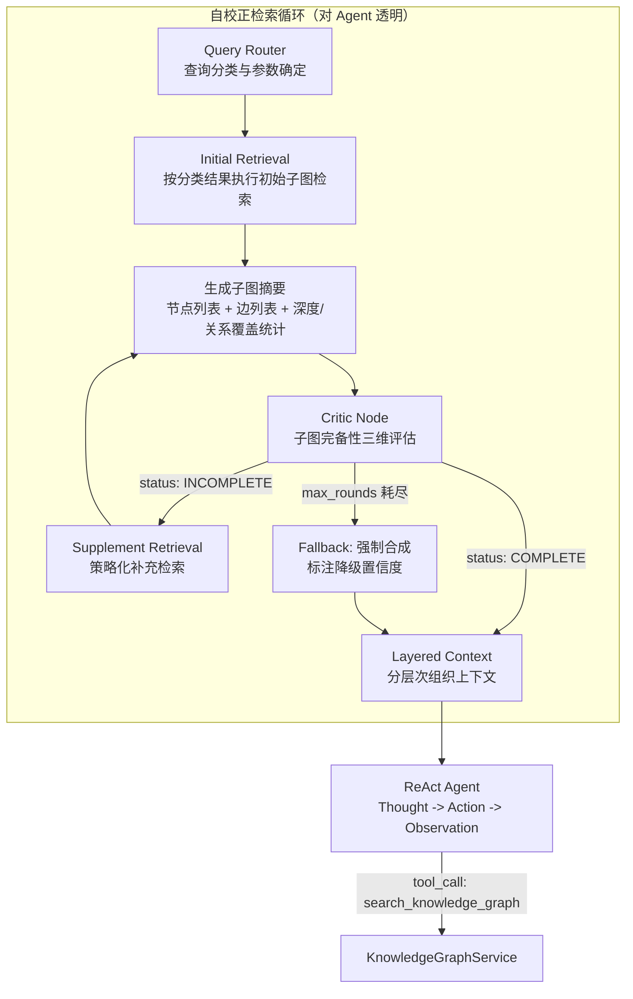
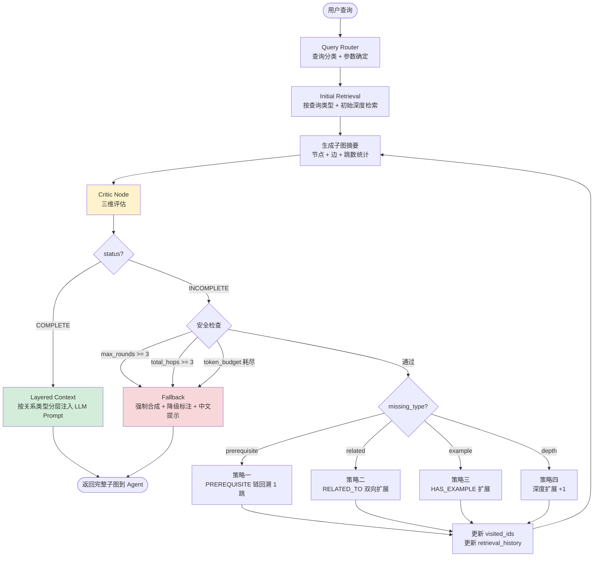
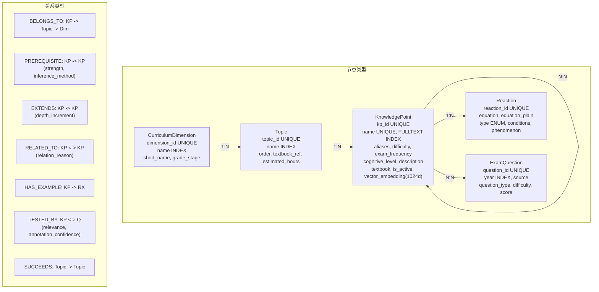
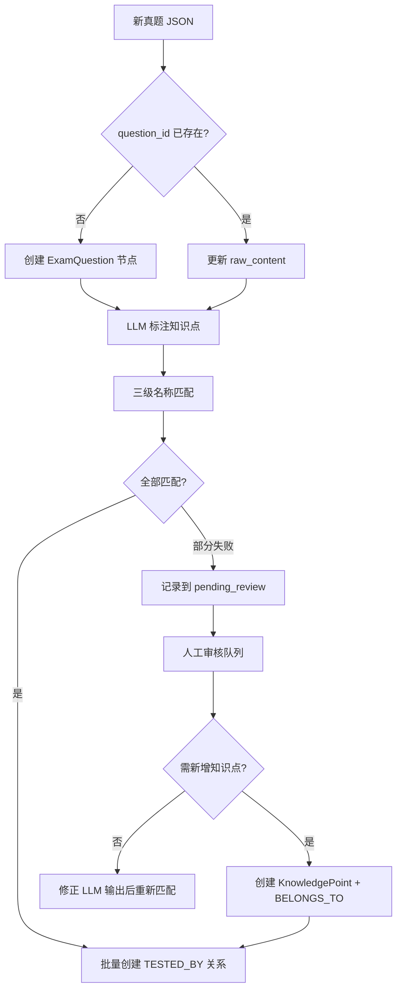
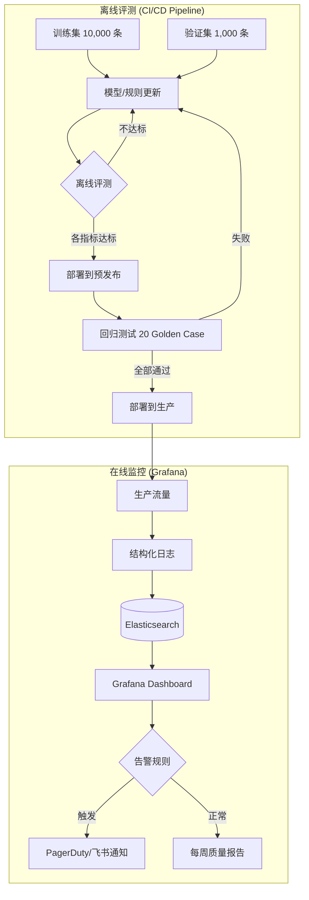

# 40. Agentic GraphRAG 知识系统设计

> 本文档定义 ChemAI 的 Agentic GraphRAG 知识图谱系统的完整设计——从系统定位、Agent-Graph 交互架构、混合检索策略、结构化 Prompt 上下文注入、自校正检索循环、知识图谱构建、Neo4j 存储到 Agent 集成的全链路。知识图谱是出题系统的知识锚点、诊断系统的障碍定位依据、自适应练习的路径推荐引擎，以及 Agent 的关系推理载体。

---

## 一、系统定位：从 Vector RAG 到 Agentic GraphRAG

### 1.1 当前 Vector RAG 流程与四个盲区

ChemAI 当前出题系统以 ChromaDB 为核心向量库，通过关键词匹配+向量检索获取真题上下文，拼接为文本块注入 LLM Prompt。这一架构存在四个结构性盲区：

**盲区一：无多跳推理**。向量检索只能找到语义相似的题目，无法沿知识关系链跨步推理。例如"出一道同时考察盐类水解和化学平衡的题"——向量能分别找到两边的题，但不理解它们之间的 PREREQUISITE 依赖。

**盲区二：无因果溯源**。学生做错"水解平衡"的题，需追溯根因——可能不是水解平衡本身出问题，而是前置知识"化学平衡"未掌握。向量 RAG 无法沿 PREREQUISITE 链向上追溯。

**盲区三：无路径推荐**。诊断出薄弱知识点后需要最优学习路径而非简单列表。"电离→化学平衡→盐类水解→水解平衡"的顺序本质是图上拓扑排序+最短路径。

**盲区四：非结构化上下文**。RAG 上下文是文本块列表而非关系化子图，LLM 无法理解知识点间的依赖、深化和横向关联。

### 1.2 Agentic GraphRAG 的变革

Agent 在 ReAct 循环中新增 Graph Researcher 节点，可主动向 Neo4j 发起 Cypher 查询，沿 PREREQUISITE/EXTENDS/RELATED_TO 等关系边遍历知识子图。不是替代 ChromaDB——Vector RAG 做语义匹配，Graph RAG 做关系推理，两者互补。

### 1.3 在 ChemAI 架构中的位置

Neo4j 与 ChromaDB 并行。它只存储知识节点和关系（~200 KnowledgePoint + ~30 Topic + ~100 Reaction），ExamQuestion 节点仅存 question_id/year/source 作为引用指针，题目全文仍在 SQLite 和 ChromaDB。KnowledgeGraphService 是 Neo4j 的唯一入口。

### 1.4 设计目标

| 目标 | 衡量标准 |
|------|---------|
| 多跳推理准确 | ≥ 85%（Vector Baseline ~50%） |
| 查询延迟 | 单次 Cypher P95 < 200ms |
| Router 分类准确 | ≥ 90% |
| 学习路径有效 | 教师确认合理率 ≥ 75% |

---

## 二、Agent-Graph 交互架构

### 2.1 GraphAgentState 扩展

在 LangGraph MessagesState 基础上扩展图探索字段：`graph_path`（探索轨迹）、`visited_nodes`（去重）、`knowledge_subgraph`（累积子图）、`retrieval_complete`（检索充分标记）、`retrieval_rounds`（累计轮次上限 3）、`graph_query_intent`（查询意图）。状态通过 Checkpointer 持久化。

### 2.2 Graph Researcher 节点

插入 ReAct 循环中 LLM 思考之后。Agent 声明 intent 后，Graph Researcher 根据意图选择预定义 Cypher 模板：prerequisites→PREREQUISITE 传递闭包(depth≤5)、related_concepts→RELATED_TO+BELONGS_TO、root_cause→沿 PREREQUISITE 链向上追溯到已掌握节点、learning_path→shortestPath、subgraph_browse→深度1邻居子图。

### 2.3 Query Router

三类分类：factual/single-hop→Vector RAG（如"什么是氧化还原反应"）、relational/multi-hop→Graph RAG（如"学盐类水解之前要掌握什么"）、comprehensive→混合（如"出一道综合考察盐类水解和化学平衡的大题"）。LLM 分类+JSON输出，置信度<0.7默认走 comprehensive。失败时关键词规则兜底。

### 2.4 Graph 工具集成

新增 3 个图工具(#36-38)：search_knowledge_graph(全体可用)、get_learning_path(教师/学生/辅导)、get_prerequisites(对学生隐藏)。工具选择优先级通过 System Prompt 注入引导。

---

## 三、混合检索策略：Vector + Graph 双引擎

### 3.1 三路径架构

**Vector 路径**（factual）：ChromaDB 关键词+向量双路召回→提取结果中知识点标签→批量查询 Neo4j 补充结构化元数据（难度/考频/前置链）。

**Graph 路径**（relational）：LLM 提取实体名→Neo4j 三级匹配（精确/编辑距离≤2/语义向量兜底）→按关系类型展开子图。展开参数：PREREQUISITE 双向深度 3、EXTENDS 正向深度 2、RELATED_TO 双向深度 1、HAS_EXAMPLE 正向深度 1。

**Hybrid 路径**（comprehensive）：Vector+Graph 并行→RRF 融合(k=60)→LLM 重排序→注入 Prompt。

### 3.2 实体名三级匹配

1. 精确：`MATCH (kp {name: $name})`；2. 模糊：Levenshtein ≤2；3. 语义：Embedding 向量兜底。

---

## 四、知识子图 -> Prompt 上下文注入

### 4.1 四层结构化注入

图检索结果按关系类型分层组织，每层独立 Prompt 模板：

| 层级 | 关系 | 优先级 | 注入格式 |
|------|------|:-----:|---------|
| L1 | PREREQUISITE | 最高 | "学习[目标]前需掌握：[前置1](已掌握)、[前置2](薄弱)" |
| L2 | EXTENDS | 高 | "[知识A]深化为[知识B]，增加了..." |
| L3 | RELATED_TO | 中 | "关联概念：[概念1]、[概念2]" |
| L4 | HAS_EXAMPLE | 低 | "典型反应：[方程式]（条件/现象）" |

### 4.2 学生掌握度感知裁剪

已掌握(≥80%)→一行提及；薄弱(<60%)→展开含反应示例和考频；未知→标记"建议先评估"。

### 4.3 Persona 感知注入

教师端：完整知识结构+考频+难度；学生端：鼓励语气+学习路径建议；家长端：通俗描述+家庭辅导建议。

### 4.4 Token 预算

出题≤2000tokens、诊断≤1500tokens、学习路径≤800tokens、Agent对话≤1200tokens。溢出按优先级裁剪。

---

## 五、自校正检索循环

### 5.1 为什么需要自校正

单次图检索天然存在信息不完整风险。虽然第三章定义的子图展开规则覆盖了常见查询模式，但在以下场景中，初始检索结果可能不足以支撑 Agent 的有效推理：

| 失败模式 | 根因 | 后果 |
|---------|------|------|
| 前置链断裂 | 初始检索从目标知识点出发仅扩展了预设深度，若目标知识点的认知层次较高（"分析"），其前置链可能超过默认深度 | 障碍诊断时无法追溯根因，给出"离子浓度比较"作为薄弱点，而忽略真正的根因"电离"（位于 3 跳外） |
| 关系类型缺失 | 查询仅沿 PREREQUISITE 方向扩展，遗漏了 RELATED_TO 关联的平行知识点 | 推荐的练习路径未覆盖横向关联知识，学生缺乏交叉训练，同类错误在关联知识点上重复出现 |
| 深度不足 | 深度参数对"分析"层知识点不足——其前置链通常 >= 3 跳 | 子图不包含完整的认知递进路径，出题时缺少必要的前置检查，生成的题目可能踩入学生的知识盲区 |
| 上下文范围过窄 | 诊断类查询需要子图同时覆盖 PREREQUISITE + TESTED_BY + HAS_EXAMPLE 三类关系才能有效推理 | 真题和典型反应信息未被注入 LLM Prompt，归因推理依据不足，Agent 只能给出模糊建议 |
| LLM 实体抽取偏差 | §3.3.1 的实体抽取可能遗漏口语化表达的隐含知识点（如学生说"那个铁离子变色的反应"，LLM 可能无法准确映射为"Fe3+ 水解"） | 入口节点定位错误，后续展开都是沿着错误起点的无效探索 |

自校正检索循环的核心思想：将检索过程建模为 **Retrieve -> Critic -> Supplement -> Retrieve** 的闭环。Critic Node 评估当前子图的完备性（从拓扑、关系、深度三个维度），在不足时驱动策略化补充检索，直至子图满足该查询类型的要求。

### 5.2 在 Agent ReAct 循环中的定位

ChemAI Agent 的 v2 单智能体架构中，知识图谱检索通过 `search_knowledge_graph` 工具对外暴露。自校正检索循环位于 KnowledgeGraphService 内部，对 Agent 的 ReAct 循环透明——Agent 看到的是一次"调用工具并获得完整子图"的原子操作，内部的 Critic -> Supplement 循环由 KnowledgeGraphService 自主管理。

这与 §2.2 中 Graph Researcher 节点的 Self-Correction 回路互补但不同层：
- **Agent 层的 Self-Correction**（§2.5）：Agent 判断工具返回的结果不足以回答问题，主动设置新的 `graph_query_intent` 发起第二轮图查询
- **KnowledgeGraphService 层的自校正循环**（本章）：在单次工具调用内部，自动评估并补充检索，返回的是经过自我修正的完整子图



### 5.3 子图摘要结构

每次检索后生成结构化的子图摘要，供 Critic Node 评估使用。摘要不包含完整的节点属性（减少 token 消耗），仅保留评估所需的关键字段：

```json
{
  "query": "氯化铁溶液为什么呈酸性",
  "query_type": "DIAGNOSIS",
  "target_kp": "盐类水解",
  "target_cognitive_level": "分析",
  "subgraph_summary": {
    "nodes": {
      "KnowledgePoint": [
        {"name": "盐类水解", "depth": 0, "cognitive_level": "分析",
         "relations_out": ["EXTENDS->水解平衡"], "relations_in": ["电离->PREREQUISITE", "化学平衡->PREREQUISITE"]},
        {"name": "电离", "depth": 1, "cognitive_level": "应用",
         "relations_out": ["PREREQUISITE->盐类水解"], "relations_in": ["电解质与非电解质->PREREQUISITE"]},
        {"name": "化学平衡", "depth": 1, "cognitive_level": "应用",
         "relations_out": ["PREREQUISITE->盐类水解"]},
        {"name": "电解质与非电解质", "depth": 2, "cognitive_level": "理解",
         "relations_out": ["PREREQUISITE->电离"]}
      ],
      "Reaction": [
        {"name": "FeCl3水解", "equation": "$\\text{Fe}^{3+} + 3\\text{H}_2\\text{O} \\rightleftharpoons \\text{Fe}(\\text{OH})_3 + 3\\text{H}^+$"}
      ],
      "ExamQuestion": []
    },
    "edges": [
      {"from": "电离", "to": "盐类水解", "type": "PREREQUISITE"},
      {"from": "化学平衡", "to": "盐类水解", "type": "PREREQUISITE"},
      {"from": "电解质与非电解质", "to": "电离", "type": "PREREQUISITE"},
      {"from": "盐类水解", "to": "水解平衡", "type": "EXTENDS"},
      {"from": "盐类水解", "to": "FeCl3水解", "type": "HAS_EXAMPLE"}
    ],
    "hop_stats": {
      "max_depth_from_target": 2,
      "prerequisite_chain_length": 2,
      "related_to_count": 0,
      "tested_by_count": 0
    }
  },
  "retrieval_history": [
    {
      "round": 0,
      "strategy": "initial_diagnosis_d3",
      "nodes_retrieved": 5,
      "edges_retrieved": 5
    }
  ]
}
```

### 5.4 Critic Node：子图完备性评估

Critic Node 是自校正循环的核心决策组件。它接收子图摘要和检索历史，从三个维度评估完备性，输出结构化的评估结果。

#### 5.4.1 维度一：拓扑完备性（Topological Completeness）

**定义**：子图中的 PREREQUISITE 链是否形成从基础知识点（认知层次"识记"或"理解"）到目标知识点的连通路径。

**判定逻辑**：

```
function check_topological_completeness(subgraph, query_type):
    if query_type not in [DIAGNOSIS, PREREQ_CHECK, LEARNING_PATH]:
        return True  # 非诊断类查询不做拓扑完备性检查

    # 找到子图中认知层次最低的节点（"识记"或"理解"层）
    root_nodes = [n for n in subgraph.KnowledgePoint
                  if n.cognitive_level in ["识记", "理解"]]

    if not root_nodes:
        return False, "子图中无基础认知层次节点，前置链可能未展开到位"

    # 检查目标节点是否通过 PREREQUISITE 路径可达所有 root_nodes
    for root in root_nodes:
        if not subgraph.path_exists(root, target, edge_type="PREREQUISITE"):
            return False, f"从根节点'{root.name}'到目标节点的PREREQUISITE链不连通"

    return True, None
```

**通过标准**：对于 DIAGNOSIS 和 PREREQ_CHECK 类型，子图中至少存在一条从"识记/理解"层节点到目标知识点的连续 PREREQUISITE 路径。

**化学领域依据**：高中化学的知识依赖关系决定了——如果一个"分析"层知识点的前置链中没有"识记/理解"层节点，说明该链不完整。例如"盐类水解"（分析层）的前置链应该能追溯至"物质的分类"（识记层）。

#### 5.4.2 维度二：关系充足性（Relational Sufficiency）

**定义**：子图是否覆盖了该查询类型所需的所有关系类型。

**各查询类型的期望关系**：

| 查询类型 | 必选关系 | 期望关系 | 判定规则 |
|---------|---------|---------|---------|
| DIAGNOSIS | PREREQUISITE | RELATED_TO, TESTED_BY | 必选关系必须全部存在；期望关系中至少 50% 存在 |
| EXAM_GEN | RELATED_TO, HAS_EXAMPLE | PREREQUISITE, TESTED_BY | 必选关系全部存在；HAS_EXAMPLE 缺失直接判定 INCOMPLETE |
| PREREQ_CHECK | PREREQUISITE | (无) | PREREQUISITE 必须存在 |
| CONCEPT_QUERY | (无必选) | PREREQUISITE, EXTENDS, RELATED_TO, HAS_EXAMPLE | 期望关系中至少 50% 存在 |
| LEARNING_PATH | PREREQUISITE | EXTENDS | PREREQUISITE 必须存在 |

**判定逻辑**：

```
function check_relational_sufficiency(subgraph, query_type):
    expected = EXPECTED_RELATIONS[query_type]
    mandatory = expected["mandatory"]  # 必选关系
    desired = expected["desired"]      # 期望关系

    present_types = set(e.type for e in subgraph.edges)

    missing_mandatory = mandatory - present_types
    if missing_mandatory:
        return False, missing_mandatory, "mandatory"

    present_desired = present_types & desired
    if len(present_desired) < len(desired) * 0.5:
        missing = desired - present_desired
        return False, missing, "desired"

    return True, set(), None
```

#### 5.4.3 维度三：深度充足性（Depth Adequacy）

**定义**：子图的扩展深度是否满足该查询类型的认知推理需求。

**深度需求表**：

| 目标认知层次 | DIAGNOSIS | PREREQ_CHECK | EXAM_GEN | CONCEPT_QUERY | LEARNING_PATH |
|:----------:|:---------:|:------------:|:--------:|:------------:|:-------------:|
| 识记 | 0 | 0 | 1 | 1 | 1 |
| 理解 | 1 | 1 | 1 | 1 | 2 |
| 应用 | 2 | 2 | 2 | 1 | 3 |
| 分析 | 3 | 3 | 2 | 1 | 4 |
| competition | 4 | 4 | 3 | 2 | 5 |

**深度需求的设计原理**：认知层次越高的知识点，其前置依赖链越长。"应用"层的"盐类水解"通常有 2 层前置（电离 <- 电解质与非电解质），"分析"层的"水解平衡"通常有 3-4 层前置。对于 DIAGNOSIS 类型，需要到达"识记/理解"层才能定位根因，因此深度需求与认知层次正相关。

**判定逻辑**：

```
function check_depth_adequacy(subgraph, query_type, target_cognitive_level):
    required = DEPTH_REQUIREMENT[query_type][target_cognitive_level]
    actual = subgraph.max_depth_from_target
    if actual < required:
        return False, required - actual
    return True, 0
```

#### 5.4.4 Critic Node LLM Prompt 模板

```
System: 你是 ChemAI 知识图谱的质量评估专家。你的任务是评估当前图检索子图的完备性。

评估三个维度：
1. 拓扑完备性：对于诊断和前置检查类查询，子图是否包含从基础知识点（识记/理解层）到目标知识点的完整 PREREQUISITE 链？
2. 关系充足性：子图是否覆盖了该查询类型所需的关系类型？
3. 深度充足性：子图的扩展深度是否足以支撑该查询类型的推理需求？

化学领域知识参考：
- "分析"层知识点的前置链通常长 3-4 跳（如：物质的分类->电解质与非电解质->电离->盐类水解->水解平衡）
- 诊断类查询必须有完整的 PREREQUISITE 链，否则无法追溯根因
- 出题类查询必须有 HAS_EXAMPLE（典型反应作为题目素材）和 RELATED_TO（知识边界参考）

判定规则：
- 若任一必选维度不满足 -> INCOMPLETE
- 若所有必选维度满足但期望维度有缺失 -> INCOMPLETE（confidence 中等）
- 若所有维度满足 -> COMPLETE

User:
查询类型：{query_type}
目标知识点：{target_kp}（认知层次：{cognitive_level}）
查询文本：{query}
期望必选关系：{expected_mandatory}
期望关系（>=50%覆盖）：{expected_desired}
要求深度：{required_depth}

当前子图摘要：
{subgraph_summary_json}

检索历史：
{retrieval_history_json}

请输出 JSON 格式评估结果（仅 JSON，无其他文本）：
{
  "status": "COMPLETE | INCOMPLETE",
  "topological_complete": true/false,
  "relational_sufficient": true/false,
  "depth_adequate": true/false,
  "missing_type": "prerequisite | related | example | depth | none",
  "missing_detail": {
    "missing_relations": [],
    "missing_depth": 0,
    "weak_nodes": [],
    "broken_chain_at": ""
  },
  "suggestion": "具体的中文补充检索建议",
  "confidence": 0.0-1.0
}
```

#### 5.4.5 Critic Node 输出示例

**场景：DIAGNOSIS 查询"FeCl3 溶液蒸干后产物？学生错误原因分析"，初始检索 depth=2**

```json
{
  "status": "INCOMPLETE",
  "topological_complete": false,
  "relational_sufficient": false,
  "depth_adequate": false,
  "missing_type": "prerequisite",
  "missing_detail": {
    "missing_relations": ["RELATED_TO", "TESTED_BY"],
    "missing_depth": 1,
    "weak_nodes": ["电解质与非电解质"],
    "broken_chain_at": "电解质与非电解质"
  },
  "suggestion": "当前子图的 PREREQUISITE 链在'电解质与非电解质'（认知层次：理解）处终止，但其可能还有更深层的前置依赖（如'物质的分类'——识记层）。需要从'电解质与非电解质'继续回溯 PREREQUISITE 链 1 跳。同时盐类水解可能与'电离平衡'存在 RELATED_TO 关联。",
  "confidence": 0.72
}
```

### 5.5 Supplement Retrieval：策略化补充检索

当 Critic Node 判定 INCOMPLETE 时，根据 `missing_type` 字段执行对应的补充检索策略。

#### 5.5.1 策略一：缺失前置依赖 (missing_type = "prerequisite")

**触发条件**：`topological_complete == false`，即 PREREQUISITE 链在到达"识记/理解"层前中断。

**检索策略**：从当前子图的最深层前置节点（broken_chain_at 指定的节点）出发，继续沿 PREREQUISITE 方向回溯 1 跳。

**Cypher 模板**：

```cypher
// 参数: $frontier_names（broken_chain_at 中的节点）, $visited_ids（已访问节点 ID 列表）
MATCH (kp:KnowledgePoint)
WHERE kp.name IN $frontier_names
MATCH (deeper:KnowledgePoint)-[:PREREQUISITE]->(kp)
WHERE NOT elementId(deeper) IN $visited_ids
RETURN kp.name AS from_name,
       deeper.name AS to_name,
       deeper.cognitive_level AS to_cognitive,
       deeper.difficulty AS to_difficulty
```

**后续判断**：若回溯后发现 `deeper.cognitive_level` 为"识记"或"理解"且 `deeper` 没有更深的 PREREQUISITE 出边（是叶节点），标记该链为完整。否则继续触发下一轮补充检索。

#### 5.5.2 策略二：缺失横向关联 (missing_type = "related")

**触发条件**：`relational_sufficient == false` 且缺失 RELATED_TO。

**检索策略**：从子图中 degree 最低的"弱节点"出发，执行双向 RELATED_TO 扩展。优先选择认知层次为"识记/理解"的节点（它们更可能有横向关联到其他基础概念）。

**Cypher 模板**：

```cypher
// 参数: $weak_node_names（Critic Node 识别的弱节点列表）, $visited_ids
MATCH (weak:KnowledgePoint)
WHERE weak.name IN $weak_node_names
MATCH (weak)-[:RELATED_TO]-(related:KnowledgePoint)
WHERE NOT elementId(related) IN $visited_ids
RETURN weak.name AS from_name,
       related.name AS to_name,
       related.cognitive_level AS related_level,
       related.exam_frequency AS related_freq
ORDER BY related.exam_frequency DESC
LIMIT 5
```

#### 5.5.3 策略三：缺失典型反应 (missing_type = "example")

**触发条件**：缺失 HAS_EXAMPLE 关系。

**检索策略**：从子图中缺少 HAS_EXAMPLE 关联的 KnowledgePoint 节点出发，扩展反应示例。

**Cypher 模板**：

```cypher
// 参数: $kp_names（缺少 HAS_EXAMPLE 的知识点名称列表）
MATCH (kp:KnowledgePoint)
WHERE kp.name IN $kp_names
OPTIONAL MATCH (kp)-[:HAS_EXAMPLE]->(rx:Reaction)
RETURN kp.name AS kp_name,
       collect({equation: rx.equation, type: rx.type,
                conditions: rx.conditions, phenomenon: rx.phenomenon}) AS reactions
```

**注意事项**：某些"识记"层知识点（如"物质的分类"）可能确实没有 HAS_EXAMPLE 关联——这属于正常情况。Critic Node 应在二次评估中识别此模式（目标节点 cognitive_level 为"识记"且无 HAS_EXAMPLE），不再将其标记为缺失。

#### 5.5.4 策略四：深度不足 (missing_type = "depth")

**触发条件**：`depth_adequate == false`。

**检索策略**：对子图中所有位于当前最大深度的 KnowledgePoint 节点，沿所有出边方向统一扩展 1 跳。使用合并查询减少数据库往返。

**Cypher 模板**：

```cypher
// 参数: $depth_nodes（子图最深层 KnowledgePoint 名称列表）, $visited_ids
MATCH (deep:KnowledgePoint)
WHERE deep.name IN $depth_nodes
MATCH (deep)-[r:PREREQUISITE|EXTENDS|RELATED_TO]-(neighbor:KnowledgePoint)
WHERE NOT elementId(neighbor) IN $visited_ids
RETURN deep.name AS from_name,
       type(r) AS relation_type,
       neighbor.name AS to_name,
       neighbor.cognitive_level AS to_cognitive,
       neighbor.difficulty AS difficulty
```

### 5.6 安全边界

自校正循环必须在以下三条安全边界的交集内运行，任一条件触发即停止循环：

| 边界 | 值 | 触发后行为 |
|------|------|-----------|
| 最大校正轮数 | 3 rounds | 停止补充检索，进入 Fallback 模式 |
| 最大总跳数（从目标知识点起算的总扩展距离） | 3 跳 | 停止所有扩展，以当前子图强制合成 |
| Token 预算 | 子图序列化后 token 数不超过上下文窗口的 30%（约 2,400 tokens，按 8K 窗口计） | Token 预算耗尽时，裁剪子图：保留 PREREQUISITE 边优先，HAS_EXAMPLE 边仅保留 1 条/节点 |

**安全边界的 Cypher 校验**（在每轮补充检索前执行）：

```cypher
// 检查从目标节点起的总扩展距离是否已超过 3
MATCH path = (target:KnowledgePoint {name: $target_name})
             -[r:PREREQUISITE|EXTENDS|RELATED_TO*1..4]-(other:KnowledgePoint)
WHERE NOT elementId(other) IN $visited_ids
WITH path, length(path) AS hop_count
WHERE hop_count > 3
RETURN count(path) AS over_limit_paths
```

若 `over_limit_paths > 0`，拒绝本次补充检索，转而裁剪最外层节点。

### 5.7 环路防护

**机制一：visited_nodes 全局集合**

```python
visited_ids: Set[str] = set()  # 存储已遍历节点的 Neo4j elementId

def update_visited(result_set):
    for record in result_set:
        visited_ids.add(record["kp"].element_id)
        if "related" in record and record["related"]:
            visited_ids.add(record["related"].element_id)
```

所有补充检索的 Cypher 查询均包含 `WHERE NOT elementId(n) IN $visited_ids` 过滤条件。

**机制二：path_hash 路径去重**

```python
import hashlib

def compute_path_hash(path_nodes: List[str]) -> str:
    canonical = "->".join(sorted(path_nodes))
    return hashlib.sha256(canonical.encode()).hexdigest()[:16]

seen_paths: Set[str] = set()

def is_new_path(path_nodes: List[str]) -> bool:
    h = compute_path_hash(path_nodes)
    if h in seen_paths:
        return False
    seen_paths.add(h)
    return True
```

**机制三：PREREQUISITE 环路检测**

```cypher
// 检查子图中是否存在 PREREQUISITE 环
MATCH (start:KnowledgePoint)
WHERE start.name IN $subgraph_kp_names
MATCH cycle = (start)-[:PREREQUISITE*2..5]->(start)
RETURN [node in nodes(cycle) | node.name] AS cycle_nodes
```

若检测到环，优先保留认知层次递进方向最合理的边（低层次 -> 高层次），断开认知层次倒挂的边（高层次 -> 低层次）。

### 5.8 Fallback：校正失败降级

当自校正循环因安全边界耗尽而终止、但 Critic Node 仍判定 INCOMPLETE 时，进入 Fallback 模式。

**Fallback 操作序列**：

1. **强制合成**：以当前子图为最终结果，不执行进一步检索

2. **置信度降级标注**：将子图的整体置信度设为 Critic Node 最后一次评估的 confidence 值

   ```json
   {
     "subgraph": { "...": "当前不完整子图" },
     "meta": {
       "retrieval_status": "PARTIAL",
       "confidence": 0.68,
       "correction_rounds_used": 3,
       "max_rounds": 3,
       "incomplete_dimensions": ["prerequisite"],
       "warning": "部分前置依赖链不完整"
     }
   }
   ```

3. **用户界面透传**：Agent 在生成最终回答时，在末尾附加降级提示中文文本"部分信息可能不完整。"。同时在 SSE 事件中附加 `meta.confidence` 字段，供前端渲染置信度指示器。

4. **异步补偿**：将此次查询的 `missing_detail` 记录到补偿队列，由后台任务异步补充缺失的关系（如人工审核是否应建立从"电解质与非电解质"到"物质的分类"的 PREREQUISITE 关系）。

### 5.9 完整自校正流程 Mermaid 图



### 5.10 分层上下文注入

检索完成后（无论 COMPLETE 还是 FALLBACK），子图按关系类型分层注入 LLM Prompt，不同层次以不同的优先级和格式呈现：

```
===== 化学知识图谱上下文 =====

【目标知识点】
盐类水解 (认知层次: 分析 | 考频: very_high | 难度: hard)
定义：盐的离子与水中 H+ 或 OH- 结合生成弱电解质的反应

【前置依赖链】(必读，影响推理准确性)
物质的分类 -> 电解质与非电解质 -> 电离 -> 盐类水解
化学平衡 -> 盐类水解

【深化扩展】
盐类水解 -> 水解平衡

【横向关联】
水解平衡 <-> 电离平衡

【典型反应】
Fe3+ + 3H2O ⇌ Fe(OH)3 + 3H+  (类型: 水解反应)
现象：氯化铁溶液呈棕黄色，加热后颜色加深

【相关真题】
(暂无本题直接关联的真题)

===== 检索元信息 =====
检索状态: COMPLETE | 置信度: 0.94 | 校正轮数: 2
===== 上下文结束 =====
```

分层注入的设计原则：
- **必读层**（PREREQUISITE）：以"【前置依赖链】(必读，影响推理准确性)"标记，Agent 在做诊断推理时必须引用此层
- **参考层**（EXTENDS, RELATED_TO）：以普通标题呈现，作为扩展信息的参考
- **证明材料层**（HAS_EXAMPLE, TESTED_BY）：提供具体实例，增强回答的可信度和具体性
- **检索元信息**：提供置信度标注，使 Agent 可以在回答中适当表达不确定性

### 5.11 完整示例：诊断查询的两轮校正

**场景**：学生做错了关于"FeCl3 溶液蒸干后产物"的题目。Agent 向 KnowledgeGraphService 发起诊断查询。

**Round 0：初始检索**

```
查询：FeCl3溶液蒸干后得到什么？学生错误原因分析
分类：DIAGNOSIS
目标：盐类水解 (认知层次: 分析)
检索参数：PREREQUISITE 回溯 2 跳 + RELATED_TO + HAS_EXAMPLE
```

初始检索得到的子图：

```
盐类水解 (depth=0, 认知层次: 分析)
  PREREQUISITE <- 电离 (depth=1, 认知层次: 应用)
  PREREQUISITE <- 化学平衡 (depth=1, 认知层次: 应用)
  EXTENDS -> 水解平衡 (depth=1, 认知层次: 分析)
  HAS_EXAMPLE -> FeCl3水解反应

电离 (depth=1)
  PREREQUISITE <- 电解质与非电解质 (depth=2, 认知层次: 理解)

电解质与非电解质 (depth=2)  [叶子节点，无更深的PREREQUISITE出边]
```

缺失项分析：
- RELATED_TO: 0 条
- TESTED_BY: 0 条
- 最深认知层次: 理解（电解质与非电解质），未到达"识记"层
- 最大深度: 2，分析层要求 >= 3

**Round 0 Critic 评估**：

```json
{
  "status": "INCOMPLETE",
  "topological_complete": false,
  "relational_sufficient": false,
  "depth_adequate": false,
  "missing_type": "prerequisite",
  "missing_detail": {
    "missing_relations": ["RELATED_TO", "TESTED_BY"],
    "missing_depth": 1,
    "weak_nodes": ["电解质与非电解质"],
    "broken_chain_at": "电解质与非电解质"
  },
  "suggestion": "电解质与非电解质(认知层次：理解)可能有更深前置依赖(如'物质的分类')。盐类水解可能需要RELATED_TO关联。",
  "confidence": 0.68
}
```

**Round 1：补充检索**

策略一（回溯 PREREQUISITE）：

```cypher
MATCH (kp:KnowledgePoint {name: "电解质与非电解质"})
MATCH (deeper:KnowledgePoint)-[:PREREQUISITE]->(kp)
WHERE NOT elementId(deeper) IN $visited_ids
RETURN kp.name AS from_name, deeper.name AS to_name,
       deeper.cognitive_level AS to_cognitive
```

结果：`电解质与非电解质 -[:PREREQUISITE]-> 物质的分类`（认知层次：识记）

策略二（RELATED_TO 扩展）：

```cypher
MATCH (kp:KnowledgePoint {name: "盐类水解"})
MATCH (kp)-[:RELATED_TO]-(related:KnowledgePoint)
WHERE NOT elementId(related) IN $visited_ids
RETURN kp.name, related.name, related.exam_frequency
```

结果：`盐类水解 -[:RELATED_TO]- 电离平衡`（认知层次：分析，考频：high）

更新后的子图：

```
盐类水解 (depth=0)
  PREREQUISITE <- 电离 (depth=1)
  PREREQUISITE <- 化学平衡 (depth=1)
  EXTENDS -> 水解平衡 (depth=1)
  RELATED_TO <-> 电离平衡 (depth=1)
  HAS_EXAMPLE -> FeCl3水解反应

电离 (depth=1)
  PREREQUISITE <- 电解质与非电解质 (depth=2)

电解质与非电解质 (depth=2)
  PREREQUISITE <- 物质的分类 (depth=3)  [认知层次: 识记, 叶子节点]
```

**Round 1 Critic 评估**：

```json
{
  "status": "COMPLETE",
  "topological_complete": true,
  "relational_sufficient": true,
  "depth_adequate": true,
  "missing_type": "none",
  "confidence": 0.94
}
```

**校验结论**：
- 拓扑：物质的分类（识记） -> 电解质与非电解质（理解） -> 电离（应用） -> 盐类水解（分析），完整链 -> 通过
- 关系：PREREQUISITE / EXTENDS / RELATED_TO / HAS_EXAMPLE 覆盖 4/4 类 -> 通过
- 深度：实际 max_depth=3，DIAGNOSIS+分析 要求 >= 3 -> 通过

**Agent 基于完整子图推理**：学生的真正薄弱点可能在前置知识"电离"（对强弱电解质概念不清导致无法判断 Fe(OH)3 是否能完全电离），而不是"盐类水解"本身。诊断根因从表面知识点深入到了前置知识点。Agent 回答："你在 FeCl3 溶液蒸干这题上的问题，根源可能不在盐类水解本身，而在于对'电离'和'强弱电解质'的理解需要巩固。建议先复习：物质的分类 -> 电解质与非电解质 -> 电离，然后再回到盐类水解。"

---

## 六、知识图谱构建

### 6.1 本体设计

本节给出 Neo4j 知识图谱的完整数据模型定义，包含所有节点类型、关系类型、属性约束和索引策略。

#### 6.1.1 节点类型定义

**CurriculumDimension（课标维度，8 个）**：

| 属性 | Neo4j 类型 | 约束 | 说明 | 示例值 |
|------|-----------|------|------|--------|
| `dimension_id` | String | UNIQUE, NOT NULL | 维度唯一标识，格式 `DIM_001` | `"DIM_001"` |
| `name` | String | NOT NULL, INDEX | 课标维度全称 | `"化学反应原理"` |
| `short_name` | String | NOT NULL | 简称，用于代码引用 | `"chem_reaction"` |
| `grade_stage` | String | NOT NULL | 必修/选择性必修 | `"选择性必修1"` |

**Topic（主题，~30 个）**：

| 属性 | Neo4j 类型 | 约束 | 说明 | 示例值 |
|------|-----------|------|------|--------|
| `topic_id` | String | UNIQUE, NOT NULL | 格式 `TOP_001` | `"TOP_003"` |
| `name` | String | NOT NULL, INDEX | 主题名称 | `"电解质溶液"` |
| `order` | Integer | NOT NULL | 教学顺序序号 | `3` |
| `textbook_ref` | String | NOT NULL | 教材出处 | `"人教版选择性必修1 第三章"` |
| `estimated_hours` | Float | | 预估教学课时 | `12.0` |

**KnowledgePoint（知识点，~200 个，核心节点）**：

| 属性 | Neo4j 类型 | 约束 | 说明 | 示例值 |
|------|-----------|------|------|--------|
| `kp_id` | String | UNIQUE, NOT NULL | 格式 `KP_001` | `"KP_042"` |
| `name` | String | NOT NULL, UNIQUE, FULLTEXT INDEX | 知识点标准名称 | `"盐类水解"` |
| `aliases` | List[String] | DEFAULT [] | 别名列表，用于模糊匹配 | `["水解反应", "盐的水解"]` |
| `difficulty` | String | NOT NULL, ENUM | easy/medium/hard/competition | `"hard"` |
| `exam_frequency` | String | NOT NULL, ENUM | very_high/high/medium/low | `"very_high"` |
| `cognitive_level` | String | NOT NULL, ENUM | 识记/理解/应用/分析 | `"分析"` |
| `description` | String | | 150-300 字的核心概念描述 | `"在溶液中盐的离子与水电离出的..."` |
| `textbook` | String | NOT NULL | 教材章节定位 | `"人教版选择性必修1 第三章 第三节"` |
| `is_active` | Boolean | DEFAULT true | 是否仍在当前考纲中 | `true` |
| `deprecated_since` | String | | 考纲移除日期（ISO 格式） | `null` |
| `vector_embedding` | LIST[FLOAT] | DIM=1024 | dashscope text-embedding-v3 向量 | `[0.0123, -0.0456, ...]` |

**Neo4j 索引与约束**：

```cypher
-- KnowledgePoint 约束和索引
CREATE CONSTRAINT kp_id_unique IF NOT EXISTS
FOR (kp:KnowledgePoint) REQUIRE kp.kp_id IS UNIQUE;
CREATE CONSTRAINT kp_name_unique IF NOT EXISTS
FOR (kp:KnowledgePoint) REQUIRE kp.name IS UNIQUE;
CREATE FULLTEXT INDEX kp_name_ft IF NOT EXISTS
FOR (kp:KnowledgePoint) ON EACH [kp.name, kp.description];
CREATE INDEX kp_cognitive_idx IF NOT EXISTS
FOR (kp:KnowledgePoint) ON (kp.cognitive_level);
CREATE INDEX kp_difficulty_idx IF NOT EXISTS
FOR (kp:KnowledgePoint) ON (kp.difficulty);
CREATE INDEX kp_exam_freq_idx IF NOT EXISTS
FOR (kp:KnowledgePoint) ON (kp.exam_frequency);
CREATE VECTOR INDEX kp_embedding_idx IF NOT EXISTS
FOR (kp:KnowledgePoint) ON (kp.vector_embedding)
OPTIONS {indexConfig: {
  `vector.dimensions`: 1024,
  `vector.similarity_function`: 'cosine'
}};

-- Topic
CREATE CONSTRAINT topic_id_unique IF NOT EXISTS
FOR (t:Topic) REQUIRE t.topic_id IS UNIQUE;
CREATE INDEX topic_name_idx IF NOT EXISTS
FOR (t:Topic) ON (t.name);

-- CurriculumDimension
CREATE CONSTRAINT dim_id_unique IF NOT EXISTS
FOR (d:CurriculumDimension) REQUIRE d.dimension_id IS UNIQUE;
CREATE INDEX dim_name_idx IF NOT EXISTS
FOR (d:CurriculumDimension) ON (d.name);
```

**Reaction（典型反应，~100 个）**：

| 属性 | Neo4j 类型 | 约束 | 说明 | 示例值 |
|------|-----------|------|------|--------|
| `reaction_id` | String | UNIQUE, NOT NULL | 格式 `RX_001` | `"RX_023"` |
| `equation` | String | NOT NULL | LaTeX 格式化学方程式 | `"$\\text{Fe}^{3+}+3\\text{H}_2\\text{O}\\rightleftharpoons\\text{Fe}(\\text{OH})_3+3\\text{H}^+$"` |
| `equation_plain` | String | NOT NULL | 纯文本方程式 | `"Fe3+ + 3H2O ⇌ Fe(OH)3 + 3H+"` |
| `type` | String | NOT NULL, ENUM | 化合/分解/置换/复分解/氧化还原/水解/电解/其他 | `"水解"` |
| `conditions` | String | | 反应条件 | `"加热促进水解"` |
| `phenomenon` | String | | 实验现象 | `"溶液呈棕黄色，加热后颜色加深"` |

**ExamQuestion（真题引用，按需增长）**：

| 属性 | Neo4j 类型 | 约束 | 说明 | 示例值 |
|------|-----------|------|------|--------|
| `question_id` | String | UNIQUE, NOT NULL | 全局唯一题目 ID | `"nat_2021_t11"` |
| `year` | Integer | NOT NULL | 考试年份 | `2021` |
| `source` | String | NOT NULL | 试卷来源 | `"全国卷I"` |
| `question_type` | String | NOT NULL | 选择题/填空题/实验题/计算题/推断题 | `"选择题"` |
| `difficulty` | String | | 题目难度 | `"medium"` |
| `score` | Float | | 分值 | `6.0` |

```cypher
CREATE CONSTRAINT question_id_unique IF NOT EXISTS
FOR (q:ExamQuestion) REQUIRE q.question_id IS UNIQUE;
CREATE CONSTRAINT reaction_id_unique IF NOT EXISTS
FOR (r:Reaction) REQUIRE r.reaction_id IS UNIQUE;
CREATE INDEX question_year_idx IF NOT EXISTS
FOR (q:ExamQuestion) ON (q.year);
```

#### 6.1.2 关系类型定义

| 关系类型 | 方向 | 起点 -> 终点 | 约束 | 语义 | 关键属性 |
|---------|------|---------|------|------|---------|
| `BELONGS_TO` | KP -> Topic -> Dim | KnowledgePoint -> Topic | 多对一，必填 | 知识点属于某主题 | — |
| `BELONGS_TO` | Topic -> Dim | Topic -> CurriculumDimension | 多对一，必填 | 主题属于某维度 | — |
| `PREREQUISITE` | KP -> KP | KnowledgePoint -> KnowledgePoint | 多对多，有向，无环 | A 是学习 B 的前置条件 | `strength`(strong/medium/weak), `inference_method`(textbook_order/cognitive_level/llm_judged/expert_reviewed) |
| `EXTENDS` | KP -> KP | KnowledgePoint -> KnowledgePoint | 多对多，有向 | B 是 A 的深化扩展 | `depth_increment`(Integer, 默认 1) |
| `RELATED_TO` | KP <-> KP | KnowledgePoint <-> KnowledgePoint | 多对多，无向 | 横向关联 | `relation_reason`(String) |
| `HAS_EXAMPLE` | KP -> RX | KnowledgePoint -> Reaction | 一对多 | 知识点的典型反应示例 | — |
| `TESTED_BY` | KP <-> Q | KnowledgePoint <-> ExamQuestion | 多对多，无向 | 知识点被真题考察 | `relevance`(direct/indirect), `annotation_confidence`(Float) |
| `SUCCEEDS` | Topic -> Topic | Topic -> Topic | 有向 | 教学顺序先后 | — |

#### 6.1.3 Neo4j Schema 完整 Mermaid 图



### 6.2 知识层级结构

#### 6.2.1 三层模型总览

```
课标维度 (CurriculumDimension) —— 8 个
  └── 主题 (Topic) —— ~30 个
        └── 知识点 (KnowledgePoint) —— ~200 个
```

**层级约束**：一个知识点只能 BELONGS_TO 一个 Topic；一个 Topic 只能 BELONGS_TO 一个 CurriculumDimension。跨维度/跨主题的知识关联通过 RELATED_TO 关系表达（不破坏树状归属）。

#### 6.2.2 八大课标维度完整列表

| 序号 | 维度 ID | 名称 | 简称 | 主题数 | 教学阶段 |
|:----:|---------|------|------|:--:|---------|
| 1 | DIM_001 | 化学科学与实验探究 | chem_experiment | 3 | 必修1 |
| 2 | DIM_002 | 常见无机物及其应用 | inorganic | 5 | 必修1 |
| 3 | DIM_003 | 物质结构基础与化学反应规律 | structure_reaction | 4 | 必修1+必修2 |
| 4 | DIM_004 | 简单的有机化合物及其应用 | organic_basic | 3 | 必修2 |
| 5 | DIM_005 | 化学反应原理 | chem_reaction | 7 | 选择性必修1 |
| 6 | DIM_006 | 物质结构与性质 | structure_property | 3 | 选择性必修2 |
| 7 | DIM_007 | 有机化学基础 | organic_advanced | 5 | 选择性必修3 |
| 8 | DIM_008 | 化学与社会发展 | chem_society | 2 | 必修+选择性必修 |

#### 6.2.3 "电解质溶液"子树的完整展开

以下为 TOP_013（电解质溶液）主题下所有知识点的完整定义。

**节点列表**：

| kp_id | 名称 | 认知层次 | 难度 | 考频 | 别名 |
|-------|------|:------:|:----:|:----:|------|
| KP_031 | 电解质与非电解质 | 理解 | medium | high | ["电解质", "非电解质"] |
| KP_032 | 强电解质与弱电解质 | 理解 | medium | high | [] |
| KP_033 | 电离 | 应用 | medium | very_high | ["电离过程", "电离方程式"] |
| KP_034 | 离子反应与离子方程式 | 应用 | hard | very_high | ["离子方程式书写"] |
| KP_035 | 水的电离与离子积 | 理解 | medium | high | ["Kw"] |
| KP_036 | 溶液的酸碱性与pH | 应用 | medium | very_high | ["pH计算"] |
| KP_037 | 盐类水解 | 分析 | hard | very_high | ["水解反应", "盐的水解"] |
| KP_038 | 水解平衡 | 分析 | hard | high | ["水解平衡移动"] |
| KP_039 | 电离平衡 | 分析 | hard | high | ["弱电解质电离平衡"] |
| KP_040 | 酸碱中和滴定 | 应用 | hard | very_high | ["中和滴定", "滴定曲线"] |
| KP_041 | 沉淀溶解平衡 | 分析 | hard | high | ["Ksp", "溶度积"] |
| KP_042 | 离子浓度大小比较 | 分析 | competition | very_high | ["溶液中离子浓度比较"] |

**关系创建 Cypher**：

```cypher
-- PREREQUISITE 关系（前置 -> 后继）
MATCH (a:KnowledgePoint {kp_id: "KP_031"}), (b:KnowledgePoint {kp_id: "KP_032"})
CREATE (a)-[:PREREQUISITE {strength: "strong", inference_method: "textbook_order"}]->(b);

MATCH (a:KnowledgePoint {kp_id: "KP_031"}), (b:KnowledgePoint {kp_id: "KP_033"})
CREATE (a)-[:PREREQUISITE {strength: "strong", inference_method: "textbook_order"}]->(b);

MATCH (a:KnowledgePoint {kp_id: "KP_032"}), (b:KnowledgePoint {kp_id: "KP_033"})
CREATE (a)-[:PREREQUISITE {strength: "strong", inference_method: "textbook_order"}]->(b);

MATCH (a:KnowledgePoint {kp_id: "KP_033"}), (b:KnowledgePoint {kp_id: "KP_034"})
CREATE (a)-[:PREREQUISITE {strength: "strong", inference_method: "textbook_order"}]->(b);

MATCH (a:KnowledgePoint {kp_id: "KP_035"}), (b:KnowledgePoint {kp_id: "KP_036"})
CREATE (a)-[:PREREQUISITE {strength: "strong", inference_method: "cognitive_level"}]->(b);

MATCH (a:KnowledgePoint {kp_id: "KP_033"}), (b:KnowledgePoint {kp_id: "KP_037"})
CREATE (a)-[:PREREQUISITE {strength: "strong", inference_method: "llm_judged"}]->(b);

MATCH (a:KnowledgePoint {kp_id: "KP_037"}), (b:KnowledgePoint {kp_id: "KP_038"})
CREATE (a)-[:PREREQUISITE {strength: "strong", inference_method: "textbook_order"}]->(b);

MATCH (a:KnowledgePoint {kp_id: "KP_033"}), (b:KnowledgePoint {kp_id: "KP_039"})
CREATE (a)-[:PREREQUISITE {strength: "medium", inference_method: "cognitive_level"}]->(b);

-- EXTENDS 关系
MATCH (a:KnowledgePoint {kp_id: "KP_037"}), (b:KnowledgePoint {kp_id: "KP_038"})
CREATE (a)-[:EXTENDS {depth_increment: 1}]->(b);

MATCH (a:KnowledgePoint {kp_id: "KP_033"}), (b:KnowledgePoint {kp_id: "KP_039"})
CREATE (a)-[:EXTENDS {depth_increment: 1}]->(b);

-- RELATED_TO 关系
MATCH (a:KnowledgePoint {kp_id: "KP_038"}), (b:KnowledgePoint {kp_id: "KP_039"})
CREATE (a)-[:RELATED_TO {relation_reason: "均涉及平衡移动原理，常联合考察"}]->(b);
```

### 6.3 Phase 1：课标与教材提取

#### 6.3.1 输入规格

| 输入项 | 格式 | 来源 | 预期内容 |
|--------|------|------|---------|
| 课程标准文档 | PDF / Markdown | 教育部《普通高中化学课程标准（2017 年版 2020 年修订）》 | "内容要求"章节，按主题分组的教学要求 |
| 教材目录 | 纯文本 | 人教版高中化学必修 1/2 + 选择性必修 1-3 | 章节目录完整层级结构 |
| 考纲映射表 | Excel / CSV | 各省市考试院 | 知识点->考频->难度三元组 |

#### 6.3.2 提取方法

**Step 1：课标内容要求结构化**

将课标中"内容要求"章节的每个条目拆解为（主题，知识点候选名，认知动词）三元组。

认知动词到认知层次的映射：
```
认识/知道/说出 -> 识记
理解/解释/区分/比较 -> 理解
应用/能书写/能计算/能判断 -> 应用
分析/推断/设计/评价 -> 分析
```

示例：
> 课标原文："理解电离过程并能书写电离方程式"
> -> "理解电离过程"和"书写电离方程式"是对同一概念的能力递进
> -> 归并为一个知识点"电离"（认知层次取最高为"应用"）

**Step 2：粒度拆分与归并**

- 若一个课标条目包含多个独立的可考核概念，拆分为多个知识点
- 若描述的是同一概念的不同能力层次，归并为一个知识点（取最高认知层次）
- 判定"是否可独立出题"：能否出一道只考察该概念、不强制涉及兄弟概念的题目

**Step 3：教材目录层级解析**

```python
import re
CHAPTER_PATTERN = re.compile(r'第([一二三四五六七八九十]+)章\s+(.+)')
SECTION_PATTERN = re.compile(r'第([一二三四五六七八九十]+)节\s+(.+)')

def parse_toc(text: str) -> list[dict]:
    chapters = []
    current_chapter = None
    for line in text.strip().split('\n'):
        ch_match = CHAPTER_PATTERN.match(line)
        sec_match = SECTION_PATTERN.match(line)
        if ch_match:
            current_chapter = {"title": ch_match.group(2), "number": _chinese_to_int(ch_match.group(1)), "sections": []}
            chapters.append(current_chapter)
        elif sec_match and current_chapter:
            current_chapter["sections"].append({"title": sec_match.group(2), "number": _chinese_to_int(sec_match.group(1))})
    return chapters
```

**Step 4：跨教材来源合并**

同名知识点取认知层次高的（选择性必修 > 必修），取更高考频，保留首次出现的 textbook 出处。

#### 6.3.3 输出 YAML 格式（片段示例）

```yaml
meta:
  version: "1.0.0"
  total_knowledge_points: 208
  total_topics: 32
  total_dimensions: 8

dimensions:
  - dimension_id: "DIM_005"
    name: "化学反应原理"
    short_name: "chem_reaction"
    grade_stage: "选择性必修1"
    topics:
      - topic_id: "TOP_013"
        name: "电解质溶液"
        order: 3
        textbook_ref: "人教版选择性必修1 第三章"
        estimated_hours: 12.0
        knowledge_points:
          - kp_id: "KP_037"
            name: "盐类水解"
            aliases: ["水解反应", "盐的水解"]
            cognitive_level: "分析"
            difficulty: "hard"
            exam_frequency: "very_high"
            description: "盐的离子与水电离出的 H+ 或 OH- 结合生成弱电解质的反应。规律：谁弱谁水解，谁强显谁性。"
            textbook: "人教版选择性必修1 第三章 第三节"
            grade_stage: "选择性必修1"
            is_active: true
```

#### 6.3.4 Phase 1 校验

| 校验项 | Cypher / 方法 | 通过标准 |
|--------|-------------|---------|
| 知识点数量 | `MATCH (kp:KnowledgePoint) RETURN count(kp)` | `actual >= expected` |
| 属性完备性 | `MATCH (kp) WHERE kp.name IS NULL OR kp.cognitive_level IS NULL ... RETURN kp` | 返回 0 行 |
| BELONGS_TO 覆盖 | `MATCH (kp:KnowledgePoint) WHERE NOT (kp)-[:BELONGS_TO]->(:Topic) RETURN kp` | 返回 0 行 |
| Topic 归属 | `MATCH (t:Topic) WHERE NOT (t)-[:BELONGS_TO]->(:CurriculumDimension) RETURN t` | 返回 0 行 |
| 名称唯一性 | `MATCH (kp:KnowledgePoint) WITH kp.name AS n, collect(kp.kp_id) AS ids WHERE size(ids) > 1 RETURN n, ids` | 返回 0 行 |

### 6.4 Phase 2：关系标注

#### 6.4.1 自动推断规则

**规则一：教材教学顺序 -> PREREQUISITE 候选**

同一 Topic 内按教学顺序排列的知识点，先教的是后教的 PREREQUISITE 候选。覆盖约 60% 的 PREREQUISITE 关系。

**规则二：认知层次递进 -> PREREQUISITE 候选**

若知识点 A 的认知层次低于 B 且 A.name 的关键词出现在 B.description 中，则 A -> B 为候选。

**规则三：概念包含关系 -> LLM 判断**

对规则一和规则二无法确定的候选对，调用 LLM 判断。

#### 6.4.2 LLM 前置依赖判断 Prompt 模板

```
System: 你是高中化学教研专家，精通高中化学知识体系的认知依赖关系。
判断知识点 A 是否是学习知识点 B 的必要前置条件。

判定标准：
- YES：不掌握 A 的核心概念，学生就不可能理解 B 的核心概念。
  例："电离"是"盐类水解"的前置（盐类水解的本质是离子与水电离产物的反应）。
- NO：A 与 B 是平行关系、A 是 B 的应用场景、或没有直接的认知依赖关系。
  例："原电池"不是"电解池"的前置（是 RELATED_TO 关系）。

User:
知识点A：{kp_a.name}（认知层次：{kp_a.cognitive_level}）
描述：{kp_a.description}

知识点B：{kp_b.name}（认知层次：{kp_b.cognitive_level}）
描述：{kp_b.description}

请输出 JSON（仅 JSON，无其他文本）：
{
  "is_prerequisite": true/false,
  "confidence": 0.0-1.0,
  "reason": "一句话理由（中文）",
  "suggested_relation": "PREREQUISITE | EXTENDS | RELATED_TO | NONE"
}
```

#### 6.4.3 人工专家审核流程

| 步骤 | 操作 | 负责人 |
|------|------|--------|
| 1. 分层抽样 | 按 inference_method 分层抽样（textbook_order 10%, cognitive_level 15%, llm_judged 30%） | 系统 |
| 2. 逐条审查 | 专家逐条判定关系是否正确 | 教研专家 |
| 3. 统计准确率 | 计算各 inference_method 的准确率 | 系统 |
| 4. 决策 | 准确率 < 90% -> 全量审核该批次 | 教研组长 |
| 5. 入库 | 将通过审核的关系写入 Neo4j | 系统 |

#### 6.4.4 循环检测与解除

```cypher
-- 检测 PREREQUISITE 图中的环路
MATCH (start:KnowledgePoint)
MATCH cycle = (start)-[:PREREQUISITE*2..10]->(start)
RETURN [node in nodes(cycle) | node.name] AS cycle_path, length(cycle) AS cycle_length
```

**解除策略**（按优先级）：
1. `strength == "weak"` 的边优先断开
2. `inference_method == "llm_judged"` 的边优先断开（置信度最低）
3. 认知层次倒挂的边（A->B 且 A.cognitive > B.cognitive）
4. 兜底：断开环路中的第一条边，降级为 EXTENDS

```cypher
-- 断开指定 PREREQUISITE 边并降级为 EXTENDS
MATCH (a:KnowledgePoint {name: $from_name})-[r:PREREQUISITE]->(b:KnowledgePoint {name: $to_name})
DELETE r
CREATE (a)-[:EXTENDS {depth_increment: 1, note: "从PREREQUISITE降级，原因：环路解除"}]->(b)
```

**通过标准**：`cycle_count == 0`。

#### 6.4.5 批量 Cypher 创建

```cypher
-- 批量创建 PREREQUISITE 关系（参数化）
UNWIND $prerequisite_batch AS rel
MATCH (a:KnowledgePoint {kp_id: rel.from_id})
MATCH (b:KnowledgePoint {kp_id: rel.to_id})
CREATE (a)-[:PREREQUISITE {
  strength: rel.strength,
  inference_method: rel.inference_method,
  reviewed_by: null, reviewed_at: null
}]->(b)
```

参数示例：
```json
{
  "prerequisite_batch": [
    {"from_id": "KP_031", "to_id": "KP_032", "strength": "strong", "inference_method": "textbook_order"},
    {"from_id": "KP_033", "to_id": "KP_037", "strength": "strong", "inference_method": "llm_judged"}
  ]
}
```

### 6.5 Phase 3：真题关联

#### 6.5.1 输入格式

真题 JSON 存储在 `data/exam_questions/{年份}/{试卷来源}/`：

```json
{
  "question_id": "nat_2024_t13",
  "year": 2024,
  "source": "全国卷I",
  "question_type": "选择题",
  "question_number": 13,
  "score": 6.0,
  "difficulty": "hard",
  "stem": "常温下，向 20.00mL 0.1000mol/L CH3COOH 溶液中滴加...",
  "options": {
    "A": "a点溶液中：c(CH3COO-) > c(Na+) > c(H+) > c(OH-)",
    "B": "b点溶液中：c(Na+) = c(CH3COO-) + c(CH3COOH)",
    "C": "c点溶液中：c(OH-) = c(H+) + c(CH3COOH)",
    "D": "d点溶液中：c(Na+) > c(CH3COO-) > c(OH-) > c(H+)"
  },
  "answer": "C",
  "analysis": "c点为滴定终点（恰好完全中和），溶液中只有CH3COONa..."
}
```

#### 6.5.2 LLM 标注 Prompt 模板

```
System: 你是高考化学命题专家。为给定题目标注其考察的核心知识点。

规则：
1. 从候选列表中选择 1-3 个最直接考察的知识点
2. 只选题目直接考察的，不选间接或背景知识点
3. 若候选列表无完全匹配，选最接近的并降低 confidence
4. 每个知识点标注 relevance 为 "direct" 或 "indirect"

候选知识点列表：{candidate_list}

题目：{stem + options + answer + analysis}

输出 JSON（仅 JSON）：
{
  "knowledge_points": [{
    "name": "标准名称",
    "relevance": "direct | indirect",
    "confidence": 0.0-1.0,
    "rationale": "标注依据（20字以内）"
  }]
}
```

#### 6.5.3 知识点名称匹配（三级策略）

| 级别 | 策略 | 匹配条件 | 预期命中率 |
|:--:|------|---------|:--:|
| L1 | 精确名称匹配 | `kp.name == annotated_name` | ~90% |
| L2 | 编辑距离模糊匹配 | Levenshtein 距离 <= 2 | ~7% |
| L3 | 别名包含 + embedding 相似度 | 别名匹配或 cosine > 0.85 | ~3% |

#### 6.5.4 批量写入策略

```python
def batch_upsert_exam_questions(questions: list[dict], batch_size: int = 50) -> dict:
    """每 50 题提交一次事务。使用 MERGE 处理去重。"""
    for i in range(0, len(questions), batch_size):
        batch = questions[i:i + batch_size]
        with neo4j_driver.session() as session:
            result = session.execute_write(_batch_upsert_tx, batch)
    return summary


def _batch_upsert_tx(tx, batch):
    for q in batch:
        # MERGE ExamQuestion（去重：同一 question_id 不重复创建）
        tx.run("""
            MERGE (eq:ExamQuestion {question_id: $question_id})
            ON CREATE SET eq.year = $year, eq.source = $source, ...
            ON MATCH SET eq.raw_content = $raw_content
        """, q)

        # 创建 TESTED_BY 关系（MERGE 避免重复）
        for kp in q.get("knowledge_points_annotated", []):
            tx.run("""
                MATCH (eq:ExamQuestion {question_id: $qid})
                MATCH (kp:KnowledgePoint {kp_id: $kp_id})
                MERGE (eq)-[r:TESTED_BY]-(kp)
                ON CREATE SET r.relevance = $relevance, r.annotation_confidence = $confidence
            """, {"qid": q["question_id"], "kp_id": kp["kp_id"], ...})
```

#### 6.5.5 去重逻辑

```cypher
-- 检查重复 question_id
MATCH (eq:ExamQuestion)
WITH eq.question_id AS qid, count(*) AS cnt
WHERE cnt > 1
RETURN qid, cnt

-- 清理：保留最早创建的节点
MATCH (eq:ExamQuestion {question_id: $dup_qid})
WITH eq ORDER BY eq.created_at ASC
WITH collect(eq) AS dups
WITH dups[0] AS keep, dups[1..] AS remove
UNWIND remove AS dup
DETACH DELETE dup
```

### 6.6 Phase 4：典型反应生成

#### 6.6.1 LLM Prompt 模板

```
System: 你是高中化学教学专家。为给定的知识点生成 1-2 个最具代表性的化学反应，
作为该知识点的 HAS_EXAMPLE 关联。

要求：
1. 方程式 LaTeX 格式：\text{...} 包裹化学式文字，\rightleftharpoons 表示可逆反应，
   下标 _（如 H_2O），上标 ^（如 Fe^{3+}），条件用 \xrightarrow{...}
2. 反应类型枚举：化合/分解/置换/复分解/氧化还原/水解/电解/其他
3. 实验现象中文描述，含颜色、状态变化
4. 优先选择高考中最常考察的反应
5. 必须是高中化学课中真实讲授的反应

User:
知识点：{kp.name}（认知层次：{kp.cognitive_level}）
描述：{kp.description}
教材：{kp.textbook}

输出 JSON（仅 JSON）：
{
  "reactions": [{
    "equation": "LaTeX 化学方程式",
    "equation_plain": "纯文本方程式",
    "type": "反应类型枚举",
    "conditions": "反应条件",
    "phenomenon": "实验现象",
    "is_typical": true,
    "safety_note": null
  }]
}
```

**LLM 输出示例**（知识点：盐类水解）：

```json
{
  "reactions": [
    {
      "equation": "$\\text{Fe}^{3+} + 3\\text{H}_2\\text{O} \\rightleftharpoons \\text{Fe}(\\text{OH})_3 + 3\\text{H}^+$",
      "equation_plain": "Fe3+ + 3H2O ⇌ Fe(OH)3 + 3H+",
      "type": "水解",
      "conditions": "常温，加热促进水解",
      "phenomenon": "氯化铁溶液呈棕黄色，加热后颜色加深，最终生成红褐色沉淀",
      "is_typical": true,
      "safety_note": null
    }
  ]
}
```

#### 6.6.2 质量校验

| 校验项 | 方法 | 通过标准 |
|--------|------|---------|
| 方程式化学平衡 | LLM 校验原子守恒和电荷守恒 | `balanced == true` |
| 反应可行性 | 不可行反应模式黑名单匹配 | 无匹配 |
| 人工抽检 | 每 30 个反应抽 5 个教研专家审核 | 准确率 >= 95% |

#### 6.6.3 批量创建 Cypher

```cypher
UNWIND $reaction_batch AS rx_data
MATCH (kp:KnowledgePoint {kp_id: rx_data.kp_id})
CREATE (rx:Reaction {
  reaction_id: rx_data.reaction_id,
  equation: rx_data.equation,
  equation_plain: rx_data.equation_plain,
  type: rx_data.type,
  conditions: rx_data.conditions,
  phenomenon: rx_data.phenomenon,
  is_typical: rx_data.is_typical,
  safety_note: rx_data.safety_note
})
CREATE (kp)-[:HAS_EXAMPLE]->(rx)
RETURN count(rx) AS reactions_created
```

### 6.7 增量更新

#### 6.7.1 新真题入库流程



#### 6.7.2 已废弃知识点的处理

```cypher
-- 软删除（不物理删除，保留历史关联）
MATCH (kp:KnowledgePoint {kp_id: $deprecated_kp_id})
SET kp.is_active = false, kp.deprecated_since = $deprecation_date
```

- 默认查询自动过滤 `is_active = false` 的节点
- 仅在明确请求历史知识时才返回废弃知识点
- 废弃知识点的 PREREQUISITE 关系保留（不影响图谱拓扑结构）

#### 6.7.3 考纲变更同步

| 步骤 | 操作 | 工具/方法 |
|:----:|------|---------|
| 1 | 解析新考纲，提取变更的知识点列表 | 人工梳理 + diff 对比 |
| 2 | 新增知识点 -> 插入 KnowledgePoint 节点 | Phase 1 流程复用 |
| 3 | 移除的知识点 -> 标记 is_active = false | 6.7.2 废弃机制 |
| 4 | 认知层次变化 -> 更新 cognitive_level，重新推断关系 | Phase 2 流程复用 |
| 5 | 重新执行 PREREQUISITE 环路检测 | 6.4.4 循环检测 |
| 6 | 增量更新受影响学生的知识掌握度数据 | 学情系统异步任务 |
| 7 | 生成变更报告供教研团队审阅 | 自动化报告 |

#### 6.7.4 图谱质量度量（每周运行）

| 度量 | Cypher / 方法 | 通过标准 |
|------|-------------|---------|
| 知识覆盖率 | `MATCH (t:Topic) <-[:BELONGS_TO]- (kp {is_active: true}) RETURN t.name, count(kp), count(kp)` | 每个 Topic 的 `coverage_pct >= 100%` |
| 关系密度 | 所有 active 知识点的平均关系度 `count(r) / count(kp)` | `avg_degree >= 2.5` |
| PREREQUISITE 无环性 | `MATCH cycle = (start)-[:PREREQUISITE*2..20]->(start) RETURN count(cycle)` | `cycle_count == 0` |
| 查询延迟 P95 | 典型诊断子图检索 PROFILE 分析 | `P95 < 200ms` |
| 向量索引覆盖率 | `MATCH (kp {is_active: true}) RETURN count(kp.vector_embedding) / count(kp)` | `coverage >= 95%` |

---

## 七、Agent 工具设计

知识图谱的价值通过 Agent 工具暴露给上层的对话系统和教学业务逻辑。本章定义三个新工具的完整规范，并与现有的30个工具（参见[29-Agent对话系统设计](./29-Agent对话系统设计.md)）统一接入。

### 7.1 工具总览

三个新工具编号从 #36 开始，接入现有工具体系：

| 编号 | 工具名 | 功能 | 类别 | 适用 Persona | 限次(次/会话) | 超时 |
|:----:|--------|------|:----:|:------------:|:------------:|:----:|
| #36 | `search_knowledge_graph` | 模糊查询知识图谱，展开子图 | graph | all | 20 | 3000ms |
| #37 | `get_learning_path` | 从学生当前位置到目标知识点的最短学习路径 | graph | tutor, student | 10 | 5000ms |
| #38 | `get_prerequisites` | 列出目标知识点的所有前置依赖，判定就绪度 | graph | tutor | 15 | 3000ms |

**工具注册表字段说明**（与现有 30 个工具一致）：

```json
{
  "tool_id": 31,
  "name": "search_knowledge_graph",
  "category": "graph",
  "description": "在化学知识图谱中执行模糊查询，展开子图并返回结构化结果",
  "persona_filter": ["teacher", "student", "parent", "admin"],
  "rate_limit": 20,
  "timeout_ms": 3000,
  "requires_auth": true,
  "fallback_tool": null,
  "retry_on_timeout": true,
  "max_retries": 1
}
```

**分类 `graph` 的说明**：不同于 `search`（题库/知识点文本检索）和 `diagnosis`（错题诊断），`graph` 类工具操作的是图结构——关系遍历、子图展开、路径查找。三者协作关系见 §7.5。

### 7.2 search_knowledge_graph

**功能**：接受自然语言查询，在化学知识图谱中执行模糊匹配，展开局部子图，返回结构化探索结果。是 Agent 探索知识图谱的"入口工具"。

#### 7.2.1 输入规范

```json
{
  "query": "化学平衡移动",
  "intent": "concept_lookup",
  "depth": 2,
  "top_k": 3,
  "filters": {
    "topic": "化学反应原理",
    "stage": "高中",
    "is_active": true
  }
}
```

| 字段 | 类型 | 必填 | 默认值 | 说明 |
|------|------|:----:|:------:|------|
| `query` | string | 是 | - | 自然语言查询，支持知识点名/别名/描述 |
| `intent` | enum | 否 | `concept_lookup` | 查询意图，影响子图展开策略 |
| `depth` | integer | 否 | 2 | 子图展开跳数，范围 1-4 |
| `top_k` | integer | 否 | 3 | 实体消歧后保留的候选数 |
| `filters.topic` | string | 否 | null | 限定 Topic 领域 |
| `filters.stage` | string | 否 | null | 限定学段 |
| `filters.is_active` | boolean | 否 | true | 是否仅查活跃节点 |

**intent 枚举值及其展开策略**：

| intent 值 | 说明 | 展开的边类型 | 典型使用场景 |
|-----------|------|-------------|-------------|
| `concept_lookup` | 查找并解释单个概念 | BELONGS_TO, NAME_MATCH | "什么是勒夏特列原理" |
| `prerequisite_chain` | 追溯前置依赖 | PREREQUISITE (outbound) | "学电化学之前要会什么" |
| `related_concepts` | 发现相关概念 | RELATED_TO, RELATED_TO, BELONGS_TO | "和化学平衡有关的还有什么" |
| `reaction_examples` | 查找反应实例 | TESTED_BY, BELONGS_TO (deep) | "化学平衡有哪些典型题目" |
| `subgraph_browse` | 浏览局部拓扑 | ALL (directional) | "看看这个区域的知识结构" |

#### 7.2.2 内部执行流程

```
收到请求
  │
  ├─ Step 1: LLM 实体提取 (轻量 prompt, ≈50ms)
  │   输入: query + intent
  │   输出: ["chemical_equilibrium", "le_chatelier_principle", ...]
  │
  ├─ Step 2: 模糊匹配 (Cypher, full-text index)
  │   CALL db.index.fulltext.queryNodes("kp_name_ft", $query)
  │   YIELD node, score WHERE score > 0.3
  │   RETURN node, score ORDER BY score DESC LIMIT top_k * 2
  │   └─ 候选集 → LLM 消歧 (选 top_k)
  │
  ├─ Step 3: 子图展开 (多跳遍历)
  │   根据 intent 选择边类型 pattern:
  │   MATCH path = (start)-[r:PREREQUISITE|RELATED_TO|BELONGS_TO*1..depth]-(neighbor)
  │   WHERE start.kp_id IN $matched_ids
  │   RETURN nodes(path), relationships(path)
  │   └─ 去重 + 限制节点数 ≤ 50
  │
  ├─ Step 4: 格式化
  │   节点 → {id, name, difficulty, cognitive_level, topic, textbook_ref}
  │   边   → {from, to, type, weight, description}
  │
  └─ Step 5: 返回
```

**消歧 prompt 模板**（Step 2）：

```
你是一个化学知识图谱消歧模块。给定查询"{query}"和候选知识点列表，
请选出最相关的 top_k={top_k} 个知识点。返回 JSON 数组。

候选列表:
{candidates_json}

规则:
1. 优先精确名称匹配
2. 同义词/别名匹配次之
3. 语义相关但非同一概念排在最后
4. 置信度低于 0.5 的不入选
```

#### 7.2.3 返回 Schema

```json
{
  "entry_points": [
    {
      "kp_id": "kp_042",
      "name": "化学平衡移动",
      "score": 0.97,
      "topic": "化学反应原理",
      "difficulty": 3,
      "cognitive_level": "apply"
    }
  ],
  "subgraph": {
    "nodes": [
      {
        "kp_id": "kp_042", "name": "化学平衡移动",
        "topic": "化学反应原理", "difficulty": 3,
        "cognitive_level": "apply",
        "textbook_ref": "人教版选择性必修1 §2.2"
      },
      {
        "kp_id": "kp_041", "name": "化学平衡常数",
        "topic": "化学反应原理", "difficulty": 3,
        "cognitive_level": "apply"
      }
    ],
    "edges": [
      {
        "from": "kp_041", "to": "kp_042",
        "type": "PREREQUISITE", "weight": 1.0,
        "description": "平衡常数是理解平衡移动的量化基础"
      }
    ]
  },
  "suggested_next": [
    {
      "action": "expand",
      "description": "查看「化学平衡常数」的前置依赖",
      "tool_call": {
        "tool": "search_knowledge_graph",
        "params": {
          "query": "化学平衡常数",
          "intent": "prerequisite_chain",
          "depth": 2
        }
      }
    },
    {
      "action": "diagnose",
      "description": "查看涉及「化学平衡移动」的典型错题",
      "tool_call": {
        "tool": "search_exam_bank",
        "params": {"knowledge_points": ["化学平衡移动"], "difficulty": 3}
      }
    }
  ]
}
```

**字段说明**：

- `entry_points`: 消歧后的入口节点列表，每个节点含匹配评分 `score`
- `subgraph`: 展开后的局部子图，nodes 去重 ≤ 50 个，edges 按边类型分组
- `suggested_next`: 基于图结构的智能建议，引导 Agent 下一步调用哪个工具——这是图工具区别于普通搜索的关键设计

#### 7.2.4 ReAct 循环使用示例

```
User: "化学平衡移动总是搞不清楚，帮我理一理"

--- ReAct Iteration 1 ---
Thought: 用户想理解"化学平衡移动"。我需要先探索图谱中这个知识点的上下文。
Action: search_knowledge_graph
Action Input: {"query": "化学平衡移动", "intent": "concept_lookup", "depth": 2}
Observation: {entry_points: [{name: "化学平衡移动", topic: "化学反应原理"}],
              subgraph: {nodes: 8, edges: 9},
              suggested_next: [{action: "diagnose", tool: "search_exam_bank"}]}

--- ReAct Iteration 2 ---
Thought: 图谱显示了8个相关节点。从 suggested_next 看，应先看典型题巩固理解。
Action: search_exam_bank
Action Input: {"knowledge_points": ["化学平衡移动"], "difficulty": [2,3]}
Observation: {questions: [{q_id: "Q_2301", type: "choice", ...}, ...], total: 5}

--- ReAct Iteration 3 ---
Thought: 拿到了5道题。但用户说"搞不清楚"，可能是前置知识薄弱。
      从 subgraph 看，"化学平衡常数"是 PREREQUISITE。检查前置掌握度。
Action: get_prerequisites
Action Input: {"knowledge_point": "化学平衡移动", "student_id": "s_8901"}
Observation: {prerequisites: [{name: "化学平衡常数", status: "weak"}, ...],
              readiness: "needs_review", missing_count: 2}

--- ReAct Iteration 4 ---
Thought: 2个前置知识点薄弱。需要先补前置再学目标知识点。
Action: get_learning_path
Action Input: {"target": "化学平衡移动", "student_id": "s_8901"}
Observation: {paths: [{steps: [
  {name: "可逆反应", mastery: "mastered", estimated_minutes: 0},
  {name: "化学平衡状态", mastery: "weak", estimated_minutes: 15},
  {name: "化学平衡常数", mastery: "weak", estimated_minutes: 20},
  {name: "化学平衡移动", mastery: "unknown", estimated_minutes: 25}
]}]}

--- Final Answer ---
Agent 综合图谱结构、学情数据和题目标注，生成个性化学习建议...
```

### 7.3 get_learning_path

**功能**：针对特定学生和目标知识点，在知识图谱上计算最短学习路径，按难度和当前掌握度标注每步预估时间。

#### 7.3.1 输入规范

```json
{
  "target": "化学平衡移动",
  "student_id": "s_8901",
  "max_path_length": 6,
  "prefer_mastered_anchor": true
}
```

| 字段 | 类型 | 必填 | 默认值 | 说明 |
|------|------|:----:|:------:|------|
| `target` | string | 是 | - | 目标知识点名称或 kp_id |
| `student_id` | string | 是 | - | 学生 ID，用于查询学情数据 |
| `max_path_length` | integer | 否 | 6 | 路径最大跳数，超限返回部分路径 |
| `prefer_mastered_anchor` | boolean | 否 | true | 是否优先从已掌握节点起步 |

#### 7.3.2 内部执行流程

```
Step 1: 解析目标知识点
  MATCH (target:KnowledgePoint) WHERE target.name = $target_name OR target.kp_id = $target
  └─ 未找到 → 返回 {error: "knowledge_point_not_found", suggestions: [...]}

Step 2: 查询学生掌握度 (来自学情微服务)
  GET /api/student/{student_id}/mastery
  └─ 返回: {"kp_005": "mastered", "kp_012": "weak", ...}
  └─ 空值默认为 "unknown"

Step 3: 最短路径计算 (Cypher)
  见下方完整 Cypher 模板

Step 4: 标注学习时间
  difficulty → estimated_minutes 映射:
    1 (记忆)     → 5 min
    2 (理解)     → 10 min
    3 (应用)     → 20 min
    4 (分析)     → 25 min
    5 (评价/创造) → 30 min
  mastery == "mastered" → estimated_minutes = 0 (已掌握，跳过)

Step 5: 构造返回
```

**完整 Cypher 模板**（Step 3）：

```cypher
// 1. 找到所有学生已掌握的节点 (mastery threshold >= 0.8)
MATCH (student:Student {student_id: $student_id})
MATCH (student)-[:MASTERS {mastery_level: 'high'}]->(mastered:KnowledgePoint {is_active: true})

// 2. 计算从所有已掌握节点到目标的最短路径
MATCH path = allShortestPaths(
  (mastered)-[:PREREQUISITE*1..$max_path_length]->(target:KnowledgePoint {kp_id: $target_kp_id})
)
WHERE all(node IN nodes(path) WHERE node.is_active = true)

// 3. 返回最短的 K 条路径
WITH path, length(path) AS hops
ORDER BY hops ASC
LIMIT 3

// 4. 展开路径节点
WITH nodes(path) AS steps, path
UNWIND range(0, size(steps)-1) AS idx
WITH steps[idx] AS kp, idx, path
OPTIONAL MATCH (kp)-[:BELONGS_TO]->(topic:Topic)
RETURN
  kp.kp_id AS kp_id,
  kp.name AS name,
  kp.difficulty AS difficulty,
  kp.cognitive_level AS cognitive_level,
  topic.name AS topic,
  kp.textbook_ref AS textbook_ref,
  idx AS step_order,
  length(path) AS total_hops
ORDER BY total_hops, step_order
```

#### 7.3.3 返回 Schema

```json
{
  "target": {"kp_id": "kp_042", "name": "化学平衡移动"},
  "student_id": "s_8901",
  "paths": [
    {
      "path_id": 0,
      "total_steps": 4,
      "total_estimated_minutes": 60,
      "steps": [
        {
          "order": 0,
          "kp_id": "kp_010",
          "name": "可逆反应",
          "difficulty": 2,
          "cognitive_level": "understand",
          "mastery_status": "mastered",
          "estimated_minutes": 0,
          "textbook_ref": "人教版必修2 §6.1"
        },
        {
          "order": 1,
          "kp_id": "kp_035",
          "name": "化学平衡状态",
          "difficulty": 3,
          "cognitive_level": "apply",
          "mastery_status": "weak",
          "estimated_minutes": 15,
          "textbook_ref": "人教版选择性必修1 §2.1"
        },
        {
          "order": 2,
          "kp_id": "kp_041",
          "name": "化学平衡常数",
          "difficulty": 3,
          "cognitive_level": "apply",
          "mastery_status": "weak",
          "estimated_minutes": 20,
          "textbook_ref": "人教版选择性必修1 §2.2"
        },
        {
          "order": 3,
          "kp_id": "kp_042",
          "name": "化学平衡移动",
          "difficulty": 4,
          "cognitive_level": "analyze",
          "mastery_status": "unknown",
          "estimated_minutes": 25,
          "textbook_ref": "人教版选择性必修1 §2.3"
        }
      ]
    },
    {
      "path_id": 1,
      "total_steps": 5,
      "total_estimated_minutes": 80,
      "steps": ["... via 化学反应速率 → 化学平衡状态 → ..."]
    }
  ],
  "recommended_path_index": 0,
  "generated_at": "2026-07-19T10:30:00Z"
}
```

#### 7.3.4 边界情况

| 情况 | 触发条件 | 处理策略 | 返回 |
|------|---------|---------|------|
| 学生已掌握目标 | 目标节点的 mastery == "mastered" | 返回空路径，提示复习建议 | `paths: [], suggestion: "review_recommended"` |
| 无连通路径 | `shortestPath` 返回 null | 降低门槛：使用 RELATED_TO 边替代 PREREQUISITE 宽搜 | `paths: [], fallback_path: [...], warning: "no_prerequisite_chain_using_related_edges"` |
| 目标不存在 | `MATCH target` 无结果 | 模糊匹配建议列表 | `error: "not_found", suggestions: [...]` |
| 学生无学情数据 | 学情 API 返回空 | 所有步骤标记为 `unknown`，按默认难度排序 | `mastery_status: "unknown"` 全部 |
| 路径过长 | 最短路径 > max_path_length | 返回 "不可达"，建议拆分为子目标 | `paths: [], reason: "path_too_long", suggested_subgoals: [...]` |
| 目标节点已废弃 | `is_active = false` | 引导至替代知识点 | `deprecated: true, replaced_by: "kp_xxx"` |
| 多条等长最短路径 | `shortestPath` 返回多条 | 优先选择 mastered 节点更多的路径，次要按难度梯度平滑度排序 | 排序后推荐最优路径 |

### 7.4 get_prerequisites

**功能**：对目标知识点执行前置依赖的传递闭包查询，交叉学生当前掌握度，判定该知识点的学习就绪度。

#### 7.4.1 输入规范

```json
{
  "knowledge_point": "化学平衡移动",
  "student_id": "s_8901",
  "max_depth": 5,
  "include_indirect": true
}
```

| 字段 | 类型 | 必填 | 默认值 | 说明 |
|------|------|:----:|:------:|------|
| `knowledge_point` | string | 是 | - | 目标知识点名称或 kp_id |
| `student_id` | string | 否 | null | 不传则仅返回前置列表，不判定就绪度 |
| `max_depth` | integer | 否 | 5 | 传递闭包最大深度 |
| `include_indirect` | boolean | 否 | true | 是否包含间接前置（传递闭包） |

#### 7.4.2 内部执行流程

```
Step 1: 传递闭包 Cypher
  MATCH path = (pre:KnowledgePoint {is_active: true})
               -[:PREREQUISITE*1..max_depth]->
               (target:KnowledgePoint {kp_id: $target_kp_id})
  WHERE all(n IN nodes(path) WHERE n.is_active = true)
  RETURN pre, length(path) AS distance
  └─ 按 distance 升序排列 (最近的前置排前面)

Step 2: 交叉学生掌握度 (如 student_id 传入)
  GET /api/student/{student_id}/mastery
  └─ 将每个前置节点映射到 mastery_level

Step 3: 三分类
  mastered: mastery_score >= 0.8
  weak:     0.4 <= mastery_score < 0.8
  unknown:  mastery_score < 0.4 或 无数据

Step 4: 综合判定 ready | needs_review | not_ready
  见下方判定规则表

Step 5: 构造返回
```

**传递闭包 Cypher**：

```cypher
// 获取目标知识点的全部传递前置依赖
MATCH (target:KnowledgePoint {kp_id: $target_kp_id, is_active: true})
OPTIONAL MATCH path = (pre:KnowledgePoint {is_active: true})
                      -[:PREREQUISITE*1..$max_depth]->(target)
WHERE all(n IN nodes(path) WHERE n.is_active = true)
WITH pre, length(path) AS distance
ORDER BY distance ASC

OPTIONAL MATCH (pre)-[:BELONGS_TO]->(topic:Topic)
RETURN
  pre.kp_id AS kp_id,
  pre.name AS name,
  pre.difficulty AS difficulty,
  pre.cognitive_level AS cognitive_level,
  topic.name AS topic,
  distance AS distance
ORDER BY distance, pre.difficulty DESC
```

#### 7.4.3 返回 Schema

```json
{
  "target": {"kp_id": "kp_042", "name": "化学平衡移动"},
  "student_id": "s_8901",
  "prerequisites": [
    {
      "kp_id": "kp_010",
      "name": "可逆反应",
      "distance": 3,
      "difficulty": 2,
      "cognitive_level": "understand",
      "topic": "化学反应原理",
      "mastery_status": "mastered",
      "mastery_score": 0.92
    },
    {
      "kp_id": "kp_035",
      "name": "化学平衡状态",
      "distance": 2,
      "difficulty": 3,
      "cognitive_level": "apply",
      "topic": "化学反应原理",
      "mastery_status": "weak",
      "mastery_score": 0.55
    },
    {
      "kp_id": "kp_038",
      "name": "浓度对平衡的影响",
      "distance": 1,
      "difficulty": 3,
      "cognitive_level": "apply",
      "topic": "化学反应原理",
      "mastery_status": "unknown",
      "mastery_score": null
    },
    {
      "kp_id": "kp_041",
      "name": "化学平衡常数",
      "distance": 1,
      "difficulty": 3,
      "cognitive_level": "apply",
      "topic": "化学反应原理",
      "mastery_status": "weak",
      "mastery_score": 0.48
    }
  ],
  "readiness": "needs_review",
  "readiness_detail": {
    "total_prerequisites": 4,
    "mastered_count": 1,
    "weak_count": 2,
    "unknown_count": 1,
    "weakest_link": "化学平衡常数",
    "weakest_score": 0.48
  },
  "missing_count": 3
}
```

#### 7.4.4 判定规则表

| 条件 | readiness | 含义 | Agent 建议动作 |
|------|:---------:|------|---------------|
| 所有前置 `mastered` | `ready` | 可以开始学习目标知识点 | `assign_adaptive_practice(target)` |
| `weak_count <= 2` 且 `unknown_count == 0` 且所有 `weak` 节点 distance >= 2 | `ready` | 远端薄弱不妨碍当前学习 | `assign_adaptive_practice(target) + 建议回顾 weak 项` |
| `weak_count > 0` 且 weak 中存在 distance == 1 | `needs_review` | 直接前置薄弱，需先巩固 | `get_learning_path(target) → assign_review_practice(weak_kps)` |
| `unknown_count > 0` 且 unknown 中存在 distance <= 2 | `needs_review` | 近端有空白的必要基础 | `get_learning_path(target) → 从第一个 unknown 步骤开始` |
| `unknown_count >= 2` 或 `weak_count >= 3` | `not_ready` | 前置缺口较大，不宜直接学习 | `get_learning_path(target) → 分解为多阶段计划` |
| `student_id` 未传入 | `unknown` | 无学情数据，仅做结构分析 | 返回完整前置列表，不做判定 |

**判定优先级**：`not_ready` > `needs_review` > `ready` > `unknown`，从上表按第一条匹配规则生效。

### 7.5 工具协作

三个图工具不是孤立的——它们与现有搜索、出题、诊断工具协同工作。以下是完整的协作流程图。

```mermaid
graph TD
    subgraph "用户输入"
        U[学生提问/教师查询]
    end

    subgraph "Search 工具"
        SE[search_exam_bank<br/>#22 题库检索]
        SK[search_knowledge_graph<br/>#5 知识点检索]
    end

    subgraph "Graph 工具"
        SKG[search_knowledge_graph<br/>#36 图谱探索]
        GLP[get_learning_path<br/>#37 学习路径]
        GP[get_prerequisites<br/>#38 前置检查]
    end

    subgraph "Diagnosis 工具"
        DE[diagnose_barrier<br/>#7 错题诊断]
        SA[show_students<br/>#2 学情分析]
    end

    subgraph "Content 工具"
        AP[assign_adaptive_practice<br/>#15 自适应练习]
        GEN[chemistry_tutor<br/>#8 生成讲解]
    end

    U -->|"这是什么"| SKG
    U -->|"我有道错题"| DE
    U -->|"给我出题"| AP

    SKG -->|suggested_next: diagnose| DE
    SKG -->|suggested_next: practice| AP
    SKG -->|suggested_next: expand| SKG

    DE -->|归因知识点| SKG
    DE -->|薄弱知识点| GP

    GP -->|needs_review| GLP
    GP -->|ready| AP

    GLP -->|路径生成完毕| AP
    GLP -->|需讲解某步| GEN

    SE -->|题目关联知识点| SKG
    SK -->|文本匹配后校验| SKG

    AP -->|出题后诊断| DE
    SA -->|学情数据| GP
```



**五步工具链示例**（完整 Agent 对话）：

```
[用户] 老师: "给张三出一套化学平衡的练习题，他最近平衡移动老错"

[Agent 内部工具链]

Step 1: search_exam_bank(#22)
  → 检索"化学平衡"相关题目，获得候选池 38 题
  → 返回: {questions: [...], knowledge_points: ["化学平衡移动", "化学平衡常数", ...]}

Step 2: search_knowledge_graph(#36)
  → query="化学平衡移动", intent="related_concepts", depth=2
  → 图谱展开: 8 个节点，9 条边
  → 发现: "化学平衡移动" 与 "勒夏特列原理"、"浓度/温度/压强影响" RELATED_TO

Step 3: get_prerequisites(#38)
  → knowledge_point="化学平衡移动", student_id="s_zhangsan"
  → 结果: readiness="needs_review"
  → weak: ["化学平衡状态" 0.55, "化学平衡常数" 0.48]
  → unknown: ["浓度对平衡的影响"]

Step 4: get_learning_path(#37)
  → target="化学平衡移动", student_id="s_zhangsan"
  → 最优路径: 化学平衡状态(weak, 15min) → 化学平衡常数(weak, 20min) → 浓度对平衡的影响(unknown, 20min) → 化学平衡移动(unknown, 25min)
  → 总预估: 80 分钟

Step 5: assign_adaptive_practice(#15)
  → 结合知识图谱结构、学生薄弱点和路径建议
  → 生成练习计划:
    Round 1(复习): 化学平衡状态 3 题 + 化学平衡常数 3 题 (低难度)
    Round 2(补漏): 浓度对平衡的影响 4 题 (中等难度)
    Round 3(主攻): 化学平衡移动 5 题 (递进难度)
  → 返回完整的练习卷

[Agent 最终输出]:
"张三在化学平衡这一块，前置基础有两个薄弱点：化学平衡状态(正确率55%)和
化学平衡常数(正确率48%)，浓度对平衡的影响没有掌握数据。建议分三轮练习:
先巩固薄弱基础(约35分钟)，再补漏浓度影响，最后主攻平衡移动。这是练习卷..."
```

### 7.6 工具注册与 Persona 过滤

#### 7.6.1 Persona 可用性表

| 工具 | tutor (教师) | student (学生) | admin (管理员) | 说明 |
|------|:-----------:|:-------------:|:-------------:|------|
| `search_knowledge_graph` (#36) | 完全可用 | 完全可用 | 完全可用 | 图谱探索是通用能力 |
| `get_learning_path` (#37) | 完全可用 | 完全可用 | 仅查询(无学情) | 学生端隐藏其他学生数据 |
| `get_prerequisites` (#38) | 完全可用 | **隐藏** | 诊断模式 | 见下方设计理由 |

#### 7.6.2 学生端隐藏 get_prerequisites 的设计理由

`get_prerequisites` 对学生隐藏是刻意的产品决策：

1. **避免认知负担**：前置依赖的传递闭包可能包含 5-10 个知识点，直接呈现给学生会造成"需要先补这么多才能学目标"的挫败感
2. **教学节奏控制**：教师通过 `needs_review` / `not_ready` 判定来控制教学节奏，而非让学生自行判断
3. **替代路径**：学生端通过 `get_learning_path` 获得同样信息但更友好的形式——"你的学习路径"而非"你还没学会的"
4. **数据隐私**：`get_prerequisites` 的 `weakest_link` 和具体分值属于诊断元数据，学生看到薄弱项可能引起焦虑

学生端等价替代方案：
- 学生问 "我还需要学什么才能理解化学平衡移动？" → Agent 内部调用 `get_prerequisites`，但通过 `get_learning_path` 的格式呈现
- Agent 在做决策时不暴露 `readiness` 和 `mastery_score`，而是转化为行动导向的输出

---

## 八、评估与验证

知识图谱的质量直接影响上层 Agent 工具的效果。本章定义六维评估体系，覆盖图结构质量、检索效果和业务指标。

### 8.1 评估架构



### 8.2 多跳推理准确率

#### 8.2.1 测试集设计（50 题）

| 类别 | 题数 | 示例问题 | 目标节点 | 期望关系链 | 难度 |
|:----:|:----:|---------|---------|-----------|:----:|
| 前置依赖 | 10 | "学电化学之前必须先掌握哪些知识？" | 电化学 | 氧化还原反应 → 离子反应 → 电化学 | 中 |
| 关系比较 | 10 | "化学平衡和化学反应速率是什么关系？" | 化学平衡, 化学反应速率 | RELATED_TO + 共享 PREREQUISITE | 中 |
| 根因追溯 | 10 | "为什么学生总是搞混化学式和化学方程式？" | 化学式, 化学方程式 | PREREQUISITE 链 + BELONGS_TO 差异 | 高 |
| 学习路径 | 10 | "从零基础到掌握有机化学需要学什么？" | 有机化学 | PREREQUISITE 多跳(>=5) | 高 |
| 综合推理 | 5 | "如果学生电离平衡判断全对但水解平衡一直错，根因在哪？" | 水解平衡 | 横跳诊断 + 易混淆对 | 极高 |
| 边界 case | 5 | 孤立节点、废弃节点、别名唯一匹配、无连通路径、超长链路 | - | 健壮性验证 | - |

**每题包含**：问题描述 + 目标知识点 ID(s) + 期望关系链（手工标注的标准答案）+ 1-5 分评分 rubric。

**评分 rubric（每题 1-5 分）**：
| 分数 | 标准 |
|:----:|------|
| 5 | 返回的关系链与标准答案完全一致，节点顺序正确 |
| 4 | 核心节点和关系正确，但缺少 1-2 个次要节点或路径较长 |
| 3 | 核心关系正确但路径不够精简（包含冗余跳转） |
| 2 | 部分正确但遗漏关键前置或关系类型错误 |
| 1 | 完全错误或未返回有效结果 |

#### 8.2.2 Baseline 对比

| 方法 | 预期准确率 | 说明 |
|------|:---------:|------|
| Vector RAG (baseline) | ~50% | 仅向量相似度检索 + LLM 推理，无显式关系 |
| Graph-enhanced RAG (本方案) | **>= 85%** | 图结构遍历 + 向量语义消歧 + LLM 推理 |
| 纯图遍历 (无 LLM) | ~70% | Cypher 查询精确但无法处理模糊语义 |
| 纯 LLM (无图) | ~45% | 幻觉多，知识边界模糊 |

**测评流程**：
1. 对每道题运行 `search_knowledge_graph` 或工具链
2. 将返回结果 + 问题输入评测 LLM（GPT-4o 或同等模型）
3. 评测 LLM 对照标准答案和 rubric 打分
4. 两名化学教师独立抽查 20% 样本，计算 LLM-as-Judge 与人工评分的一致性 (Cohen's Kappa >= 0.8)

### 8.3 学习路径质量

#### 8.3.1 测试集设计（20 条路径）

选取 20 个不同起点-终点组合，覆盖：
- 不同 Topic（无机、有机、物化、结构化学等，各 4 条）
- 不同路径长度（2 跳 5 条、3-4 跳 10 条、5-6 跳 5 条）
- 不同学段（初中 5 条、高中必修 8 条、高中选修 7 条）

#### 8.3.2 评分维度与 rubric

**教师评分矩阵**（每维度 1-5 分，3 位教师独立评分）：

| 维度 | 权重 | 评分标准 |
|------|:----:|---------|
| 逻辑顺序 | 30% | 5=每步逻辑必然（前置->后继无可争议），3=大体合理但 1-2 步可优化，1=顺序不符合认知规律 |
| 完整性 | 25% | 5=无遗漏关键前置，3=缺少 1 个次要前置，1=缺少多个关键步骤 |
| 难度递进 | 20% | 5=难度单调递增且梯度合理，3=总体递增但有跳跃，1=难度波动大 |
| 前置覆盖 | 15% | 5=直接前置全被路径覆盖，3=大部分覆盖，1=覆盖不全 |
| 实用价值 | 10% | 5=可直接用于教学，3=需微调，1=不实用 |

**评分者一致性**：计算 Kendall W 系数，目标 >= 0.7。
**总体目标**：加权平均分 >= 4.0 / 5.0。

### 8.4 上下文注入质量

评估知识图谱信息注入 LLM 后对回答质量的提升。

#### 8.4.1 测评方法

**LLM-as-Judge 盲评**：

- 同一问题生成两份回答：A（Vector-only 上下文注入）和 B（Graph-enhanced 上下文注入）
- 评测 LLM 不知道哪份对应哪个方法（盲评）
- 每位评测者对 30 道题评分
- 两轮测试（不同评测 LLM 模型），取平均

#### 8.4.2 评分维度

| 维度 | 权重 | 评分标准 |
|------|:----:|---------|
| 概念准确性 | 40% | 知识点定义、关系描述是否准确，无事实错误 |
| 逻辑连贯性 | 30% | 推理链条是否完整，从基础到进阶是否自然 |
| 知识覆盖度 | 20% | 是否提及关键前置和相关概念 |
| 适合教学 | 10% | 语言是否适合目标学段，是否有恰当的例子 |

#### 8.4.3 测试题目分布（30 题）

| 题型 | 数量 | 示例 |
|------|:----:|------|
| 概念解释 | 10 | "什么是电离平衡？" |
| 关系分析 | 8 | "原电池和电解池有什么区别和联系？" |
| 根因诊断 | 7 | "为什么学生容易混淆取代反应和加成反应？" |
| 知识串联 | 5 | "从化学键到有机反应类型的完整知识链是什么？" |

**目标**：Graph-enhanced 在概念准确性维度显著优于 Vector-only（+25pp），总体均分 >= 4.2 / 5.0。

### 8.5 检索延迟

#### 8.5.1 Benchmark 设计

| 测试项 | 路径模板 | 迭代次数 | P50 目标 | P95 目标 | P99 目标 |
|--------|---------|:-------:|:--------:|:--------:|:--------:|
| 单点查询 | `concept_lookup` depth=1 | 1000 | < 50ms | < 150ms | < 250ms |
| 子图展开 | `related_concepts` depth=2 | 1000 | < 100ms | < 300ms | < 500ms |
| 前置链 | `prerequisite_chain` depth=3 | 1000 | < 100ms | < 300ms | < 500ms |
| 最短路径 | `get_learning_path` max_path_length=6 | 1000 | < 200ms | < 500ms | < 800ms |
| 传递闭包 | `get_prerequisites` max_depth=5 | 1000 | < 150ms | < 400ms | < 600ms |
| 综合工具链 | 5 步工具链 (见 §7.5) | 1000 | < 2000ms | < 4000ms | < 6000ms |

#### 8.5.2 Benchmark 实施方法

```bash
# k6 负载测试脚本示例
k6 run --vus 10 --duration 5m graph-tools-benchmark.js \
  --env NEO4J_URI=bolt://localhost:7687 \
  --env TOOL=concept_lookup
```

- 使用 k6 或 Vegeta 做 HTTP 压测
- 在 CI/CD pipeline 中每个 PR 自动运行
- 延迟目标：P95 < 500ms（单工具），P95 < 4s（工具链）
- 数据库：Neo4j AuraDB Professional，2vCPU/8GB RAM

### 8.6 图质量指标

6 维度持续度量，每周自动化报告：

| 维度 | 指标 | Cypher / 方法 | 目标 | 当前基线 |
|------|------|-------------|:----:|:-------:|
| 知识覆盖率 | 每个 Topic 至少匹配考纲知识点 | `MATCH (t:Topic) RETURN t.name, count(kp), t.expected_count` | >= 95% | 待测 |
| PREREQUISITE 准确率 | 抽样 200 条边人工标注 | 教师团队审核 | >= 95% | 待测 |
| 关系密度 | 活跃节点平均关系度 | `MATCH (kp:KnowledgePoint {is_active: true}) OPTIONAL MATCH (kp)-[r]-(neighbor) RETURN avg(count(r))` | >= 2.5 | 待测 |
| 无环性 | PREREQUISITE 环路计数 | `MATCH cycle = (start)-[:PREREQUISITE*2..20]->(start) RETURN count(DISTINCT cycle)` | 0 (100%) | 待测 |
| 属性完整性 | required 字段的填充率 | 对每个 active 节点检查 name, kp_id, difficulty, cognitive_level, is_active 五字段 | 100% | 待测 |
| 孤立节点比率 | 无边连接的 active 节点占比 | `MATCH (kp {is_active: true}) WHERE NOT (kp)--() RETURN count(kp) / total` | 0% | 待测 |

**PREREQUISITE 准确率审核流程**：
1. 每周从图谱中随机抽样 200 条 `[:PREREQUISITE]` 边
2. 按 Topic 分层抽样（保证各领域覆盖）
3. 两名化学教师独立标注（正确/错误/不确定）
4. 分歧项由第三人仲裁
5. 计算 Precision = 正确边数 / 总边数
6. 标注为错误的边 → 创建修正任务 → 通过 §6.7 维护流程修复

### 8.7 回归测试

#### 8.7.1 Golden Case 集（20 个）

| 组别 | 数量 | 典型案例 | 验证内容 |
|------|:----:|---------|---------|
| 单工具 | 9 | 精确查询 "勒夏特列原理" / 模糊查询 "电子排布规律" / 别名查询 "阿伏伽德罗" / 前置链 深度=4 / 空结果处理 / 多义消歧 "盐" / 跨 Topic 查询 / depth=1 最小子图 / depth=4 最大子图 | 每个工具的基础功能正确 |
| 工具链 | 6 | search_exam_bank → search_knowledge_graph / diagnose_barrier → get_prerequisites → get_learning_path / 完整 5 步工具链 × 2 / get_prerequisites → assign_adaptive_practice / search_knowledge_graph → suggested_next 正确性 | 工具协作正确 |
| 边界 | 5 | 废弃节点查询 / 学生无学情数据 / 超长路径 max_path_length 截断 / 并发请求幂等性 / 特殊字符知识点名 | 健壮性 |

#### 8.7.2 执行策略

```
部署前检查清单:
[ ] 全部 20 个 Golden Case 通过
[ ] 新代码覆盖的单元测试 >= 80%
[ ] P95 延迟不超过基线的 110%
[ ] 图质量 6 维度全部达标
[ ] 人工抽查 5% 的 PREREQUISITE 新边
```

- **CI/CD 集成**：每次 PR → GitHub Actions 运行回归测试 → 不通过则阻止合并
- **夜间构建**：每日凌晨 2 点全量回归 + 延迟 benchmark + 图质量报告
- **预发布验证**：部署到 staging 后运行全套测试 + 1 小时静默期监控

### 8.8 持续监控

#### 8.8.1 Grafana 仪表盘布局

```
Row 1: 图存储健康
  - 节点总数 (active vs deprecated)
  - 边总数 (按类型分组: PREREQUISITE, RELATED_TO, BELONGS_TO, RELATED_TO)
  - 新增/删除节点速率 (24h window)
  - 向量索引覆盖率 (gauge, target 95%)

Row 2: 工具性能
  - P50/P95/P99 延迟 (按工具分线)
  - 工具调用量 QPS (按工具分线)
  - 错误率 (按工具分线, 5xx + timeout)
  - 缓存命中率 (Neo4j query cache)

Row 3: 图质量
  - PREREQUISITE 环路检查 (0 = green, >0 = red)
  - 孤立节点计数
  - 知识覆盖率 (按 Topic 分面)
  - 关系密度趋势 (7d/30d)

Row 4: Agent 效果
  - Graph 工具调用成功率 (vs fallback 触发率)
  - 工具链完成率 (5 步全部成功 vs 中途失败)
  - 学生反馈评分 (thumbs up/down 比例)
  - suggested_next 点击率 (Agent 建议被采纳的比例)
```

#### 8.8.2 告警规则（8 条）

| # | 告警名 | 条件 | 严重级别 | 通知方式 |
|:--:|--------|------|:------:|---------|
| 1 | 图查询 P99 > 2s | `histogram_quantile(0.99, graph_query_duration) > 2000` | warning | 飞书 |
| 2 | 图查询错误率 > 1% | `rate(graph_query_errors[5m]) / rate(graph_query_total[5m]) > 0.01` | critical | PagerDuty + 飞书 |
| 3 | PREREQUISITE 环路检测 > 0 | `cycle_count > 0` | critical | PagerDuty + 飞书 |
| 4 | 向量索引覆盖率 < 90% | `vector_coverage < 0.90` | warning | 飞书 |
| 5 | 知识覆盖率 < 90% | `kp_coverage < 0.90` | warning | 飞书 |
| 6 | 孤立节点 > 5 | `isolated_node_count > 5` | info | 飞书 |
| 7 | 工具链完成率 < 80% | `chain_success_rate < 0.80` for 15min | warning | 飞书 |
| 8 | 数据库连接池耗尽 | `db_pool_active / db_pool_max > 0.90` | critical | PagerDuty |

#### 8.8.3 三级降级策略

| 级别 | 触发条件 | 降级措施 | 影响 |
|:----:|---------|---------|------|
| **Level 1** (轻微降级) | 图查询 P95 > 500ms 持续 5 分钟 | `search_knowledge_graph` 的 depth 限制为 1，禁用 `subgraph_browse` intent | 图工具返回信息减少，但基础功能可用 |
| **Level 2** (中等降级) | 图查询错误率 > 1% 或数据库连接池 > 90% | 所有 Graph 工具回退到 Vector Search 模式：用 `search_knowledge_graph(#5)` 文本匹配替代图谱遍历 | 失去关系链和路径能力，概念查询仍可用 |
| **Level 3** (严重降级) | Neo4j 不可用，持续 2 分钟以上 | 切到纯 Vector RAG 模式：完全绕过图谱，依赖 embedding 相似度 + LLM | 恢复到 baseline 水平(~50% 多跳推理准确率)，图特有功能暂时不可用 |

**降级恢复**：每 30 秒健康检查探测 Neo4j，连续 3 次正常后自动恢复到正常模式，记录降级事件到 audit log。

---

> **关联文档**：[24-AI出题与题库管理系统设计](./24-AI出题与题库管理系统设计.md) §9——现有 JSON 知识点文件（种子数据来源）；[26-错题诊断与障碍分类系统设计](./26-错题诊断与障碍分类系统设计.md)——诊断结果的知识点归因；[29-Agent对话系统设计](./29-Agent对话系统设计.md)——Agent 工具集成；[53-Agent架构](../5.AI%20Coding工程实践/AI%20coding自然语言版/53-Agent架构.md)——ReAct 循环与工具注册机制
>
> **迁移说明**：本文档定义的 Neo4j 知识图谱替代 doc 24 §9 描述的 flat JSON 知识点文件。JSON 文件中的知识点作为种子数据导入 Neo4j（见 §6.3 Phase 1），后续所有知识查询统一走 KnowledgeGraphService 的 Cypher 接口。
