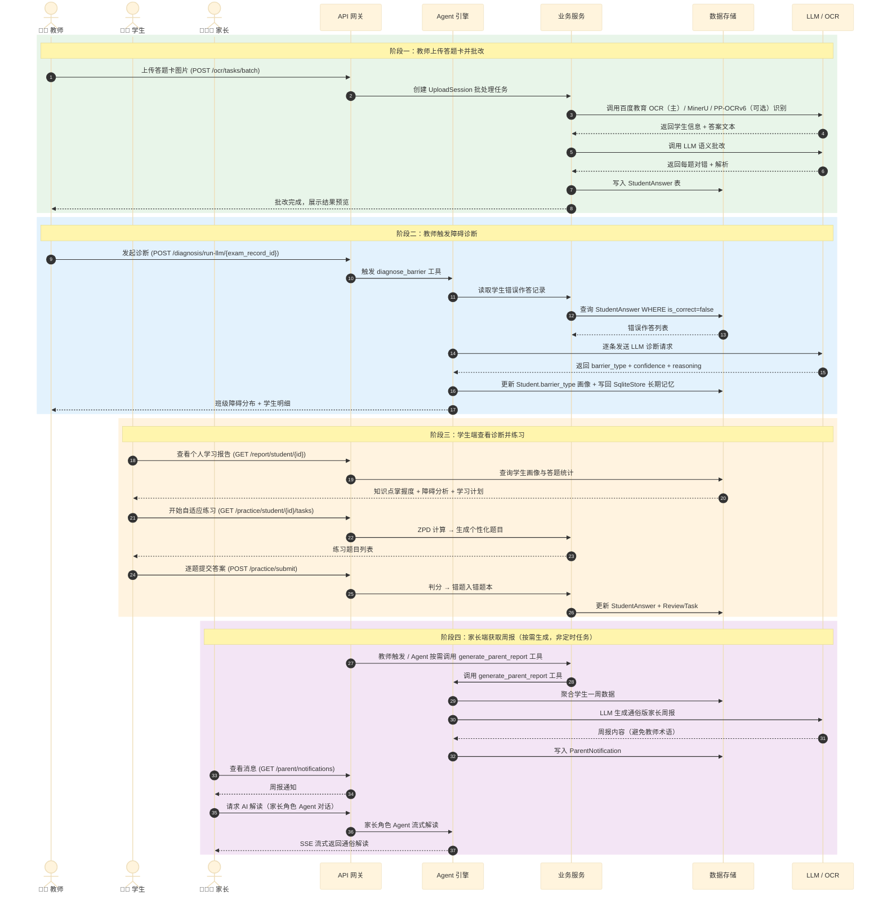

# 系统架构图 — ChemAI 智辅化学

> 本文档以四组 Mermaid 架构图呈现 ChemAI 的完整系统设计。图一为系统全景分层架构，图二为 Agent 推理核心的内部机制，图三为一次完整教学闭环的端到端数据流，图四为数据模型的核心实体关系。
>
> **注意**：本目录 `39-系统架构图.html` 为 40 张图的完整图集（2026-08 架构升级后版本）；下方引用的 `docs/` 下 PNG 为升级前旧版快照，细节以 HTML 图集为准。

---

## 一、系统分层架构

> **图解**：ChemAI 整体采用六层架构（基础设施层/数据层/服务层/安全审核层/Agent 编排层/应用层），每层依赖下层接口并向上暴露能力，前端三端（教师端/学生端/家长端）统一通过 API 网关访问后端服务。

### 碎片版

---

### 精简版

## 二、Agent 推理核心内部机制

> **图解**：用户请求经 Persona 过滤后进入 ReAct 推理循环（思考-行动-观察），LLM 根据可用工具集决策调用哪个工具，工具执行结果反馈回循环继续推理，直至产生最终回复或触发审批中断。

下图聚焦于 Agent 编排层内部的 **ReAct 推理循环**，展示一个用户请求从进入到响应的完整处理路径。这是 ChemAI 区别于传统 CRUD 应用的核心架构差异。

**ReAct 循环中的关键设计决策：**

| 机制 | 设计决策 | 说明 |
|------|---------|------|
| **递归上限** | 12 轮 | 单 Agent 无协调开销，12 轮足够覆盖"诊断→出题→保存→发布"完整链路 |
| **工具可见性** | Persona 过滤 | 教师/学生/家长看到不同的工具子集（TOOL_META × Persona YAML 白名单），从源头杜绝越权 |
| **审批中断** | LangGraph interrupt() + request_approval 工具 | 面板类工具（出题工作台）经 post_model_hook interrupt() 挂起等待前端参数；破坏性操作（布置练习、删除题库）由 request_approval 工具申请授权，GuardState 校验 approved 后放行，状态随 Checkpoint 持久化 |
| **去重保护** | GuardState 签名去重 + Jaccard 相似度 > 70% | 工具调用层：5 秒内同工具同参数直接跳过（seen_calls）；SSE 流式层：辅导工具返回引导步骤后，抑制 LLM 在流式回复中复述相同内容（字符级相似度 > 0.7 抑制） |
| **状态持久化** | 每步 Checkpoint | 对话中断后可从中断点恢复，而非从头开始 |

---

## 三、端到端数据流

> **图解**：时序图按四个阶段（教师批改-诊断-学生练习-家长周报）展现一次完整教学闭环的数据流转路径，跨越 API 网关/Agent 引擎/业务服务/数据存储/LLM OCR 五层组件，覆盖教师端、学生端、家长端三个角色的全部交互。

以下时序图展示一次完整的"教师批改答题卡 → 学生收到诊断 → 家长获取周报"数据闭环，覆盖三端全流程。

---

## 四、核心数据模型

> **图解**：ER 图以 Student/Teacher/Parent 三类用户实体为核心，通过 ExamRecord/StudentAnswer/ReviewTask/Question/WarningLog 等业务实体串联起考试-诊断-练习-复习-预警的完整数据链路，红线标注核心教学闭环的关键关联关系。

下图展示 ChemAI 数据库的核心实体及其关系，聚焦于与教学闭环直接相关的表。

---

## 五、架构关键决策记录

| ID | 决策 | 选择 | 放弃的方案 | 原因 |
|:--:|------|------|-----------|------|
| **ADR-1** | Agent 架构 | 单 Agent ReAct | 多 Agent 协作 (v1) | 路由准确率 87% vs 75%，延迟降低 40%，状态管理更简单 |
| **ADR-2** | 工具过滤 | Persona YAML 白名单 ∩ TOOL_META | LLM 自行判断权限 | 从源头杜绝越权，学生绝不暴露教师工具 |
| **ADR-3** | 前端架构 | 组件化 SPA（React 19 + antd 6 + Vite）| 多页手写 DOM / Vue CDN (legacy) | Agent 流式渲染、内联面板、学情图表等高交互复杂度下，组件复用与状态管理收益超过框架成本；2026 升级为 React SPA 并路由级代码分割 |
| **ADR-4** | 审批机制 | LangGraph interrupt() + request_approval 工具 | 单独的审批中间件 | 面板中断利用框架原生能力，审批状态随 Checkpoint 持久化；破坏性工具经 request_approval 申请、GuardState 校验 |
| **ADR-5** | 数据库 | SQLite（单校部署）| PostgreSQL | 零运维，Docker 单容器部署；ORM 抽象层预留 MySQL 切换路径 |
| **ADR-6** | LLM 策略 | 四 Provider 分工：DeepSeek（Agent/网关分类）+ MiMo（业务服务主力，联网+图像）+ 智谱 GLM-4-Flash/glm-4v（辅助推理+视觉复核）+ 通义千问 qwen-turbo/qwen-vl-ocr（最后兜底）| 单一 Provider | 视觉+联网+纯文本能力互补，单 Provider 故障不影响服务 |
| **ADR-7** | OCR 策略 | 百度教育 OCR（doc_analysis 主引擎，印刷+手写混排）+ MinerU（PDF 离线解析）+ PP-OCRv6_small（本地可选）+ VLM（GLM-4V/MiMo 低置信复核）| 单引擎 | 百度教育 OCR 在线高精度且支持手写；MinerU 离线可用；PP-OCRv6_small 本地免费但依赖体积大（paddleocr 未安装时自动降级跳过） |
| **ADR-8** | 流式协议 | SSE（Server-Sent Events）| WebSocket | 单向推送场景 SSE 更简单；浏览器原生支持；无需心跳维护双向连接 |
| **ADR-9** | 长期记忆 | LangGraph SqliteStore（chemai_store.db，内置 sqlite-vec 语义搜索）| 自建 SQLite 表 + ChromaDB 双写 / MemoryStack | LangGraph 原生支持、与 checkpointer 统一编译、agent 节点经 runtime.store 自动获取；诊断结果自动写回（diagnosis-writeback） |
| **ADR-10** | 向量嵌入 | dashscope text-embedding-v3 API（维度 1024）| MD5 伪向量 / 本地 sentence-transformers | 零新增依赖、中文效果好；失败时回退 MD5 伪嵌入；检索默认语义召回再结构化过滤 |
| **ADR-11** | 题库持久化 | QuestionBankService 统一深模块（保存去重 / is_system 删除守护 / 保存即同步向量索引与历史真题库）| API 与 Agent 各写一套 | 关闭 known_gap「Agent 保存的题目搜索不到」，所有写路径统一入口 |
| **ADR-12** | 上下文管理 | TrimMessages 混合策略（保留最近 6 条 + 关键词保留 ≤10 条 + 30 条/15 轮触发 LLM 摘要）| 硬截断 30 条 | 教师对话主题跳跃大，全量摘要混入无关话题；先 Trim 后摘要控制 token 成本 |

